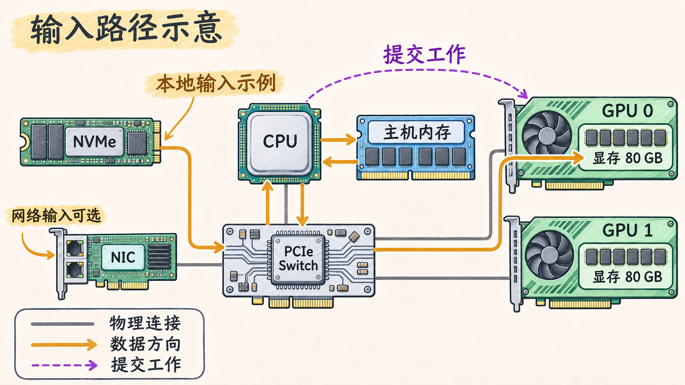

# GPU 服务器的设备分工与输入数据路径

把 8 张顶级显卡插进一台普通服务器，算力就能直接释放出来吗？远远不够。普通服务器既没有支撑多张高功耗 GPU 的供电、散热与高速互联通道，也无法靠“把卡插满”自动解决数据喂给问题——很多工程师上线首个 GPU 作业后遇到的第一个困惑，就是硬件明明很贵，程序却卡在“准备数据”上，甚至还没开算就报显存不足。

根源在于 GPU 并不是一台独立的小电脑。它没有自己的操作系统，也不能直接挂载磁盘文件系统。理解 GPU 基础设施的第一步，就是看清：**CPU、主机内存、存储/网卡与 GPU 之间如何分工，一批数据究竟要经过哪几道关口才能走进显存开始计算。**

## 谁负责指挥，谁负责计算？

假设我们有一批压缩图像，需要解码后对每个像素做相同的数值变换。这类“成千上万个元素同时执行同一套运算”的工作，正是 **GPU（Graphics Processing Unit，图形处理器）** 的拿手好戏——它内部堆叠了大量并行执行单元，能把整批像素同时铺开处理。

但在 GPU 动手之前，整套流程仍由 **CPU** 掌舵：
- **CPU 与主机内存**：运行 Linux 操作系统和应用进程，负责打开文件、解码图像、整理数据格式，并统筹调度后续任务。
- **CUDA 与 GPU 驱动**：应用通过 NVIDIA 的 **CUDA** 编程接口选定目标显卡、安排数据拷贝并提交计算；驱动则在底层为硬件建立内存地址映射与执行上下文。
- **GPU 与独立显存**：独立 GPU 拥有专属的高速显存。数据必须先搬进目标卡的显存里，GPU 的执行单元才能真正读取并开算。

> [!tip] 工程直觉
> 可以把 CPU 比作“调度中心兼备菜厨师”，把 GPU 比作“只管高速爆炒的自动化流水线”。不管是图像预处理、大模型训练喂入样本，还是在线推理加载模型权重与输入请求，数据都必须先经过主机侧准备好，再送进目标 GPU 的显存。

## 一批输入如何从磁盘走到显存？

为了看清每一步的物理载体，我们先看一台配有本地 **NVMe（Non-Volatile Memory Express）** 固态盘、网卡和两张独立 GPU 的 Linux 服务器。

这些高速外设都通过 **PCIe（Peripheral Component Interconnect Express）** 总线与 CPU 相连。你可以把 PCIe 想象成主板上的点对点多车道高速路，而主板上的 **PCIe Switch** 就像多口立交桥交换芯片：它把来自 CPU 的一条上行通道分出多条下行通道，把数据精准转发给下挂的 NVMe、网卡和各张 GPU。

当应用发起一次普通的本地文件读取并交由 GPU 处理时，数据会依次经过三道关口：

1. **文件字节落入主机页缓存**：如果文件尚未被缓存，Linux 文件系统与存储驱动向 NVMe 控制器下发读请求。NVMe 控制器将原始压缩字节写入主机内存的**页缓存（Page Cache）**，应用再通过 `read` 拿到这些字节。
2. **CPU 解码并整理成计算数组**：应用线程在主机内存中把压缩图像解码成规整的数值数组，写入另一块应用缓冲区。此时“磁盘源文件 → 页缓存压缩字节 → 解码后的数组”三份数据各司其职。
3. **搬运进显存并触发 GPU 计算**：应用通过 CUDA 提交“主机到设备（H2D）”拷贝。驱动建立地址映射后，GPU 内部的搬运引擎把数组拉进目标卡显存，紧接着执行计算任务。后续计算可直接复用显存里的结果；只有当主机需要落盘或返回结果时，才再做一次显存到主机的拷贝。

在这条路径上，真正干体力活搬运字节的并不是 CPU，而是 **DMA（Direct Memory Access，直接内存访问）** 机制。驱动提前把内存地址映射交给硬件设备，NVMe 控制器和 GPU 搬运引擎就能像“自动化叉车”一样直接按地址读写主机内存，CPU 只需下达指令并等待完成信号。



*图 01-01-01：普通本地输入从 NVMe 经主机内存进入 GPU 0 显存的数据路径。橙色实线表示数据流动方向，紫色虚线表示 CPU 向 GPU 提交计算任务；图中 CPU 方框合并展示了 PCIe 根端口与内存通路。*

> [!warning] 常见误区：数据在主机内存里，不等于就能零开销喂给 GPU
> 即使文件早已命中 Linux 页缓存，省掉的也只是“NVMe → 页缓存”的磁盘读取。后续的 CPU 解码、数组整理以及“主机内存 → 显存”的 DMA 拷贝一步都少不了。此外，如果应用把数组放在普通可分页内存中，CUDA 往往还需要先在主机侧多做一次拷贝，转存到不可被系统换出的**页锁定内存（Pinned Memory）**，GPU 才能启动高速 DMA 拉取。

如果输入数据不在本地盘，而是来自远端存储服务，数据入口就会从 NVMe 换成 **NIC（Network Interface Card，网络接口卡）**（即图 01-01-01 左下角分支）。网卡先通过 DMA 把网络收包写进主机接收缓冲区，经由内核网络协议栈与存储客户端还原出文件字节，之后汇入完全相同的解码、拷贝与计算流程。

至于网卡或存储能否绕开主机内存、直接读写 GPU 显存，那是后面 [第 06 章](../06_从普通网络通信走向RDMA/00_内容大纲.md)（GPUDirect RDMA）与 [第 09 章](../09_GPU的数据从哪里来_存储与IO/00_内容大纲.md)（GPUDirect Storage）要解锁的进阶路径。

## 看懂真实整机配置：为什么显存必须“逐卡算账”？

回到真实的生产机房，我们可以拿一台主流的 **NVIDIA DGX H100** 整机规格，把上面每个抽象角色对回真实硬件：

| 核心部件 | DGX H100 真实规格 | 在数据路径中的职责 |
| --- | --- | --- |
| **CPU 与主机内存** | 2 颗 Intel Xeon 8480C（每颗 56 核），共 2 TB 内存 | 运行 Linux、承载页缓存与解码缓冲区、编排任务 |
| **GPU 与显存** | 8 张 H100 SXM，每张 80 GB 显存 | 承载模型与输入张量、执行高并发矩阵与向量计算 |
| **本地 NVMe 盘** | 2 × 1.92 TB 系统盘（RAID 1）+ 8 × 3.84 TB 缓存盘（RAID 0） | 存放系统、本地样本缓存或预热模型权重 |
| **高速与管理网卡** | 8 张单口 ConnectX-7 集群网卡 + 2 张双口存储/管理网卡 | 分别承接高速节点间通信与远端存储、管理流量 |

面对这样的 8 卡服务器，工程里最容易犯的一个预算错误，是把整机显存直接加起来当作一个共享大池子：

$$\text{整机标称显存库存} = 8 \times 80\text{ GB} = 640\text{ GB}$$

这 `640 GB` 只是机房资产库存账。对于普通 CUDA 程序而言，**每张 GPU 的显存相互独立，申请显存必须按目标执行卡单独结算**。

来看一个直观的容量核算（硬件规格常用十进制 `GB`，操作系统与显存分配统计按二进制 `GiB` 计）：假设当前服务器上相邻两张卡（对应图 01-01-01 中的 `GPU 0` 与 `GPU 1`）各有 `70 GiB` 可用空闲显存。

1. **单卡硬塞**：如果直接向单张卡申请 `75 GiB` 显存，即便两张卡合计空闲高达 `140 GiB`，申请仍会因超出目标卡上限 `5 GiB` 而直接报 OOM（显存不足）。
2. **切分双卡并行**：如果算法允许把输入拆成两份互不依赖的分片，每张卡分摊一半输入（`37.5 GiB`），再加上各自所需的 `8 GiB` 中间临时缓冲区，则每张卡的峰值新增占用与余量为：

$$\text{每卡峰值新增占用} = \frac{75\text{ GiB}}{2} + 8\text{ GiB} = 45.5\text{ GiB}$$

$$\text{每卡剩余可用显存} = 70\text{ GiB} - 45.5\text{ GiB} = 24.5\text{ GiB}$$

在主机上，运维人员通常会直接用 `nvidia-smi` 检查每一张卡独立的显存余量，而不是只看整机总量：

```bash
# 按卡查看当前已用与空闲显存（单位 MiB），核对目标卡是否装得下
nvidia-smi --query-gpu=index,name,memory.used,memory.free,memory.total --format=csv
```

```text
index, name, memory.used [MiB], memory.free [MiB], memory.total [MiB]
0, NVIDIA H100 80GB HBM3, 9820 MiB, 71739 MiB, 81559 MiB   # 约 70 GiB 可用
1, NVIDIA H100 80GB HBM3, 9820 MiB, 71739 MiB, 81559 MiB   # 独立显存，不可与卡 0 直接混用
```

> [!summary] 核心结论
> - **数据流向决定瓶颈边界**：普通路径下，输入数据必须先经 NVMe/NIC 进入主机内存，完成 CPU 处理后再经 PCIe DMA 送入目标 GPU 显存。
> - **显存账本按卡独立核算**：整机多卡显存之和仅代表集群库存，单个进程分配显存受限于目标 GPU 当下的可用余量；跨卡分摊容量需要应用侧显式切分数据或模型。

现在，我们已经画清了单颗 CPU 视角下的完整数据路径。但真实 GPU 服务器几乎都是**双路 CPU** 架构，主机内存被物理拆分在两颗处理器旁边。当 GPU 发起 DMA 搬运时，如果数据恰好落在了另一颗 CPU 的内存里，它要跨过哪些硬件通道？又会和哪些邻居设备抢同一条 PCIe 上行带宽？下一篇我们拆开双路服务器的 PCIe 与 NUMA 拓扑。

> [!info]- 参考资料
> - **CUDA 编程与内存模型**：[CUDA 13.2.1 · Programming Model](https://docs.nvidia.com/cuda/archive/13.2.1/cuda-programming-guide/01-introduction/programming-model.html)、[Unified and System Memory](https://docs.nvidia.com/cuda/archive/13.2.1/cuda-programming-guide/02-basics/understanding-memory.html)、[Multi-GPU Systems](https://docs.nvidia.com/cuda/archive/13.2.1/cuda-programming-guide/03-advanced/multi-gpu-systems.html)、[API 同步行为](https://docs.nvidia.com/cuda/archive/13.2.1/cuda-runtime-api/api-sync-behavior.html)
> - **Linux 页缓存与 DMA**：[Linux Kernel · Page Cache](https://docs.kernel.org/mm/page_cache.html)、[DMA API HOWTO](https://docs.kernel.org/core-api/dma-api-howto.html)
> - **硬件规格参考**：[NVIDIA DGX H100/H200 · 组件规格](https://docs.nvidia.com/dgx/dgxh100-user-guide/introduction-to-dgxh100.html#dgx-h100-h200-component-descriptions)、[NVIDIA HGX H100 · 逐卡与整节点规格](https://docs.nvidia.com/enterprise-reference-architectures/hgx-ai-factory-h100-h200-b200/latest/components.html)
