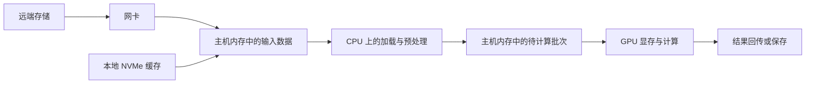

# 一份配置单背后的整机

## 先认识一台用于学习的服务器

后文使用导读中的教学服务器 `gpu-node-a`。它采用双路 CPU、四张 PCIe GPU，设备列表如下。

| 配置项 | 教学模型中的安排 | 这项配置首先回答什么 |
| --- | --- | --- |
| CPU | 2 个 Socket，各 32 个物理核心 | 主机计算资源由几颗处理器提供 |
| 主机内存 | 每个 Socket 附近配置 256 GiB，共 512 GiB | CPU 侧数据能够放在哪里、放多少 |
| GPU | 4 张独立显存的 PCIe GPU，每张 48 GiB | 加速设备数量与每个设备的容量 |
| 高速网卡 | NIC0、NIC1，各一个 200 Gbit/s 端口 | 具备哪些对外通信入口 |
| 本地存储 | 系统盘组、数据缓存 NVMe | 系统与数据分别存放在哪里 |
| PCIe Switch | 每个 Socket 下各一组 | 哪些设备共享同一条上行路径 |
| 管理 | 主机管理网卡、独立 BMC 入口 | 操作系统内外分别如何访问服务器 |
| 机箱支持 | 电源模块、风扇、传感器 | 设备如何获得电力并维持运行温度 |

接下来需要把这些数量对应到 PCIe 链路、设备插槽、DIMM 布局、端口接线和功率预算，才能判断设备怎样协作。

## GPU 接手计算后，CPU 仍在组织整个过程

设想一个作业需要读取远端数据，进行预处理，再交给 GPU 计算。一个常见的简化路径如下：

图中箭头表示数据处理顺序；实际搬运采用什么协议和路径，由软件栈、内存分配与设备能力共同决定。

CPU 上通常运行作业进程的主机部分，完成系统调用、文件访问、数据准备、计算提交以及与其他进程的协调。GPU 擅长的计算片段交由 GPU 执行，服务器并不会因此失去主机侧开销。

因此，GPU 利用率偏低可以提示计算没有持续推进，却不能单独说明原因。CPU 预处理跟不上、存储响应慢、通信等待、工作量本来就小，都可能形成间歇性的 GPU 活动。先用这条路径提出候选原因，随后才寻找指标证实。

## 两种容量：主机内存与 GPU 显存

本例的 512 GiB 是主机内存总容量；每张卡的 48 GiB 是各自 GPU 的显存。四张卡的显存加起来是 192 GiB，这个加法适合描述装机容量，不能直接推出某个普通单 GPU 分配能够获得一块连续的 192 GiB 空间。

例如，某个计算阶段需要在一张卡上同时放下 60 GiB 数据，而其他三张卡基本空闲。仅凭“全机还有空余显存”无法判断这个阶段能够运行。还要知道程序是否会拆分数据、计算如何分布，以及对应的软件和硬件访问方式。

对离散 GPU 而言，主机内存和每个 GPU 的内存有各自的物理位置；统一虚拟地址或统一内存编程机制也不能抹去物理容量和访问路径的限制。这个区分可对照 [CUDA Programming Guide：异构系统中的 DRAM](https://docs.nvidia.com/cuda/cuda-programming-guide/01-introduction/programming-model.html#dram-memory-in-heterogeneous-systems)。GPU 内部的存储层次将在下一章展开。

图 01-01-01：主机内存与各张 GPU 的本地显存具有独立容量边界。其他 GPU 空闲，并不直接为 GPU0 提供一块可供普通单卡分配使用的连续空间；跨卡分片或其他内存管理方式需要另行安排。本图是容量关系示意，不表示物理拓扑。

## 主机内存怎样向计算持续供给数据

主机内存的容量回答“能放多少数据”，带宽回答“单位时间能搬运多少数据”。即使输入数据全部放得下，CPU 预处理和向 GPU 准备数据时仍可能受主机内存带宽限制。

在本章这类服务器中，CPU 内的内存控制器管理内存访问，通过多条内存通道连接 DIMM。DIMM 就是插在主板内存插槽中的内存模组；一条通道可以对应一个或多个插槽，具体数量由平台决定。**通道提供访问路径，DIMM 提供存储容量，插槽用于安装模组。** 内存通道与 DIMM 的基本关系可参见 [Linux EDAC 的内存概念说明](https://docs.kernel.org/driver-api/edac.html#main-concepts-used-at-the-edac-subsystem)。

例如，假设每颗 CPU 支持 8 条内存通道，并且下面两种插法都受该平台支持：

| 每个 Socket 的布局 | 总容量 | 使用的通道数 |
| --- | --- | --- |
| 4 条 64 GiB DIMM，分别放在 4 条通道上 | 256 GiB | 4 |
| 8 条 32 GiB DIMM，分别放在 8 条通道上 | 256 GiB | 8 |

图 01-01-02：在正文给定的每 Socket 支持 8 通道、两种插法均受支持的教学条件下，4×64 GiB 与 8×32 GiB 容量相同，使用的通道数不同。相同传输速率且访问并发充足等条件下，更多通道具有更高聚合带宽潜力，不能直接推出应用加速倍数。图中按每通道一条 DIMM 简化，不代表所有平台的插槽规则。

两种布局都符合教学模型中“每侧 256 GiB”的容量条件，但第二种使用了更多并行访问通道。在相同数据传输速率、足够访问并发等条件下，它具有更高的聚合带宽潜力。实际差异还取决于处理器、DIMM、插法及负载，不能仅按通道数推算应用加速倍数。

因此，读配置单时应把每个 Socket 的容量、DIMM 数量与型号、通道占用和运行速率一起记录。NVIDIA 的 [HGX 整机配置说明](https://docs.nvidia.com/enterprise-reference-architectures/hgx-ai-factory-h100-h200-b200/latest/components.html#hgx-h100-h200-or-b200-8-gpu-systems) 也分别列出内存容量、带宽与通道布局要求。这里先建立供给能力的认识；下一篇再讨论这些内存与 GPU 在整机中的相对位置。

## NIC、NVMe 与两类 Switch

NIC 是主机连接外部网络的适配器。网卡型号、端口数量、链路速率和实际协商状态是不同信息：两个外部接口不必然意味着两张独立网卡；一张双端口卡也可能共享内部资源和主机侧连接。

NVMe 是访问非易失性存储的协议体系，本章的本地 NVMe SSD 通过 PCIe 接入。系统盘承担启动与系统文件，缓存盘承担可重建的数据副本；如果两者共用设备，数据读写、容器镜像和日志就可能争用同一组存储资源。“有本地盘”仍不足以说明数据持久性、可用容量和并发性能。

PCIe Switch 连接服务器内部的 PCIe 分支，网络交换机连接服务器之间的网络端口。两者都有交换功能，但所交换的协议、连接对象和配置方式不同。GPU 平台还可能有 NVSwitch，它服务于 NVLink 互联。阅读材料时，遇到 “Switch” 应先确定它属于哪种互联。

## 从数量走向连接

假设两台服务器拥有完全相同的上述设备。一台把两张高速网卡分散在两颗 CPU 附近，另一台把它们都放在同一分支下；相同的设备数量可以形成不同的数据路径与共享关系。

接下来要把配置表改画成拓扑图。CPU 和 GPU 的关系、某条上行是否被共同使用，只有在图上才能看清。

[下一篇：把设备放回 PCIe 与 NUMA 拓扑](02_把设备放回PCIe与NUMA拓扑.md)
