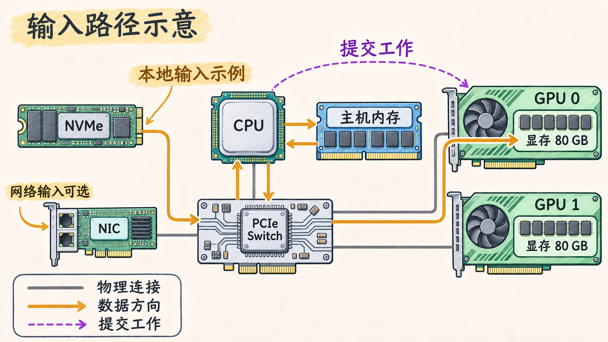

**GPU（Graphics Processing Unit，图形处理器）**在 AI 服务器中是一种并行计算加速器。以一批图像为例，许多像素或矩阵元素可以同时参与同类运算，GPU 可以把这些工作分给大量执行单元。服务器仍由 CPU 运行 Linux 和应用。CPU 上的进程负责读文件、准备输入，再通过驱动提交计算。独立 GPU 从自己的显存取数，执行提交的工作，并把结果写回显存，供下一次 GPU 计算使用或在需要时传回主机。这套分工要求输入先到达目标 GPU 能使用的位置。 [CUDA 13.2.1 · Programming Model](https://docs.nvidia.com/cuda/archive/13.2.1/cuda-programming-guide/01-introduction/programming-model.html) · [Unified and System Memory](https://docs.nvidia.com/cuda/archive/13.2.1/cuda-programming-guide/02-basics/understanding-memory.html)

## 从本地文件到 GPU 0 的显存

设应用要在 GPU 0 上对一批图像做并行变换。输入是本地 **NVMe（Non-Volatile Memory Express）** 固态盘上的压缩文件。以 Linux 普通缓冲式读取为例，假设文件还没进页缓存，CPU 解码后得到的输入放在主机内存中，再由复制操作送入 GPU 0 显存。

1. **读取文件。** 应用发起读取，Linux 文件系统找到对应的盘上数据，由存储驱动安排 I/O（输入输出）。NVMe 控制器把读出的数据传到主机的页缓存，应用取得文件字节。页缓存是 Linux 在主机内存中保留的文件数据。 [Linux 内核 · Page Cache](https://docs.kernel.org/mm/page_cache.html)
2. **准备输入。** CPU 上的线程解码图像，并把结果整理成 GPU 要处理的数组。此时数组位于主机内存。
3. **复制并计算。** 应用经驱动安排主机到 GPU 的复制，等这份输入在 GPU 0 显存中可用，GPU 才用它执行变换。除了读盘阶段，主机到 GPU 的复制也可以由设备的搬运引擎完成。 [CUDA 13.2.1 · Unified and System Memory](https://docs.nvidia.com/cuda/archive/13.2.1/cuda-programming-guide/02-basics/understanding-memory.html)

这几步需要两种能力。**PCIe（Peripheral Component Interconnect Express）** 提供主机与 GPU、网卡、存储控制器之间的设备互连。若设备接在 **PCIe Switch（交换芯片）** 下，由 Switch 转发相应的 PCIe 事务。**DMA（Direct Memory Access，直接内存访问）** 使这些设备或其搬运引擎可以按驱动准备好的地址读写内存。CPU 核心执行发起 I/O、设置缓冲区和提交工作等操作。普通缓冲读中，应用取用文件数据也可能涉及 CPU 复制。图中的 CPU 方框同时简化表示主机侧的连接和内存通路。 [Linux 内核 · DMA API HOWTO](https://docs.kernel.org/core-api/dma-api-howto.html) · [PCI Peer-to-Peer DMA Support](https://docs.kernel.org/driver-api/pci/p2pdma.html)

**图 01-01-01**　图中的橙色路径画出本地读取及后续复制，紫色虚线表示 CPU 提交 GPU 工作。根端口和内存控制器等主机侧细节已简化，两块 GPU 的画法和 80 GB 标签用于说明逐卡容量口径。

若文件已经命中页缓存，这次读取可以从主机内存取得文件数据，普通路径中的盘读随之省去。若将冷输入换成远端存储，**NIC（Network Interface Card，网络接口卡）** 接收报文，把数据送入主机侧的接收缓冲区。操作系统和存储客户端处理协议后，应用取得文件字节，再做解码和显存复制。下文按这条经过主机缓冲区的路径推理。第 06 章和第 09 章会分别增加网卡直达显存和存储直达显存所需的条件。

## 配置表给出的是哪一份资源

用 NVIDIA DGX H100 的官方配置对照刚才的过程。这里的卡数、盘组和接口来自指定机型手册。 [NVIDIA DGX H100/H200 · 组件说明](https://docs.nvidia.com/dgx/dgxh100-user-guide/introduction-to-dgxh100.html#dgx-h100-h200-component-descriptions)

| 部件 | DGX H100 规格摘录 | 对一次作业的含义 |
| --- | --- | --- |
| CPU 与主机内存 | 2 颗 Xeon 8480C，每颗 56 核。32 条 DIMM（内存条），共 2 TB | CPU 运行 Linux 和准备数据。系统内存合计包含可用于页缓存和应用缓冲的资源 |
| GPU 与显存 | 8 块 H100，每块 80 GB | 选定 GPU 执行工作，按该卡可用显存预算输入、中间值与结果 |
| NVMe 盘 | 系统盘为 2 × 1.92 TB M.2，RAID 1。数据缓存盘为 8 × 3.84 TB U.2，RAID 0 | 盘保存文件，阵列可用容量需结合实际盘组、镜像或条带配置 |
| ConnectX-7 网卡 | 集群网络有 8 块单端口卡。存储与带内管理有 2 块双端口卡 | 按物理端口与部署读取网络角色，核对端口模式、速率和接线 |

八块 GPU 的显存规格合计为 **`8 × 80 GB = 640 GB`**。若应用在 GPU 0 上发起普通设备内存分配，该请求要从这张卡的可用显存中满足。比如运行时查到 GPU 0 仅有 70 GiB 空闲，一次 75 GiB 的分配就差 5 GiB，其他卡即使空闲也补不了这个单卡缺口。这里用相同单位的请求和空闲量比较，厂商表中的 GB 另按规格口径记录。如果应用能将数据分片，就把每个分片及随后需要新分配的中间缓冲放到对应的卡上，再逐卡核算。 [NVIDIA HGX H100 组件和节点规格](https://docs.nvidia.com/enterprise-reference-architectures/hgx-ai-factory-h100-h200-b200/latest/components.html) · [CUDA 13.2.1 · Programming Systems with Multiple GPUs](https://docs.nvidia.com/cuda/archive/13.2.1/cuda-programming-guide/03-advanced/multi-gpu-systems.html)

现在已经知道数据要经过哪些设备。要判断这次复制是否跨过两颗处理器，或和网卡共享一段链路，需要把同一批数据的缓冲区和设备放回主板拓扑。
