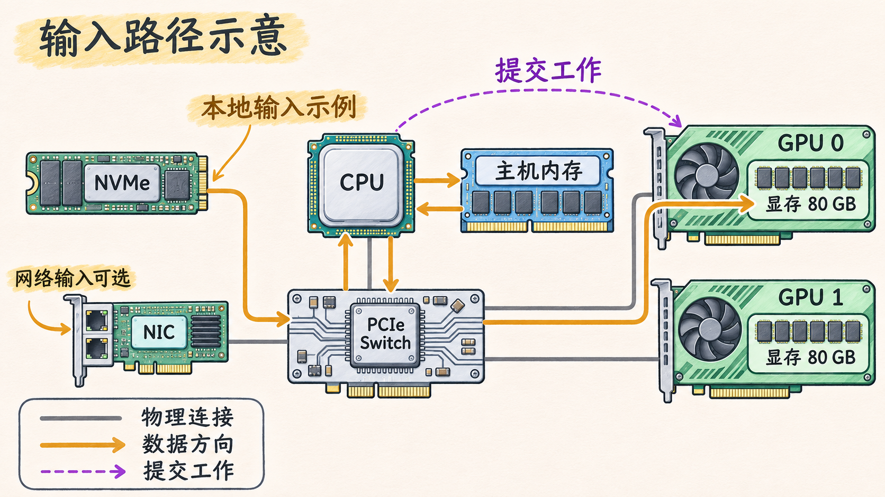

# 一份配置表里的设备各做什么

一台 GPU 服务器上的作业往往从读取输入开始。文件可能在本地 NVMe 固态盘上，也可能存放在远端存储系统中。CPU 上的进程取得输入、准备计算所需的数据，再提交 GPU 工作。GPU 在自己的显存和计算单元上执行操作，结果随后可以返回主机或交给后续 GPU 工作。

追踪这一过程，可以把配置表中不同设备的容量和作用放回同一张图。

## 一次输入经过哪些地方

下面先假设应用采用普通的主机缓冲路径，输入来自本地 NVMe。文件读取由主机进程发起，操作系统和存储设备配合将数据读入主机内存。应用在 CPU 上做必要的解析、解码或整理，再把准备好的输入传入目标 GPU 显存，最后提交 GPU 计算。

CPU 发起读取或传输，不表示数据的每个字节都由 CPU 核心逐一搬运。设备可以通过 DMA，也就是直接内存访问，在系统内存和设备之间传输数据。CPU 负责运行应用与驱动中的控制逻辑，实际数据路径取决于设备、驱动和所用接口。

换成远端文件时，输入先通过网络到达 NIC，也就是网络接口卡，再进入主机内存。应用后续准备输入与使用 GPU 的步骤仍可以采用相同方式。这里选用的是便于观察的常规路径。页缓存、预取和其他存储访问方式会改变细节，特定平台支持的 GPUDirect Storage 或 GPUDirect RDMA 也会改变数据经过的位置。

| 部件 | 在此路径中的职责 | 容量或数量应怎样理解 |
| --- | --- | --- |
| CPU | 运行操作系统和应用，发起 I/O，准备数据并提交 GPU 工作 | Socket 数和核心数描述主机计算资源 |
| 主机内存 | 保存操作系统、应用、文件缓存及输入缓冲区 | 系统内存是整机主机内存的规格容量 |
| GPU | 执行提交给它的并行计算 | 卡数、型号和每卡显存需要一起读取 |
| GPU 显存 | 保存该 GPU 使用的数据和计算结果 | 每块 GPU 有自己的设备内存，逐卡判断可用量 |
| NVMe | 为操作系统、输入数据或缓存提供本地持久存储 | 盘数和每盘容量还需结合 RAID 或其他配置 |
| NIC | 把节点连接到管理、存储或计算网络 | 区分网卡数量、每卡端口数和每端口速率 |
| PCIe Switch | 在连接的 PCIe 上行与下行端口之间转发事务 | 是否经过 Switch 由具体主板和设备连线决定 |

GPU 附带的物理内存与 CPU 附带的主机 DRAM 分别属于不同的物理位置。CUDA 提供多种访问和内存管理方式，但判断容量时仍需知道数据实际放在哪里。 [CUDA Programming Guide · Unified and System Memory](https://docs.nvidia.com/cuda/cuda-programming-guide/02-basics/understanding-memory.html)

图 01-01-01：教学示意中，本地 NVMe 或网络可以提供输入，数据经过主机内存进入 GPU 显存。每块 GPU 有自己的显存。图中连接和设备外形经过简化，实际路径取决于平台与传输方式。

## 读一份实际配置

以 NVIDIA DGX H100 的官方组件表为例，该系统有两颗 Intel Xeon 8480C CPU、2 TB 系统内存和八块 H100 GPU。下面保留表中与输入路径有关的项目。实际部署还需核对机器的具体配置。 [NVIDIA DGX H100/H200 User Guide · Component Descriptions](https://docs.nvidia.com/dgx/dgxh100-user-guide/introduction-to-dgxh100.html)

| 部件 | 规格表中的数量和容量 | 读表时关注的口径 |
| --- | --- | --- |
| CPU | 2 颗，每颗 56 核 | CPU 核心数是两颗处理器各自的规格 |
| 系统内存 | 32 条 DIMM，共 2 TB | 这是系统内存合计，还需结合 DIMM 分布看拓扑 |
| H100 GPU | 8 块，GPU 显存合计 640 GB | 此配置为每块 80 GB，合计值是八块相加 |
| 操作系统盘 | 2 块 1.92 TB NVMe M.2，RAID 1 | 原始盘容量和阵列可用容量是不同口径 |
| 数据缓存盘 | 8 块 3.84 TB NVMe U.2，RAID 0 | 单盘容量、原始合计与阵列可用容量分开确认 |
| 集群网络 | 8 块单端口 ConnectX-7，规格表列出 InfiniBand 和 Ethernet 速率选项 | 检查实际端口模式、速率和接线 |
| 存储及带内管理网络 | 2 块双端口 ConnectX-7，规格表列出 Ethernet 和 InfiniBand 选项 | 两块双端口卡提供的端口需按部署映射 |

八块 H100 的规格容量相加为 `8 × 80 GB = 640 GB`。考虑一次普通的 GPU 设备内存分配，如果某个操作要求单块卡上可用显存超过 80 GB，就不能凭整机合计值认定它能成功。若软件能将数据切分到多张卡上，则需要分别核对切分后的每卡占用、运行时预留与中间结果开销。规格中的 80 GB 也不是作业启动后保证可分配的数值。HGX H100 的官方规格同样列出每 GPU 80 GB 与八 GPU 节点合计 640 GB。 [NVIDIA HGX 组件与节点规格](https://docs.nvidia.com/enterprise-reference-architectures/hgx-ai-factory-h100-h200-b200/latest/components.html)

这份表说明机器有哪些资源。要解释某个 NIC 或 GPU 离哪颗 CPU 更近，以及哪些设备可能共享链路，还需要继续读节点的物理拓扑。
