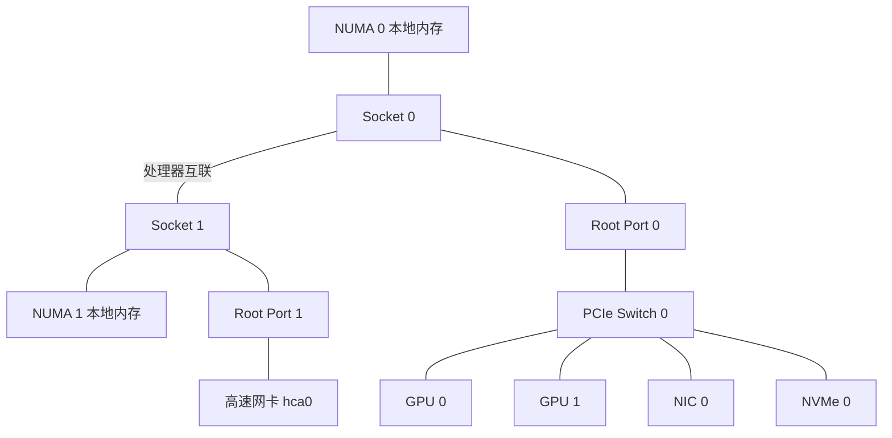

# PCIe 拓扑、NUMA 亲和与共享上行带宽

同样的程序、同样的输入数据和同一张 GPU，为什么换一种进程绑核方式，主机到显存的拷贝带宽就会明显掉速？甚至在另一张网卡满负荷收包时，GPU 写回结果的速度也跟着被拖慢？

答案藏在双路服务器的物理走线里。一台双路 GPU 服务器并不是“一块平摊的大内存 + 一条所有设备共用的公共总线”，而是被两颗 CPU 划成了左右两大区域，所有外设沿着树状 PCIe 通道接入主板。这一篇我们沿硬件桥树回溯，看清设备接在哪一侧、数据页落在哪一边，以及共享上行带宽该如何算账。

## 从设备回到 CPU：读懂 PCIe 桥树与 BDF 门牌号

**Socket** 就是主板上的物理 CPU 插座。双路服务器装有两颗处理器，各自直连一组内存条，两颗处理器之间通过高速处理器互联（如 Intel UPI）沟通。

把处理器、内存系统与所有 PCIe 外设衔接起来的枢纽，叫 **PCIe Root Complex（根复合体）**。你可以把主板想象成两座相邻的城区：
- **Root Port（根端口）**：从某颗 CPU 的根复合体引出的高速主干匝道，既可以直接接一块高速网卡，也可以往下挂接交换芯片。
- **PCIe Switch（交换芯片）**：像一座多出口立交桥，朝向根端口的一侧叫**上行口（Upstream）**，朝向各外设的一侧叫**下行口（Downstream）**。
- **方向辨析**：“上行”和“下行”仅指物理挂载的上下游层级关系，不代表单向水流——每段 PCIe 链路本身都是**双向全双工**的。



*双路服务器 PCIe 桥树示意：目标计算卡、普通网卡与本地盘共用同一 Switch 上行通道，高速网卡挂载在另一侧 CPU 的独立根端口下。*

Linux 用 PCI 域号配合 **BDF（Bus:Device.Function，总线号:设备号.功能号）** 唯一标识每一个 PCIe 功能单元，相当于硬件在主板上的“省-市-街-门牌号”。例如 `0000:1b:00.0` 中，`0000` 是 PCI 域，`1b` 是总线号，`00` 是设备号，`.0` 是功能号。

当多块设备挂在同一颗 Switch 下方时，它们虽各有独立的下行口，却要共用 Switch 上行口到 Root Port 的同一段物理链路。对照下表逐级回溯，就能一眼找出哪些设备共享上行通道（桥地址省略共同域号 `0000`）：

| 角色与设备标识 | 从端点向根端口逐级回溯 | 归属 Socket |
| --- | --- | --- |
| `GPU 0`（`0000:1b:00.0`） | 下行口 A `1a:01.0` → Switch 0 上行 `19:00.0` → Root Port 0 `18:01.0` | Socket 0 |
| `NIC 0`（`0000:1c:00.0`） | 下行口 B `1a:02.0` → 同一 Switch 0 上行 → Root Port 0 `18:01.0` | Socket 0 |
| `NVMe 0`（`0000:1d:00.0`） | 下行口 C `1a:03.0` → 同一 Switch 0 上行 → Root Port 0 `18:01.0` | Socket 0 |
| `GPU 1`（`0000:1e:00.0`） | 下行口 D `1a:04.0` → 同一 Switch 0 上行 → Root Port 0 `18:01.0` | Socket 0 |
| 高速网卡 `hca0`（`0000:a1:00.0`） | 直连 Root Port 1 `a0:01.0` | Socket 1 |

在真实 Linux 节点上，运维人员通常用 `lspci` 先展平整棵桥树，再核对单个设备的驱动接管状态：

```bash
# 1. 展开完整 PCIe 桥树，一眼看出哪些设备共用同一 Switch 与 Root Port
lspci -D -t
```

```text
-+-[0000:18]---01.0-[19-1e]----00.0-[1a-1e]--+-01.0-[1b]----00.0  # GPU 0 (0000:1b:00.0)
 |                                           +-02.0-[1c]----00.0  # NIC 0 (0000:1c:00.0)
 |                                           +-03.0-[1d]----00.0  # NVMe 0 (0000:1d:00.0)
 |                                           \-04.0-[1e]----00.0  # GPU 1 (0000:1e:00.0)
 \-[0000:a0]---01.0-[a1]----00.0                                  # hca0  (0000:a1:00.0)
```

```bash
# 2. 按 BDF 核对目标 GPU 的厂商型号与当前接管的内核驱动
lspci -D -nnk -s 0000:1b:00.0
```

```text
0000:1b:00.0 3D controller [0302]: NVIDIA Corporation GH100 [H100 SXM5 80GB] [10de:2330] (rev a1)
        Subsystem: NVIDIA Corporation Device [10de:16c1]
        Kernel driver in use: nvidia        # 已被 NVIDIA 内核驱动接管
        Kernel modules: nvidiafb, nouveau, nvidia_drm, nvidia
```

> [!warning] 常见误区：`lspci` 看到设备且驱动已绑定，不等于 GPU 已经能正常计算
> `lspci` 列出 BDF 只证明总线已经枚举到这块卡；看到 `Kernel driver in use: nvidia` 说明 Linux 内核驱动已接管它。但用户态程序能否真正创建上下文并跑通计算，还要依赖用户态 CUDA 库和运行时栈，这部分会在 [第 03 章](../03_从驱动到CUDA应用的软件依赖/00_内容大纲.md) 展开排查。

## NUMA 亲和：缓冲区落在哪侧，决定 GPU 走不走冤枉路

**NUMA（Non-Uniform Memory Access，非一致内存访问）** 描述的是多路服务器的一个核心事实：**两颗 CPU 虽然能访问整机所有内存，但访问代价并不一样。**

每颗 CPU 通过本地内存控制器读写自己紧挨着的内存条，延迟最短、带宽最充裕；一旦要访问对面 CPU 侧的内存，数据就必须额外穿越处理器互联，不仅延迟上升，还要和跨路同步流量争抢通道。Linux 把具有亲和关系的 CPU 核心与本地内存组织成一个 **NUMA 节点**。

> [!note] 平台差异：单颗 CPU 内部也可能拆分多个 NUMA 节点
> 为聚焦主线，本章约定每颗物理 CPU 对应一个同号 NUMA 节点（Socket 0 → NUMA 0，Socket 1 → NUMA 1）。在真实平台上，若开启 Intel Sub-NUMA Clustering（SNC）等特性，单颗处理器内部也会细分为多个 NUMA 节点，现场可通过 `numactl --hardware` 直接核对。

在节点上运行 `numactl --hardware`，可以直接看到各 NUMA 节点的 CPU 核心、内存容量以及访问距离矩阵：

```bash
# 查看节点内 NUMA 拓扑分布与本地/跨路访问相对代价
numactl --hardware
```

```text
available: 2 nodes (0-1)
node 0 cpus: 0-55          # Socket 0 管理的 CPU 核心
node 0 size: 1031850 MB    # NUMA 0 本地内存（约 1 TiB）
node 1 cpus: 56-111        # Socket 1 管理的 CPU 核心
node 1 size: 1032192 MB    # NUMA 1 本地内存（约 1 TiB）
node distances:
node   0   1
  0:  10  21               # 本地访问代价 10；跨处理器互联访问远端代价 21
  1:  21  10
```

现在回到 GPU 搬运数据的场景。假设应用通过 `cudaHostRegister` 将输入缓冲区注册为**页锁定内存（Pinned Memory）**，确保物理页在传输期间不被换出，并由驱动建立好 DMA 地址映射，让目标 GPU 的搬运引擎直接拉取数据。

固定目标 GPU 挂在本地 Socket（如 Socket 0），只改变缓冲区物理页的落点，两条搬运路径的差异立刻显现：

| 缓冲区落点 | DMA 读取请求方向 | 有效载荷返回路径 |
| --- | --- | --- |
| **同侧本地内存**（NUMA 0） | GPU → Switch → Root Port → 本地 Socket → 本地内存 | 本地内存 → 本地 Socket → Root Port → Switch → GPU |
| **跨 CPU 远端内存**（NUMA 1） | GPU → Switch → Root Port → 本地 Socket → **处理器互联** → 远端 Socket → 远端内存 | 远端内存 → 远端 Socket → **处理器互联** → 本地 Socket → Root Port → Switch → GPU |


*图 01-02-01：目标 GPU（图中 GPU 0）经 Socket 0 的 PCIe Switch 发起 DMA 读取时，本地缓冲区（左）与远端缓冲区（右）的路径对比。琥珀色虚线表示读取请求方向，有效数据沿反方向返回；图中 NIC 对应同分支网卡，省略其余下挂设备与 Socket 1 的 PCIe 分支。*

> [!tip] 工程直觉：只把线程绑到近侧 CPU，并不会自动把旧数据搬过来
> 很多调优踩坑都出在这里：如果缓冲区的物理页早已在远端内存分配完成，事后仅把提交任务的线程迁到 GPU 所在 Socket，GPU 的 DMA 读取**依然会跨路去取远端页**！改变的只是线程自身读写内存时的路径。
>
> Linux 默认采用“首次写入就近分配（First-Touch）”策略：只有迁移线程之后**新创建并首次写入**的匿名页，才会优先落到新 CPU 的本地节点（同时受内存策略、`cpuset` 与页迁移机制影响）。

排查跨 NUMA 降速时，要把**设备归属、线程位置、缓冲区页驻留**三件事拆开取证：

| 排查对象 | Linux 观测入口 | 核心判读方法 |
| --- | --- | --- |
| **PCIe 设备归属** | `/sys/bus/pci/devices/<BDF>/numa_node` | 读取亲和 NUMA 号；若返回 `-1` 表示固件未上报，须回退到 `lspci -D -t` 桥树与主板框图确认 |
| **工作线程位置** | `/proc/<pid>/task/<tid>/status` 与 `/sys/devices/system/node/node<N>/cpulist` | 查 `Cpus_allowed_list` / `Mems_allowed_list` 允许范围，结合采样到的实际运行 CPU 映射出所属 NUMA |
| **缓冲区物理页落点** | `/proc/<pid>/numa_maps` | 按缓冲区虚拟起始地址定位对应行，直接读取 `N0=`、`N1=` 的驻留页数分布 |

下面是一条典型的 `/proc/<pid>/numa_maps` 输出，对应输入缓冲区独占的一段匿名内存映射：

```text
7f0000000000 default anon=256 dirty=256 N0=1 N1=255 kernelpagesize_kB=4
```

按行末给出的 `4 KiB` 基页大小，直接就能算出整块缓冲区的体积和跨路比例：

$$\text{缓冲区总大小} = (1 + 255) \times 4\text{ KiB} = 1024\text{ KiB} = 1\text{ MiB}$$

$$\text{远端节点（NUMA 1）占比} = \frac{255}{256} \approx 99.6\%$$

也就是说，虽然只看程序逻辑一切正常，但目标 GPU 拉取这段输入时，有 `99.6%` 的数据都在被迫穿越处理器互联。

## 共享上行带宽：为什么同向会打架，反向可以各跑各的？

即便物理页已经老老实实落在本地内存，如果同一颗 PCIe Switch 下挂了多个高速外设，它们依然可能在通往 Root Port 的**共享上行链路**上撞车。

来看一个典型的同向竞争场景：目标 GPU 正把计算结果写回主机内存，与此同时，挂在同一颗 Switch 下的网卡正把收到的网络数据写入主机内存。两股有效载荷从各自的下行口汇入 Switch，**沿同一方向（设备 → 主机）** 冲向上行通道。

假设同一时间窗口内，两台设备各自需要持续写出 `12 GB/s`（十进制每秒十亿字节），而这条上行通道在“设备 → 主机”方向的有效载荷上限为 `16 GB/s`：

$$\text{同向并发总需求（设备} \to \text{主机）} = 12\text{ GB/s} + 12\text{ GB/s} = 24\text{ GB/s}$$

$$\text{同向上行容量缺口} = 24\text{ GB/s} - 16\text{ GB/s} = 8\text{ GB/s}$$

很显然，两个 `12 GB/s` 的目标不可能同时满足。如果其中一方抢到了完整的 `12 GB/s`，在这个带宽模型下另一方最多只能拿到：

$$16\text{ GB/s} - 12\text{ GB/s} = 4\text{ GB/s}$$

现在把场景稍微改一下：**目标 GPU 改成从主机内存读取输入（主机 → 设备），而网卡仍然把收包写入主机内存（设备 → 主机）。**

这时结果截然不同！因为 PCIe 是双向全双工链路，发送通道与接收通道各自独立：
- GPU 的输入有效载荷沿 **Root Port → Switch → GPU** 方向流动；
- 网卡的收包有效载荷沿 **NIC → Switch → Root Port** 方向流动。

两份 `12 GB/s` 的主载荷落在相反方向的预算里，不再正面抢同一条车道（仅剩少量读取请求包、协议头与交换芯片内部缓存开销带来轻微扰动）。

至于如果数据不是进出主机内存，而是直接从一块设备显存传到另一块设备显存——即 **P2P（Peer-to-Peer，点对点）** 传输——事务路由会按新拓扑重新计算，我们在 [第 04 章](../04_单机多卡与GPU数据路径/00_内容大纲.md) 会结合 PCIe 链路协商与实测工具继续深挖。

> [!summary] 核心结论
> - **PCIe 桥树定归属**：通过 `lspci -D -t` 与 BDF 逐级回溯到 Root Port，才能确认设备归属哪颗 CPU、与谁共享上行链路。
> - **NUMA 亲和看物理页**：设备、线程、内存页三者必须分开取证；只迁移线程不迁移旧页，无法消除 GPU 跨 Socket 读远端内存的代价。
> - **共享上行分方向算账**：同向并发载荷直接相加并与单向容量比对，反向载荷利用 PCIe 全双工特性分开核算。

看清 PCIe 共享上行的天花板后，一个自然的问题随之而来：如果一台服务器里装了 8 张顶级 GPU，彼此之间还要频繁交换海量梯度或注意力中间结果，全走 PCIe 早就堵死了。硬件厂商是怎么突破 PCIe 插槽与总线限制的？下一篇我们拆解 PCIe 插卡、SXM 模组与 HGX 底板。

> [!info]- 参考资料
> - **PCIe 拓扑与事务路由**：[Linux Kernel · PCI P2PDMA](https://docs.kernel.org/driver-api/pci/p2pdma.html)、[pciutils · lspci 手册](https://github.com/pciutils/pciutils/blob/master/lspci.man)、[NVIDIA DGX H100/H200 · 系统拓扑](https://docs.nvidia.com/dgx/dgxh100-user-guide/introduction-to-dgxh100.html#dgx-h100-200-system-topology)
> - **NUMA 与内存策略**：[Linux Kernel · NUMA Memory Policy](https://docs.kernel.org/admin-guide/mm/numa_memory_policy.html)、[Intel · 第四代 Xeon 平台拓扑](https://www.intel.com/content/www/us/en/developer/articles/technical/fourth-generation-xeon-scalable-family-overview.html)
> - **CUDA 锁页内存与 DMA**：[CUDA 13.2.1 · Page-Locked Host Memory](https://docs.nvidia.com/cuda/archive/13.2.1/cuda-programming-guide/02-basics/understanding-memory.html#page-locked-host-memory)、[Linux Kernel · DMA API HOWTO](https://docs.kernel.org/core-api/dma-api-howto.html)
> - **Linux sysfs 与 procfs 接口**：[Linux 6.10 · PCI sysfs ABI](https://docs.kernel.org/6.10/admin-guide/abi-testing.html#sys-bus-pci-devices-numa-node)、[Linux Kernel · procfs](https://docs.kernel.org/filesystems/proc.html)、[Linux Kernel · NUMA 节点 ABI](https://docs.kernel.org/admin-guide/abi-stable-files.html)
