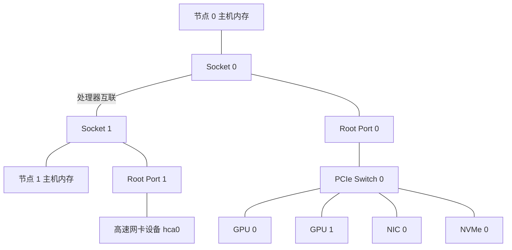
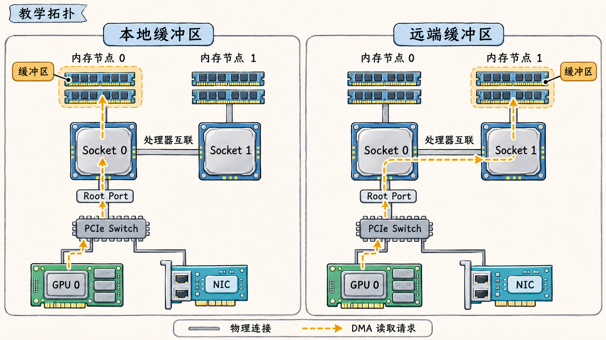

应用已在主机内存里准备好一批输入，也选定由 GPU 0 处理。复制要走哪些连线，取决于 GPU 接在主板哪一侧，以及缓冲区实际占用了哪里的内存。先从 GPU 回溯到处理器，再逐一改变缓冲区和提交线程的位置。

## 从端点沿 PCIe 桥回到处理器

**Socket** 是 CPU 的物理插座。双路机装有两颗处理器，各自连接一组内存，两颗处理器之间设有互联。**PCIe Root Complex（根复合体）** 把处理器与内存系统接到 PCIe 层级。根复合体的 **Root Port（根端口）** 引出分支，可直接连接设备，也可先接 Switch。Switch 朝根端口的一侧叫上行，朝设备的一侧叫下行。上下行指连接位置，每段链路都可双向传输。 [Linux 内核 · PCIe 拓扑和事务路由](https://docs.kernel.org/driver-api/pci/p2pdma.html)



Linux 用 PCI 域号及 **BDF（Bus:Device.Function，总线、设备、功能号）** 标识一个 PCI 功能。以 GPU 0 的教学地址 `0000:1b:00.0` 为例，`0000` 是域，`1b` 是总线号，`00` 是设备号，`.0` 是功能号。GPU 0 与 NIC 0 有各自的下行口，却从 Switch 0 的上行口经同一段物理链路接到 Root Port 0。沿下表逐级回溯即可找到交汇点。两个根端口都在域 `0000`，其 Socket 归属要回到主板连接确认。

| 端点地址 | 从端点向根端口回溯（桥地址省略共同域号 `0000`） | 所接 Socket |
| --- | --- | --- |
| GPU 0 `0000:1b:00.0` | 下行 A `1a:01.0` → Switch 0 上行 `19:00.0` → Root Port 0 `18:01.0` | 0 |
| NIC 0 `0000:1c:00.0` | 下行 B `1a:02.0` → 同一 Switch 上行 → Root Port 0 | 0 |
| NVMe 0 `0000:1d:00.0` | 下行 C `1a:03.0` → 同一 Switch 上行 → Root Port 0 | 0 |
| GPU 1 `0000:1e:00.0` | 下行 D `1a:04.0` → 同一 Switch 上行 → Root Port 0 | 0 |
| `hca0` `0000:a1:00.0` | Root Port 1 `a0:01.0` | 1 |

在真实节点可用 `lspci -D -t` 展开树，配合整机框图辨认桥的层级与处理器归属。查单个 PCI 功能可用 `lspci -D -nnk -s 0000:1b:00.0`，将地址换成现场 BDF。列出功能说明系统已枚举到它，即读到了它在总线上的标识。若同时出现 `Kernel driver in use: nvidia`，则该功能已由 Linux 中的 NVIDIA 驱动接管。应用能否完成计算还需第 03 章的进程侧验证。 [pciutils · lspci 手册](https://github.com/pciutils/pciutils/blob/master/lspci.man) · [NVIDIA DGX H100/H200 · 系统拓扑](https://docs.nvidia.com/dgx/dgxh100-user-guide/introduction-to-dgxh100.html#dgx-h100-200-system-topology)

## 缓冲区的物理页怎样改变复制路径

**NUMA（Non-Uniform Memory Access，非一致内存访问）** 描述一台主机内存访问代价随位置而变的结构。处理器可通过本地内存控制器访问自己一侧的内存，也可经处理器互联访问另一侧。远端路径多了一段共享互联，可用带宽和延迟会受这段连接及并发访问影响。Linux 将有亲和关系的 CPU 和内存组织为 NUMA 节点。本例约定两个 Socket 各对应一个同号节点。真实平台可在一个 Socket 内再划分多个节点，例如启用 Intel Sub-NUMA Clustering 的配置。 [Linux 内核 · NUMA Memory Policy](https://docs.kernel.org/admin-guide/mm/numa_memory_policy.html) · [Intel · 第四代 Xeon 平台拓扑](https://www.intel.com/content/www/us/en/developer/articles/technical/fourth-generation-xeon-scalable-family-overview.html)

假设 GPU 0 的复制引擎直接读取已锁页的输入缓冲区。在支持的平台上，应用可用 `cudaHostRegister` 注册已分配的主机内存。锁页使相关物理页在传输期间保持可用，驱动为设备建立 DMA 地址映射。下表固定 GPU 0 在 Socket 0，仅改变页落点。 [CUDA 13.2.1 · Page-Locked Host Memory](https://docs.nvidia.com/cuda/archive/13.2.1/cuda-programming-guide/02-basics/understanding-memory.html#page-locked-host-memory) · [Linux 内核 · DMA 映射](https://docs.kernel.org/core-api/dma-api-howto.html)

| 缓冲区位置 | DMA 读取请求 | 有效数据返回 |
| --- | --- | --- |
| NUMA 0 | GPU 0 → Switch 0 → Root Port 0 → Socket 0 → NUMA 0 | NUMA 0 → Socket 0 → Root Port 0 → Switch 0 → GPU 0 |
| NUMA 1 | GPU 0 → Switch 0 → Root Port 0 → Socket 0 → Socket 1 → NUMA 1 | NUMA 1 → Socket 1 → Socket 0 → Root Port 0 → Switch 0 → GPU 0 |



**图 01-02-01**　琥珀色虚线表示 GPU 0 发出的读取请求，数据沿反方向返回。两侧只改变页锁定缓冲区的落点。图中 NIC 对应 NIC 0，省略 GPU 1、NVMe 0 和 Socket 1 的 PCIe 分支。

如果页已落在 NUMA 1，仅把提交线程移到 Socket 0 且页未迁移，设备仍从 NUMA 1 取数。变化的是线程执行解码或写缓冲时自身的访存路径。若在线程迁移后新建普通匿名缓冲区，Linux 默认策略通常在匿名页首次写入分配时优先使用当时运行 CPU 的本地节点。内存策略、cpuset 允许范围、回退分配和后续迁页都会影响页驻留，现场应分别取证。 [Linux 内核 · NUMA Memory Policy](https://docs.kernel.org/admin-guide/mm/numa_memory_policy.html)

| 要定位的对象 | 读取办法与含义 |
| --- | --- |
| 设备 | 用 PCIe 桥树找接入点。读取 `/sys/bus/pci/devices/<BDF>/numa_node` 看系统报告的亲和节点，`-1` 表示未知 |
| 线程 | 读 `/proc/<pid>/task/<tid>/status` 中的 `Cpus_allowed_list` 和 `Mems_allowed_list` 了解允许范围。另采样线程的实际 CPU，再按 `/sys/devices/system/node/node<N>/cpulist` 映射到节点 |
| 缓冲区 | 在 `/proc/<pid>/numa_maps` 按映射起始地址找对应行。缓冲区独占这段映射时，可用 `N0=`、`N1=` 的驻留页数描述它 |

下面的教学记录对应输入缓冲区的独立映射。实际查询时，把 `<pid>`、`<tid>`、`<BDF>` 和 `<N>` 替换为对应的进程号、线程号、PCI 地址和节点号。 [Linux 6.10 · PCI sysfs ABI](https://docs.kernel.org/6.10/admin-guide/abi-testing.html#sys-bus-pci-devices-numa-node) · [Linux 内核 · procfs](https://docs.kernel.org/filesystems/proc.html) · [Linux 内核 · NUMA 节点 ABI](https://docs.kernel.org/admin-guide/abi-stable-files.html)

```text
7f0000000000 default anon=256 dirty=256 N0=1 N1=255 kernelpagesize_kB=4
```

按题设的 4 KiB 基页，`(1 + 255) × 4 KiB = 1 MiB`。若 GPU 读取整段，NUMA 1 的 255 页约占 99.6%，这些页的数据经过处理器互联返回。实际吞吐还取决于请求并发、访问顺序和路径上的其他流量。

## 按链路方向核算共享上行

设 GPU 0 把结果写回主机，同时 NIC 0 把收到的数据写到主机。两份载荷从各自下行口汇入 Switch 0，再朝 Root Port 0 走。本章算例用 GB/s 表示每秒十亿字节。若同一时间窗口内每个设备都要持续送出 12 GB/s，该方向的有效载荷容量为 16 GB/s，则总需求 `12 + 12 = 24 GB/s`，超出 `8 GB/s`。如果其中一方实际拿到 12 GB/s，另一方在这个模型里最多得到 4 GB/s。真实分配要看负载和实际调度。

若 GPU 0 改成从主机读入，GPU 的有效载荷由 Root Port 0 流向 Switch 0，NIC 的载荷仍朝向主机。PCIe 是双向链路，所以两份 12 GB/s 载荷计入各自方向的预算。读取请求、协议开销和其他共享资源仍可能影响结果。若再把主机内存换成另一块设备的内存，做 **P2P（Peer-to-Peer，点对点）** 传输，就要按事务的实际路由重画路径。第 04 章会结合链路协商、路由和传输观测进一步推算。 [Linux 内核 · PCIe 事务路由](https://docs.kernel.org/driver-api/pci/p2pdma.html)
