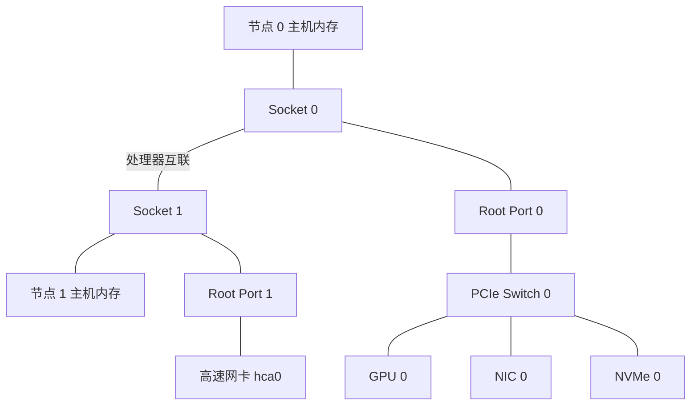
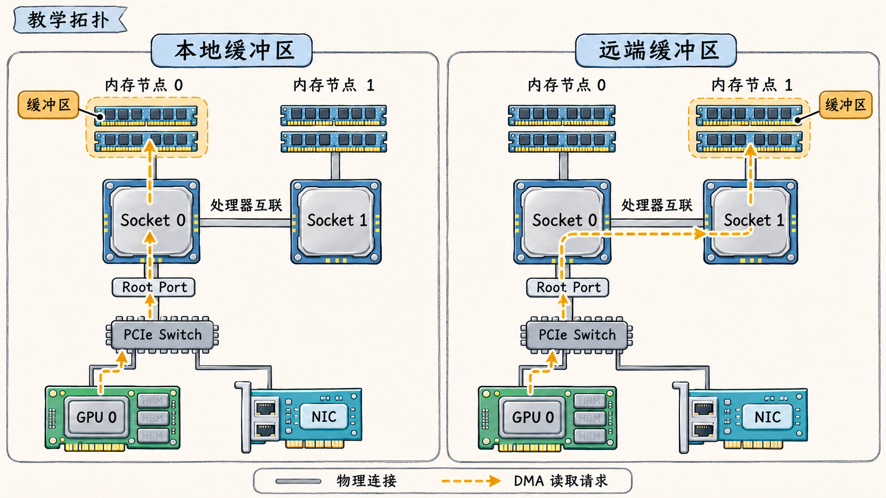

主机内存和 GPU 之间的数据必须走一条实际的连接。双路服务器有两颗 CPU，各自连接一组内存。一块 GPU 接在哪一侧、输入处于哪一组内存，决定传输要经过哪些部件。若两块设备的路径经过同一段链路，还需按传输方向核算并发需求。

## 给设备找到主板上的接入点

**Socket** 是 CPU 的物理插座，双路机有两个装有处理器的 Socket。两颗处理器经互联访问彼此一侧的主机内存。**PCIe Root Complex（根复合体）** 把处理器和内存系统接到 PCIe 层级，其 **Root Port（根端口）** 引出一条 PCIe 分支。它可以直接接一个端点，也可以先接 Switch，再由 Switch 的多个下行端口接 GPU、NIC 或 NVMe 控制器。Switch 朝根端口的一侧叫上行。这里讨论的 PCIe 上行和下行是拓扑位置，链路可双向传输。 [Linux 内核 · PCIe 拓扑和事务路由](https://docs.kernel.org/driver-api/pci/p2pdma.html)

在本章的双路教学节点中，Socket 0 下的 GPU 0、NIC 0 和 NVMe 0 各有一条下行连线。Socket 1 另接一个高速网卡设备，记为 `hca0`。下面只画参与本章推导的设备。



Linux 用域号和 **BDF（Bus:Device.Function，总线、设备、功能号）** 标识一个 PCI 功能。完整地址可写成 `0000:1b:00.0`。以下是与图对应的教学设备树。沿上级桥回溯，就能找到 GPU 0 与 NIC 0 的共同链路。两个根端口的域号都为 `0000`，Socket 归属由桥和主板的连接决定。 `lspci -D -t` 可查看设备树并显示域号，真实节点的根端口到处理器映射可对照厂商框图。DGX 手册的系统拓扑同时画有主机 PCIe 和 GPU 互联，追踪时应区分各类连线。 [pciutils · lspci 手册](https://github.com/pciutils/pciutils/blob/master/lspci.man) · [DGX H100/H200 · System Topology](https://docs.nvidia.com/dgx/dgxh100-user-guide/introduction-to-dgxh100.html#dgx-h100-200-system-topology)

| 端点地址 | 从端点回溯到根端口（桥共用域号 `0000`） | 所接 Socket |
| --- | --- | --- |
| GPU 0 `0000:1b:00.0` | 下行 A `1a:01.0` → Switch 0 上行 `19:00.0` → Root Port 0 `18:01.0` | 0 |
| NIC 0 `0000:1c:00.0` | 下行 B `1a:02.0` → 同一 Switch 上行和 Root Port 0 | 0 |
| NVMe 0 `0000:1d:00.0` | 下行 C `1a:03.0` → 同一 Switch 上行和 Root Port 0 | 0 |
| `hca0` `0000:a1:00.0` | Root Port 1 `a0:01.0` | 1 |

## 同一张 GPU 读取两处主机内存

**NUMA（Non-Uniform Memory Access，非一致内存访问）** 描述同一主机内的访问距离。处理器可以经过本地内存控制器访问自己一侧的内存，也可以经过处理器互联访问另一侧。两条路径的延迟和可用带宽可能不同。Linux 将有亲和关系的 CPU 和内存组织为 NUMA 节点。本例约定每个 Socket 对应一个 NUMA 节点且编号一致。真实服务器需读取系统拓扑，例如启用 Intel Sub-NUMA Clustering 时，一个 Socket 可以暴露多个 NUMA 节点。 [Linux · NUMA Memory Policy](https://docs.kernel.org/admin-guide/mm/numa_memory_policy.html) · [Intel · 第四代 Xeon Sub-NUMA Clustering](https://www.intel.com/content/www/us/en/developer/articles/technical/fourth-generation-xeon-scalable-family-overview.html)

固定 GPU 0 在 Socket 0。本例用页锁定的主机缓冲区，使这些页在传输期间保持可供设备访问。例如在支持的平台上，CUDA 可用 `cudaHostRegister` 注册已分配的主机缓冲区。这里假定驱动已建立 DMA 映射，GPU 直接从该缓冲区读取。 [CUDA 13.2.1 · Page-Locked Host Memory](https://docs.nvidia.com/cuda/archive/13.2.1/cuda-programming-guide/02-basics/understanding-memory.html#page-locked-host-memory)

线程提交复制后，GPU 的读取请求经 Switch 0、Root Port 0 到达 Socket 0 一侧的主机内存系统。若这些页全在 NUMA 0，数据沿本地路径返回 GPU 0。若只有页的落点改到 NUMA 1，读取请求还要从 Socket 0 跨到 Socket 1，返回的有效数据也要跨回 Socket 0，再进入同一条 PCIe 分支。



**图 01-02-01**　两图仅改变页锁定缓冲区的位置。琥珀色虚线从 GPU 指向内存，表示读取请求。返回数据走相反方向。图中只画出 GPU 0 与 NIC 0 的下行，省略 NVMe 0 与 Socket 1 的设备分支。

如果页已落在 NUMA 1，单独把提交线程移到 Socket 0，GPU 仍从 NUMA 1 读取。线程位置会影响该线程自身访问内存的路径，也可能影响以后分配的页。以正常运行中的 Linux 默认策略为例，新建匿名映射的物理页通常在首次写入时按当时的策略分配，优先考虑发生分配的 CPU 本地节点。显式内存策略、cpuset 允许的节点、内存压力和后续迁页都可能影响实际落点。 [Linux · NUMA Memory Policy](https://docs.kernel.org/admin-guide/mm/numa_memory_policy.html)

## 用 Linux 材料分清三个位置

| 位置 | 从哪里取证 | 怎样解读 |
| --- | --- | --- |
| 设备 | `lspci -D -t` 和 `/sys/bus/pci/devices/<BDF>/numa_node` | 地址换成真实值。从 PCIe 树找桥路径，sysfs 的 `numa_node` 给出系统报告的设备亲和，`-1` 表示未知，可回查固件和主板框图 |
| 线程 | `/proc/<pid>/task/<tid>/status` 的 `Cpus_allowed_list` 和 `Mems_allowed_list`，再按需采样线程运行在哪个 CPU | 两个字段给出允许范围。用 `/sys/devices/system/node/node<N>/cpulist` 将实际 CPU 编号映射到节点 |
| 缓冲区的页 | `/proc/<pid>/numa_maps` 中与目标映射起始地址对应的一行 | `N0=` 和 `N1=` 是各节点的驻留页数。将目标缓冲区单独映射才能直接用整行页数描述该缓冲区 |

例如，程序将 GPU 输入缓冲区单独映射，记录的映射起始地址为 `7f0000000000`。下面是匹配到的 `numa_maps` 教学节录。

```text
7f0000000000 default anon=256 dirty=256 N0=1 N1=255 kernelpagesize_kB=4
```

按给定的 4 KiB 页计算，`256 × 4 KiB = 1 MiB`，其中 255 页在节点 1。若 GPU 直接读取整段，读取节点 1 的部分时会跨 Socket。页数和线程运行位置都是各自采样时的状态。 [Linux PCI sysfs ABI](https://docs.kernel.org/6.10/admin-guide/abi-testing.html#sys-bus-pci-devices-numa-node) · [Linux NUMA 节点 ABI](https://docs.kernel.org/admin-guide/abi-stable-files.html) · [Linux · The /proc Filesystem](https://docs.kernel.org/filesystems/proc.html)

## 同一段上行怎样限制并发

现在用同一棵树比较两次传输。GPU 0 把结果写回主机，NIC 0 同时把接收的数据写到主机。两者的有效数据都从各自下行进入 Switch 0，再沿共有的上行往 Root Port 0 走。假设两个设备分别需要持续达到 12 GB/s，该上行往主机方向的有效容量设为 16 GB/s。统计的是同一时段、同一链路方向的有效数据量。需求为 `12 + 12 = 24 GB/s`，比模型容量多 `24 − 16 = 8 GB/s`。在此条件下两者无法同时各得 12 GB/s，具体分配要看负载与实测。

如果 GPU 0 改成从主机读入数据，与网卡载荷在该上行上的方向相反，两个 12 GB/s 应放入各自方向的预算。请求、返回和协议开销以及其他共享部件仍可能影响吞吐。16 GB/s 是教学假设的有效容量。若设备之间直接做 P2P（Peer-to-Peer，点对点传输），需要按实际路由重画路径。Switch 的 ACS（Access Control Services，访问控制服务）设置也可能改变事务是否经过根端口。 [Linux · PCI Peer-to-Peer DMA Support](https://docs.kernel.org/driver-api/pci/p2pdma.html)
