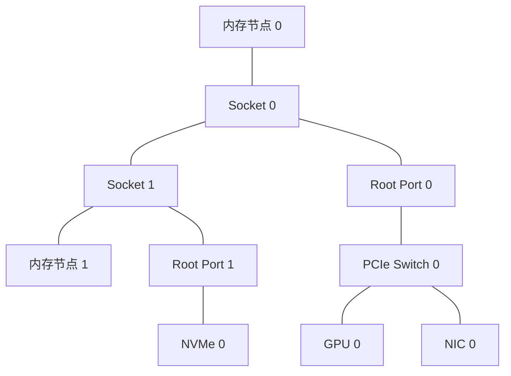
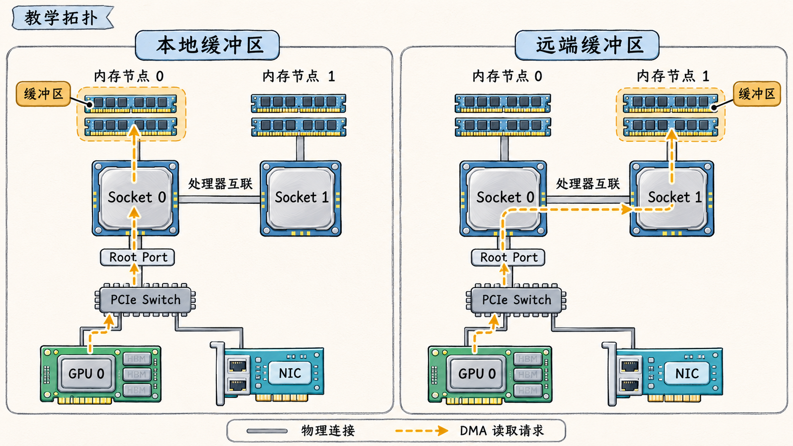

# 从设备清单画出 PCIe 和 NUMA 拓扑

两台服务器都可能有两颗 CPU、两张 GPU 和两张网卡，设备的连接方式却可以不同。设备挂在哪个 PCIe 根端口、多个端点是否共用上行链路、内存页实际位于哪个 NUMA 节点，都会影响一条数据路径经过哪些资源。

## 先画出物理连接

以一个教学用双路服务器为例，假设每颗 CPU 所在的 Socket 都有本地内存，两颗处理器之间有互联。Socket 0 的 PCIe 根端口连接一个 Switch，GPU 0 和 NIC 0 分别连接到该 Switch 的两个下行端口。Socket 1 则通过另一个根端口连接 NVMe 0。实际机器可能有更多根端口、Switch 和互联，设备分布也可能不同。



PCIe Root Complex 将处理器和内存系统连接到 PCIe 层级。Root Port 是该层级向下连接设备的端口。GPU、NIC 和 NVMe 控制器在这里是 PCIe 端点。Switch 的上行端口朝向根端口，下行端口连接下面的设备或其他桥。图中 GPU 0 和 NIC 0 各有下行连接，它们访问主机时还可能共用 Switch 到 Root Port 0 的上行。图只表达连接关系，实际传输还取决于事务方向、软件与设备能力。

厂商拓扑图通常比这个例子复杂。DGX H100/H200 手册的 System Topology 图分别标出 CPU、GPU、PCIe Switch、NVSwitch、网络设备、NVMe、PCIe 和处理器间连线。读取时先按图例辨认不同类型的线，再追踪要分析的端点。 [NVIDIA DGX H100/H200 User Guide · 1.3 System Topology](https://docs.nvidia.com/dgx/dgxh100-user-guide/dgxh100-user-guide.pdf)

## 把 PCI 地址放回树中

Linux 中的 PCI 地址常写作 `域:总线:设备.功能`，例如 `0000:41:00.0`。这些十六进制字段标识一个 PCI 功能。它可以是 GPU，也可以是网卡、存储控制器或桥。地址告诉我们要查哪一个功能，还需要结合桥的上下级关系才能还原路径。

以下为教学示意，地址用于展示读法，不代表任何具体型号机器的枚举结果。

| 功能地址 | 假设角色 | 假设上级 |
| --- | --- | --- |
| `0000:20:01.0` | Socket 0 的 Root Port | 根总线 |
| `0000:21:00.0` | Switch 上行端口 | `0000:20:01.0` |
| `0000:22:01.0` | Switch 下行端口 A | Switch 上行端口 |
| `0000:23:00.0` | GPU 0 | 下行端口 A |
| `0000:22:02.0` | Switch 下行端口 B | Switch 上行端口 |
| `0000:24:00.0` | NIC 0 | 下行端口 B |
| `0000:80:01.0` | Socket 1 的 Root Port | 另一根总线 |
| `0000:81:00.0` | NVMe 0 | `0000:80:01.0` |

从 GPU 和 NIC 向上回溯，两条路径汇合于 Switch，并共用到 Root Port 的连接。NVMe 位于另一条假设路径上。相同的 PCI 域号 `0000` 本身并不能决定 Socket 归属，同一个域中可能存在多个根总线。

在真实 Linux 主机上，`lspci -D -t` 展示总线和桥的树形关系，`-D` 保留域号。结合设备清单中的完整地址追踪桥路径，再用厂商框图确认根端口和 CPU 关系。树形输出的具体编号由固件和枚举结果决定。 [pciutils · lspci 手册](https://github.com/pciutils/pciutils/blob/master/lspci.man)

## 再叠加 NUMA 节点

NUMA 指非一致内存访问。同一系统中的处理器都能访问系统内存，但访问不同位置的内存可能经过不同路径，延迟和可用带宽也可能不同。操作系统将具有亲和关系的 CPU 和内存表示为 NUMA 节点。

上面的教学图假设 Socket 0 对应 NUMA 节点 0，Socket 1 对应节点 1。这只是为了让路径容易看清。具体机器的固件配置可能使一个 Socket 暴露多个 NUMA 域，Intel 的 Sub-NUMA Clustering 就提供这样的例子。节点编号也应以操作系统发现结果为准。 [Intel · Fourth Generation Xeon Scalable Family](https://www.intel.com/content/www/us/en/developer/articles/technical/fourth-generation-xeon-scalable-family-overview.html)

分析数据从主机内存传到 GPU 时，要分别记录三件事。

1. 提交工作的线程在哪些 CPU 上运行，或允许运行在哪些 CPU 上。
2. 输入缓冲区的物理页实际驻留在哪个 NUMA 节点。
3. GPU 从哪个 PCIe 根端口接入，以及系统报告的设备 NUMA 亲和。

假设 GPU 0 接在 Socket 0，输入缓冲区已经锁页，GPU 的 DMA 直接从该缓冲区读取。如果页驻留在节点 0，数据可从 Socket 0 本地内存经其 PCIe 层级到 GPU 0。若页驻留在节点 1，则本例路径要通过处理器间互联，再经过 Socket 0 的 PCIe 层级。即使之后把提交线程调回节点 0，已经驻留在节点 1 的页也不会仅因此自动搬到节点 0。实际传输实现可能使用其他缓冲或路径，需要结合具体软件与观测确认。



图 01-02-01：教学拓扑中，每个 Socket 对应一个 NUMA 节点。GPU 0 的 DMA 直接读取页锁定缓冲区，橙色箭头表示读取请求方向。缓冲区位于节点 1 时，请求经过处理器互联。

为什么页会落到那里？对于正常运行中的 Linux 系统，默认内存策略通常优先从发生分配的 CPU 所在节点取得页面。匿名内存常在首次触页时分配物理页，因此哪个线程先触页可能影响初始落点。显式内存策略、cpuset 可用节点、内存压力和后续迁页都会改变结果。设置策略后的既有页默认不会因策略变化而全部搬迁。 [Linux · NUMA Memory Policy](https://docs.kernel.org/admin-guide/mm/numa_memory_policy.html)

## 用 Linux 信息验证三个位置

可从设备的 sysfs 条目读取系统报告的 NUMA 亲和，并查看各节点包含哪些 CPU。将下面的示例地址替换为目标设备的真实 PCI 地址。

```bash
lspci -D -t
cat /sys/bus/pci/devices/0000:23:00.0/numa_node
cat /sys/devices/system/node/node0/cpulist
cat /sys/devices/system/node/node1/cpulist
```

设备的 `numa_node` 表示内核报告的亲和节点，`-1` 表示未知。初始信息通常来自固件。若显示未知或与机型资料不一致，继续查看 PCIe 桥路径、固件设置和厂商拓扑资料。 [Linux PCI sysfs ABI](https://docs.kernel.org/admin-guide/abi-testing.html) · [Linux NUMA 节点 ABI](https://docs.kernel.org/admin-guide/abi-stable-files.html)

再看目标线程允许使用哪些 CPU 和内存节点，以及进程中具体映射的页面落点。以下进程号指向线程组的主线程。

```bash
target_pid=1234  # 替换为实际进程号
cat "/proc/$target_pid/status"
cat "/proc/$target_pid/numa_maps"
```

下面为教学示意，假设程序为输入缓冲区建立了独立映射，程序记录的缓冲区地址为 `7f0000000000`，页大小为 4 KiB。

```text
# /proc/<pid>/status 的相关字段
Cpus_allowed_list: 0-31
Mems_allowed_list: 0-1

# /proc/<pid>/numa_maps 的目标映射
7f0000000000 default anon=256 dirty=256 N0=1 N1=255 kernelpagesize_kB=4
```

允许 CPU 为 0–31、允许内存节点为 0–1，说明所查询线程的允许范围。其他线程的 CPU 亲和可能不同，可查看 `/proc/<pid>/task/<tid>/status` 中对应线程的字段。目标映射中 `N0=1` 和 `N1=255` 表示采样时分别有 1 页和 255 页位于节点 0、1，合计 256 页，即 1 MiB。需要用程序记录的地址匹配映射，才能把这行归因于输入缓冲区。允许在哪些 CPU 上运行，并不能单独证明采样时线程在哪个 CPU 执行。`numa_maps` 是采样时的映射状态，页可能随时间变化。 [Linux · The /proc Filesystem](https://docs.kernel.org/filesystems/proc.html)

若以锁页缓冲区演示 GPU DMA，要先确认分配、触页、锁页和传输的先后步骤。CUDA 的 `cudaHostRegister` 可注册已有主机内存，具体平台与接口支持条件需按所用 CUDA 版本和设备检查。 [CUDA Programming Guide · Page-Locked Host Memory](https://docs.nvidia.com/cuda/cuda-programming-guide/02-basics/understanding-memory.html#page-locked-host-memory)

## 找出可能共享的上行

在开头的教学拓扑中，GPU 0 和 NIC 0 分别有到 Switch 的下行链路。如果两者各自与主机传输，且同一方向都要经过 Switch 到 Root Port 0 的上行，就需要共同使用该方向的上行容量。

假设 GPU 和 NIC 各自需要向主机发送 12 GB/s，公共上行在这个方向的有效容量为 16 GB/s。两者同时提出的需求为 `12 + 12 = 24 GB/s`，比假设容量多 `8 GB/s`。在这些条件下，二者不可能同时各获得 12 GB/s 的持续吞吐。谁获得多少还取决于流量、设备和调度，需要实际测量。

这里的 16 GB/s 是假设的单方向有效容量，并非指定 PCIe 代际的规格值。另一方向的流量要单独核对。设备之间若采用 P2P，是否能在 Switch 内转发以及是否支持所需访问，还取决于拓扑、设备、驱动和 ACS 等条件。 [Linux · PCI Peer-to-Peer DMA Support](https://docs.kernel.org/driver-api/pci/p2pdma.html)
