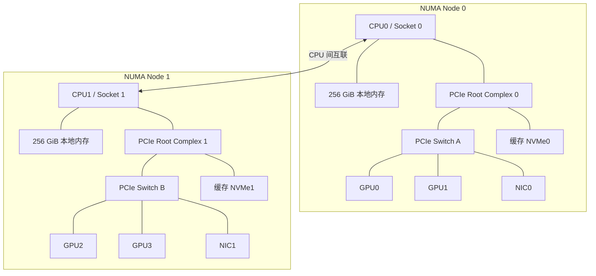

# 把设备放回 PCIe 与 NUMA 拓扑

## 数量相同，访问距离可以不同

沿用上一篇的双路四卡教学模型。这里进一步规定：每个 Socket 对应一个 NUMA Node，CPU0 附近连接 GPU0/GPU1/NIC0，CPU1 附近连接 GPU2/GPU3/NIC1。

下图沿用导读中的教学模型，省略部分桥、Root Port 和辅助设备，连线表示硬件连接关系。



NUMA Node 是操作系统看到的资源局部性分组。Socket 表示处理器封装位置，物理核心执行指令，逻辑 CPU 是操作系统调度线程时使用的编号。本章图中的 CPU0/CPU1 分别指 Socket 0/1 上的处理器，命令输出中的逻辑 CPU 编号另有含义，后面会通过输出建立对应。

本例采用一个 Socket 对应一个 NUMA Node 的布局；实际处理器、固件分区设置和平台设计可能使一个 Socket 对应多个节点。CPU 拓扑的系统接口见 [Linux CPU topology 文档](https://docs.kernel.org/admin-guide/cputopology.html)。

## 距离来自内存与 I/O 的物理位置

若 CPU0 上的线程读取 M0，数据由本地内存子系统提供；读取 M1，则需要经过 CPU 间互联。NUMA 描述的就是这种非均匀访问特征：远近会影响可获得的延迟和带宽，具体幅度由平台和负载决定。[Linux 的 NUMA 说明](https://docs.kernel.org/mm/numa.html) 同时解释了硬件局部性与操作系统节点抽象。


图 01-02-01：同一 CPU0 访问 M0 时使用本地内存路径；访问 M1 时还需经过 Socket 间互联。图中箭头表示访问请求方向，未画数据返回；CPU 符号包含处理器的内存控制与互联范围。本章采用一个 Socket 对应一个 NUMA Node 的教学布局，不据此给出固定的延迟或带宽差值。

GPU 场景还需要把设备的位置放进来。例如，运行在 CPU0 上的加载进程把数据放入 M0，之后传入 GPU0，主机侧资源与目标 GPU 位于同一组局部资源中。如果数据放入 M1，传输路径就需要考虑远端内存访问。

选择 CPU 与内存位置时，还要考虑空闲计算资源、可用内存和作业使用的 GPU 分布。对单个搬运阶段有利的位置，未必能满足整个多卡作业。先画清对应关系，再结合实际阶段判断如何对齐。

## 一条 PCIe 链路有多宽、以什么速率运行

PCI Express（PCIe）是连接主机与扩展设备的互联技术。图中每条 PCIe 连线代表一段点到点链路；一段链路可以由多条 Lane 组成。每条 Lane 都具有发送和接收方向，多条 Lane 可以共同承载传输。

`Gen5 x16` 中的两部分需要分别阅读：`Gen5` 表示链路采用的技术代际，决定单 Lane 的传输速率与编码规则；`x16` 表示链路宽度为 16 条 Lane。`x8` 则表示 8 条。比较带宽时要同时看代际、宽度、方向和协议开销，不能把 `x16` 理解为某个固定的 GB/s 数值。规格中的代际、宽度与带宽口径可以对照 [PCI-SIG 的 PCIe 5.0 说明](https://pcisig.com/what-bit-rates-does-pcie-50-specification-support-and-how-does-it-compare-prior-pcie-generations)。

读整机资料时，还要区分三个层面：

| 层面 | 含义 | 教学例子 |
| --- | --- | --- |
| 插槽机械形态 | 卡能够插入怎样的连接器 | 机箱提供 x16 长度的插槽 |
| 设备能力与主板布线 | 端点和主机侧分别支持什么、实际连接多少 Lane | GPU 支持 x16，但该插槽只布线 x8 |
| 当前链路状态 | 两端在当前条件下建立的代际与宽度 | 当前以 Gen5 x8 运行 |

在上述例子中，x8 可以是主板设计的正常结果。若该插槽按整机设计应运行 x16，却持续只建立 x8，则需要进一步调查。判断差异时，比较对象应是这台整机该插槽的预期配置。

`lspci -vv` 可以显示设备的 PCIe Link Capabilities（`LnkCap`）和 Link Status（`LnkSta`）。例如，对某个端点整理出的两个字段如下：

```text
LnkCap: Speed 32GT/s, Width x16
LnkSta: Speed 32GT/s, Width x8
```

这是按字段语义编写的教学片段，省略了其他字段。它表示端点报告的链路能力为 Gen5 x16，而当前状态是 Gen5 x8。`GT/s` 是传输速率单位，需要结合编码和协议开销才能换算有效数据带宽；端点的能力也不能代表所有上游链路都具备相同能力。字段定义可参见 [pciutils 的 PCIe Link Capability/Status 定义](https://github.com/pciutils/pciutils/blob/master/lib/header.h)。

链路状态还可能随设备活动和电源管理变化。因此，观测时应保留负载条件与采样时刻；例如 NVIDIA 明确说明，设备空闲时报告的当前链路代际或宽度可能降低，见 [nvidia-smi 官方文档](https://docs.nvidia.com/deploy/nvidia-smi/index.html)中的“GPU Link information”小节。持续负载下的验证方法在第 04 章展开。

## Root Complex、Root Port 与 PCIe Switch

Root Complex 把主机处理器/内存子系统与 PCIe 层级连接起来；Root Port 是根侧通向下级 PCIe 层级的端口。Switch 把一条上游连接扩展成多个下游分支。服务器中可以存在多个根端口和多级交换结构，图中把它们合并成了便于阅读的示意。

Switch 扩展了设备连接能力，但共同经过的上行链路仍有容量限制。GPU、NIC、NVMe 分别标出的接口速率，不能在所有访问模式下都独立兑现。

考虑一个纯粹用于预算的例子：**假设** Switch A 到 Root Complex 的上行，在某个方向和既定条件下能够提供 32 GB/s 有效传输预算。GPU0、GPU1 同时从主机内存取数据，各希望占用 20 GB/s，则共同上行需要 40 GB/s，超出了这个预算。


图 01-02-02：本例两张 GPU 同时从主机内存取数，各希望获得 20 GB/s，需要共同经过 Switch A 的同一条根侧链路。给定该方向有效预算为 32 GB/s，40 GB/s 总需求超出预算。20 GB/s 是需求，32 GB/s 是题设预算；图中不表示实际测量结果或固定公平分配。

这里直接给定有效传输预算，用来练习共享路径上的需求加法。Switch 内部若存在可用的设备间直达路径，流量可能不经过该上行；能否使用这种路径需要硬件和软件条件，留待第 04 章验证。

同理，NIC0 的 200 Gbit/s 是端口速率量级，除以 8 得到 25 GB/s，只完成了比特到字节的单位转换。协议、链路状态、PCIe 路径、消息大小和软件处理都会影响应用实际吞吐。

## 给设备建立可核对的身份

“第三张 GPU”可能指物理槽位、驱动枚举索引，也可能指容器内看到的第三个设备。交接时需要能够相互映射的标识。

| 标识 | 用途 | 阅读时的限制 |
| --- | --- | --- |
| 机箱槽位/底板位置 | 让现场人员找到设备 | 依赖整机标注，不能仅由软件索引猜测 |
| PCI BDF，如 `0000:41:00.0` | 标识当前 PCI 层级中的一个 Function | 是地址，单凭总线数字大小不能推断距离 |
| GPU UUID | 对应 NVIDIA 驱动识别的 GPU | 记录时仍应关联节点与物理位置；换卡后需更新 |
| GPU index | 当前环境中的便捷索引 | 重启、枚举变化或容器可见性设置可能改变对应关系 |
| NUMA Node | 表示局部性关联 | 有时未知；未知值不能擅自当作 Node 0 |

BDF 按 `domain:bus:device.function` 表达，字段通常以十六进制显示。Linux 在 sysfs 中暴露 PCI 层级与设备信息，见 [PCI sysfs 文档](https://docs.kernel.org/PCI/sysfs-pci.html)。GPU 身份与索引的差异见 [nvidia-smi 官方说明](https://docs.nvidia.com/deploy/nvidia-smi/index.html)。

## 从四份输出还原设备位置

下面给出同一教学模型的四份输出材料：CPU 布局、GPU 身份、PCIe 层级与设备 NUMA 归属。**输出均为自拟，按工具字段语义编写；省略行、简写及人工注释已标明。** 本节进一步假定关闭 SMT，每个物理核心对应一个逻辑 CPU：Socket 0 使用逻辑 CPU 0—31，Socket 1 使用 32—63。

### 先确定逻辑 CPU 属于哪个 Socket

```text
$ lscpu -e=CPU,CORE,SOCKET,NODE
CPU CORE SOCKET NODE
  0    0      0    0
  1    1      0    0
  ...（省略逻辑 CPU 2—30）
 31   31      0    0
 32   32      1    1
  ...（省略逻辑 CPU 33—39）
 40   40      1    1
  ...（省略逻辑 CPU 41—62）
 63   63      1    1
```

`CPU=40` 是逻辑 CPU 编号，它属于 `SOCKET=1` 和 `NODE=1`，对应前图处理器 CPU1 一侧的执行资源。正文说的“在 CPU0 上运行”，应理解为在线程被调度到 Socket 0 所属的逻辑 CPU 上运行，不能机械地替换成 `taskset` 中的逻辑 CPU 0。

`CORE` 列描述核心归属，开启 SMT 时多个逻辑 CPU 可以属于同一物理核心。实际编号需按工具输出读取；本例的连续编号和 SMT 设置只服务于这份材料。工具行为参见 [util-linux 的 lscpu 手册](https://github.com/util-linux/util-linux/blob/master/sys-utils/lscpu.1.adoc)。

### 再把 GPU 身份换成 PCI 地址

```text
$ nvidia-smi --query-gpu=index,name,uuid,pci.bus_id --format=csv
index, name, uuid, pci.bus_id
0, 教学 PCIe GPU, GPU-11111111-1111-1111-1111-111111111111, 00000000:41:00.0
1, 教学 PCIe GPU, GPU-22222222-2222-2222-2222-222222222222, 00000000:42:00.0
2, 教学 PCIe GPU, GPU-33333333-3333-3333-3333-333333333333, 00000000:C1:00.0
3, 教学 PCIe GPU, GPU-44444444-4444-4444-4444-444444444444, 00000000:C2:00.0
```

设备名称与 UUID 都是教学占位值。要追踪当前索引 2，先记住它对应的 UUID 和 `C1:00.0` 地址，而不是猜测“索引 2 接近 CPU2”。有些工具将 domain 补齐为八位十六进制，sysfs 常用四位；`00000000:C1:00.0` 与 `0000:c1:00.0` 在本例中表达同一地址。

### 顺着 PCIe 树寻找共同祖先

下方使用 `lspci -D -t` 的树形风格，省略其他分支；末尾的 GPU/NIC 代号由本文添加。桥上的 `[41]` 等标记是下级总线，末尾的 `00.0` 需结合所在总线读取为完整 BDF。

```text
-[0000:00]---01.0-[3f-43]----00.0-[40-43]--+-01.0-[41]----00.0  GPU0
                                          +-02.0-[42]----00.0  GPU1
                                          \-03.0-[43]----00.0  NIC0
-[0000:80]---01.0-[bf-c3]----00.0-[c0-c3]--+-01.0-[c1]----00.0  GPU2
                                          +-02.0-[c2]----00.0  GPU3
                                          \-03.0-[c3]----00.0  NIC1
```

从索引 2 的地址 `0000:c1:00.0` 可以找到 GPU2 所在的叶子，再沿父层级读出它位于根总线 `0000:80` 下。GPU2、GPU3、NIC1 有共同的上游结构，对应本例 Switch B 一侧。GPU0、GPU1、NIC0 则在另一个根分支下。

树本身没有给出 Socket 编号，也没有单独标出实体 Switch 的外壳边界。将桥层级归并为 Switch A/B，需要结合整机连接图；把设备关联到 NUMA Node，则还需下一份材料。`lspci` 的树形模式和地址显示选项见 [pciutils 官方手册](https://github.com/pciutils/pciutils/blob/master/lspci.man)。

### 最后关联 NUMA Node 与逻辑 CPU 集合

```text
$ cat /sys/bus/pci/devices/0000:c1:00.0/numa_node
1
$ cat /sys/bus/pci/devices/0000:42:00.0/numa_node
0
```

第一项把 GPU2 关联到 Node 1；结合 `lscpu`，Node 1 的执行资源是本例逻辑 CPU 32—63。现在可以写出一条可核对的设备记录：

```text
当前 index 2 / UUID GPU-3333…
  → PCI 0000:c1:00.0
  → 根总线 0000:80 下的分支 / 整机图中的 Switch B
  → NUMA Node 1 / Socket 1
  → 本例逻辑 CPU 32—63
```

UUID 的省略形式仅用于本段示意，实际记录保留完整值。若 `numa_node` 返回 `-1`，表示归属未知，应继续查固件和整机资料。该字段的初始信息来自平台描述，语义见 [Linux PCI 设备 ABI 的 numa_node 条目](https://docs.kernel.org/5.17/admin-guide/abi-testing.html#abi-sys-bus-pci-devices-numa-node)。

### 自己还原另一张卡

用同样方法，写出索引 1 的 UUID、PCI 地址、所在分支、NUMA Node 和可关联的逻辑 CPU 集合，再判断它与逻辑 CPU 40 是否在本例同一 NUMA Node。

参考结果：索引 1 对应 `GPU-22222222-2222-2222-2222-222222222222`、`0000:42:00.0`，位于根总线 `0000:00` 下的分支 A，关联 Node 0、Socket 0 和逻辑 CPU 0—31。逻辑 CPU 40 属于 Node 1，因此两者不在同一 NUMA Node。

四份材料一起建立了设备身份和局部性映射。后续验证实际搬运路径时，还要结合链路状态、驱动支持与通信观测；这张映射表就是定位这些观测对象的起点。

[上一篇](01_一份配置单背后的整机.md) · [下一篇：PCIe 卡、SXM、HGX 与整机平台](03_PCIe卡_SXM_HGX与整机平台.md)
