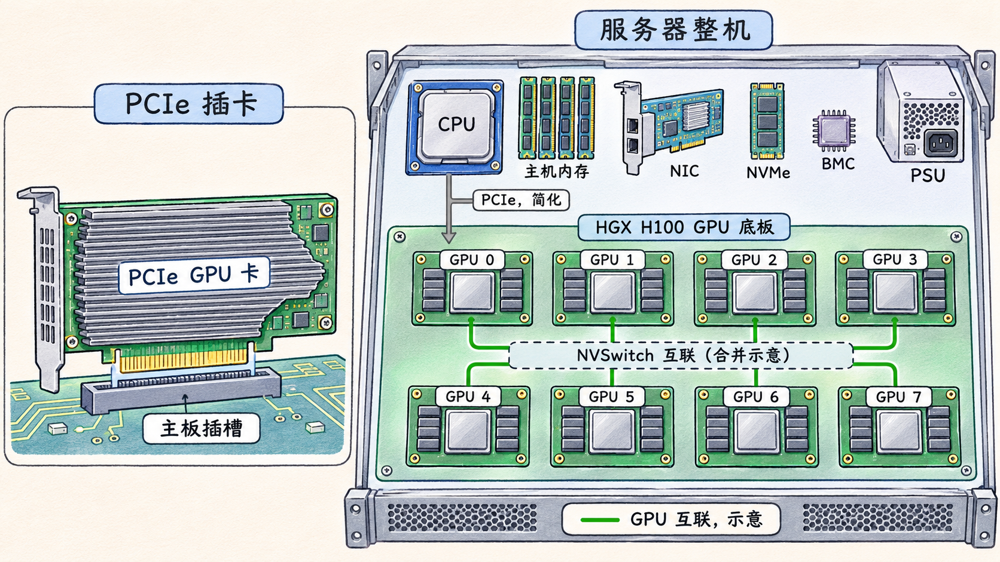

报价上写着「HGX H100 8-GPU」，只凭这一行能知道机架要留几 U、服务器背后有几个网口吗？这行给出的是装有 GPU 模组与互联的子系统。读规格时先辨认 GPU 怎样装、主机和 GPU 怎样连，再确定哪个整机型号把这些部件组合起来。

## 安装接口与数据路径

**PCIe 插卡**通过主板或转接板的 PCIe 插槽连接主机。插卡的厚度、插槽位置和辅助供电会影响一台机器能装几块，机箱散热还要覆盖所选的布局与功耗。

**SXM 模组**装在专用 GPU 底板上，由底板提供电气连接和供电，散热由整机设计配合。以 **HGX H100 8-GPU 底板**为例，八块 H100 SXM 通过底板组成 GPU 子系统。从主机内存复制输入到 GPU 0，仍要沿整机的 PCIe 路径走。若 GPU 0 需要把显存里的中间结果直接交给 GPU 1，在支持的运行配置中，数据可经 GPU 0 的 **NVLink** 链路进入 **NVSwitch**，再经另一段 NVLink 到达 GPU 1。NVLink 提供设备之间的高速连接，NVSwitch 将多条 NVLink 接入同一个交换网络。第 04 章在这条硬件路径上增加访问支持、互联就绪和传输验证的条件。 [NVIDIA HGX H100 · 底板组件](https://docs.nvidia.com/enterprise-reference-architectures/hgx-ai-factory-h100-h200-b200/latest/components.html#nvidia-hgx-h100-h200-8-gpu-baseboard) · [NVIDIA DGX H100/H200 · 系统拓扑](https://docs.nvidia.com/dgx/dgxh100-user-guide/introduction-to-dgxh100.html#dgx-h100-200-system-topology)

**图 01-03-01**　灰线把主机经 PCIe 接入 GPU 子系统的路径简化为一条箭头。绿色线表示各 GPU 经 NVLink 与 NVSwitch 相连，多颗 NVSwitch 合并画成同一个框。整机其余部件用图标表示类别，具体数量和连线以机型手册为准。BMC 是基板管理控制器，PSU 是电源模块，两者的作用在下一篇展开。

## 都是 H100 80 GB，替换时要重查什么

下面比较同一版 NVIDIA 数据表中的 H100 SXM 和 H100 PCIe 80 GB。**TDP（Thermal Design Power，热设计功耗）** 是部件规格，供整机厂商规划该部件的供电和散热。 [NVIDIA H100 数据表，由 Dell 托管](https://i.dell.com/sites/csdocuments/App-Merchandizing_Documents/en/us/h100-gpu.pdf)

| 项目 | H100 SXM | H100 PCIe 80 GB |
| --- | --- | --- |
| 安装 | SXM 模组，配专用底板 | 双槽宽 PCIe 插卡，风冷 |
| 每 GPU 标称显存 | 80 GB | 80 GB |
| 最大热设计功耗 | 最高 700 W，可配置 | 300–350 W，可配置 |
| 数据表列出的互联 | NVLink、PCIe Gen5 | NVLink、PCIe Gen5 |

换成 PCIe 80 GB 版后，每卡标称容量仍为 80 GB，但需重新核对插槽与机械空间、供电和散热，以及卡间是否配有相应的连接件。互联能力要按卡型与整机拓扑一起看。例如 H100 NVL 也采用 PCIe 插卡，规格页列出每 GPU 94 GB、350–400 W，并面向带 NVLink 桥接的双卡部署。若报价写 NVL，应采用该型号自己的规格。 [NVIDIA H100 · H100 NVL 产品规格](https://www.nvidia.com/en-us/data-center/h100/)

## 从底板到整机再到机架

HGX H100 写明八块 GPU 及底板互联。整机型号再确定 CPU、内存、盘位、网口、管理控制器、电源和散热方式。比如 NVIDIA DGX H100 是 8U，支持 HGX H100 SXM5 配置的 Dell PowerEdge XE9680 是 6U。**U** 是机架高度单位，单台少占 2U 可以直接从手册推出。能否装入同一个机架，还要查看整机深度、导轨、承重、供电、气流以及线缆空间。 [NVIDIA DGX H100/H200 · 机械规格](https://docs.nvidia.com/dgx/dgxh100-user-guide/introduction-to-dgxh100.html#mechanical-specifications) · [Dell PowerEdge XE9680 · 系统配置](https://www.dell.com/support/manuals/en-us/poweredge-xe9680/xe9680_ism_pub/dell-poweredge-xe9680-system-configurations-and-features?guid=guid-219a12b6-5232-49fe-9506-ac2aed25ac30&lang=en-us)

评审报价时，GPU 型号和安装形态用于核对逐卡资源与安装，底板和整机框图用于核对连线，整机的接线与输入规格用于核对机架。拿到最后一组资料，才能判断主机关机后从哪里读状态，以及失去一路供电时哪些部件还在工作。
