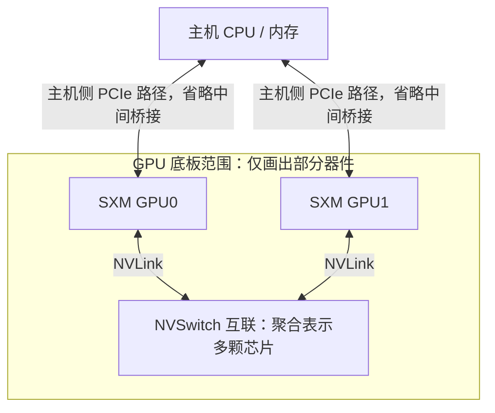

# PCIe 卡、SXM、HGX 与整机平台

## 先分清名称描述的是哪一层

“H100”“SXM”“HGX H100”“DGX H100”可能出现在同一份材料中，但它们描述的对象不同。判断服务器能力之前，先把名称放回相应层次。

| 层次 | 例子 | 需要继续确认的信息 |
| --- | --- | --- |
| GPU 产品与具体变体 | H100 的不同产品形态 | 精确型号、显存、功耗限制、互联能力 |
| GPU 的硬件形态 | PCIe 插卡、SXM 模组 | 如何安装、供电、散热，支持什么底板 |
| 多 GPU 平台/底板 | HGX H100/H200 GPU 底板 | GPU 数量、NVLink/NVSwitch 结构、主机侧接口 |
| 完整服务器 | 厂商基于 HGX 构建的系统、DGX H100 | CPU、DIMM、NIC、NVMe、BMC、供电与机箱 |
| 多机集群 | 多个 GPU 节点与交换机、存储、管理节点 | 跨节点拓扑、网络与设施容量 |

本篇以 H100/H200 代际为例，平台连接关系按对应代际阅读。

## PCIe 插卡：设备与整机一起选

PCIe GPU 插卡通过服务器的 PCIe 插槽接入主机，也可能需要额外供电。选定卡本身以后，仍要检查机箱高度、卡长、占用槽位、供电接口、受支持的服务器配置和散热方式。

“插槽外形能插进去”只解决了机械匹配的一部分。插槽实际布线宽度、所在 CPU、共享的 PCIe 分支和机箱风道，都影响最终可用性。被动散热卡依赖机箱提供合适风量，不能因为卡上没有风扇就认为它没有主动散热需求。

PCIe 插卡也不能简单等同于“所有卡间通信都只能走 PCIe”。特定产品可能提供 GPU 专用互联，是否存在、连哪几张卡，需要查对应变体与整机设计。可以对照 [NVIDIA H100 产品规格中的不同形态](https://www.nvidia.com/en-us/data-center/h100/) 阅读，避免仅凭 GPU 家族名称判断。

## SXM 模组：装在专用底板上的 GPU

SXM 是 GPU 模组形态，需要匹配的专用底板、供电与散热设计。它与主机侧的 PCIe 连接并不矛盾：**SXM 描述模组如何集成，PCIe 也可以描述该 GPU 如何连接主机**。所以，在操作系统 PCI 枚举中看到 GPU，不能反推出它一定是一张 PCIe 插卡。

图 01-03-01：PCIe 插卡与 SXM 模组采用不同的安装和集成方式。图中仅画机械形态与局部安装关系，不表达互联能力或实际器件尺寸；SXM 形态与 GPU 使用 PCIe 连接主机可以同时成立。

以 HGX H100/H200 八 GPU 底板为例，GPU 之间通过 NVLink 与 NVSwitch 构成专用互联；完整服务器还需要配套主机、网卡、存储与机箱。这个具体平台关系可参见 [NVIDIA HGX 八 GPU 底板说明](https://docs.nvidia.com/enterprise-reference-architectures/hgx-ai-factory-h100-h200-b200/latest/components.html#nvidia-hgx-h100-h200-8-gpu-baseboard)。

框表示底板对器件的物理容纳范围，连线表示设备之间的连接。主机侧 PCIe 路径分别到达 GPU，GPU 之间的 NVLink 则经过底板上的 NVSwitch 互联。图将多颗 NVSwitch 聚合为一个节点，并省略其他 GPU、PCIe 桥及管理连接，便于分别观察这两类路径。对应的实际设备层级见 [Fabric Manager：GPU 底板 PCIe 拓扑](https://docs.nvidia.com/hgx-platforms/fabric-manager-user-guide/index.html#gpu-baseboard-topologies)。

特定 HGX/DGX 系统需要 Fabric Manager 等组件管理互联状态，具体职责和依赖见 [Fabric Manager 概述](https://docs.nvidia.com/hgx-platforms/fabric-manager-user-guide/index.html#overview)。详细初始化流程在后续驱动与互联章节展开。

## HGX 与 DGX 怎样放在同一张图中

HGX 是多 GPU 平台体系。讨论某台“HGX 服务器”时，要继续问清厂商整机型号和配置，因为主机与设备布局仍有整机实现层面的差异。

DGX 则提供 NVIDIA 的完整系统。以 DGX H100/H200 为例，官方用户指南分别描述了 GPU、CPU、本地存储、集群网卡、管理入口、机箱与电源。它适合用来学习完整系统需要哪些组成部分。[DGX H100/H200 用户指南](https://docs.nvidia.com/dgx/dgxh100-user-guide/introduction-to-dgxh100.html) 中的拓扑应当作为该系统的资料阅读。

图 01-03-02：SXM 模组集成在匹配的 GPU 底板上，GPU 底板又是完整服务器的一部分。图中借用 HGX H100/H200 八 GPU 平台解释包含层次，仅选择主机、供电和散热等部分整机组成作对照，省略其他组件；不复刻实际 PCB、机箱布局或互联拓扑。

将这里的八 GPU HGX 平台与双路四卡教学模型对照，可以看到：GPU 的形态和卡间互联发生了变化，而 CPU、内存、设备位置及对外连接仍是分析整机时需要保留的信息。

## 读配置单时，追到可以定位的粒度

遇到“8×H100、双路、全 NVLink”这样的描述，可以按以下顺序补齐材料：

1. 精确的 GPU 变体与形态，逐卡显存和运行功率范围。
2. 整机型号、GPU 底板代际与卡间互联图。
3. CPU Socket、NUMA 分组、GPU/NIC/NVMe 的 PCIe 映射。
4. 网卡型号、网卡与端口数量、端口到交换机的实际连接。
5. 电源、散热、机箱尺寸重量及机架配套要求。

“卡之间有互联”仍未说明所有 GPU 是否可用、互联是否初始化完成，或当前作业是否采用预期路径。硬件结构与运行状态是两份需要互相核对的材料。

[上一篇](02_把设备放回PCIe与NUMA拓扑.md) · [下一篇：管理入口与运行条件](04_管理入口与运行条件.md)
