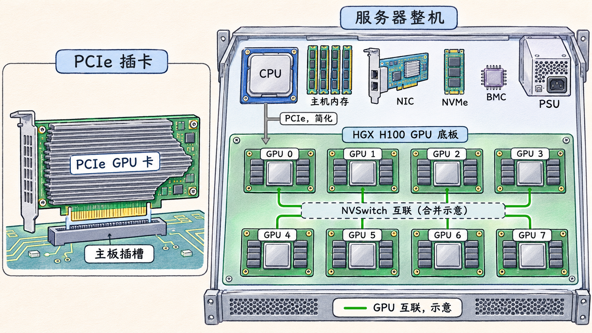

# 从 GPU 形态读到整机平台

服务器配置单可能同时出现 H100、PCIe、SXM、HGX 和 DGX。它们描述的对象大小不同。H100 是 GPU 产品名称，PCIe 和 SXM 在这里描述 GPU 产品的封装或安装形态，HGX 可以指由 GPU 底板和互联组成的平台，DGX H100 则是一款完整服务器。确定对象的边界之后，才能判断配置单里哪些信息还需要向整机厂商索取。

## 插卡、模组与连接

PCIe 形态的 GPU 通常是一块扩展卡，装入主板或转接板上的 PCIe 插槽。插槽和机箱要为它提供空间，平台还需满足该卡的供电和散热要求。双槽宽的卡会影响相邻插槽的可用空间，能否装入、是否支持某种卡数，取决于整机厂商验证过的组合。

SXM 形态的 GPU 则是安装在专用 GPU 底板上的模组。底板为模组提供连接和供电，整机再为整个底板提供机箱、电源与散热。模组不能像标准 PCIe 卡一样仅凭一个空闲插槽就判断可安装。

形态、主机连接和 GPU 间互联需要分别阅读。SXM 模组所在的平台也可以通过 PCIe 连接主机，底板上的 GPU 还可以通过 NVLink 等互联。PCIe 外形的卡也可能具备 NVLink，例如 NVIDIA 的 H100 NVL 数据表列出了 PCIe 双槽外形和 NVLink。实际能否连接、如何连接，以及可用带宽，仍需看具体 SKU、底板和服务器拓扑。 [NVIDIA HGX H100/H200 组件说明](https://docs.nvidia.com/enterprise-reference-architectures/hgx-ai-factory-h100-h200-b200/latest/components.html) · [NVIDIA H100 NVL 数据表](https://dam-cdn.nvd.orangelogic.com/AssetLink/u5hh6fv4r7564i4y673484y3m20083nj.pdf)

## 同叫 H100，规格仍要按版本读

下表摘自一份同时列出 H100 SXM 与 H100 PCIe 的 NVIDIA 数据表。数值对应表中的两个产品，功耗是可配置的热设计功耗，不能直接当作整机实时输入功率。

| 项目 | H100 SXM | H100 PCIe |
| --- | --- | --- |
| 外形 | SXM | PCIe 双槽，风冷 |
| 每 GPU 显存 | 80 GB | 80 GB |
| 最大热设计功耗 TDP | 最高 700 W，可配置 | 300–350 W，可配置 |
| 数据表列出的互联 | NVLink、PCIe Gen5 | NVLink、PCIe Gen5 |

两列显存容量相同，安装形态和功耗范围不同。数据表列出 NVLink 能力，并不能证明某台服务器已安装对应的桥接或互联系统。比较实际机器时，需要再核对整机配置、互联拓扑和厂商支持范围。NVIDIA 另有 H100 NVL 规格，采用不同的显存容量和功耗范围，不能把不同数据表的列直接拼成同一款 GPU 的规格。 [NVIDIA H100 数据表，由 Dell 托管](https://i.dell.com/sites/csdocuments/App-Merchandizing_Documents/en/us/h100-gpu.pdf) · [NVIDIA H100 NVL 数据表](https://dam-cdn.nvd.orangelogic.com/AssetLink/u5hh6fv4r7564i4y673484y3m20083nj.pdf)

## 从底板走到整机

HGX H100 8-GPU 底板把八个 H100 SXM GPU 和高速互联组合起来。按 NVIDIA 的组件规格，单 GPU 为 80 GB，八 GPU 合计为 640 GB。这个合计描述八块 GPU 显存的总容量，应用是否能使用它取决于分配和数据划分方式。 [NVIDIA HGX H100/H200 组件说明](https://docs.nvidia.com/enterprise-reference-architectures/hgx-ai-factory-h100-h200-b200/latest/components.html)

整机还需要 CPU、主机内存、网络适配器、本地存储、管理控制器、电源和散热装置。GPU 底板只能说明其中一部分。NVIDIA DGX H100 配置包含八个 H100 GPU 和双路 CPU，机箱高度为 8U。Dell PowerEdge XE9680 支持八 GPU HGX H100 SXM5 配置，机箱高度为 6U。它们使用相近的 GPU 子系统，整机的空间、扩展与运行条件仍需分别查表。 [DGX H100/H200 组件及机械规格](https://docs.nvidia.com/dgx/dgxh100-user-guide/introduction-to-dgxh100.html) · [Dell XE9680 系统配置](https://www.dell.com/support/manuals/en-us/poweredge-xe9680/xe9680_ism_pub/dell-poweredge-xe9680-system-configurations-and-features?guid=guid-219a12b6-5232-49fe-9506-ac2aed25ac30&lang=en-us)

例如，DGX H100 的组件表分别列出用于集群的网络卡、用于存储与带内管理的网络卡、操作系统盘和数据缓存盘。看到 HGX 底板的型号后，还要回到整机端口表确认网卡数量、接口类型和布线。XE9680 手册列出的盘位和 PCIe 扩展选项也有随 GPU 配置变化的条件。 [DGX H100/H200 组件说明](https://docs.nvidia.com/dgx/dgxh100-user-guide/introduction-to-dgxh100.html) · [Dell XE9680 系统配置](https://www.dell.com/support/manuals/en-us/poweredge-xe9680/xe9680_ism_pub/dell-poweredge-xe9680-system-configurations-and-features?guid=guid-219a12b6-5232-49fe-9506-ac2aed25ac30&lang=en-us)

图 01-03-01：左侧是 PCIe GPU 插卡示意，右侧是包含 HGX H100 GPU 底板的整机示意。灰色箭头概括主机与 GPU 底板的 PCIe 连接，多颗 NVSwitch 合并为一个互联范围，器件布局经过简化。

## 看配置表的顺序

拿到一份报价或交付配置时，可以沿着硬件边界依次核对。

1. 确认整机厂商、型号和具体配置版本，找到其机箱尺寸、支持清单和环境规格。
2. 确认 GPU 的精确 SKU、形态、数量、每卡显存和可配置 TDP。将每卡容量和全机合计分别记录。
3. 查看 GPU 到主机的 PCIe 路径、GPU 之间的互联方式，以及 CPU、GPU 和网卡的连接关系。
4. 查看网口、存储盘位、BMC、电源、散热和机架条件，确认配置中的设备确实具备所需的物理连接与运行条件。

互联是否被软件启用、数据实际走哪条路径，还需要结合驱动、平台组件和运行观测判断。
