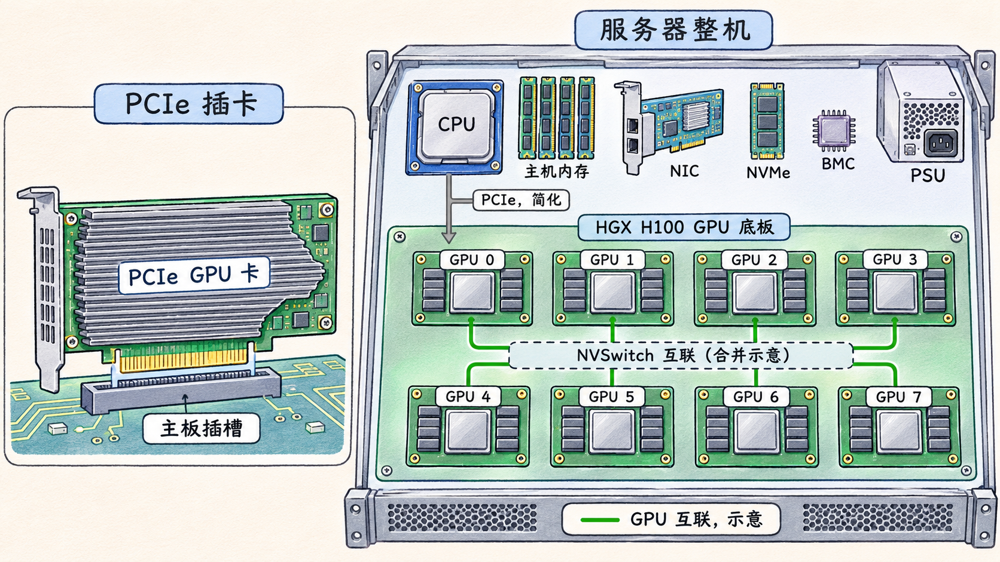

一份报价写着「HGX H100 8-GPU」，采购人员要知道机架需留多少空间、有哪些网口。这一行描述的是装有 GPU 模组和互联的子系统。要回答机架和网口问题，还要知道它装在哪款整机里。读这样的配置，先确定每个名称指向哪一层硬件。

## GPU 怎么装，数据怎么走

**PCIe 插卡**装入主板或转接板的 PCIe 插槽，经 PCIe 与主机交换数据。双槽宽的卡可能挡住相邻位置。能装几块还取决于机箱空间、辅助供电、散热和整机厂商验证过的组合。

**SXM 模组**装在专用 GPU 底板上，由底板提供电气连接和供电，再由整机提供冷却和机箱空间。以 HGX H100 为例，主机到 GPU 子系统仍有 PCIe 路径。GPU 之间还有 **NVLink**（NVIDIA 的高速互联）和 **NVSwitch**（转发 NVLink 流量的交换芯片）。沿主机侧 PCIe 可以追踪输入从主机内存到显存，沿 NVLink 和 NVSwitch 可以追踪底板上 GPU 间的高速通信。某些 PCIe 插卡也支持 NVLink，例如 H100 NVL。确定一台机器的实际互联时，要同时查卡型、连接件和整机拓扑。 [NVIDIA HGX H100/H200 · 组件说明](https://docs.nvidia.com/enterprise-reference-architectures/hgx-ai-factory-h100-h200-b200/latest/components.html) · [DGX H100/H200 · System Topology](https://docs.nvidia.com/dgx/dgxh100-user-guide/introduction-to-dgxh100.html#dgx-h100-200-system-topology) · [NVIDIA H100 数据表 · H100 NVL](https://dam-cdn.nvd.orangelogic.com/AssetLink/u5hh6fv4r7564i4y673484y3m20083nj.pdf)

## 显存相同，安装和功率条件仍可能不同

以下两列来自同一版 NVIDIA H100 数据表。**TDP（Thermal Design Power，热设计功耗）** 是 GPU 部件的规格，用于评估该部件的供电与散热条件。表中的互联是该版本数据表列出的产品能力，具体系统须具备相应连接。 [NVIDIA H100 数据表，由 Dell 托管](https://i.dell.com/sites/csdocuments/App-Merchandizing_Documents/en/us/h100-gpu.pdf)

| 项目 | H100 SXM | H100 PCIe |
| --- | --- | --- |
| 安装形态 | SXM 模组 | PCIe 双槽插卡，风冷 |
| 每 GPU 显存 | 80 GB | 80 GB |
| 最大热设计功耗 | 最高 700 W，可配置 | 300–350 W，可配置 |
| 数据表所列互联 | NVLink、PCIe Gen5 | NVLink、PCIe Gen5 |

若把报价中的 H100 SXM 换成表中的 80 GB H100 PCIe，逐卡的标称容量仍是 80 GB，但安装位置、组件功耗和 GPU 之间的连线都要重新确认。若型号明确写 H100 NVL，应读取它自己的显存和功耗规格。电源和机架预算则按所选整机的输入规格计算。 [NVIDIA H100 数据表 · H100 NVL](https://dam-cdn.nvd.orangelogic.com/AssetLink/u5hh6fv4r7564i4y673484y3m20083nj.pdf)

## 从 HGX 底板找到整机规格

HGX H100 8-GPU 底板把八块 H100 SXM 与高速互联组合起来。底板的 640 GB 是八块 GPU 的显存规格相加。完整服务器还要装入 CPU、主机内存、NIC、NVMe、硬件管理控制器、电源和散热部件。 [NVIDIA HGX H100/H200 · 组件说明](https://docs.nvidia.com/enterprise-reference-architectures/hgx-ai-factory-h100-h200-b200/latest/components.html)

**图 01-03-01**　灰线概括主机到 GPU 子系统的 PCIe 连接，绿线表示 GPU 之间经 NVSwitch 互联。主机侧硬件按部件类别画出，多颗 NVSwitch 合并在同一个互联框内。

同样是八个 H100 的服务器，DGX H100 需要 **8U**，支持 HGX H100 SXM5 配置的 Dell PowerEdge XE9680 需要 **6U**。U 是机架高度单位。若把前者换成后者，机架占用少 2U，但盘位、网口、输入电源和冷却规格要按新机型及具体配置逐项核对。判断 GPU 到主机和到其他 GPU 的走线时，也应使用新机型的拓扑。 [DGX H100/H200 · 组件与机械规格](https://docs.nvidia.com/dgx/dgxh100-user-guide/introduction-to-dgxh100.html#mechanical-specifications) · [Dell PowerEdge XE9680 · 系统配置](https://www.dell.com/support/manuals/en-us/poweredge-xe9680/xe9680_ism_pub/dell-poweredge-xe9680-system-configurations-and-features?guid=guid-219a12b6-5232-49fe-9506-ac2aed25ac30&lang=en-us)

因此报价需要给出整机型号和配置、GPU 的精确型号和形态，以及面向部署的端口与机架条件。拿到整机资料后，才能沿它的管理口、电源线和风道判断节点如何接入机房，以及故障发生后还剩哪些能力。
