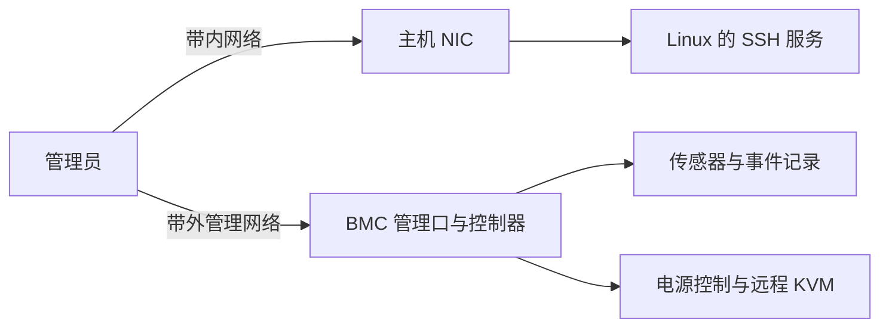

GPU 装进机箱后，整机必须有合适的供电、散热和管理路径才能持续运行。以一台 DGX H100 为例，平时可通过 Linux 管理节点。Linux 尚未启动或无法访问时，管理员还可以通过独立的硬件控制器查看电源状态和启动控制台。这两条访问路径各有自己的前提。

## 到主机与到 BMC

**带内管理**依赖主机提供服务。例如，管理员连到主机网卡上的地址，由 Linux 的 SSH 服务处理登录。

**带外管理**把请求交给 **BMC（Baseboard Management Controller，基板管理控制器）**。BMC 有独立于主机操作系统的执行环境，可读取传感器、保存硬件事件和控制整机电源。本例使用 DGX 的专用 BMC 管理口。远程 **KVM（Keyboard、Video、Mouse，键盘、显示器和鼠标）**可以让管理员通过 BMC 查看并操作主机控制台。 [DGX H100/H200 · Using the BMC](https://docs.nvidia.com/dgx/dgxh100-user-guide/bmc.html)

一次正常检查中，SSH 返回表示主机的带内路径及该服务当时可用，BMC 页面可打开表示带外路径当时可用。假如主机关机，只要 BMC 还有待机供电且管理网络可达，管理员仍可查询主机电源状态或历史事件。随后上电，可用 KVM 看主机启动停在哪里。若失去的是带外链路，BMC 可能仍在采集状态，管理员需要恢复到管理口的路径才读得到。若 BMC 自身失电，远程管理服务也随之停止。 [DGX H100/H200 · BMC 与前面板状态](https://docs.nvidia.com/dgx/dgxh100-user-guide/bmc.html) · [DGX H100/H200 · Front Panel Connections and Controls](https://docs.nvidia.com/dgx/dgxh100-user-guide/introduction-to-dgxh100.html#front-panel-connections-and-controls)

## 用状态和事件判断启动进度

例如 SSH 刚刚超时，BMC 仍可访问并报告主机为 `On`。可以接着看远程控制台是否已经进入 Linux，再把相同时段的 BMC 事件和 SSH 服务日志对应起来。**Redfish** 是服务器硬件管理的接口规范，按资源提供系统状态与日志。下表的语义来自两个具体版本的资源定义，查询时按实际响应的 `@odata.type` 和机型文档读取。 [DMTF ComputerSystem v1.20.0](https://redfish.dmtf.org/schemas/v1/ComputerSystem.v1_20_0.json) · [DMTF LogEntry v1.9.0](https://redfish.dmtf.org/schemas/v1/LogEntry.v1_9_0.json)

| 字段 | 在本例中怎样使用 |
| --- | --- |
| `PowerState` | 记录查询时系统报告的电源状态。`On` 只到上电这一层，启动进度看控制台 |
| `Created` | 用日志条目的创建时间筛出相关记录，跨设备对照前先核对时区与时钟 |
| `EntryType` 与 `MessageId` | 先确定记录类型。`Event` 的 `MessageId` 是消息标识，`SEL`（系统事件日志）类型的该字段是事件数据，厂商条目按对应定义读取 |
| `Severity` | 查看日志标记的严重程度，再用消息内容与对应时段的状态判断影响 |

## 从 PSU 端数到 PDU 端

规划供电时，先按机型查交流输入规格。GPU 的 TDP 只涉及一个部件，整机输入还包括 CPU、内存、网卡、风扇等负载及电源转换损耗。DGX H100/H200 手册列出六个 **PSU（Power Supply Unit，电源模块）**，每个额定 3.3 kW。整机在 200–240 V AC 输入下的最大输入功率为 10.2 kW。手册将该机型的 PSU 冗余设计标为 4+2。 [DGX H100/H200 · Power Specifications](https://docs.nvidia.com/dgx/dgxh100-user-guide/introduction-to-dgxh100.html#power-specifications)

机架的 **PDU（Power Distribution Unit，配电单元）**把上游电力送到各根 PSU 电源线。以下教学接线把六个 PSU 按 **3+3** 分到 A、B 两路 PDU。若仅一个 PSU 故障，仍有五个可用。若 A 路 PDU 整路失电，属于 A 路的三个 PSU 同时失电，只剩 B 路的三个。NVIDIA 对 DGX H100/H200 的说明是，运行中因数据中心或 PDU 事件失去三个 PSU，系统会降性能运行，启动至少需要三个可用 PSU。该条描述针对机型和剩余 PSU 可正常供电的情形。按同一手册部署 N+N，即两组供电任一失去后由另一组承担运行负载，还要启用相应的功率限制功能。手册注明该功能自 24.07.1 起默认关闭。 [DGX H100/H200 · PSU Redundancy and Continuous Operation](https://docs.nvidia.com/dgx/dgxh100-user-guide/introduction-to-dgxh100.html#support-for-psu-redundancy-and-continuous-operation) · [Managing Power Capping](https://docs.nvidia.com/dgx/dgxh100-user-guide/power-capping.html)

## 用机架预算检查失一路后的目标

设两台 DGX H100 都按每台 10.2 kW 的整机最大输入预留，其他设备共预留 1.0 kW，合计 21.4 kW。教学场景中每路 PDU 有 15 kW 可用预算，正常负载均分。故障目标要求剩余一路承载全部原有预留。

| 状态 | 每路或剩余一路所需 | 与预算相比 |
| --- | --- | --- |
| A、B 两路正常且均分 | `(2 × 10.2 + 1.0) ÷ 2 = 10.7 kW/路` | 各剩 4.3 kW |
| A 路丢失，B 路保留所有设备的原预算 | `2 × 10.2 + 1.0 = 21.4 kW` | B 路缺 6.4 kW |

所以这套机架预算能覆盖正常均分，达不到指定的失一路目标。若现场改为保障降级运行，需按目标负载、生效的限功率设置和故障时的供电实测重新预算。PSU 的可用数量给出节点侧条件，PDU 的容量给出上游条件，作业性能还要用同一负载的运行记录判断。

机架高度之外，还要核对深度、导轨、承重、进出风空间与冷却能力。DGX H100/H200 的环境表给出前向后气流，运行温度 5–30°C。机架即使有足够 U 位且当前进风温度在规定范围内，也要用规划负载下的冷却能力和进风数据确认能否持续散热。 [DGX H100/H200 · 机械与环境规格](https://docs.nvidia.com/dgx/dgxh100-user-guide/introduction-to-dgxh100.html#environmental-specifications)

到这里已分清主机管理口和 BMC 管理口。接入第二台服务器后，还要给作业协调、节点间传输和存储访问找到各自的实际出入口。
