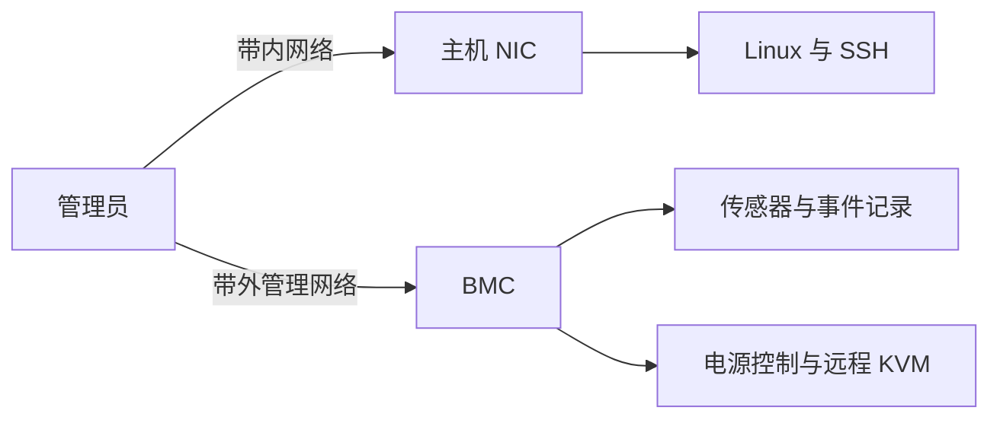

# 带内外管理与运行条件

一台 GPU 服务器可以通过 SSH 失联，却仍然能从管理网络访问其 BMC。也可以有多个冗余电源，在机架的一路供电丢失后降低性能。理解这两种现象，需要分别追踪管理路径、服务器内部电源和机架上游供电。

## 两条管理路径

带内管理通过服务器的操作系统提供服务。例如，管理员从网络连接主机 NIC 上的地址，再由 Linux 内的 SSH 服务处理登录。主机 NIC、网络、操作系统和 SSH 服务都参与了这条路径。

带外管理通过 BMC（Baseboard Management Controller，基板管理控制器）访问硬件管理功能。BMC 有自己的管理接口和软件环境，通常由待机电源供电。以 DGX H100/H200 为例，BMC 提供传感器、硬件清单、事件日志、电源控制和远程 KVM 等功能。远程 KVM 可以让管理员在主机上电启动时查看控制台。 [DGX H100/H200 BMC 功能](https://docs.nvidia.com/dgx/dgxh100-user-guide/bmc.html)

主机关机时，只要 BMC 有待机供电且带外网络可达，仍可能报告主机电源状态和保留的事件。主机上电后，远程 KVM 可以观察启动过程。若带外网络断开，BMC 即使正常也无法通过该网络访问。若 BMC 失去供电，带外服务也会停止。具体电源状态和功能取决于机型与当前供电条件。

SSH 超时说明这次带内连接未成功，还要结合网络、主机状态和服务日志判断原因。BMC 可达表明带外连接成立，可以继续查看硬件状态，但单凭它不能断定 Linux 或应用正常。

## 怎样把状态和事件联系起来

Redfish 是面向服务器硬件管理的接口规范。它把系统状态和日志记录表示为资源，具体路径、版本及支持字段由设备实现决定。读取时先看当前系统的 `PowerState`，再按时间检查事件记录。

| 字段 | 提供的信息 | 阅读时要确认的条件 |
| --- | --- | --- |
| `PowerState` | 查询时系统报告的电源状态 | 它是当前状态，需结合采集时间 |
| `EntryType` | 日志记录的类型 | 决定后续字段的解释方式 |
| `Created` | 日志记录创建的时间 | 比对主机日志前核对时区和时钟 |
| `MessageId` | 消息标识、事件数据或厂商信息 | 随 `EntryType` 的不同而变化 |
| `Severity` | 日志记录的严重程度 | 再结合消息内容与其他证据判断影响 |

例如，当前 `PowerState` 为 `On` 只说明查询时系统报告已上电。若此前曾重启，要查看对应时间附近的日志及其消息内容。Redfish 的字段定义不保证每台设备或每个事件都提供相同字段，实际读取时应查看响应中的 `@odata.type` 和厂商文档。 [DMTF ComputerSystem v1.20.0](https://redfish.dmtf.org/schemas/v1/ComputerSystem.v1_20_0.json) · [DMTF LogEntry v1.9.0](https://redfish.dmtf.org/schemas/v1/LogEntry.v1_9_0.json)

## 从 GPU 功耗到机架供电

GPU 的热设计功耗是部件规格。服务器整机还包括 CPU、主机内存、网卡、存储、风扇和电源转换损耗，所以规划供电时要读取整机输入功率，并核对输入电压与厂商指定的运行条件。

DGX H100/H200 手册列出六个 3.3 kW 电源模块（PSU），在 200–240 V AC 输入下整机最大输入功率为 10.2 kW。六个 PSU 的额定值之和并不是整机的最大输入功率。该系统使用 4+2 电源冗余。 [DGX H100/H200 电源规格](https://docs.nvidia.com/dgx/dgxh100-user-guide/introduction-to-dgxh100.html#power-specifications)

假设六个 PSU 中三个接机架 A 路 PDU，三个接 B 路 PDU。PDU 是把上游电力分配到设备电源线的机架配电单元。如果单个 PSU 故障，还有五个 PSU 可用。如果整条 A 路失电，则同时失去三个 PSU，剩余三个。

DGX H100/H200 手册说明，系统运行时若因数据中心供电或 PDU 故障导致三个 PSU 失电，系统会以降低的性能继续运行。启动至少需要三个可用 PSU。接线还必须符合实际厂商部署要求，是否满足目标性能要结合剩余供电和功率限制策略判断。 [DGX H100/H200 电源冗余说明](https://docs.nvidia.com/dgx/dgxh100-user-guide/introduction-to-dgxh100.html#support-for-psu-redundancy-and-continuous-operation)

对于该机型，NVIDIA 的 N+N 功率管理说明要求启用功率限制以实现安全运行，并注明相关功能从版本 24.07.1 起默认关闭。实际生效配置和固件版本需在目标节点核对。 [DGX H100/H200 Power Capping](https://docs.nvidia.com/dgx/dgxh100-user-guide/power-capping.html)

## 用算例检查上游容量

下面是机架预算的教学算例，不代表某个实测机房。假设有两台 DGX H100 节点，每台按 10.2 kW 整机最大输入预算；其他设备预留 1.0 kW。A、B 两路 PDU 各有 15 kW 可用预算，并假设正常时两路均分总负载。

| 状态 | 算式 | 预算判断 |
| --- | --- | --- |
| 两路正常、负载均分 | `(2 × 10.2 + 1.0) ÷ 2 = 10.7 kW/路` | 每路低于假设的 15 kW 预算 |
| 要求失一路后保留原预算 | `2 × 10.2 + 1.0 = 21.4 kW` | 剩余一路的 15 kW 预算不足 |

这个结果说明，正常状态下单路有余量，还需要单独核对故障状态。算例假设其他设备也留在剩余路上，且要求保留原最大功率预算。真实事故中的节点功率、降级行为和能否继续运行，要结合 PSU 到 PDU 的接线、PDU 实际可用容量、功率限制及现场测量。

## 机箱能放下，也要能散热

机架还需要核对高度、设备深度、导轨和承重，以及前后进出风空间。DGX H100/H200 的官方环境表给出前向后气流，并列出指定运行温度范围。实际布置需要将进风温度、机架风道和机房冷却能力放在一起核对，避免热空气回流到服务器进风侧。 [DGX H100/H200 机械与环境规格](https://docs.nvidia.com/dgx/dgxh100-user-guide/introduction-to-dgxh100.html)

交付评审时，应将机箱和环境规格、整机最大输入功率、PSU 接线图、A/B 路可用容量和目标故障状态放在同一份材料中。现场没有某项数据时，该项仍需核实，单靠 PSU 个数或机架剩余 U 位无法完成判断。
