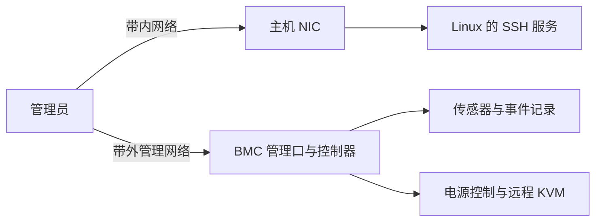

一台已安装到机架的 DGX H100 在正常运行时，可以通过 Linux 登录并检查作业。若 Linux 尚未启动，管理员仍需要读取电源状态或查看启动画面。服务器提供两条访问路径，分别以主机软件和硬件管理控制器为终点。

## 管理请求到 Linux 或到 BMC

**带内管理**使用主机的网络和软件。在本例中，管理员向主机网卡上的地址发起 SSH 登录，Linux 的 SSH 服务接受请求。登录成功依赖链路与 IP 路径、运行中的主机以及可用的服务。

**带外管理**由 **BMC（Baseboard Management Controller，基板管理控制器）** 处理。DGX H100/H200 提供专用的 BMC 管理口。BMC 运行独立于主机操作系统的管理环境，可读取传感器、提供硬件事件和控制整机电源。远程 **KVM（Keyboard, Video, Mouse，键盘、显示器和鼠标）** 把主机控制台的画面和操作提供给管理员。 [NVIDIA DGX H100/H200 · Using the BMC](https://docs.nvidia.com/dgx/dgxh100-user-guide/bmc.html)

主机关机时，若 BMC 仍有待机供电且管理网络可达，管理员可查询主机电源状态，然后用 KVM 观察上电后的启动过程。若断开的是 BMC 的网络，管理请求到不了控制器，主机的 SSH 路径仍可独立工作。若 BMC 自身失电，远程管理服务也会停止。 [NVIDIA DGX H100/H200 · BMC 与前面板状态](https://docs.nvidia.com/dgx/dgxh100-user-guide/introduction-to-dgxh100.html#front-panel-connections-and-controls)

## 用电源状态、控制台和事件判断启动进度

现场若发现 SSH 超时，先看 BMC 是否可达，以及它查询时报告的主机电源状态。如果报告 `On`，接着通过 KVM 看启动画面。若画面还停在固件自检，SSH 服务尚没有运行环境。若已到 Linux 登录界面，则可检查主机接口、路由和 SSH 服务，并用对应时段的日志缩小原因。

**Redfish** 是硬件管理的接口规范，可通过 BMC 查询系统资源和日志。下面使用 DMTF 的两个资源版本说明字段语义，实机以响应的 `@odata.type` 和固件文档为准。 [DMTF ComputerSystem v1.20.0](https://redfish.dmtf.org/schemas/v1/ComputerSystem.v1_20_0.json) · [DMTF LogEntry v1.9.0](https://redfish.dmtf.org/schemas/v1/LogEntry.v1_9_0.json) · [NVIDIA DGX H100/H200 · Redfish API 支持](https://docs.nvidia.com/dgx/dgxh100-user-guide/redfish-api-supp.html)

| 字段 | 对应的证据 |
| --- | --- |
| `ComputerSystem.PowerState` | 系统在查询时报告的电源状态。初次看到 `On`，可用控制台确认启动进度 |
| `LogEntry.Created` | 条目的创建时间。与主机日志对照前，先确认双方的时区和时钟 |
| `LogEntry.EntryType`、`MessageId` | 按条目类型解释字段。对于 `Event`，`MessageId` 是 Redfish 消息标识。对于 `SEL`（系统事件日志），该字段承载事件数据 |
| `LogEntry.Severity` | 日志标记的严重程度。结合事件正文、时间和当前状态判断影响 |

## PSU 冗余与机架 A/B 路预算

机架的 **PDU（Power Distribution Unit，配电单元）** 从上游接收电力，再通过各根电源线为服务器的 **PSU（Power Supply Unit，电源模块）** 供电。PSU 将交流输入转换并送到机内负载。预算应采用整机交流输入规格，其中包含 CPU、GPU、内存、网卡、风扇等负载及转换损耗。DGX H100/H200 手册列出 6 个额定 3.3 kW 的 PSU，在 200–240 V AC 下整机最大输入为 10.2 kW。手册将该机型的模块冗余设计标作 4+2，表示四个模块可满足设计供电需求，余下两个提供冗余容量。六根线各接哪一路上游，由机架接线决定。 [NVIDIA DGX H100/H200 · Power Specifications](https://docs.nvidia.com/dgx/dgxh100-user-guide/introduction-to-dgxh100.html#power-specifications)

教学接线把每台节点的六个 PSU 按 **3+3** 接到 A、B 两路 PDU。一个模块失效后还有五个可用，A 路整路失电时则同时丢掉三个。机型手册描述，运行时因机房或 PDU 事件失去三个 PSU，节点按降性能方式运行。至少三个 PSU 正常供电才满足该机型的启动门槛。若按 **N+N** 部署，即希望任一组供电失去后由另一组承载预定负载，NVIDIA 还要求启用相应的系统限功率功能。手册注明该功能自 24.07.1 起默认关闭。整路失电后，机架配电和上游的容量仍需单独计算。 [NVIDIA DGX H100/H200 · PSU 冗余与持续运行](https://docs.nvidia.com/dgx/dgxh100-user-guide/introduction-to-dgxh100.html#support-for-psu-redundancy-and-continuous-operation) · [Managing Power Capping](https://docs.nvidia.com/dgx/dgxh100-user-guide/power-capping.html)

设机架有两台这样的节点，每台按 10.2 kW 的最大输入预留，其他设备合计预留 1.0 kW。假定 A、B 都有 15 kW 可用预算，正常时均分，失一路时要求剩余一路保留全部预留。

| 状态 | 每路所需预算 | 余量 |
| --- | --- | --- |
| A、B 均正常 | `(2 × 10.2 + 1.0) ÷ 2 = 10.7 kW/路` | 每路余 4.3 kW |
| A 路失电，B 路承担全部预留 | `2 × 10.2 + 1.0 = 21.4 kW` | B 路差 6.4 kW |

正常均分满足预算，整路失电后维持全部预留的目标差 6.4 kW。若把目标调整为失一路后维持降级运行，就要以预定负载、生效的系统限功率和故障工况下的输入功率重新计算，并观察作业能否维持所需性能。

## 用气流和进风温度判断能否持续运行

DGX H100/H200 手册给出的气流是前进后出，运行温度为 5–30°C。机架需要为进气、排气、导轨和线缆留空间，还要核对承重。一次空闲时测得进风在范围内，只能说明那个时刻的条件。若排出的热空气回流到进风侧，节点上负载后可能逐渐抬高进风温度。持续运行需要结合规划负载下的机房冷却能力与各节点进风记录判断。 [NVIDIA DGX H100/H200 · 机械与环境规格](https://docs.nvidia.com/dgx/dgxh100-user-guide/introduction-to-dgxh100.html#environmental-specifications)

主机和 BMC 的管理口各有明确的服务终点。接入第二台节点后，同样要根据终点追踪作业会合、数据交换和存储访问，再看哪些路径共用网卡、线缆和上游设备。
