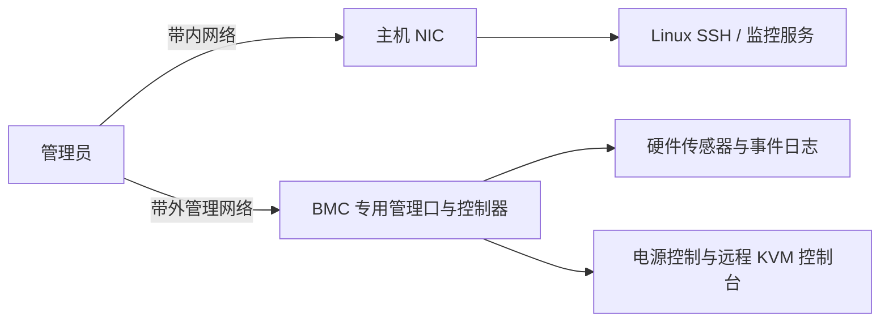

# 带内管理、BMC 带外管理与机架运行条件

深夜三点，一台满载 8 张 H100 的节点突然 SSH 失联了。此时它究竟是机柜断电、卡在 BIOS 硬件自检、Linux 内核死机，还是仅仅业务网卡掉了线？如果运维人员手里只有 SSH，根本无从判断，只能派人跑进机房接显示器。

高密度 GPU 服务器不仅昂贵，还动辄单台功耗超过 10 kW。这一篇我们拆解数据中心里的两条关键底线：**不依赖操作系统的带外管理生命线**，以及**决定高密节点能否稳稳扛住故障的供电冗余与散热条件**。

## 带内 vs 带外：两条互不依赖的管理生命线

一台上架的 GPU 服务器向管理员提供两条完全独立的访问路径，终点一个是主机操作系统，另一个是主板上的专用硬件管理芯片：

- **带内管理（In-Band）**：走主机业务/管理网卡进入 Linux 系统（例如 SSH 登录、Prometheus 采集 Agent）。它的成立前提是**主机已上电、网络链路连通、Linux 正常运行且目标服务存活**。
- **带外管理（Out-of-Band）**：由 **BMC（Baseboard Management Controller，基板管理控制器）** 负责，就像“焊在主板上的独立值班微机”，配备专用物理管理网口和独立固件环境。
  - 只要服务器插着电（哪怕处于关机待机态），BMC 就能读取温压传感器、查看硬件事件日志、远程开关机，并通过远程 **KVM（Keyboard, Video, Mouse）** 传回主机画面与键鼠操作。



*图 01-04-01：带内管理（经主机网卡进入 Linux）与带外管理（经独立管理口进入 BMC）的双路径分工。*

正因为两条路径物理隔离，它们在故障时呈现清晰的互补关系：
- **主机关机或 Linux 死机**：只要待机供电仍在且带外网络连通，BMC 照常工作，可以查电源状态、开 KVM 看启动画面或执行硬重启。
- **带外管理网线断开**：BMC 无法远程访问，但运行中的主机 SSH 路径不受影响。
- **服务器彻底断电**：待机供电消失，BMC 自身也随之离线。

## SSH 超时怎么查？电源状态、KVM 与 Redfish 日志实战

现场遇到 SSH 超时，不要盲目重启机器，沿带外路径按四步即可把故障精准切开：

1. **先测 BMC 可达性与电源状态**：确认机箱还在供电，且主机当前处于 `On` 还是 `Off`。
2. **开远程 KVM 看控制台画面**：若画面停留在固件自检（POST）或 BIOS 报错，说明还没进操作系统，SSH 自然起不来；若已经出现 Linux 登录提示符，则故障收敛在主机网卡、路由、防火墙或 `sshd` 服务。
3. **调取硬件事件日志**：核查是否有电源掉电、内存 ECC、PCIe 异常或过温触发保护。
4. **对齐时钟后再做关联**：把 BMC 事件日志与 Linux 内核日志放到同一时间线上比对前，务必先确认双方的时区与时钟是否同步。

在现代服务器（如 DGX H100/H200）中，运维脚本通常同时使用传统 `ipmitool` 和现代化的 **Redfish** 接口与 BMC 对话。**Redfish** 是 DMTF 制定的基于 HTTPS/JSON 的硬件管理 REST API 标准，相比传统二进制 IPMI，数据结构清晰、极易与自动化平台集成：

```bash
# 1. 使用 ipmitool 快速确认主机电源状态（带外独立查询）
ipmitool -I lanplus -H 10.20.0.101 -U admin -P '***' chassis power status
# 典型输出：Chassis Power is on

# 2. 通过 Redfish API 查询系统电源状态与硬件日志条目
curl -sk -u admin:'***' https://10.20.0.101/redfish/v1/Systems/System_0 | jq '{PowerState, Status}'
```

```json
{
  "PowerState": "On",
  "Status": { "State": "Enabled", "Health": "OK" }
}
```

```bash
# 3. 读取 BMC 日志服务中的关键硬件事件
curl -sk -u admin:'***' https://10.20.0.101/redfish/v1/Systems/System_0/LogServices/EventLog/Entries | jq '.Members[0]'
```

```json
{
  "Created": "2026-11-19T02:58:14Z",
  "EntryType": "Event",
  "MessageId": "Power.1.0.PowerSupplyLost",
  "Severity": "Warning",
  "Message": "Power supply PSU1 lost AC input."
}
```

判读 Redfish 响应时，重点盯住以下四个核心字段：

| Redfish 核心字段 | 承载的排障证据 |
| --- | --- |
| `ComputerSystem.PowerState` | 查询瞬间的主机电源状态；看到 `On` 仅说明已加电，还须借 KVM 确认启动进度 |
| `LogEntry.Created` | 事件发生时间；与主机 `dmesg` / `journalctl` 对齐前先核对时区与 NTP 偏移 |
| `LogEntry.EntryType` 与 `MessageId` | 决定如何解码消息：`EntryType` 为 `Event` 时 `MessageId` 是标准 Redfish 事件码；为 `SEL`（系统事件日志）时则承载底层 IPMI SEL 数据 |
| `LogEntry.Severity` | 严重级别（`OK` / `Warning` / `Critical`）；结合正文和当前状态决定处置优先级 |

> [!note] Schema 版本说明
> 上表语义对照 DMTF `ComputerSystem v1.20.0` 与 `LogEntry v1.9.0` 规范整理。不同厂商和固件版本的 URI 路径（如 `System_0` 与日志服务名）略有差异，实操时可直接查看响应中的 `@odata.type` 字段与机型固件文档。

## PSU 冗余与机架 A/B 路预算：单模块故障 vs 整路断电

GPU 服务器的供电是一条从机房上游逐级下沉的链路：**机房上游供电 → 机架 PDU（Power Distribution Unit，配电单元）→ 电源线 → 服务器 PSU（Power Supply Unit，电源模块）→ 机内直流负载**。

做电力预算时，**必须按整机交流（AC）最大输入功率算账，绝不能只把 GPU 的 TDP 相加**——因为整机输入里还包含双路 CPU、2 TB 内存、高速网卡、大风量风扇以及电源转换损耗。

以一台 **DGX H100/H200** 为例，官方规格如下：
- 配备 **6 个额定 3.3 kW 的 PSU**，在 200–240 V AC 下整机最大输入功率为 **10.2 kW**。
- 模块冗余设计为 **4+2**：4 个模块即可满足满载设计需求，余下 2 个作为冗余备份。

机房双路配电时，通常将这 6 根电源线按 **3+3** 分别接入机架的 A 路 PDU 与 B 路 PDU。此时，“坏一个模块”和“断掉一整路电”的后果截然不同：

- **单个 PSU 模块故障**：还剩 5 个健康模块，高于 4 个模块的满载需求，业务毫无感知。
- **A 路 PDU 整路失电**：同一瞬间同时失去 3 个 PSU，仅剩 B 路 3 个模块在线。按照 DGX 手册，3 个正常 PSU 是开机启动的最低门槛，运行中因供电事件失去 3 个 PSU 后，节点会自动进入**降性能（限频/限功）模式**维持运行。

> [!warning] 常见误区：双路 3+3 接线，不等于自动具备满血 N+N 容灾
> 若希望 A 路或 B 路任一整路掉电后节点仍稳定承载预定负载（N+N 部署），NVIDIA 要求显式启用系统限功率功能（System Power Capping）——而该功能自 DGX OS `24.07.1` 起**默认关闭**。同时，剩余那一路机架 PDU 与机房上游配电也必须扛得住整架功率的瞬间翻倍。

我们来算一笔经典的机架配电账：假设一个机架安装了 **2 台 DGX H100**（每台按 `10.2 kW` 最大输入预留），加上交换机等其他机架设备预留 `1.0 kW`。A、B 两路 PDU 的可用配电预算各为 `15.0 kW`，正常时均分负载，目标是在失一路后由另一路完整兜底全部预留功率：

$$\text{整架总预留功率} = 2 \times 10.2\text{ kW} + 1.0\text{ kW} = 21.4\text{ kW}$$

$$\text{A、B 双路正常均分} = \frac{21.4\text{ kW}}{2} = 10.7\text{ kW/路} \implies \text{每路余量} = 15.0 - 10.7 = +4.3\text{ kW}$$

$$\text{A 路整路失电（B 路兜底）} = 21.4\text{ kW} \implies \text{B 路缺口} = 15.0 - 21.4 = -6.4\text{ kW}$$

| 供电工况 | 每路所需预算 | 相对 15.0 kW 上限的余量 | 结论 |
| --- | --- | --- | --- |
| **A、B 两路均正常** | `10.7 kW/路` | 每路余 `+4.3 kW` | 满足常态运行 |
| **A 路失电，B 路兜底全部预留** | `21.4 kW` | B 路缺 `-6.4 kW` | **超载跳闸风险**，无法全额兜底 |

面对这 `6.4 kW` 的缺口，工程上只有两条务实出路：要么扩容单路配电预算（或减少单架节点数），要么明确将容灾目标调整为“失一路后降级限功运行”，并结合生效的系统限功率阈值重新核算故障工况下的实际输入功率与业务吞吐。

## 气流与散热：为什么空载温度合格，满载依然可能过热？

电力送进服务器后，几乎 100% 最终都会变成热量排出来。两台满载的 DGX H100 相当于在单个机柜里放了一台 20 kW 以上的电暖炉。

DGX H100/H200 的散热设计为**前进后出**，官方允许的运行进风温度范围为 **5–30°C**。装柜时，除了为前部冷风吸入、后部热风排出以及导轨和背部线缆留足净空，还必须严格核对机柜静态承重。

> [!warning] 常见误区：上架空载测得进风温度合格，不等于能扛住持续满载
> 空载时点测进风口为 24°C，只能说明那一刻环境温度达标。一旦集群跑起满载训练或高并发推理，如果冷热通道封闭不严，机箱尾部排出的滚烫热风会绕流回前部进风口（热风回流），导致进风温度在几十分钟内持续爬升、触发 GPU 降频甚至过温关机。判断能否持续稳定运行，必须结合规划满载功率下的机房制冷能力，以及压测期间各节点的持续进风温度曲线。

> [!summary] 核心结论
> - **双管理平面各司其职**：SSH 依赖主机网络与 OS，BMC/Redfish 走独立管理口与待机电源；排障时按“BMC 电源态 → KVM 画面 → 时钟对齐日志”快速定界。
> - **供电算账看整机 AC 与失一路**：单 PSU 故障靠模块冗余（4+2）平滑消化，整路 PDU 断电则会同时打掉半数模块并让另一路功率翻倍，必须单独核算 N+N 容量与限功率配置。
> - **散热验收看满载持续态**：进风温度与气流组织必须在目标满载功率下持续验证，防范热风回流。

至此，我们已经能把单台 GPU 服务器的硬件、管理和机架底线全部拿捏清楚。接下来，我们把第二台一模一样的服务器摆进机房、插上网线和光纤——当集群开始跑多机作业时，管理、协调、存储与 GPU 高速通信该怎样分流？拔掉一根线究竟会牵连哪些业务？下一篇我们拆开集群网络平面与故障域。

> [!info]- 参考资料
> - **BMC 与带外管理**：[NVIDIA DGX H100/H200 · Using the BMC](https://docs.nvidia.com/dgx/dgxh100-user-guide/bmc.html)、[前面板连接与状态](https://docs.nvidia.com/dgx/dgxh100-user-guide/introduction-to-dgxh100.html#front-panel-connections-and-controls)
> - **Redfish 标准与接口支持**：[DMTF ComputerSystem v1.20.0](https://redfish.dmtf.org/schemas/v1/ComputerSystem.v1_20_0.json)、[DMTF LogEntry v1.9.0](https://redfish.dmtf.org/schemas/v1/LogEntry.v1_9_0.json)、[NVIDIA DGX H100/H200 · Redfish API 支持](https://docs.nvidia.com/dgx/dgxh100-user-guide/redfish-api-supp.html)
> - **供电冗余、限功率与散热规格**：[NVIDIA DGX H100/H200 · Power Specifications](https://docs.nvidia.com/dgx/dgxh100-user-guide/introduction-to-dgxh100.html#power-specifications)、[PSU 冗余与持续运行](https://docs.nvidia.com/dgx/dgxh100-user-guide/introduction-to-dgxh100.html#support-for-psu-redundancy-and-continuous-operation)、[Managing Power Capping](https://docs.nvidia.com/dgx/dgxh100-user-guide/power-capping.html)、[机械与环境规格](https://docs.nvidia.com/dgx/dgxh100-user-guide/introduction-to-dgxh100.html#environmental-specifications)
