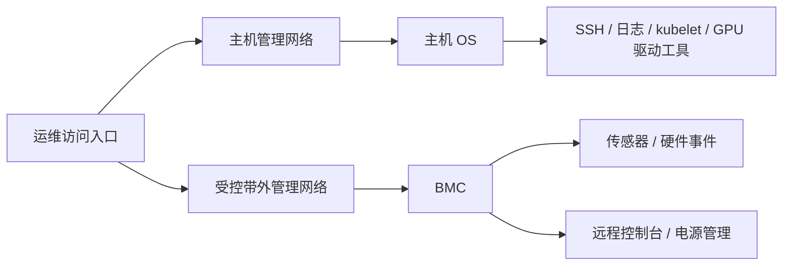

# 管理入口与运行条件

## SSH 之外，还要能看到操作系统启动之前

如果服务器无法启动到操作系统，SSH、节点上的监控进程和 kubelet 都无法提供完整视角。GPU 服务器因此需要主机系统之外的管理入口。

带内管理依赖主机操作系统及其网络栈，例如 SSH、主机监控和 kubelet 状态。带外管理通过 BMC 等独立管理控制器，观察主机硬件、远程控制台和电源状态。BMC 本身也有固件、网络配置、权限和事件记录。



图中连线表示管理访问关系，省略 BMC 到硬件的内部管理总线。沿两条入口分别追踪，才能在主机失联时继续判断是系统、网络还是供电环节出了问题。

以 DGX H100/H200 为例，BMC 提供传感器、硬件信息、事件记录、远程控制台和电源操作等能力，可对照 [BMC 用户指南](https://docs.nvidia.com/dgx/dgxh100-user-guide/bmc.html)。其他整机的字段、界面和支持范围以对应厂商资料为准。

## 两条入口分别能证明什么

| 观察结果 | 可以支持的判断 | 还不能直接推出什么 |
| --- | --- | --- |
| SSH 无法连接，BMC 控制台显示引导错误 | 主机至少没有正常进入预期系统阶段 | GPU 一定损坏、应立即更换设备 |
| BMC 能访问，主机电源关闭 | 管理控制器及其网络在当前时刻可用 | 主机一定可以正常开机或满载 |
| SSH 正常，某张 GPU 未被驱动识别 | 主机可用，问题需沿设备与驱动链路定位 | 整个机箱的硬件状态都正常 |
| BMC 与 SSH 都无法连接 | 两种远程路径都没有成功 | 机房断电是唯一解释 |


图 01-04-01：这里给定主机未正常进入操作系统，而供电、BMC 自身和带外管理路径正常，因此 SSH 不可用时仍可经 BMC 查看引导画面。独立管理入口不消除共同的供电等故障依赖；BMC 可访问也不证明主机能够正常启动或完成 GPU 计算。

操作系统关闭时，BMC 在有待机供电且自身正常的条件下通常仍可工作；若上游供电、管理网络或 BMC 本身失效，带外入口也会消失。独立入口改善了观测能力，但仍要画出共同故障依赖。

实际记录应同时关联主机名、整机序列号、BMC 地址与机架位置。否则，远程控制台里看到的硬件可能与正在调查的 Kubernetes 节点不是同一台机器。

带外管理具有很高的控制权限。网络分区、受控访问和独立身份管理是设计的一部分。NVIDIA 对该代 DGX 的具体建议是将 BMC 放入受防火墙保护的专用管理网络，见 [DGX 安全说明](https://docs.nvidia.com/dgx/dgxh100-user-guide/security.html)。物理独立的端口仍需配合访问控制。

## 从一个电源模块追到整条供电路径

理解供电时，至少区分四个数：GPU 功率限制、整机功耗、PSU 额定输出、上游回路可承受的负载。GPU 只是整机的一部分；CPU、内存、网卡、风扇和电源转换都有各自开销。

PSU 是机箱中的电源模块。多个模块的额定值相加，既不等于实测整机输入，也不等于在冗余条件下允许使用的持续负载。冗余设计要求在部分模块或一路电源失效后仍满足指定运行条件，具体可能是继续运行、限制性能或关机。

PDU 是机架配电单元，把上游电力分配给设备。对 A/B 双路供电，需要把两条路径画到上游：

```text
路径 A：上游回路 A → PDU A → 指定 PSU 组 → 机箱电源分配
路径 B：上游回路 B → PDU B → 指定 PSU 组 → 机箱电源分配
```

两根电源线插在同一个 PDU 上，并不提供 PDU 故障下的独立性；两个 PDU 若共享同一个会同时中断的上游，也仍有共同故障点。服务器允许怎样分配 PSU、失去一路后还能带多少负载，要按该型号设计核对。

例如，[DGX H100/H200 的 Power Specifications](https://docs.nvidia.com/dgx/dgxh100-user-guide/introduction-to-dgxh100.html#power-specifications) 分别列出了系统功率条件和 PSU 故障时的行为，阅读时应保持这两个层次。

## 机架功率要按失去一路后的条件检查

沿用教学场景，设一个机架放入 4 台 GPU 服务器，每台整机交流输入功率预算为 4 kW，已包含 PSU 损耗；交换机等附加设备的输入功率预算合计为 1 kW。则输入侧总负载预算是：

```text
4 × 4 kW + 1 kW = 17 kW
```

若 A/B 两路各自允许的持续负载只有 12 kW，在正常分担时每路约 8.5 kW，看上去都有余量。但如果设计目标要求一路故障后另一条路承担全部 17 kW，12 kW 的单路能力就不足。


图 01-04-02：本篇给定四台节点及附加设备合计 17 kW 整机交流输入预算，正常时两路各承担 8.5 kW；若目标要求故障后剩余一路承担全部负载，单路 12 kW 上限会被超出 5 kW。图按题设的全负载承担目标比较，不推定任意设备接法都支持这种切换。

这里采用“剩余路径承担全负载”的冗余目标，输入功率和回路容量使用同一口径。实际方案还要核对 PSU 分配、输入电压、回路、相位和设备运行规则，并协调功率密度与冷却能力，见 [NVIDIA 数据中心部署规划](https://docs.nvidia.com/dgx-superpod/design-guides/dgx-superpod-data-center-design-h100/latest/planning.html)。

## 热量必须有持续离开设备的路径

高负载下消耗的电能大部分最终成为热量。把服务器放进温度看似合适的房间，并不能保证散热：冷空气需要到达进风口，穿过设计中的散热路径，再把热空气带离机架。

风冷系统需关注进出风方向、进风温度、机架风道、线缆遮挡和热风回流。缺少挡板、改变机箱盖板状态或错误布线，可能破坏原本设计的气流。对应操作要求可查 [DGX 的 Cooling and Airflow 说明](https://docs.nvidia.com/dgx/dgxh100-user-guide/safety.html#cooling-and-airflow)。

液冷系统还需核对供回液条件、流量、压差、冷却分配单元（CDU）、接口和泄漏监测。液体和空气各自承担哪些部件的散热，由整机设计决定，需要一并核对。

温度升高可能导致部件主动降低运行频率或功率，以维持允许的运行条件。因此，“节点在线、作业还在跑”与“节点保持原先性能”之间仍有距离。需要把环境、部件温度和频率功率限制联系起来；详细指标在可观测性章节讨论。

## 机架位置也是配置的一部分

U 数只能描述安装高度，还要核对深度、导轨、承重、维护空间、冷却条件、配电和线缆路径。GPU 机箱、交换机、PDU 与维护通道共同决定机架能否容纳预定节点。

扩容时也应计算设施余量：新增服务器不仅增加卡数，还占用网络端口、上游带宽、供电与散热能力。这些物理条件会继续影响下一篇讨论的集群组织。

[上一篇](03_PCIe卡_SXM_HGX与整机平台.md) · [下一篇：从一台服务器走向集群](05_从一台服务器走向集群.md)
