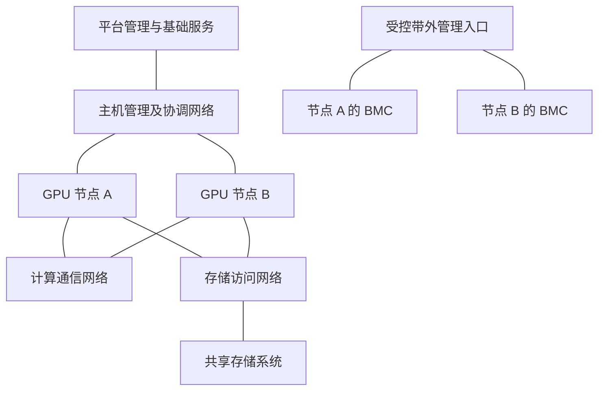

# 从一台服务器走向集群

## 多台机器首先需要分清谁在和谁通信

把两台相同的 GPU 服务器接到交换机上，增加了设备数量，却还没有完成集群设计。管理组件需要访问节点，作业成员需要找到同伴，GPU 上的计算阶段可能需要交换数据，存储系统还要持续供应输入。

本章先按通信目的划分职责。这里的“管理、协调、计算通信、存储”是学习时采用的逻辑分类，实际参考架构可能将它们合并到不同的物理网络中。

| 逻辑职责 | 常见参与者与内容 | 出现问题时可能看到什么 |
| --- | --- | --- |
| 带外管理 | BMC、交换机管理口、PDU 管理口 | 失去远程控制台、硬件事件或电源状态入口 |
| 主机与平台管理 | 主机管理地址、kubelet、API 访问、DNS、镜像分发、监控 | 新作业无法启动、节点失联、镜像拉取失败 |
| 作业协调 | 进程发现、成员集合、启动信息与状态协调 | 进程等待同伴或初始化超时 |
| GPU 计算通信 | 不同进程/设备之间的计算数据交换 | 作业推进变慢、通信阶段失败或等待 |
| 存储访问 | 数据读取、缓存填充、Checkpoint 写入与恢复 | GPU 等待输入、保存变慢、恢复耗时增加 |

这张表把现象对应到需要调查的网络职责。下一步要确认流量实际使用的地址、设备与链路。

## 协调消息和大量数据可以走不同路径

两个作业进程在开始协作之前，需要知道同伴地址、成员身份和启动参数。之后，实际计算阶段还可能持续交换大量数据。少量协调消息与大量数据交换可以由不同网络承载。

两个 Pod 能通过默认网络互相访问，说明默认网络具备相应连通性。要继续确认高速数据路径，还需分别检查网卡设备分配、RDMA 通信和通信库实际选择的传输。后续章节会按这条依赖关系逐步展开。

下面是自拟的逻辑连接图，线条不代表确定的网卡数量：



带外入口也可能管理网络设备和配电设备；图中仅画出了节点 BMC。计算与存储流量在某些设计中可以共享设备，也可以分别使用专用端口和交换网络。

## 逻辑职责与物理网络怎样对应

物理分网意味着使用不同网卡/端口、线缆和交换基础设施形成路径；逻辑隔离通常通过 VLAN、VRF、访问控制与流量策略等手段组织共享设施。二者应分别记录。

两个 VLAN 能划分相应的二层广播域，但如果仍共用同一物理上行，就仍需共同承担其容量限制和故障影响；是否能互访则取决于路由和策略。即便使用不同端口，也可能共享同一张适配器、PCIe 上行或交换机。


图 01-05-01：这里给定管理与存储 VLAN 使用同一物理端口和链路，逻辑划分没有消除该端口及链路的共享容量与故障依赖。虚线仅表示流量使用接口的映射，不表示 VLAN 间互通；访问关系仍取决于路由和策略。

已有参考架构也没有统一的物理网络数量。H100 代 DGX SuperPOD 文档采用计算、存储、带内管理、带外管理四类网络；HGX H100/H200/B200 的另一份参考架构则列出计算、融合、带外管理三类物理网络。两者可分别查阅 [SuperPOD Network Fabrics](https://docs.nvidia.com/dgx-superpod/reference-architecture-scalable-infrastructure-h100/latest/network-fabrics.html) 与 [HGX Networking Physical Topologies](https://docs.nvidia.com/enterprise-reference-architectures/hgx-ai-factory-h100-h200-b200/latest/networking-physical-topologies.html)。

阅读具体方案时，应问“这些职责由哪些端口与设施承载”，再讨论隔离、性能和故障恢复。不能只数有几张网络图。

## 把节点内拓扑延伸到机架之外

回到 `gpu-node-a`：GPU0/GPU1 位于 CPU0 一侧，GPU2/GPU3 位于 CPU1 一侧。如果作业希望每组 GPU 使用附近的高速网卡，设备映射就需要从 GPU 一直追到交换机：

```text
GPU0/GPU1 → PCIe 分支 A → NIC0 的端口 → 线缆 → 交换机与端口
GPU2/GPU3 → PCIe 分支 B → NIC1 的端口 → 线缆 → 交换机与端口
```

这张记录把服务器内外的设备关联起来。验证 GPU 到 NIC 的实际传输时，就可以据此查找对应驱动、分配记录和通信观测。

一份最小接线记录至少包含：节点序列号、适配器标识、物理端口、线缆标记、交换机名称与端口、预期网络职责、预期/实际链路状态。OS 接口名适合主机观测，但单独使用 `eth1` 等名称不足以支持跨团队定位。

## 集群规模改变了共享与故障范围

单节点可能受到一条 PCIe 上行限制，多节点则可能受到机架上行或共享存储限制。单台 200 Gbit/s 端口工作正常，不说明多台机器同时发送时仍能获得同等吞吐。

故障也会沿共享关系传播。一根接入线缆通常影响相应端口；共享交换机、机架供电或存储服务故障可能同时影响多个节点。参与同一同步作业的节点还会在软件层面相互等待，物理故障范围和作业影响范围未必相同。

在这个阶段应建立的习惯是：设备数量之外，再写清共享资源和共同故障点。下一篇提供一份不完整的交接材料，用它检查这些联系能否真正支撑判断。

[上一篇](04_管理入口与运行条件.md) · [下一篇：读懂一份节点交接材料](06_读懂一份节点交接材料.md)
