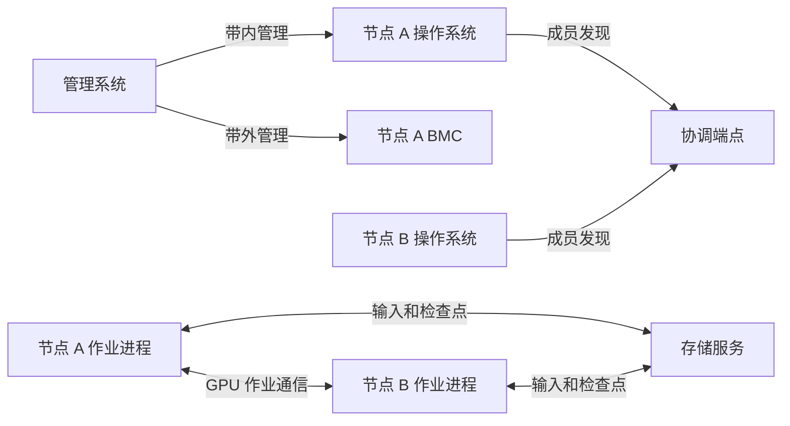
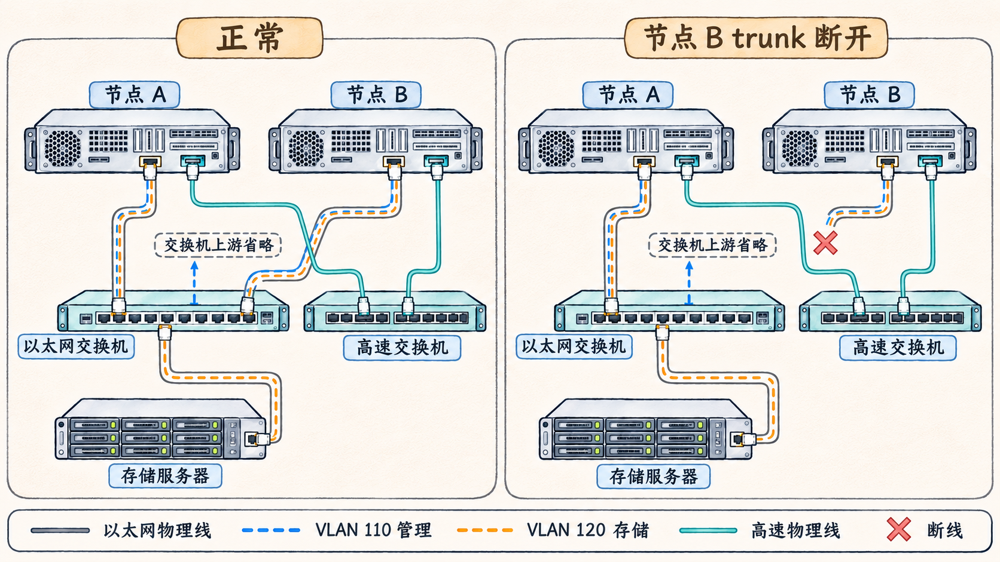

# 把一台服务器的端口接到集群

一台 GPU 服务器接入集群后，会同时与管理系统、其他作业节点和存储服务通信。它们对网络的要求和发生故障时的表现各不相同。阅读网络图时，可以先确定谁在与谁通信、要完成什么工作，再沿接口、链路和交换机追踪实际路径。

## 一次作业涉及哪些流量

假设节点 A 和节点 B 共同运行一个多机作业。用户通过管理系统启动作业，两台节点的进程先找到彼此，随后读取训练数据并交换计算结果，运行过程中还要写入检查点。此时至少需要关注以下几类流量。

| 职责 | 通信双方与用途 | 要确认的路径 |
| --- | --- | --- |
| 主机带内管理 | 管理系统与节点操作系统通信，完成登录、部署和监控 | 主机 IP、路由、网卡、交换机和管理服务 |
| 带外管理 | 管理系统与服务器的 BMC 通信，查看电源状态、事件和远程控制台 | BMC 管理口、供电、管理地址和管理网络 |
| 作业协调 | 各节点的作业启动进程联系协调端点，完成成员发现和组建 | 协调端点的名称、端口、解析结果与各节点到端点的 IP 路由 |
| GPU 作业通信 | 节点上的作业进程交换计算所需数据，由选定的通信库和传输方式组织 | 通信库选择的网络设备、端口、实际传输方式及交换网络 |
| 存储访问 | 节点从存储服务读取数据，或向其写入检查点 | 客户端挂载或访问配置、网口和到存储服务的完整路径 |

BMC 是服务器的管理控制器，可在主机操作系统之外提供部分管理功能。它需要自身的供电和管理网络。网络图中的「管理」有时同时涵盖带内和带外，查故障时需要继续区分目的地址和实际接口。

这些名称描述用途。作业协调可能与主机管理共用以太网，存储也可能与它们共享物理网络。GPU 作业通信可以走独立的高速网络，也可能使用其他可用路径。实际行为取决于应用、通信库、接口配置和网络可达性。

下面是教学路径示意。箭头表示本次作业的通信关系，物理端口是否共用要通过后面的接口表确认。



## 从协调端点追踪 IP 路径

下面是 PyTorch 2.8 `torchrun` 的多节点启动参数片段。假设两个节点都能解析 `coord.example.internal`，作业管理器在两台节点上分别启动相同参数。`train.py` 代表已有的分布式训练程序，片段用于阅读参数与网络关系。

```bash
torchrun \
  --nnodes=2 \
  --nproc-per-node=8 \
  --rdzv-id=example-job-01 \
  --rdzv-backend=c10d \
  --rdzv-endpoint=coord.example.internal:29400 \
  train.py
```

`--nnodes=2` 给出节点数，`--nproc-per-node=8` 给出每台节点启动的进程数。`--rdzv-id` 标识这组作业，`--rdzv-backend` 指定协调后端，`--rdzv-endpoint` 提供后端的主机与端口。对于 PyTorch 文档中的 C10d 例子，端点的主机承载该后端。两个节点要使用相同的作业标识和端点，并能到达对应服务。 [PyTorch 2.8 · torchrun](https://docs.pytorch.org/docs/2.8/elastic/run.html)

假设名称在两个节点都解析为教学地址 `192.0.2.10`，端点运行在节点 A。若节点 B 上的路由查询显示到该地址经 `mgmt0` 发出，那么节点 B 的协调连接走 `mgmt0` 及其后续网络。仍需检查服务是否监听端口、沿途访问控制和返回路径，才能解释连接失败。名称解析或一次 TCP 连接成功，只能证明相应环节当时可用。

此参数片段没有指定 GPU 数据通信所用的 NIC 或传输方式。协调端点可达之后，通信库还要初始化自己的连接，并依据其配置、设备和环境选择传输路径。不能从 `--rdzv-endpoint` 推断计算数据一定经过同一张网卡。

## VLAN 与物理路径

VLAN 是以太网中的二层逻辑分段。交换机可以根据端口配置和帧携带的 VLAN 标识，把不同网络的帧分开转发。承载多个 VLAN 的 trunk 链路允许它们共用同一物理连接。跨 VLAN 通信还需要相应的路由和访问策略。

考虑下面的教学配置。节点 A 和 B 各有一条以太网 trunk 接到交换机 E。该 trunk 承载 VLAN 110 的带内管理流量和 VLAN 120 的存储流量。存储服务器经另一端口接入交换机 E 的 VLAN 120。两台节点另有高速接口，经交换机 F 相连，用于本例的 GPU 作业通信。编号和用途是本例的假设。

| 路径 | 逻辑用途 | 示例中的物理依赖 |
| --- | --- | --- |
| 节点 A、B 的 VLAN 110 | 管理和协调 IP 连接 | 各自到 E 的 trunk、E 及端点所在网络 |
| 节点 A、B 的 VLAN 120 | 到存储服务器的访问 | 各自到 E 的 trunk、E、存储服务器链路 |
| 节点 A、B 的高速端口 | GPU 作业的节点间通信 | 各自到 F 的线缆、F 与对应设备 |

如果节点 B 到 E 的 trunk 断开，节点 B 上这条链路承载的 VLAN 110 和 VLAN 120 都会受影响。节点 B 到 F 的独立线缆仍可能正常，作业能否继续还取决于协调连接、存储访问及应用的运行阶段。若 E 拥塞，两类 VLAN 流量也可能竞争同一物理出口带宽，除非设备配置提供适当的资源分配。逻辑分段可以区分二层广播域，却无法单凭 VLAN 数量证明链路容量或设备故障域互相独立。

如果只断开节点 B 到 F 的高速线，E 上的管理和存储链路在这个简化拓扑里仍存在。实际系统可能存在其他共享组件，例如同一服务器、上游交换机、电源或机架。只有逐条核对端口和上游连接，才能确定一个故障的影响范围。



图 01-05-01：教学示意中，节点 B 到以太网交换机的 trunk 断开，影响该链路承载的管理和存储流量。节点到高速交换机的独立线缆仍然连接，完整故障域需要结合上游路径判断。

## 用真实部署图核对端口

NVIDIA 的 DGX H100/H200 BasePOD 部署指南给出了一种具体组合。每台 DGX 的八个端口经四个 OSFP 连接用于 InfiniBand 计算网络，两张双端口 ConnectX-7 卡各选一个端口组成以太网 bond，承载带内管理和以太网存储网络。BMC 接入带外管理网络。bond 把成员接口组织为一个逻辑接口，其故障切换和流量分布取决于所用模式与交换机配置。 [NVIDIA DGX BasePOD · Networking](https://docs.nvidia.com/dgx-basepod/deployment-guide-dgx-basepod/latest/network-overview.html)

该指南把集群内部带内管理和存储称为 `managementnet`，把 BMC 网络称为 `oobmanagementnet`，把计算用 InfiniBand 网络称为 `computenet`。名称表达的是这份部署方案的分工。读取另一套方案时，要重新查作业协调端点、客户端路由和端口映射。

同一份部署指南的 SN2201 带外交换机示例包含 `vlan 101`、BMC 端口的 `access 101` 和上联成员组成的 `bond1`。其中 VLAN 101 定义逻辑成员关系，接入端口和上联接口配置表明帧通过哪些交换机端口转发。要确认一台机器的真实路径，还需要节点 BMC 口到交换机端口的线缆表以及上联目的地。 [NVIDIA DGX BasePOD · Network Deployment](https://docs.nvidia.com/dgx-basepod/deployment-guide-dgx-basepod/latest/network-deploy.html)

## 三种变化需要不同证据

以下均为条件推演。结果会随具体应用、重试策略和部署变化。

| 条件变化 | 可能观察到的现象 | 下一步证据 |
| --- | --- | --- |
| 节点 B 到协调端点的地址或端口不可达 | 节点 B 无法完成成员发现，作业启动或重组停滞 | 两节点的名称解析、到端点的路由、端口监听、访问控制及启动进程日志 |
| 高速网口或相应链路断开 | 已发现成员的作业在通信初始化或数据交换阶段失败、等待或改走其他可用路径 | 通信库日志中的选定设备与传输方式、网卡和交换机端口状态、端口映射与错误计数 |
| 存储繁忙 | 数据读取或检查点写入变慢，作业可能等待数据或 I/O | 客户端 I/O 等待与吞吐、存储服务端负载、网络接口流量和同一时间段的作业进度 |

例如，协调端点连接成功后，高速端口未连通，这两条观察并不冲突。前者对应到协调地址的 IP 路径，后者对应本例的另一组设备与链路。若通信库支持回退，作业也可能继续运行，需要读取其实际选择结果。NCCL 的接口选择有独立配置，`NCCL_SOCKET_IFNAME` 过滤用于 IP 通信的接口，`NCCL_IB_HCA` 过滤用于 Verbs 通信的 HCA。变量语义及支持字段应按部署的 NCCL 版本核对。 [NCCL 环境变量](https://docs.nvidia.com/deeplearning/nccl/user-guide/docs/env.html)

## 练习：读一组节点材料

以下为编造的教学材料，地址、设备和状态只用于推演。两台双路节点各使用 HGX H100 8-GPU 底板，配置表列出 `8 × 80 GB`。节点 B 中 GPU 0 挂在 Socket 0 的 PCIe 层级下，操作系统将 Socket 0 和 Socket 1 分别暴露为 NUMA 节点 0 和 1。某次传输中，GPU 0 的 DMA 直接读取驻留在节点 1 的页锁定主机缓冲区。

网络方面，节点 B 的 `mgmt0` 承载作业协调路径，`hca0` 连接独立高速交换网络。观察结果是节点 B 的 SSH 连接失败、BMC 页面可访问，作业成员发现成功，但 `hca0` 所连接的交换机端口显示链路断开。

| 材料 | 可以得出的判断 | 还需要的证据 |
| --- | --- | --- |
| `8 × 80 GB` 和 HGX H100 底板 | GPU 显存规格合计为 640 GB，单卡规格为 80 GB。一次要求单卡提供超过 80 GB 可用显存的分配不能由合计容量保证 | GPU 实际可用显存、其他占用与应用是否支持分片。整机 CPU、盘位、端口和电源要查整机配置 |
| GPU 0 位于节点 0 一侧，输入缓冲区在节点 1 | 在所给的直接 DMA 和双路拓扑假设下，该次读取跨处理器互联 | 设备与根端口拓扑、目标缓冲区页位置、实际传输实现及性能测量 |
| SSH 失败，BMC 可访问 | 带外访问路径可用，SSH 路径存在问题 | 主机电源与启动状态、BMC 控制台、主机地址和路由、SSH 服务与访问控制 |
| 成员发现成功，`hca0` 对端端口断链 | 协调连接已在该时刻完成，指定高速链路目前不可用 | 通信库实际使用的 HCA、端口与传输方式、两端端口状态及线缆映射、通信日志 |

这组材料把显存的统计口径、设备与内存的位置、管理路径和作业网络放在同一张节点图上。每个结论都依赖给出的条件，进一步定位需要把设备、时间和实际数据路径对应起来。
