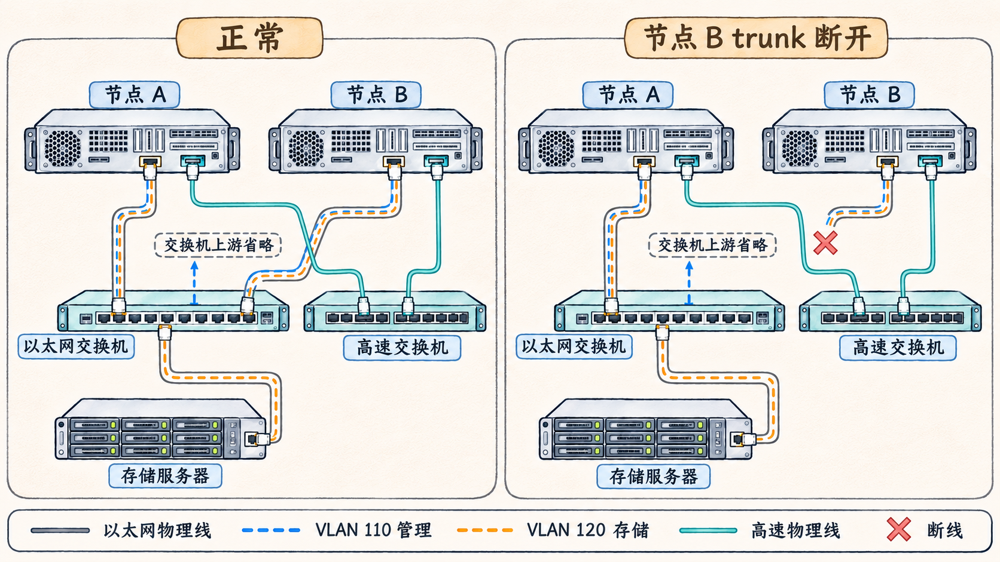

两台 GPU 服务器共同运行一个作业时，启动进程需要找到其他成员，作业进程要交换计算数据，还要从存储读取输入、写回检查点。管理员同时需要访问 Linux 和 BMC。把这些通信分别映射到实际端口，才能判断哪一条失联会卡住哪些工作。

## 一次作业里的通信双方

把第 02 篇的教学节点复制为节点 A 和 B。每台节点的 NIC 0 提供以太网物理接口 `eth0`，高速网卡 `hca0` 提供本例专用于 GPU 作业通信的端口，BMC 有独立管理口。先按用途找通信双方，再按地址、接口和线缆找路径。

| 用途 | 谁与谁通信 | 本例使用的端口 |
| --- | --- | --- |
| 带内管理 | 管理机到节点 Linux，登录或采集状态 | NIC 0 的 `eth0` |
| 带外管理 | 管理机到 BMC，查电源状态和事件 | BMC 管理口 |
| 作业协调 | 启动进程到协调端点，确认哪些节点加入本次作业 | NIC 0 的 `eth0` |
| GPU 作业通信 | 两节点作业进程，经通信库交换计算需要的数据 | 高速网卡 `hca0` |
| 存储访问 | 作业进程通过存储客户端读取输入和写入检查点 | NIC 0 的 `eth0` |

带外管理使用第 04 篇的独立管理路径。带内管理、作业协调和存储在本例中有三个不同的目的，却经同一张网卡。真实部署要按各服务的地址、路由和选用的传输方式核对这些对应关系。

## 两个 VLAN 共用哪段线缆

**VLAN（Virtual Local Area Network，虚拟局域网）** 将以太网分成多个二层转发范围。交换机在连接普通端点的接入口上，可按端口配置把入站帧归入一个 VLAN。在允许多个 VLAN 通过的 **trunk** 链路上，可用帧标签区分它们。划分 VLAN 改变二层转发范围，两个 VLAN 仍可共用同一条物理线缆。 [NVIDIA Cumulus Linux 5.18 · VLAN-aware Bridge Mode](https://docs.nvidia.com/networking-ethernet-software/cumulus-linux-518/Layer-2/Ethernet-Bridging-VLANs/VLAN-aware-Bridge-Mode/)

以下是 A、B 节点的教学接线。两个节点分别用一条 trunk 接 E。带内管理和作业协调使用 VLAN 110，存储使用 VLAN 120。存储服务接在 E 的 24 号端口（E24），该端口接入 VLAN 120。

| 流量 | 节点侧接口或设备 | 本例的物理路径 |
| --- | --- | --- |
| 带内管理与作业协调 | `eth0.110` | 节点 `eth0` → 节点 trunk → E → 对端 |
| 存储访问 | `eth0.120` | 节点 `eth0` → 同一条节点 trunk → E → E24 → 存储服务 |
| GPU 作业通信 | `hca0` | 高速端口 → F → 另一节点的高速端口 |
| 带外管理 | BMC 管理口，记为 `bmc0` | `bmc0` → 独立带外交换机 M → 管理机 |

## 从协调地址追到物理网口

**Rendezvous（作业成员会合）** 让各节点启动进程加入同一作业并确定本轮参与者。以 PyTorch 2.8 的 `torchrun` 和 C10d 后端为例，两台节点用同一作业标识和同一协调端点启动，端点由节点 A 承载。下面的片段用于解释参数，`train.py` 代表另行提供的训练程序，域名是教学占位符。 [PyTorch 2.8 · torchrun](https://docs.pytorch.org/docs/2.8/elastic/run.html)

```bash
torchrun \
  --nnodes=2 \
  --nproc-per-node=8 \
  --rdzv-id=example-job-01 \
  --rdzv-backend=c10d \
  --rdzv-endpoint=coord.example.internal:29400 \
  train.py
```

`--nnodes=2` 要求两台节点，`--nproc-per-node=8` 表示每台启动八个工作进程。`--rdzv-id` 标识本次组队，`--rdzv-backend` 指定协调实现，`--rdzv-endpoint` 给出协调服务所在的主机和端口。假设该名称解析到 A 的教学地址 `192.0.2.10`。若在 B 上查这个地址的路由，出接口是 `eth0.110`，就可继续追到其下层的 `eth0`、到以太网交换机 E 的线缆，以及 E 到 A 的路径。判断能否组队，还需确认服务监听、来回路径、访问控制和启动进程日志。

成员会合成功为进程提供了组队结果。接下来，通信库用其配置和设备能力建立交换计算数据的路径。本例预期这条路径经 `hca0` 和高速交换机 F。验证时要查看通信库实际选用的设备和两端传输记录。例如在 NCCL（NVIDIA Collective Communications Library，NVIDIA 集合通信库）2.27.3 中，`NCCL_SOCKET_IFNAME` 筛选库用于 IP 通信的接口。若使用 RDMA（Remote Direct Memory Access，远程直接内存访问），NCCL 可通过 Verbs 接口使用高速网卡，`NCCL_IB_HCA` 筛选这种传输所用的 HCA（Host Channel Adapter，主机通道适配器）。 [NCCL 2.27.3 · Environment Variables](https://docs.nvidia.com/deeplearning/nccl/archives/nccl_2273/user-guide/docs/env.html)

## 沿断点判断哪些流量受影响

只断开 B 到 E 的 trunk，B 的两个 VLAN 都会失去这段连接，B 会失去这条路上的带内访问、协调和存储连接。B 到 F 的高速线和到 M 的 BMC 线接在其他端口。作业能否继续还取决于所处阶段、存储依赖和重试策略。如果仅 E24 断开，两台节点都失去本例的存储接入路径，节点各自的 trunk 此时仍可能报告链路建立。同样，共用线缆的流量可能竞争同一物理出口，具体取决于方向、并发负载和队列配置。



**图 01-05-01**　右图的断点在 B 到 E 的 trunk，B 的两个 VLAN 都受影响。存储服务接在 E 的另一端口。图中省略带外交换机 M 和各交换机的上游连接。

只有高速链路断开时，已完成成员发现的作业仍可能在通信初始化或数据交换时等待、报错，或按其配置改用可用路径。查看通信库日志中的接口、传输类型和两端计数可以区分这些情况。如果链路均为 `Up`，而存储访问依然耗时，则要比较同一时段的客户端 I/O 等待、存储服务端负载及链路计数，再判断作业是否在等数据。

## 对照 BasePOD 的真实端口分工

DGX H100/H200 BasePOD 部署指南给出了另一种组合。每台 DGX 用四组 OSFP 连接提供的八个端口接入 InfiniBand 计算网络。在以太网存储方案中，从两张双端口 ConnectX-7 卡各取一个端口组成 **bond（链路绑定）**，由一个逻辑接口承载带内管理与以太网存储。链路故障时能否切换取决于绑定模式和交换机配置。BMC 口接入带外交换机。指南把三种用途分别称为 `computenet`、`managementnet` 和 `oobmanagementnet`。该实例的带外交换机也有上联，判断故障域时仍需看接线和上游依赖。 [NVIDIA DGX BasePOD · Networking](https://docs.nvidia.com/dgx-basepod/deployment-guide-dgx-basepod/latest/network-overview.html)

同一指南的 SN2201 带外交换机示例用 `access 101` 把 BMC 接入口归入 VLAN 101，并用端口 `swp49`、`swp50` 组成上联 `bond1`。读配置可确定逻辑成员和上联由哪些端口组成。要把一台机器的 BMC 路径画完整，还需查它接到哪个交换机端口，以及 bond 的对端。 [NVIDIA DGX BasePOD · Network Deployment](https://docs.nvidia.com/dgx-basepod/deployment-guide-dgx-basepod/latest/network-deploy.html) · [Switch Configurations](https://docs.nvidia.com/dgx-basepod/deployment-guide-dgx-basepod/latest/switch-configurations.html)
