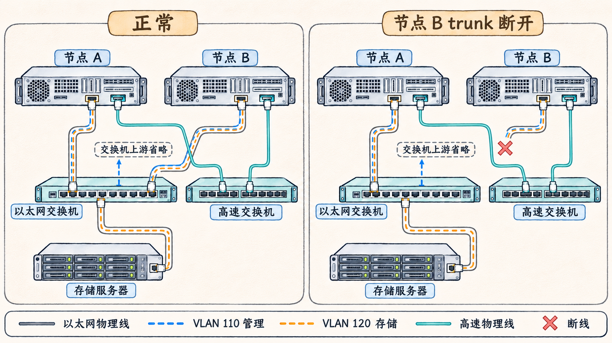

把双路教学机复制为节点 A 和 B，两台用前文准备的图像数据运行同一个训练作业。启动器要先与协调服务确认成员，作业进程要交换计算数据，也要从存储读输入、写检查点。管理机访问 Linux 和 BMC 时还有各自的通信对象。每项活动都可从发起者、目的地和实际传输方式追到一条路径。

## 从通信双方找到出入口

本例中，NIC 0 提供以太网接口 `eth0`，接交换机 E。高速网卡设备 `hca0` 提供计算网络端口，接交换机 F。BMC 管理口记作 `bmc0`，接专用带外交换机 M。各用途的接线由下表给定。

| 用途 | 通信双方 | 物理出入口 |
| --- | --- | --- |
| 带内管理 | 管理机 ↔ Linux 的 SSH 或采集服务 | `eth0` ↔ E |
| 作业协调 | 节点上的启动器 ↔ A 上的协调服务 | `eth0` ↔ E |
| 存储访问 | 作业的存储客户端 ↔ 存储服务 | `eth0` ↔ E |
| GPU 作业通信 | A 和 B 的作业进程，通过通信库交换计算数据 | `hca0` ↔ F |
| 带外管理 | 管理机 ↔ BMC 的管理服务 | `bmc0` ↔ M |

以太网上，**VLAN（Virtual Local Area Network，虚拟局域网）** 把二层转发划为多个范围。接入口可把未打标签的入站帧归入指定 VLAN，承载多个 VLAN 的 **trunk** 则用帧标签区分它们。节点 A 和 B 各用一根线、一个 trunk 接 E，允许 VLAN 110 和 120 通过。Linux 的 `eth0.110` 供带内管理和协调，`eth0.120` 供存储访问。两个逻辑接口都依赖底层 `eth0` 和同一根线。存储服务只接 E 的 24 号端口（E24），该口将存储端的未标记帧归入 VLAN 120。 [NVIDIA Cumulus Linux 5.18 · VLAN-aware Bridge Mode](https://docs.nvidia.com/networking-ethernet-software/cumulus-linux-518/Layer-2/Ethernet-Bridging-VLANs/VLAN-aware-Bridge-Mode/)

## 追踪一次成员会合与后续数据交换

**Rendezvous（作业成员会合）** 让启动器找到彼此，并确定本轮有哪些成员参加。以 PyTorch 2.8 的 `torchrun` 为例，两节点都用同一个作业标识、协调后端和服务地址。本例的 C10d 协调服务在 A 上。以下片段用于读启动参数，`train.py` 是另行提供的作业入口，域名是教学占位符。 [PyTorch 2.8 · torchrun](https://docs.pytorch.org/docs/2.8/elastic/run.html)

```bash
torchrun \
  --nnodes=2 \
  --nproc-per-node=2 \
  --rdzv-id=example-job-01 \
  --rdzv-backend=c10d \
  --rdzv-endpoint=coord.example.internal:29400 \
  train.py
```

`--nnodes=2` 要求两台节点，`--nproc-per-node=2` 表示每台启动两个工作进程。后三项分别确定会合的作业标识、实现和服务端。假设协调域名解析到 A 的 VLAN 110 地址 `192.0.2.10`。在 B 上用 `ip route get 192.0.2.10` 查询内核会选择哪条路径，以下为教学节录。 [iproute2 · ip-route 手册](https://github.com/iproute2/iproute2/blob/main/man/man8/ip-route.8.in)

```text
192.0.2.10 dev eth0.110 src 192.0.2.11
```

`dev eth0.110` 给出出接口，`src` 给出选中的本地源地址。沿接口向下，B 的协调请求经 `eth0`、trunk、E 和 A 的 trunk 到达 A 的 `eth0.110`，再由监听 29400 端口的会合服务处理。能否完成会合还要看监听、来回连通及启动器记录。

会合完成后，作业进程才能按本轮成员初始化后续通信。在本例的健康路径上，通信库选用 `hca0`，计算数据经 F 到达另一节点。若库使用 **RDMA（Remote Direct Memory Access，远程直接内存访问）** 传输，兼容的高速网卡可按已建立的访问条件搬运远端数据。以 **NCCL（NVIDIA Collective Communications Library，NVIDIA 集合通信库）** 2.27.3 为例，`NCCL_SOCKET_IFNAME` 筛选 NCCL 使用的 IP 接口，`NCCL_IB_HCA` 筛选 RDMA 通信所用的 HCA（Host Channel Adapter，主机通道适配器）。这些配置属于通信库。启动器的协调端点仍按前述主机 IP 路由到达。实际的数据路径应结合两端的库日志和传输记录判断。 [NCCL 2.27.3 · Environment Variables](https://docs.nvidia.com/deeplearning/nccl/archives/nccl_2273/user-guide/docs/env.html)

## 从断点推导影响范围

网络**故障域**可从一个断点影响的路径集合来理解。只断开 B 到 E 的 trunk 时，B 的 VLAN 110 与 VLAN 120 同时丢失这段连接。B 的带内访问、会合和存储都依赖它。高速线和 BMC 线仍各有自己的连接。此时作业能否继续，取决于它是否已完成通信初始化、是否还需要经过 `eth0` 的连接，以及是否仍要读写存储。



**图 01-05-01**　以太网交换机和高速交换机分别对应 E 和 F。蓝色虚线的 VLAN 110 同时服务于带内管理和作业协调，橙色虚线表示 VLAN 120。存储服务器接 E24，图中省略了端口编号、带外交换机 M 和交换机上游。

把断点移到 E24，两节点到 E 的 trunk 可继续工作，但两条存储路径都失去了服务端接入。若只断开 B 到 F 的高速线，B 到 A 的会合路径仍可工作，依赖该高速线的计算数据交换会受影响。应用可能报错、等待或根据通信配置采用其他可用传输。验证哪种行为发生，要看相关阶段的完成记录及实际接口。即使所有端口都显示 `Up`，仍需完成一次与问题对应的读写或传输，才能确认服务路径恢复。

## 对照 BasePOD 的实际接线

DGX H100/H200 BasePOD 用四个 OSFP（Octal Small Form Factor Pluggable）连接器提供的八个端口接入 InfiniBand 计算网络。以太网存储方案从两张双端口 ConnectX-7 卡各取一个端口组成 **bond（链路绑定）**，由这个逻辑接口同时承载带内管理与以太网存储。是否能在故障后切换、切换后还剩多少带宽，要按绑定模式、对端和上游连接判断。BMC 另接带外交换机。部署指南中，相应网络称为 `computenet`、`managementnet` 和 `oobmanagementnet`。 [NVIDIA DGX BasePOD · Networking](https://docs.nvidia.com/dgx-basepod/deployment-guide-dgx-basepod/latest/network-overview.html)

同一指南的 SN2201 带外交换机配置用 `access 101` 将 BMC 接入口归入 VLAN 101，另将 `swp49`、`swp50` 组成上联 `bond1`。从配置能找到接入口范围和上联成员，结合现场线缆与对端还能判断多个节点的 BMC 是否共用上游断点。教学节点与 BasePOD 使用不同的端口组织，重建路径时都要读到物理连接。 [NVIDIA DGX BasePOD · Switch Configurations](https://docs.nvidia.com/dgx-basepod/deployment-guide-dgx-basepod/latest/switch-configurations.html)
