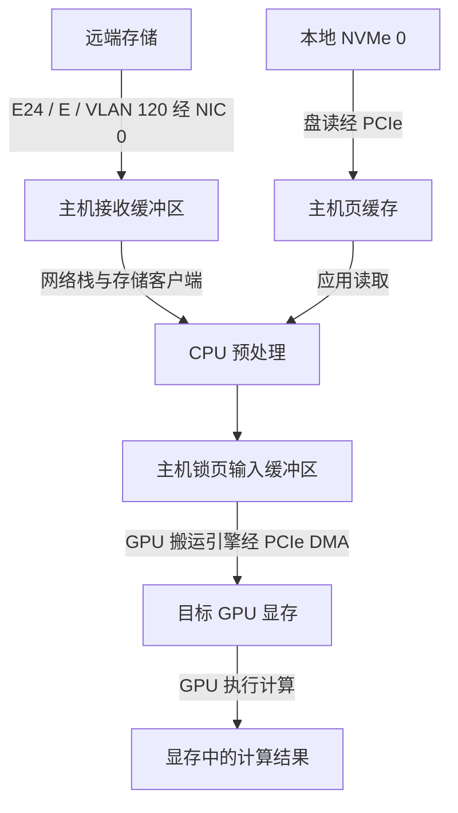

# GPU 节点交付与数据路径的综合检验

机房新上架了两台 **NVIDIA DGX H200** 节点（`node-1` 与 `node-2`，分别对应前文双机场景中的节点 A 与节点 B）。本篇把两台新节点的官方硬件规格，与本章建立的双路 PCIe 桥树、双网络平面以及一组上线观测记录整合在一起，检验你能否在不依赖实机的情况下，独立走通数据路径、核算显存/带宽/配电余量并锁定网络断点。

建议先遮住后半部分的「分步参考推理」，凭交付材料自己推演一遍再核对答案。

## 交付评审材料

### 1. 整机硬件规格（DGX H200）

| 维度 | 官方规格参数 |
| --- | --- |
| **GPU 子系统** | HGX H200 8-GPU 底板，8 块 H200 SXM，每块标称显存 **141 GB** |
| **主机算力与内存** | DGX H200，2 颗 Intel Xeon 8480C（每颗 56 核），共 **2 TB** 主机内存 |
| **本地存储** | 2 × 1.92 TB NVMe 系统盘（RAID 1）；8 × 3.84 TB NVMe 缓存盘（RAID 0） |
| **网络接口** | 8 块单口 ConnectX-7 集群网卡、2 块双口 ConnectX-7 存储/带内管理卡、专用 BMC 口 |
| **机架、供电与环境** | 每台 **8U**，最大深度 **897.1 mm**；前进后出，运行温度 **5–30°C**；6 × 3.3 kW PSU（**4+2** 冗余），200–240 V AC 下整机最大输入 **10.2 kW** |

### 2. 单节点 PCIe 桥树与 NUMA 映射

两台节点的 CPU 与 PCIe 拓扑一致：双路 Socket 各对应一个同号 NUMA 节点（Socket 0 → NUMA 0，Socket 1 → NUMA 1）。下表列出评审涉及的关键 PCIe 端点（其余 6 张 GPU 暂略）：

| 设备与标识 | PCIe 接入桥路径 | `sysfs` 上报的 `numa_node` |
| --- | --- | --- |
| `GPU 0`（`0000:1b:00.0`） | 下行 A → `Switch 0` → `Root Port 0` → `Socket 0` | `0` |
| `NIC 0`（`0000:1c:00.0`，接口 `eth0`） | 下行 B → `Switch 0` → `Root Port 0` → `Socket 0` | `-1` |
| `NVMe 0`（`0000:1d:00.0`） | 下行 C → `Switch 0` → `Root Port 0` → `Socket 0` | `0` |
| `GPU 1`（`0000:1e:00.0`） | 下行 D → `Switch 0` → `Root Port 0` → `Socket 0` | `0` |
| 高速网卡 `hca0`（`0000:a1:00.0`） | 直连 `Root Port 1` → `Socket 1` | `1` |

### 3. `node-2` 的输入路径与并发窗口条件

- **缓冲区与线程落点**：`NIC 0` 的接收缓冲区位于 `NUMA 0`；应用预处理线程采样运行在 `Socket 1` 的 `CPU 72` 上。
- **GPU 输入缓冲区**：CPU 预处理完成后写入一段独立的锁页缓冲区，`/proc/<pid>/numa_maps` 采样为 `N0=4096, N1=0`（每页 `4 KiB`），由 `GPU 0` 的搬运引擎直接读取；若切为本地输入，则从 `NVMe 0` 读盘后经主机处理写入同一缓冲区。
- **健康并发带宽窗口**：`node-2` 的 `eth0` 为 `200 GbE` 链路，`NIC 0` 接收远端数据的目标有效载荷为 **`14 GB/s`**；同一时间，`NVMe 0` 单盘预取另一批本地文件写入 `NUMA 0`，目标载荷为 **`6 GB/s`**。两者各自独立通路均能满足自身目标。
- **共享上行约束**：`Switch 0 → Root Port 0`（设备 → 主机方向）的有效载荷容量上限为 **`16 GB/s`**；`GPU 0` 从主机读输入时，按有效数据返回方向计入对应方向的预算。

### 4. 机架、配电、接线与异常时间线

- **机架与散热**：标准 **42U** 机柜，内部可用深度 **1,000 mm**；现场空载采样进风 **24°C**，尚未做规划满载下的冷却验证。
- **双路配电**：两台节点的 6 个 PSU 均按 **3+3** 接入 A、B 两路 PDU；每台按最大输入 `10.2 kW` 预留，机架内其他设备合计预留 **`1.6 kW`**；A、B 每路可用配电预算为 **`18.0 kW`**，正常时均分，失一路时要求剩余一路全额保留全部预留功率。
- **双机接线**：`node-1` 与 `node-2` 各用一条 `eth0` trunk 接入交换机 `E`（`VLAN 110` 走 SSH 与会合，协调服务 `coord.example.internal:29400` 位于 `node-1`；`VLAN 120` 走存储，存储服务端仅接 `E24`）；两台 `hca0` 接入高速交换机 `F`，BMC 接入带外交换机 `M`。

上线试运行期间，某时段记录到如下状态时间线：

| 时间 | 节点与网络观测记录 |
| --- | --- |
| `09:00` | 两台节点 BMC 均可访问且报告 `PowerState=On`；两台节点的 SSH 命令均正常返回 |
| `09:01` | 协调端点确认 `node-1` 与 `node-2` 均已加入作业 |
| `09:02` | 两台节点的 `hca0` 与高速交换机 `F` 对应端口均报告 `Up` |
| `09:02` | 两台节点存储读取双双超时；两条节点 trunk 均为 `Up`，但交换机 `E` 的 **`E24` 为 `Down`** |
| `09:03` | `node-2` 的 8 块 GPU 各有 **`124 GiB`** 空闲显存；应用准备在 `GPU 0` 上单卡申请 **`128 GiB`** 常驻工作集 |

---

## 检验题目

1. **路径与归属判定**：画出健康状态下远端文件流向 `node-2` 的 `GPU 0` 显存的完整路径，并标明换用本地文件时从哪里汇入，明确标出接收缓冲区、预处理线程、GPU 输入缓冲区与 GPU 的位置。当 `NIC 0` 的 `numa_node` 返回 `-1` 时，你凭什么确定它归属哪颗 CPU？
2. **显存与带宽算账**：核算 `node-2` 的单卡与整机标称显存，计算 `09:03` 这次单卡分配的显存差额；复算健康并发窗口中 `Switch 0` 共享上行的带宽缺口，并指出 `GPU 0` 从主机拉取输入的有效载荷计入哪个方向。
3. **选型、供电与机架验收**：假如采购单上只写了“HGX H200”，还必须向整机厂商补查哪些条件？算出正常双路均分与 A 路整路失电时的机架配电余量/缺口，说明剩余 PSU 数量意味着什么，以及上架与持续运行还缺哪些验收证据。
4. **多平面故障归因与恢复验证**：解释为什么 `09:00–09:02` 期间 BMC、SSH、会合与高速链路全部正常，却同时出现双节点存储超时？当 `E24` 随后恢复 `Up`，应如何验证存储与作业真正恢复？
5. **三个独立变更推演**：
   - **变体 A**：将 `GPU 输入缓冲区` 的物理页全部迁到 `NUMA 1`（其余缓冲区位置与并发需求不变），受影响的路径和共享上行带宽会怎么变？
   - **变体 B**：把 `NIC 0` 改接到 `Socket 1` 上的独立根端口（接收缓冲区仍留在 `NUMA 0`），路径与共享上行又怎么变？
   - **变体 C**：应用把 `128 GiB` 常驻工作集平均分给 `GPU 0` 与 `GPU 1`，同时两张卡还需分别额外分配 `56 GiB` 和 `62 GiB` 临时空间（同时驻留）。均分方案放得下吗？如果允许不等长切分，应该怎么调整？

---

## 分步参考推理

### 题 1：按“数据来源 → 落点 → 执行者”逐段定界

1. **远端输入路径**：存储服务 → `E24` → 交换机 `E` → `node-2` 的 `eth0` trunk（`VLAN 120`）→ `NIC 0` → `Switch 0` → `Root Port 0` → `Socket 0` → 写入 **`NUMA 0` 接收缓冲区**。
2. **CPU 预处理阶段**：应用通过内核网络栈和存储客户端拿到字节后，运行在 **`Socket 1`（`CPU 72`）** 上的预处理线程读写 `NUMA 0` 中的接收缓冲区与 GPU 输入缓冲区——**这一步往返都在跨越处理器互联**。
3. **GPU DMA 搬运阶段**：锁页 GPU 输入缓冲区全部落在 `NUMA 0`，总大小为：

$$\text{GPU 输入缓冲区容量} = 4096 \times 4\text{ KiB} = 16384\text{ KiB} = 16\text{ MiB}$$

`GPU 0` 发起 DMA 读取后，有效载荷从 `NUMA 0` → `Socket 0` → `Root Port 0` → `Switch 0` → `GPU 0` 显存，**此段完全走本地路径，无需跨 Socket**。
4. **切为本地输入**：数据入口从 `NIC 0` 切换为挂在同一 `Switch 0` 下行 C 的 `NVMe 0`，文件字节经 `Switch 0 → Root Port 0 → Socket 0` 进入主机页缓存，随后由同一预处理线程整理并写入锁页 GPU 输入缓冲区。
5. **`numa_node = -1` 如何定位**：`-1` 仅表示固件/BIOS 未通过 sysfs 声明亲和信息，不代表设备没有物理归属。从已知 PCIe 桥树（`NIC 0 → Switch 0 → Root Port 0 → Socket 0`）可直接确定它接在 `Socket 0` 一侧；在真实机房里，可用 `lspci -D -t`、整机拓扑框图与固件资料交叉核实。

### 题 2：显存逐卡核算，带宽按方向分账

1. **标称显存与单卡分配差额**：单卡标称 `141 GB`，整机标称显存库存为 `8 × 141 = 1,128 GB`。虽然 `09:03` 整机 8 张卡合计空闲高达 `8 × 124 = 992 GiB`，但普通分配仅针对 `GPU 0` 单卡结算，因此直接触发显存不足，差额为：

$$\text{单卡显存缺口} = 128\text{ GiB} - 124\text{ GiB} = 4\text{ GiB}$$

2. **共享上行并发缺口**：`200 GbE` 的理论线速折合 `200 ÷ 8 = 25 GB/s`（扣除协议开销后，`14 GB/s` 是本窗口给定的有效载荷目标）。在 `Switch 0 → Root Port 0`（设备 → 主机）同一方向上，`NIC 0` 与 `NVMe 0` 两股写流量叠加：

$$\text{设备} \to \text{主机同向总需求} = 14\text{ GB/s} + 6\text{ GB/s} = 20\text{ GB/s}$$

$$\text{同向上行容量缺口} = 20\text{ GB/s} - 16\text{ GB/s} = 4\text{ GB/s}$$

超出有效上限 `4 GB/s`，两项目标无法同时达成。
3. **GPU 读取的方向归属**：`GPU 0` 从主机拉取输入时，读取请求包虽然朝向主机，但真正占带宽的**有效载荷沿主机 → GPU（`Root Port 0 → Switch 0`）方向返回**，利用 PCIe 全双工特性，计入反向预算，不直接叠加在上述 `20 GB/s` 的上行写需求里。

### 题 3：从底板追到整机与机架，复算双路失电预算

1. **采购单仅写“HGX H200”须补查的清单**：整机型号与完整 PCIe/NUMA 框图、机箱 U 数/深度/重量/导轨、气流方向与冷却要求、CPU/内存/本地盘/网卡与 BMC 端口配置、整机交流最大输入功率与 PSU 冗余接线方式。
2. **机架配电预算推演**：

$$\text{整架总预留功率} = 2 \times 10.2\text{ kW} + 1.6\text{ kW} = 22.0\text{ kW}$$

$$\text{正常双路均分} = \frac{22.0\text{ kW}}{2} = 11.0\text{ kW/路} \implies \text{每路余量} = 18.0 - 11.0 = +7.0\text{ kW}$$

$$\text{A 路失电（B 路全额兜底）} = 22.0\text{ kW} \implies \text{B 路缺口} = 18.0 - 22.0 = -4.0\text{ kW}$$

3. **剩余 PSU 数量与缺口证据**：A 路失电后每台节点剩 3 个 B 路 PSU，恰好踩在 DGX 的最小 3-PSU 启动门槛上，运行中失半数模块将按手册进入降性能模式。若想确认故障后能否撑住业务，还需核查机房上游配电余量、系统限功率（Power Capping）是否开启及其设定阈值，以及限功工况下的实际作业吞吐。
4. **物理空间与散热缺口**：两台机器共占 `2 × 8U = 16U`（小于 42U），机箱最大深度 `897.1 mm`（小于可用深度 `1,000 mm`），空载进风 `24°C` 落在 `5–30°C` 规格内。但正式交付前仍必须补齐**机柜承重、滑轨匹配、背部线缆空间**核验，以及**规划满载工况下的持续进风冷却证据**。

### 题 4：沿着独立平面解释时间线，用业务 I/O 验证恢复

1. **为什么正常观测与存储超时同时成立**：四条链路各走各的物理平面——BMC 走独立带外交换机 `M`；SSH 与作业会合走两节点 trunk 的 `VLAN 110`；`hca0` 的 `Up` 反映的是连接高速交换机 `F` 的链路。唯有存储服务端的单口 **`E24`** 处在两台节点访问存储的公共必经之路上，因此 `E24` 一旦 `Down`，就会在其余业务全绿的情况下精准引发双节点存储超时。
2. **`E24` 恢复 `Up` 后的闭环验证**：切忌只看端口灯变绿就结案。应从 `node-1` 和 `node-2` 分别发起一次真实的存储对象读取，同时交叉核对客户端完成记录、`E24` 端口收发包计数、存储服务端日志，并确认作业重新向前推进；另外，高速网 `hca0` 是否真正跑起作业数据流量，还需通过通信库选卡日志和实际传输记录单独证实。

### 题 5：三个独立变体的路径重画与不等长分片

- **变体 A（GPU 输入缓冲区迁至 `NUMA 1`）**：
  - `CPU 72`（位于 `Socket 1`）写入 GPU 输入缓冲区变成**本地写**，省去一次跨路；
  - 但 `GPU 0`（挂在 `Socket 0`）发起 DMA 读取时，数据必须从 `NUMA 1 → Socket 1 → 处理器互联 → Socket 0 → Root Port 0 → Switch 0 → GPU 0`，变成跨路读取；
  - `NIC 0`（`14 GB/s`）与 `NVMe 0`（`6 GB/s`）的写流量依然在 `Switch 0` 上行同向汇合，**同向总需求仍是 `20 GB/s`，缺口仍是 `4 GB/s`**，而跨处理器互联新增的 GPU 读流量还需另行评估。
- **变体 B（`NIC 0` 改接 `Socket 1` 独立根端口，接收缓冲区仍在 `NUMA 0`）**：
  - `NIC 0` 收到的数据改为经 `Socket 1` 新根端口进入 `Socket 1`，再**跨处理器互联**写入 `Socket 0` 的 `NUMA 0`；
  - `Switch 0` 上行（设备 → 主机方向）彻底卸掉了网卡的 `14 GB/s`，现在只承载 `NVMe 0` 的 `6 GB/s`（相对 `16 GB/s` 上限余量充裕）；但瓶颈风险转移到了 `Socket 1` 新根端口和处理器间互联，须对这两段重新算账。
- **变体 C（双卡切分 `128 GiB` 工作集）**：
  - **均分（各 `64 GiB`）**：`GPU 0` 峰值为 `64 + 56 = 120 GiB`（余 `4 GiB`）；`GPU 1` 峰值为 `64 + 62 = 126 GiB`（**超出 `124 GiB` 上限 `2 GiB`，直接 OOM**）。
  - **不等长分片**：设从 `GPU 1` 往 `GPU 0` 挪动 $x\text{ GiB}$ 工作集，两张卡必须同时不超过 `124 GiB`：

$$\begin{cases} 120 + x \le 124 \\ 126 - x \le 124 \end{cases} \implies 2\text{ GiB} \le x \le 4\text{ GiB}$$

可行挪动区间为 **`2–4 GiB`**。取中间值 $x = 3\text{ GiB}$，让 `GPU 0` 承载 `67 GiB`、`GPU 1` 承载 `61 GiB`，则两张卡峰值占用均为 `123 GiB`，各自保留 `1 GiB` 纸面余量（上线时仍须以实际运行分配为准）。

---

## 全章知识串联：路径、规格与证据

回望整章，无论面对单卡显存报警、PCIe 拷贝掉速、机柜断电演练还是集群存储超时，背后其实都只依赖同一套“三步工程心法”：**先画清数据与控制流的物理路径，再按独立对象与方向核算容量上限，最后沿着各层观测入口取证闭环。**

*图 01-99-01：第 01 章单机输入数据路径全景（远端存储与本地 NVMe 双入口汇入主机缓冲区，经 CPU 预处理后由 GPU 搬运引擎送入目标显存）。*

> [!summary] 第 01 章核心框架沉淀
> - **节点内部**：输入走“外设 → 主机内存 → CPU 整理 → 锁页缓冲 → DMA 进显存”；跨不跨 CPU 由 PCIe 桥树和物理页落点共同决定；显存按卡单算，PCIe 带宽分方向单算。
> - **整机与机架**：分清芯片、形态（PCIe/SXM）、HGX 底板与整机四层边界；带内 SSH 与带外 BMC/Redfish 互为备份；供电按整机 AC 与失一路算，散热按满载持续态验。
> - **集群网络**：按管理、协调、存储、GPU 高速计算与带外管理拆清平面，顺着物理线和共享端口定位故障域。

现在，数组已经稳稳送进了 GPU 显存。接下来，第一阶段的后三章会继续沿这条路径往深处走：

- [第 02 章](../02_GPU如何计算与显存/00_内容大纲.md)：掀开 GPU 芯片外壳，剖析训练与大模型推理如何消耗算力与显存带宽。
- [第 03 章](../03_从驱动到CUDA应用的软件依赖/00_内容大纲.md)：拆解从内核驱动、用户态库到 CUDA 应用的完整软件依赖链。
- [第 04 章](../04_单机多卡与GPU数据路径/00_内容大纲.md)：将单机数据路径拓展到多卡 P2P、NVLink 与 NVSwitch 实测。

> [!info]- 参考资料
> - **DGX H200 / HGX 硬件规格**：[NVIDIA DGX H100/H200 · 硬件概览](https://docs.nvidia.com/dgx/dgxh100-user-guide/introduction-to-dgxh100.html#hardware-overview)、[NVIDIA HGX H100/H200 · 逐卡与整节点规格](https://docs.nvidia.com/enterprise-reference-architectures/hgx-ai-factory-h100-h200-b200/latest/components.html)
> - **Linux PCI sysfs 亲和属性**：[Linux 6.10 · PCI sysfs ABI（numa_node）](https://docs.kernel.org/6.10/admin-guide/abi-testing.html#sys-bus-pci-devices-numa-node)
> - **供电冗余与限功率策略**：[NVIDIA DGX H100/H200 · PSU 冗余与持续运行](https://docs.nvidia.com/dgx/dgxh100-user-guide/introduction-to-dgxh100.html#support-for-psu-redundancy-and-continuous-operation)、[Managing Power Capping](https://docs.nvidia.com/dgx/dgxh100-user-guide/power-capping.html)
