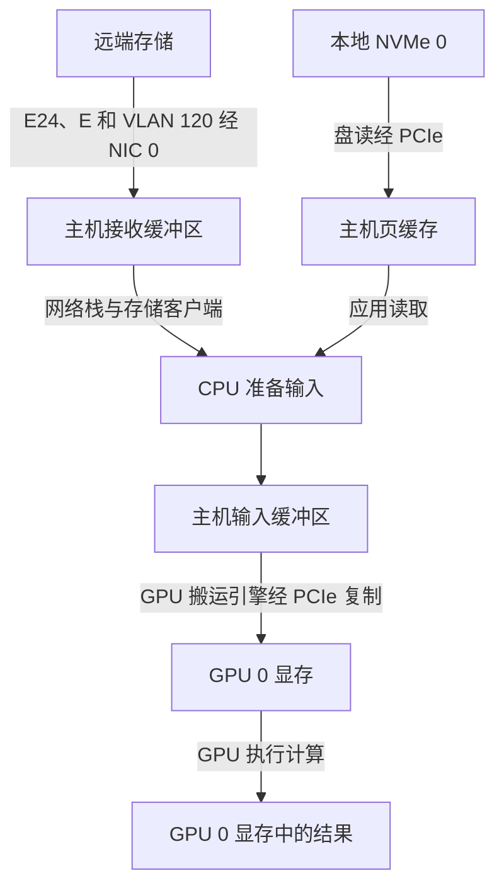

用同一批交付材料评审两台节点。前文的 A、B 在交付记录中分别叫 N21、N22。整机参数采用 DGX H200 官方规格，桥树、页驻留、接线、负载和事件均为教学设定。题目可直接根据材料推导。

## 交付材料

### 整机参数与设备接入

| 范围 | 规格 |
| --- | --- |
| GPU 子系统 | HGX H200 8-GPU 底板，8 块 H200 SXM，每块标称 141 GB |
| 主机 | DGX H200，2 颗 Xeon 8480C，每颗 56 核，共 2 TB 主机内存 |
| 本地存储 | 2 × 1.92 TB NVMe 系统盘，RAID 1。8 × 3.84 TB NVMe 数据缓存盘，RAID 0 |
| 网络 | 8 块单端口 ConnectX-7 集群卡，2 块双端口 ConnectX-7 存储与带内管理卡，另有专用 BMC 管理口 |
| 机架与供电 | 每台 8U，机箱最大深度 897.1 mm。前进后出，运行温度 5–30°C。6 × 3.3 kW PSU，4+2 模块冗余，200–240 V AC 下整机最大输入 10.2 kW |

[NVIDIA DGX H100/H200 · 硬件规格](https://docs.nvidia.com/dgx/dgxh100-user-guide/introduction-to-dgxh100.html#hardware-overview) · [NVIDIA HGX H100/H200 · 每卡规格](https://docs.nvidia.com/enterprise-reference-architectures/hgx-ai-factory-h100-h200-b200/latest/components.html)

两台机器的教学桥树各有两个 Socket，每个 Socket 对应一个同号 NUMA 节点。表中只列题目会用到的 PCIe 端点。单节点的其余六块 GPU 无需画出。

| 设备 | 接入路径 | 系统报告的 `numa_node` |
| --- | --- | --- |
| GPU 0 `0000:1b:00.0` | 下行 A → Switch 0 → Root Port 0 → Socket 0 | `0` |
| NIC 0 `0000:1c:00.0`，接口为 `eth0` | 下行 B → Switch 0 → Root Port 0 → Socket 0 | `-1` |
| NVMe 0 `0000:1d:00.0` | 下行 C → Switch 0 → Root Port 0 → Socket 0 | `0` |
| GPU 1 `0000:1e:00.0` | 下行 D → Switch 0 → Root Port 0 → Socket 0 | `0` |
| 高速网卡 `hca0`，`0000:a1:00.0` | Root Port 1 → Socket 1 | `1` |

### N22 的输入与并发窗口

NIC 0 的接收缓冲区在 NUMA 0，应用的预处理线程采样时运行在 Socket 1 的 CPU 72。应用经主机网络栈与存储客户端取得输入，CPU 预处理后写入一段独立的 GPU 输入缓冲区。该段缓冲区已锁页，采样为 `N0=4096, N1=0`，每页 4 KiB。假定 GPU 0 的复制引擎直接读取它。若换用本地输入，则从 NVMe 0 读文件，经主机处理后写入同一段 GPU 输入缓冲区。

在一段网络和存储都健康的窗口，设 N22 的 `eth0` 链路为 200 GbE，NIC 0 接收应用数据的目标有效载荷为 14 GB/s。与此同时，NVMe 0 从单个 NVMe 端点预取另一批文件字节，往另一段 NUMA 0 缓冲区写入，目标为 6 GB/s。两者各自的接入能力在模型中足以支持单独的目标。Switch 0 到 Root Port 0 的共用链路，往主机方向的有效载荷容量设为 16 GB/s。GPU 从主机读取时，按有效数据的返回方向计入相应的方向预算。

### 机架、端口与观测

机架有 42U、内部可用深度 1,000 mm，现场采样进风 24°C。每台机器的六个 PSU 按 3+3 接入 A、B 两路 PDU。两台节点均按整机最大输入预留，其他设备合计预留 1.6 kW。每路可用预算为 18 kW，正常时均分，失一路后要求在剩余一路保留全部预留。现场尚无规划负载下的冷却验证。

N21 和 N22 各有一条 `eth0` trunk 接 E。VLAN 110 承载 SSH 和会合，协调端点 `coord.example.internal:29400` 由 N21 承载。存储客户端使用 VLAN 120，服务端仅经 E24 接入 E。两节点的 `hca0` 各接 F，BMC 各接 M。下列记录取自另一时间窗口，显存分配是应用对常驻工作集的预算。

| 教学时间 | 观测 |
| --- | --- |
| 09:00 | 两节点 BMC 可访问，均报告 `PowerState=On`，两节点的 SSH 命令均返回 |
| 09:01 | 协调端点记录两台节点均已加入作业 |
| 09:02 | 两节点的 `hca0` 与 F 的对应端口均报告 `Up` |
| 09:02 | 两节点存储读取超时。两条节点 trunk 均为 `Up`，E24 为 `Down` |
| 09:03 | N22 八块 GPU 各有 124 GiB 空闲，应用计划在 N22 的 GPU 0 上普通分配 128 GiB 设备内存 |

## 题目

1. 画出健康时远端文件到 N22 的 GPU 0 显存的路径，再标出换用本地文件时从哪里接入。分别标记预处理线程、接收缓冲区、GPU 输入缓冲区和 GPU 的位置。NIC 0 报告 `numa_node=-1` 时，凭什么确定它接在哪一侧？
2. 核算 N22 的每卡和整机标称显存，求这次单卡分配的差额。复算健康窗口的共享上行缺口，并标出 GPU 0 从主机取输入的有效载荷属于哪个方向。
3. 假设采购单只给了 HGX H200 底板名，应向整机厂商补查哪些条件？算出正常和失去 A 路时的机架预算，说明剩余 PSU 数量可以支持什么判断，还要拿到哪些运行证据。
4. 解释 BMC、SSH、会合和高速链路的观测为什么能与存储超时同时成立。E24 随后恢复 `Up`，应怎样验证存储和作业恢复？
5. 分别考虑三个独立变体。第一，GPU 输入缓冲区的页全移到 NUMA 1，其余缓冲区位置和并发需求如前。第二，NIC 0 改接 Socket 1 上的独立根端口，缓冲区仍在原处。对这两种布置重画受影响的路径并重新判断共享上行。第三，应用把 128 GiB 工作集平均分给 GPU 0 和 GPU 1，两卡分别还要新分配 56 GiB 和 62 GiB 临时空间，且两类分配同时存在。均分有无余量？若可不等长分片，应怎样调整？

## 参考推理

**1. 找到每一段的源、执行者与落点。** 远端文件经存储服务、E24、E 和 N22 的 trunk（VLAN 120） 到 NIC 0。NIC 0 通过 Switch 0、Root Port 0 和 Socket 0，把接收数据写入 NUMA 0。应用取得文件字节，CPU 72 在 Socket 1 上执行预处理。它读写位于 NUMA 0 的缓冲区时会跨处理器互联。GPU 输入缓冲区占 `4,096 × 4 KiB = 16 MiB`，全部位于 NUMA 0。GPU 0 读取后，数据从 NUMA 0 经 Socket 0、Root Port 0 和 Switch 0 进入显存，此段走本地路径。换用本地文件时，NVMe 0 经同一 Switch 和根端口把文件数据读到主机内存，随后由 CPU 准备输入。报告值 `-1` 表示系统未提供 NIC 亲和节点，本题有已知桥路径可定位到 Socket 0。现场可用桥树、整机框图与固件资料交叉确认。 [Linux 6.10 · PCI sysfs ABI](https://docs.kernel.org/6.10/admin-guide/abi-testing.html#sys-bus-pci-devices-numa-node)

**2. 按目标卡和链路方向分别算账。** 每卡标称 141 GB，整机合计 `8 × 141 = 1,128 GB`。八卡空闲合计是 `8 × 124 = 992 GiB`，本次只在 GPU 0 上申请，按采样少 `128 − 124 = 4 GiB`。200 GbE 的标称线路速率折合 25 GB/s，实际有效载荷还要扣除协议开销，14 GB/s 是本题给定的载荷目标。共享上行往主机方向的需求为 `14 + 6 = 20 GB/s`，超过题设的有效容量 `4 GB/s`，两个目标无法同时达到。GPU 0 的读取请求朝主机，有效数据从主机返回 GPU，计入反向预算。

**3. 从底板规格追到整机，再核算失一路。** 应补查整机型号与拓扑、风向和冷却要求、机箱尺寸和导轨、各端口与盘位的配置、交流输入规格及 PSU 接法。两台合计 `2 × 10.2 + 1.6 = 22.0 kW`。正常均分 `11.0 kW/路`，每路余 7.0 kW。失去 A 路后每台有三个 B 路供电的 PSU，B 路要保留 22.0 kW 的预留则差 4.0 kW。DGX 的机型手册给出三个 PSU 的启动门槛，以及运行中因供电事件失去三个 PSU 后的降级行为。现场还需确认上游可用容量、生效的系统限功率和故障工况下的输入与作业吞吐。两台机箱共占 16U，24°C 的进风采样落在规格范围内。最大深度 897.1 mm 小于机架的可用深度，装柜还需核对承重、导轨及线缆空间，持续运行需规划负载下的冷却证据。 [NVIDIA DGX H100/H200 · PSU 冗余与持续运行](https://docs.nvidia.com/dgx/dgxh100-user-guide/introduction-to-dgxh100.html#support-for-psu-redundancy-and-continuous-operation) · [Managing Power Capping](https://docs.nvidia.com/dgx/dgxh100-user-guide/power-capping.html)

**4. 按路径解读同一时间线。** BMC 走 M，SSH 和会合走 E 与 VLAN 110，高速端口的 `Up` 对应连接 F 的链路。两条存储路径都必须经过 E24，因此该端口掉线可以解释两节点的存储超时。E24 恢复链路后，从两节点分别读取同一个存储对象，结合客户端完成情况、E24 计数和服务端记录判断 I/O 是否恢复，再查看作业是否重新推进。高速链路是否真正承载作业通信，要看实际选中的设备和对应传输证据。

**5. 沿变化重画路径并重算。**

- **页改落在 NUMA 1。** CPU 72 对 GPU 输入缓冲区的写入变成本地，GPU 0 的数据由 NUMA 1 经 Socket 1、处理器互联和 Socket 0 返回。NIC 和 NVMe 的两段写入仍在原上行同向汇合，因此需求仍是 20 GB/s，缺口仍是 4 GB/s。GPU 返回数据新增的一段处理器互联需另行评估。
- **NIC 换到 Socket 1 的独立根端口。** 接收数据从 NIC 0 经新根端口到 Socket 1，再跨处理器互联到 Socket 0 的 NUMA 0 内存。NVMe 0 留在 Switch 0 分支。Switch 0 的原方向预算只需计入这两项需求中的 NVMe 0 的 6 GB/s，新的 NIC 传输要分别核算根端口和处理器互联。
- **两卡分摊工作集。** 均分时 GPU 0 的峰值是 `64 + 56 = 120 GiB`，余 4 GiB。GPU 1 是 `64 + 62 = 126 GiB`，超 2 GiB。若从 GPU 1 向 GPU 0 转移 `x GiB`，须同时满足 `120 + x ≤ 124` 与 `126 − x ≤ 124`，可行区间为 2–4 GiB。例如移动 3 GiB 后，两卡各需 123 GiB，各有 1 GiB 纸面余量。实际可用量还要在分配时验证。

## 路径、规格与证据

本章的输入路径有两个阶段。盘或网卡先把输入送到主机缓冲区，主机软件准备出可计算的数组，再由 GPU 的搬运引擎送入目标卡。图中每条写入和读取都从上一步实际得到的数据开始，分段预算也因此能找准落点和方向。

主机侧每段为何经过某颗处理器，由 PCIe 接入点和页驻留决定。每卡显存与每方向的链路容量分别约束分配和搬运。把同样的追踪方法延伸到机架，就能找出节点共用的存储入口、管理上联或配电支路，并选出能证明相应功能完成的观测。第 02 章继续追踪数组进入 GPU 后如何执行，第 03 章检查应用通过哪些软件层提交工作，第 04 章将主机到显存的路径扩展到单机多卡。
