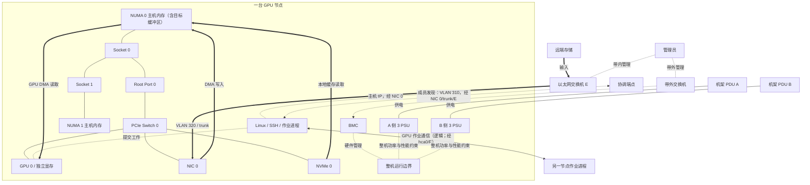

# 第 01 章 本章小节：从一份节点交付材料还原真实运行路径

## 1. 本章真正需要建立的判断能力

两台服务器的配置表可以完全相同，输入数据却可能经过不同的 PCIe 上行和处理器互联；管理页面仍然可访问，作业也可能已经停在存储读取；管理与存储分属不同 VLAN，一条共用线缆断开时仍会一起受影响。配置、可达性和逻辑分段各自只描述系统的一部分。

面对一份新 GPU 节点的配置、拓扑、机架和网络材料，本章要回答的是：**能否还原作业实际经过的路径，并判断一次故障或性能变化会影响哪些环节？** 完成本文的推演后，应能独立做到：

1. 从输入来源追踪到主机缓冲区和目标 GPU，区分控制操作与数据移动。
2. 把设备、线程和内存页分别放回 PCIe/NUMA 拓扑，找出跨 Socket 路径与共享上行。
3. 分清 GPU 卡或模组、GPU 底板、整机和机架的规格边界，按单卡而非整机合计判断分配条件。
4. 分别评估带内、带外、作业协调、GPU 通信和存储路径，不把局部可达当作全链路可用。
5. 对每项判断写明证据、适用边界和下一项最有区分力的证据。

## 2. 用一张图和一条主线重建全章

下图是全章的关系图，不代表某款机器的固定布局。实线表示物理连接或供电，粗箭头表示假定的一次数据移动，虚线表示管理、控制或约束，双向箭头表示集群通信。

主线不是“设备依次出现”，而是**先确定通信双方和数据位置，再沿物理连接追踪路径，最后检查管理与运行条件**。第 01 篇赋予配置项以角色并划定容量边界；第 02 篇把角色落到 Root Port、Switch、Socket 和内存页；第 03 篇确认这些对象属于模组、底板还是整机；第 04 篇补充带内外管理以及供电、散热等可用条件；第 05 篇再把节点内的作业进程接到协调端点、另一节点和存储服务。

这些材料不能互相替代：设备清单没有连线，PCIe 树没有机箱与供电边界，整机规格没有某次内存分配的落点，VLAN 名称也没有物理故障域。`PowerState=On`、SSH 成功或交换机端口 `Up` 都只证明对应局部在采样时可用，不能证明输入已经到达 GPU，更不能证明整个作业正常。

## 3. 必须真正理解的关键关系

| 关系               | 在什么条件下可以怎样判断                                                               | 依据与不能再推出的结论                                                                                                                                                                                                                           |
| ---------------- | -------------------------------------------------------------------------- | ------------------------------------------------------------------------------------------------------------------------------------------------------------------------------------------------------------------------------------- |
| 整机显存合计与单卡边界      | 已知卡数和每卡规格时可算整机合计；已知目标设备当前空闲量时，才能评估一次单卡分配                                   | 每块 GPU 有独立设备内存。合计容量不能证明某个单次分配成功；规格容量也不等于运行时可用量。[CUDA 的多 GPU 说明](https://docs.nvidia.com/cuda/cuda-programming-guide/03-advanced/multi-gpu-systems.html)要求按设备理解资源                                                                      |
| CPU 控制与数据搬运      | 在常规主机缓冲路径中，可判断 CPU 发起 I/O、准备数据并提交工作；设备 DMA 可移动数据                           | “CPU 发起”不意味着核心逐字节复制。实际经过哪些缓冲区仍取决于设备、驱动和接口，不能由进程所在 CPU 反推                                                                                                                                                                              |
| 线程、页与设备位置        | 分别取得线程运行位置、目标映射的页驻留和设备桥路径，才能判断一次访问是否跨 Socket                               | CPU 亲和范围不是实际运行位置；设备 `numa_node=-1` 是亲和信息未知，不是“没有 NUMA 亲和”。移动线程也不会仅因此搬走既有页。[Linux NUMA 策略](https://docs.kernel.org/admin-guide/mm/numa_memory_policy.html)与[PCI sysfs ABI](https://docs.kernel.org/admin-guide/abi-testing.html)给出相应口径 |
| GPU 形态、HGX 底板与整机 | 精确 SKU 和形态用于判断模组或卡；HGX 8-GPU 底板用于判断 GPU 子系统；整机型号与配置用于查 CPU、盘位、端口、BMC 和 PSU | SXM 模组所在平台仍通过 PCIe 连接主机；某种 PCIe 卡型的互联能力也不能推广到所有 PCIe GPU。底板规格不能替代整机规格。[HGX 组件说明](https://docs.nvidia.com/enterprise-reference-architectures/hgx-ai-factory-h100-h200-b200/latest/components.html)展示了这些边界                              |
| 可达性、逻辑隔离与设备冗余    | BMC 可达且有供电时，可继续查硬件状态；VLAN 可划分二层广播域；PSU 冗余可覆盖其设计范围内的电源故障                    | BMC 可达不证明 OS 或作业正常；不同 VLAN 可共享线缆、交换机和容量；PSU 数量不证明失一路 PDU 后上游预算足够或性能不变。每项结论都要回到实际路径、接线和对应机型手册                                                                                                                                          |

## 4. 综合案例：评审一份新节点交付包

### 4.1 场景目标与假设

**以下全部为教学材料，不是实测记录或客户环境。** 节点 N21、N22 准备上架并运行首个两节点作业，每台八个作业进程、每进程使用一块 GPU。评审目标是判断 N22 的 GPU 0 能否取得输入并完成一次显存分配，同时验收共享 PCIe 上行、机架失一路供电和网络故障的影响。

整机规格取自 DGX H200 官方手册；为突出机制，PCIe/NUMA 树、端口编号、VLAN、地址、负载需求和观测均为教学设定，**不能当作 DGX H200 的固定端口布局或性能数据**。假设每 Socket 在本例中对应一个 NUMA 节点，输入采用常规主机缓冲路径，缓冲区已锁页，GPU DMA 直接读取它；不采用后续章节才展开的直接设备间传输。

### 4.2 配置和平台材料

| 层次 | 交付条目 | 评审口径 |
| --- | --- | --- |
| GPU 子系统 | HGX H200 8-GPU 底板，8 块 H200 SXM，每 GPU 141 GB | 模组与底板不是完整服务器；规格合计为 1,128 GB |
| 整机 | DGX H200，2 颗 Xeon 8480C（各 56 核），2 TB 主机内存 | 双路主机资源与 GPU 显存分开统计 |
| 本地存储 | 2 × 1.92 TB NVMe（OS，RAID 1）；8 × 3.84 TB NVMe（缓存，RAID 0） | 本例只追踪缓存盘 NVMe 0，不计算阵列可用容量 |
| 网络与管理 | 8 块单端口 ConnectX-7 集群卡；2 块双端口 ConnectX-7 用于存储和带内管理；独立 BMC 1 GbE 口 | 教学图展开 NIC 0 的物理拓扑，hca0 仅标逻辑通信，其余端口省略 |
| 电源与机箱 | 6 × 3.3 kW PSU（4+2 冗余），200–240 V AC 下整机最大输入 10.2 kW；8U、最大深度 897.1 mm，前向后气流，运行温度 5–30°C | PSU 额定值之和不作为整机输入功率 |

上述 H200 显存、主机、网络、PSU 和机箱条目见 [DGX H100/H200 组件、机械与环境规格](https://docs.nvidia.com/dgx/dgxh100-user-guide/introduction-to-dgxh100.html)；HGX H200 底板的每 GPU 141 GB 与八 GPU 1,128 GB 口径也见 [HGX 组件表](https://docs.nvidia.com/enterprise-reference-architectures/hgx-ai-factory-h100-h200-b200/latest/components.html)。

教学观测另给出：采样时八块 GPU 各有 **124 GiB 空闲显存**。作业准备在 N22 的 GPU 0 上执行一次 **128 GiB** 的单卡设备内存分配。GB 是厂商规格口径，GiB 是教学观测与应用请求口径，两者不直接相减。

### 4.3 PCIe/NUMA 拓扑与内存放置

N21、N22 在本例中使用相同的简化树。所有地址都在 PCI 域 `0000` 中，路径里的桥地址省略共同的 `0000:` 前缀；Root Port 0 和 Root Port 1 分属不同 Socket，域号不能用来判定 Socket。

| 设备与功能地址 | 下行端口与上行路径 | Socket / NUMA 归属 | 系统报告的 `numa_node` |
| --- | --- | --- | --- |
| GPU 0：`0000:1b:00.0` | 下行 A `1a:01.0` → Switch 0 上行 `19:00.0` → Root Port 0 `18:01.0` | Socket 0 / 节点 0 | `0` |
| NIC 0（含 eth0）：`0000:1c:00.0` | 下行 B `1a:02.0` → 同一 Switch 与 Root Port 0 | Socket 0 / 节点 0 | `-1` |
| NVMe 0：`0000:1d:00.0` | 下行 C `1a:03.0` → 同一 Switch 与 Root Port 0 | Socket 0 / 节点 0 | `0` |
| hca0：`0000:a1:00.0` | Root Port 1 `a0:01.0` | Socket 1 / 节点 1 | `1` |

GPU 0、NIC 0 和 NVMe 0 各有下行链路；NIC 0 与 NVMe 0 同方向向主机传数据时，共享 Switch 0 到 Root Port 0 的上行。NIC 0 的 `-1` 只表示内核报告未知，物理桥路径仍以表中材料为准，并需补查固件信息。

另给出三项彼此独立的位置：预处理线程采样时运行在 Socket 1 的 CPU 72；目标锁页缓冲区为独立映射，4 KiB 页共 4,096 页，`N0=4096, N1=0`，即 16 MiB 全部驻留 NUMA 0；GPU 0 与 NIC 0 接在 Socket 0。预处理假设在原缓冲区就地完成。

教学负载预算规定：NIC 0 接收远端输入时需向主机写入 **14 GB/s**，同时 NVMe 0 预取下一批数据需向主机写入 **12 GB/s**。二者公共上行在主机方向的有效容量假设为 **20 GB/s**。这些数值是需求与容量假设，不是测得吞吐；GPU 0 接收主机数据使用另一方向，不计入这笔同方向预算。

本地替代输入使用上述目标缓冲区，并发算例的下一批预取则使用另一个位于 NUMA 0 的缓冲区。这里的 12 GB/s 特指已限定命中 NVMe 0 的教学 I/O 需求，不是八盘 RAID 0 卷的聚合预取；真实阵列读取需按条带映射追踪各成员盘。

### 4.4 供电、机架和散热材料

每台节点六个 PSU 按 **3+3** 接到 A/B 两路 PDU；`4+2` 是机型冗余设计，`3+3` 是本例接线，二者不是同一口径。两路正常时，为做容量规划，假设两台节点及其他设备的输入功率在 A/B 间均分；其他机架设备合计预留 **1.6 kW**，A、B 每路可用预算均为 **18 kW**。交付要求是“正常时不超过预算，并评估失一路后是否仍能保留原最大功率预算”。

| 项目 | 教学站点材料 |
| --- | --- |
| 机架空间 | 42U，内部可用深度 1,000 mm；两台 8U 节点合计 16U，标称尺寸没有明显冲突，导轨、线缆弯曲空间和承重仍需现场核对 |
| 散热 | 冷通道进风 24°C 在上述机型温度范围内；单点进风温度不能证明整柜散热能力，站点未提供规划负载下的冷却验证 |
| 故障状态 | A 或 B 任一路丢失时，另一路承担仍需保留的负载；节点实际功耗限制配置与固件版本未提供 |

DGX H100/H200 手册规定的是**该机型**的规则：运行中三只 PSU 因数据中心或 PDU 事件失电时，系统以降低的性能继续运行；至少三只可用 PSU 才能启动。N+N 安全运行还涉及功率限制配置，该功能从 24.07.1 起默认关闭。不得把这套规则套到其他服务器。[电源冗余说明](https://docs.nvidia.com/dgx/dgxh100-user-guide/introduction-to-dgxh100.html#support-for-psu-redundancy-and-continuous-operation) · [功率限制说明](https://docs.nvidia.com/dgx/dgxh100-user-guide/power-capping.html)

### 4.5 网络端口、VLAN 与管理路径

| 职责与通信双方 | 逻辑路径 | 本例物理路径 |
| --- | --- | --- |
| 带内管理：管理机 ↔ 节点 OS | VLAN 310，主机地址 | 节点 eth0 → 交换机 E；N21、N22 各自一条 trunk |
| 带外管理：管理机 ↔ 节点 BMC | 独立管理地址 | bmc0 → 独立带外交换机 M |
| 作业协调：两节点启动进程 ↔ `coord.example.internal:29500` | 协调地址在 VLAN 310 | 与带内管理共用 eth0 trunk 和 E |
| GPU 作业通信：N21 作业进程 ↔ N22 作业进程 | 独立高速网络 | 各节点 hca0 → 独立交换机 F |
| 存储访问：两节点 ↔ `10.32.0.20` | VLAN 320 | 与 VLAN 310 共用本节点 eth0 trunk 和 E；存储端接 E 的 24 号端口 |

VLAN 310 与 320 逻辑上分开，却在每个节点方向共享 trunk、NIC 0 和 E；高速通信使用另一组端口和交换机，但节点仍共享机架、供电等物理条件。协调端点参数只说明成员发现去哪里连接，不指定 GPU 数据一定走哪条路径。

### 4.6 作业和管理侧观测记录

以下时间属于同一教学时间线，节点与交换机时钟已校准。

| 教学记录                                                     | 可以支持的判断                              | 仍不能支持的判断                      |
| -------------------------------------------------------- | ------------------------------------ | ----------------------------- |
| 09:00，两台 BMC 可访问，`PowerState=On`；SSH 命令均返回               | 带外路径可用，系统报告已上电；两次带内 SSH 访问成功         | Linux 所有服务、GPU、显存分配和作业均正常     |
| 09:01，协调端点记录 N21、N22 均已注册                                | 两节点当时完成了本例的成员发现                      | hca0 路径已传输数据，或存储读取已经成功        |
| 09:02，两节点 hca0 与 F 对应端口均为 `Up`                           | 所列高速物理端口当时报告链路建立                     | 端到端通信无拥塞、通信库已选择该端口或作业已有进展     |
| 09:02，两节点存储读取超时；两条节点 trunk 均为 `Up`，E 的存储接入端口 24 为 `Down` | 存储服务的一条已知物理接入路径不可用，这与节点 trunk 正常并不矛盾 | 端口为何为 `Down`、唯一根因是什么，或高速通信也中断 |
| 09:02，八卡各有 124 GiB 空闲；NIC 0 的 `numa_node=-1`             | 显存是采样值；NIC 亲和信息未知                    | 随后的分配必然成功；NIC 没有拓扑归属          |

### 4.7 分析任务

1. **重建**：画出 N22 一次远端输入到 GPU 0 的完整路径，再写出本地 NVMe 入口；标出线程、页和设备三个位置，以及共享上行。
2. **计算**：分别计算整机显存规格合计与 GPU 0 分配差额、两路主机方向并发需求与共享上行差额、正常及失一路 PDU 时的功率预算。写清已知条件、假设、公式、单位、结果及其证明边界。
3. **解释**：为什么 BMC/SSH 正常、成员发现成功、高速端口 `Up` 与存储读取超时并不矛盾？为什么 `numa_node=-1` 不改变已给出的物理桥路径？
4. **判断**：指出当前 PCIe 放置、失去 A 路供电、E24 为 `Down` 分别影响哪段路径；若把 NIC 0 移到 Root Port 1，哪些路径与共享关系必须重画？
5. **取证**：为显存分配、实际吞吐、掉电后性能、存储端口 Down 原因及高速通信是否可用，各提出一项最有区分力的下一项证据。

## 5. 改变条件后重新判断

每次只改变下列条件，其余材料保持原样。

1. **页驻留变式**：在另一初始状态下，N22 同容量目标缓冲区的 4,096 页于锁页前已全部触页在 NUMA 1，随后再锁页并建立 DMA 映射；线程仍在 CPU 72，设备位置不变。重新追踪 NIC 写入和 GPU 读取，判断原共享上行算式是否改变。
2. **供电变式**：A 路 PDU 失电，接线不变。重新计算机架预算，并判断“节点还能报告状态”“节点维持原性能”“作业保持原进度”是否等价。
3. **存储链路变式**：在 09:02 之后，只将 E24 从 `Down` 恢复为 `Up`。判断哪些历史结论仍成立、哪些当前判断需要修改；现有材料能否证明作业必然恢复。

若材料只能缩小范围，应明确写“目前不能确定”，不得用单一状态替代唯一根因。

## 6. 参考推演

### 6.1 重建路径

- **结论**：无故障时的设计路径为“存储服务 → E24 → E/VLAN 320 → N22 trunk → NIC 0 → Switch 0 → Root Port 0 → Socket 0 → NUMA 0 缓冲区”；随后 GPU 0 DMA 从 NUMA 0 经 Socket 0、Root Port 0、Switch 0 到 GPU 0 显存。本地替代输入则由 NVMe 0 经 Switch 0、Root Port 0 和 Socket 0 进入目标缓冲区。
- **证据**：4.3 的桥路径和 `N0=4096`，4.5 的端口表，以及常规主机缓冲与直接 DMA 假设。
- **推导**：NIC 0 与 NVMe 0 向主机写入时汇合于公共上行；预处理线程虽在 Socket 1，其 CPU 访问会跨处理器互联，但 GPU 读取仍从 NUMA 0 出发。CPU 提交工作不等于逐字节搬运。
- **边界**：这是所给教学传输方式的设计路径，不排除其他软件采用额外缓冲；图中省略其余 GPU 和网卡。09:02 的观测不能证明数据已沿该路径到达 GPU 0。
- **下一项证据**：取同一传输时段的实际缓冲区地址与页映射、设备桥路径和传输接口记录，确认教学假设与运行实现一致。

### 6.2 三项可复算计算

- **结论**：整机显存规格合计不能证明当前 GPU 0 分配可以成功；两路并发需求超过共享上行；正常功率预算通过，失一路后不能保留原最大功率预算。
- **证据**：每 GPU 141 GB、每卡空闲 124 GiB、单次请求 128 GiB；并发需求 14 与 12 GB/s、上行 20 GB/s；节点最大输入 10.2 kW、其他负载 1.6 kW、每路 PDU 18 kW。
- **推导**：
  1. **显存**。规格合计为 `8 × 141 GB = 1,128 GB`。假设八卡各有 124 GiB 空闲，观测合计为 `8 × 124 GiB = 992 GiB`；GPU 0 的分配差额为 `128 GiB − 124 GiB = 4 GiB`。虽然 `992 GiB > 128 GiB`，一次指定 GPU 0 的单卡分配在当前采样条件下仍缺 4 GiB。该计算不能预测释放占用或分片后的结果，也不把 GB 与 GiB 混算。
  2. **共享上行**。假设两路同时持续向主机传输，需求为 `14 GB/s + 12 GB/s = 26 GB/s`，超出 `26 − 20 = 6 GB/s`。两者不能同时各得全额需求；20 GB/s 是该方向共享能力假设，不决定各自分配，也不等于应用端到端吞吐。
  3. **功率**。总规划功率为 `2 × 10.2 kW + 1.6 kW = 22.0 kW`。正常均分时每路为 `22.0 ÷ 2 = 11.0 kW`，余量为 `18.0 − 11.0 = 7.0 kW`。失一路且保留原预算时，剩余一路需 `22.0 kW`，缺口为 `22.0 − 18.0 = 4.0 kW`。这证明原故障目标不满足，不证明实际功耗一定达到最大值，也不单独给出降级后的吞吐。
- **边界**：所有结果都依赖给定需求、均分和“保留原最大功率预算”的假设；实际持续功率、链路分配与散热还需现场材料。
- **下一项证据**：显存看分配时同卡空闲与返回结果；PCIe 看同方向分设备吞吐；供电看事件期间整机输入功率、剩余 PSU 状态、生效的功率限制配置和同负载计算吞吐；散热看该机架在规划负载下的冷却验证与进回风记录。

### 6.3 解释观测与判断影响

- **结论**：带内 SSH 与协调成功覆盖 VLAN 310，BMC 可达只覆盖带外路径，高速 `Up` 只覆盖 hca0/F 的物理链路；E24 `Down` 能独立阻断本例给定的存储接入路径，所以这些观测可以同时成立。当前 GPU 读取 NUMA 0 不需跨 Socket；A 路丢失会影响节点供电与性能条件；E24 `Down` 影响存储而非 BMC 的物理路径。
- **证据**：4.5 将五类流量映射到不同通信双方和端口，4.6 给出同一时间线，4.3 给出内存与设备位置。
- **推导**：VLAN 分段不改变物理依赖，链路状态也不证明上层传输。若只把 NIC 0 移到 Root Port 1，它写入 NUMA 0 要经过处理器互联，与 NVMe 0 的共享关系消失，原公共上行算式不再适用；GPU 0 从 NUMA 0 读取的路径不变，新根端口容量则需另取。
- **边界**：E24 `Down` 的直接原因目前不能确定；高速端口是否被软件选用也不能确定。`numa_node=-1` 只表示报告未知，不能覆盖桥路径证据。
- **下一项证据**：读取 E24 的管理状态、光模块/线缆与错误计数以区分配置和物理原因；读取作业通信日志中的实际接口与两端传输计数，验证高速路径。

### 6.4 条件变式

**变式一：页初始驻留 NUMA 1**

- **结论**：NIC 0 写入变为“NIC 0 → Switch 0 → Root Port 0 → Socket 0 → 处理器互联 → NUMA 1”，GPU 0 读取变为“NUMA 1 → 处理器互联 → Socket 0 → Root Port 0 → Switch 0 → GPU 0”，原“GPU 读取不跨 Socket”不适用于这个新状态。
- **证据**：只有锁页前的初始页落点改变，线程仍在 Socket 1，NIC/GPU/NVMe 仍接 Socket 0。
- **推导**：数据访问随页落点改变；预处理线程的 CPU 访问变为本地，NIC 与 GPU 的设备路径则增加跨 Socket 段。共享上行的 `26 GB/s > 20 GB/s` 算术不变，显存、供电和网络状态也不变，但端到端结果还受处理器互联影响。
- **边界**：目前不能确定性能下降多少，也不能只凭路径长度断言实际吞吐；变式不假定已锁页并建立 DMA 映射的缓冲区可以在线迁移。
- **下一项证据**：锁页后的新 `numa_maps` 样本与同方向实际吞吐，确认采样时页落点并观察路径变化的影响。

**变式二：A 路失电**

- **结论**：三者不等价。每台剩三只由 B 路供电的 PSU；按本机型手册，运行性能会降低。B 路若保留原预算需 22.0 kW，仍缺 4.0 kW，因此不能承诺原性能或原进度。
- **证据**：3+3 接线、上述功率算式和 DGX H100/H200 的 PSU 规则。
- **推导**：失去的是整组 PSU 而非单个模块。BMC 可报告只证明管理与相应供电条件，节点性能要看运行状态，作业进度还受持续存在的 E24 `Down` 和共享上行等因素影响。显存和共享上行算术不变，但不能据此推出作业保持原进度。
- **边界**：节点是否立即断电、实际功率和作业损失程度不能由 PSU 数量唯一确定；规则不外推到其他机型。
- **下一项证据**：同一事件窗口的 PSU/PDU 状态、节点功率、生效功率限制、GPU 时钟与限制原因，再用同负载计算吞吐对照作业进度。

**变式三：E24 恢复为 `Up`**

- **结论**：09:02 时 E24 `Down` 和读取超时仍是历史事实；当前 `Up` 使“E24 仍因 Down 而阻断后续读取”不再成立。节点 trunk、协调和高速链路状态未变，但存储与作业是否恢复仍不能确定。
- **证据**：只有 E24 的后续状态改变，没有新的读取结果或服务端记录。
- **推导**：物理链路是存储访问的必要条件之一，不是服务、路由、访问控制和数据路径全部正常的充分条件；新状态不能改写旧观测。
- **边界**：原端口 Down 原因是否已消除、服务是否健康均无新证据。
- **下一项证据**：从 N21、N22 各做一次到同一存储测试对象的读取，并同时记录 E24 计数与服务端日志。

## 7. 脱离正文后的自测

1. 不看正文，画出“远端存储到一块 GPU”的数据路径，以及管理员到 OS、到 BMC 的两条管理路径。用不同线型标物理连接、数据移动与管理操作，并指出哪条观察只能证明局部可用。
2. 一份报价只写“某 HGX 8-GPU 底板”，另一份写“采用该底板的整机”，第三份写“两块 PCIe GPU 扩展卡”。分别标出卡或模组、底板、整机边界，并列出后两份报价仍需补充的端口、供电和散热材料；不要凭底板名称补出整机配置。
3. 新节点中 GPU 0 接 Socket 1，页锁缓冲区全部在 NUMA 1。只把提交线程从 NUMA 0 移到 NUMA 1，页和设备不动：GPU DMA 路径是否改变？线程、页、设备三项证据中哪一项变了，哪一项还要重新采样？
4. 某节点 BMC 可访问且报告 `PowerState=On`，带内管理与存储分属两个 VLAN 但共用一条 `Up` 的 trunk，随后 A 路 PDU 失电。分别写出这三项观察能支持和不能支持的结论，并为失电后的性能判断选择一项下一证据。

## 8. 本章能解释什么，还不能解释什么

本章建立的是设备角色、节点拓扑、整机运行条件与集群流量之间的整体认知：先确认对象和数据位置，再沿物理路径判断影响范围，最后用新证据收窄解释。

它还没有解释 GPU 内部如何执行、显存带宽如何影响计算，这由第 02 章展开；驱动、CUDA 库与应用可用性由第 03 章展开；实际多卡传输、P2P、NVLink 与带宽测量由第 04 章展开；多机通信、RDMA、NCCL 和数据供给的详细机制由后续章节展开。因此，本章可以指出“哪条路径需要验证”，但不会把一个端口状态或一次容量计算冒充完整的性能与故障结论。
