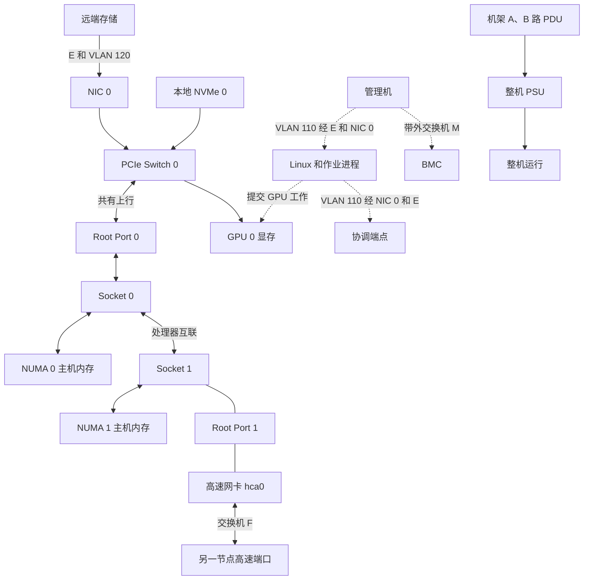

# 第 01 章 本章小节：从交付材料重建节点与集群路径

一批数据要到达 GPU，先要有可用的输入来源，再有主机侧的数据路径和目标 GPU 的显存。跨节点时，启动进程的协调连接、计算数据的交换、存储访问各有目的地址和设备。供电与冷却维持整机运行，带内、带外路径分别提供主机软件和硬件状态。排查时先把现象放到对应的路径，再检查共同经过的设备。

图中的 PCIe 与 NUMA 连接取自第 02 篇，网络来自第 05 篇。沿数据路径分析时，内存是数据的落点，也是下一段传输的起点。作业协调和带内管理在本例中都经 E 和 VLAN 110，协调端点从作业配置中确定。第 02—04 章会在这张图上依次补上 GPU 内部执行、驱动与应用依赖，以及设备间的实际传输方式。

## 检查：两台节点能否按计划交付

用下面的材料评审节点 B 上的一次作业。交付表将 A、B 记为 **N21、N22**。本题用官方 DGX H200 规格做容量和机架预算，拓扑、负载、接线和运行记录均为教学设定。题目所需信息都在下面。

### 规格与放置

| 交付材料 | 给定信息 |
| --- | --- |
| GPU 子系统 | HGX H200 8-GPU 底板，8 块 H200 SXM，每块规格 141 GB |
| 整机 | DGX H200，2 颗 Xeon 8480C（各 56 核），2 TB 主机内存 |
| 本地盘 | 2 × 1.92 TB NVMe 为系统盘（RAID 1），8 × 3.84 TB NVMe 为数据缓存盘（RAID 0） |
| 网络能力 | 8 块单端口 ConnectX-7 集群卡，2 块双端口 ConnectX-7 用于存储与带内管理，另有 BMC 管理口 |
| 电源和环境 | 6 × 3.3 kW PSU，机型标为 4+2 冗余。200–240 V AC 下整机最大输入 10.2 kW。8U，最大深度 897.1 mm，前向后气流，运行温度 5–30°C |

表中容量、电源和环境参数采用厂商规格。 [NVIDIA DGX H100/H200 · 硬件规格](https://docs.nvidia.com/dgx/dgxh100-user-guide/introduction-to-dgxh100.html#hardware-overview) · [NVIDIA HGX H100/H200 · 组件说明](https://docs.nvidia.com/enterprise-reference-architectures/hgx-ai-factory-h100-h200-b200/latest/components.html)

两台教学节点沿用第 02 篇的设备树，每个 Socket 对应一个同号 NUMA 节点。下表给出本题需要的桥路径与系统报告。

| 设备 | 接入路径 | 系统报告的 `numa_node` |
| --- | --- | --- |
| GPU 0 `0000:1b:00.0` | 下行 A → Switch 0 → Root Port 0 → Socket 0 | `0` |
| NIC 0 `0000:1c:00.0`（含 `eth0`） | 下行 B → Switch 0 → Root Port 0 → Socket 0 | `-1` |
| NVMe 0 `0000:1d:00.0` | 下行 C → Switch 0 → Root Port 0 → Socket 0 | `0` |
| `hca0` `0000:a1:00.0` | Root Port 1 → Socket 1 | `1` |

N22 的预处理线程采样时在 Socket 1 的 CPU 72。NIC 0 的接收缓冲区位于 NUMA 0。输入由主机网络栈和应用取得，CPU 做预处理，写入单独的 GPU 输入缓冲区。该输入缓冲区已经锁页，采样记录为 `N0=4096, N1=0`，每页 4 KiB。假定 GPU 0 的复制引擎直接从它读取，再写入显存。本地替代输入从 NVMe 0 开始读取，经过主机端的读盘和预处理环节，也放到同一 GPU 输入缓冲区。

另设一段网络和存储都健康的时间窗口。NIC 0 接收远端输入的有效载荷需求为 14 GB/s，NVMe 0 同时预取下一批数据，往另一个 NUMA 0 缓冲区写入，需求为 12 GB/s。两者共用的上行往主机方向的有效容量假设为 20 GB/s。12 GB/s 是这个单端点模型的需求设定，阵列读取时需要按条带映射看实际成员盘。GPU 0 从主机读取时，按返回的有效载荷方向计。以上容量和需求用于纸面预算。

### 机架、网络与现场记录

机架有 42U，内部可用深度 1,000 mm，采样进风温度 24°C。尚无规划负载下的冷却验证。每台节点的六个 PSU 按 3+3 接到 A/B 两路 PDU。两台节点都按最大输入预留，其他设备合计预留 1.6 kW。A、B 每路有 18 kW 可用容量。正常时假设所有预留均匀分到两路，失一路后要求在剩余一路保留全部原预留。

沿用第 05 篇的接线。N21 与 N22 各有一条 `eth0` trunk 接 E，VLAN 110 承载 SSH 和作业协调，VLAN 120 承载存储。协调端点 `coord.example.internal:29400` 在 N21。存储服务仅经 E24 接入 E。两节点的 `hca0` 各接高速交换机 F，BMC 各接带外交换机 M。

| 教学时间 | 记录 |
| --- | --- |
| 09:00 | 两节点 BMC 可访问，均报告 `PowerState=On`，两节点的 SSH 命令均返回 |
| 09:01 | 协调端点记录两台节点均已加入作业 |
| 09:02 | 两节点的 `hca0` 与 F 的对应端口均报告 `Up` |
| 09:02 | 两节点的存储读取超时。两条节点 trunk 均为 `Up`，E24 为 `Down` |
| 09:02 | N22 的八块 GPU 各有 124 GiB 空闲。应用计划在 N22 的 GPU 0 上做一次 128 GiB 的普通设备内存分配 |

### 题目

1. **画路径。** 画出健康时远端文件到 N22 的 GPU 0 显存的路径，再标出本地替代输入从哪里接入。分别标记线程、接收缓冲区、GPU 输入缓冲区和 GPU 的位置。解释 NIC 0 报告 `numa_node=-1` 时还能依据什么画它的路径。
2. **算预算。** 算出 N22 每卡和整机的显存规格、这次分配的差额，以及健康窗口中往主机方向的共享上行缺口。GPU 0 的主机到显存复制要计入哪个方向？
3. **作交付判断。** 若采购单只提供 HGX 底板名，应向整机厂商补查哪些材料？在题设接线下，算出正常和失一路时的整机架预算，说明掉电时单靠 PSU 数量能判断到哪一步。
4. **解释现场记录。** 写出为什么 BMC、SSH、成员会合和高速链路状态可以与存储超时同时成立。若 E24 随后变为 `Up`，还需要什么证据判断存储和作业是否恢复？
5. **每次只改一个条件。** 先假设新建 GPU 输入缓冲区的页全部落在 NUMA 1，NIC 的接收缓冲区和预取缓冲区仍在 NUMA 0。再回到原始条件，假设把 NIC 0 改接 Socket 1 上一个空闲的根端口。分别重画改变的路径，判断原共享上行算式是否适用。最后回到原始放置，假设应用把 128 GiB 数据均分到 GPU 0 和 GPU 1，并且两张卡还要分别取得 56 GiB 和 62 GiB 的额外临时显存。两张卡能否各自容纳所需的峰值？

### 参考推理

**1. 从存储到显存。** 健康时，文件数据经「存储服务 → E24 → E → N22 trunk（VLAN 120）→ NIC 0」到节点。NIC 0 经「Switch 0 → Root Port 0 → Socket 0」把接收数据送入 NUMA 0 内存。主机软件取得输入，CPU 72 做预处理时访问 NUMA 0 的缓冲区会跨处理器互联。GPU 输入缓冲区占 `4,096 × 4 KiB = 16 MiB`，全在 NUMA 0。应用提交复制后，返回的有效数据从 NUMA 0 经 Socket 0、Root Port 0 和 Switch 0 进入 GPU 0 显存，此段无需跨 Socket。换成本地输入时，从 NVMe 0 经同一个 Switch 和根端口进入主机侧读盘缓冲区，再由 CPU 准备 GPU 输入。 `numa_node=-1` 表示系统未报告 NIC 的亲和节点。题设已经给出桥路径，实际环境中还可用厂商框图和固件信息交叉核对。 [Linux · PCI sysfs ABI](https://docs.kernel.org/6.10/admin-guide/abi-testing.html#sys-bus-pci-devices-numa-node)

**2. 按目标设备和方向计算。** 每 GPU 的规格是 141 GB，合计 `8 × 141 GB = 1,128 GB`。同一次采样的空闲量合计为 `8 × 124 GiB = 992 GiB`。目标 GPU 0 此时只有 124 GiB，对 128 GiB 的单卡请求差 `4 GiB`。这里用同单位的空闲量和请求做差。实际分配还要看申请时的该卡空闲量与调用结果。健康窗口往主机方向的需求为 `14 + 12 = 26 GB/s`，比假设上行容量多 `26 − 20 = 6 GB/s`，两者无法同时达到各自需求。GPU 读取请求朝主机，复制的有效载荷由主机返回 GPU，后者计入反向预算。要取得每路实际吞吐，需要在同一时段测量。

**3. 底板、整机和上游各有规格。** HGX 名称给出了 GPU 子系统。机箱和导轨、整机 AC 输入、PSU 接法、网口与盘位、风向与冷却要求，都要按整机型号和实际配置核对。机架总预留是 `2 × 10.2 + 1.6 = 22.0 kW`。正常均分为 `11.0 kW/路`，每路余 `7.0 kW`。A 路失电时，每台剩三个由 B 路供电的 PSU。B 路只有 18 kW，要保留 22.0 kW 的原预算还差 `4.0 kW`。DGX H100/H200 的机型手册给出剩三个 PSU 时的启动条件，以及运行中因供电事件失去三个 PSU 时的降级规则。要判断现场是否可持续运行以及性能如何，还要确认剩余一路实际供电、生效的限功率设置和同负载吞吐。两台共占 16U，24°C 也在环境表范围内，现场仍需核对导轨、承重、线缆空间和规划负载下的冷却。 [NVIDIA DGX H100/H200 · PSU 冗余与持续运行](https://docs.nvidia.com/dgx/dgxh100-user-guide/introduction-to-dgxh100.html#support-for-psu-redundancy-and-continuous-operation) · [Managing Power Capping](https://docs.nvidia.com/dgx/dgxh100-user-guide/power-capping.html)

**4. 把状态放回时间和路径。** BMC 走 M，SSH 和成员会合经 VLAN 110，`hca0` 的 `Up` 对应连接 F 的物理链路。存储单独从 E24 接入。两条节点 trunk 即使都能转发，也绕不过 E24 的断点。E24 后来报告 `Up`，只说明此前的物理断点在新时刻已恢复链路。应从两台节点各对同一存储对象做读取，结合 E24 计数和服务端日志确认 I/O，再看作业进度。若要验证高速路径，查看应用实际选择的设备及同一次传输在两端的计数。

**5. 每次重算改变的那一段。**

- **页换到 NUMA 1。** NIC 0 仍把数据送到 NUMA 0 的接收缓冲区，CPU 72 准备结果时改为在本地 NUMA 1 写入 GPU 输入缓冲区。GPU 取回的有效数据从 NUMA 1 跨过处理器互联到 Socket 0，再到 GPU 0。NIC 与 NVMe 的数据仍穿过同一上行、方向相同，所以在题设需求和容量下仍是 `26 > 20 GB/s`。实际 GPU 复制吞吐还要测量加入处理器互联后的路径。
- **NIC 改接空闲根端口。** NIC 0 到 NUMA 0 的路径变为「新根端口 → Socket 1 → 处理器互联 → Socket 0 → NUMA 0」。NVMe 0 仍经 Switch 0 向主机写入。两个设备在 Switch 0 上行上的需求不再相加，要按新的路径和各段容量预算。
- **数据由应用分片。** 两张卡各持 64 GiB。GPU 0 峰值为 `64 + 56 = 120 GiB`，按采样还有 4 GiB 余量；GPU 1 峰值为 `64 + 62 = 126 GiB`，差 2 GiB。均分后依然有一张卡超出预算。如果应用允许不等长分片，可重算各卡的同时占用，例如从 GPU 1 转移 2 GiB 数据后，静态预算变为 122 GiB 和 124 GiB。第二张卡此时没有额外余量，运行时仍需核对实际峰值。
