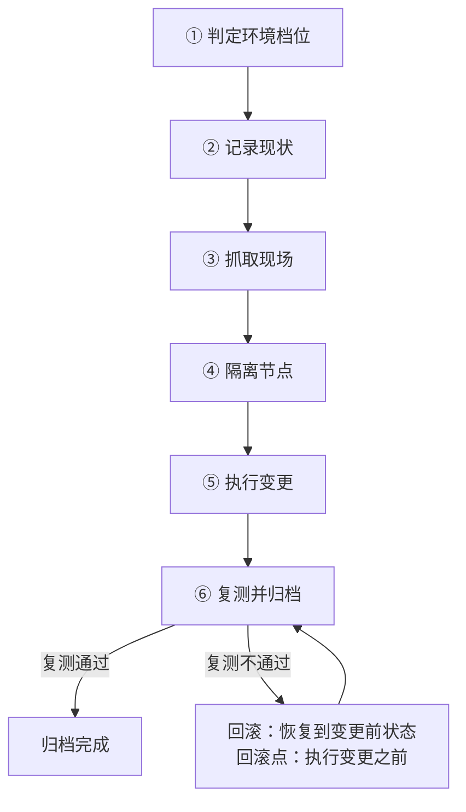

---
tags:
  - AI-Infra
  - 实验环境
  - 操作纪律
  - 体系
  - 变更旅程
created: 2026-10-11
---

# 一次驱动变更的完整旅程

一次变更的起点不是敲下安装命令的那一刻，而是「决定要动这台机器」的那一刻。从那一刻起，这台机器会依次经历六段：判定环境档位、记录现状、抓取现场、隔离节点、执行变更、复测并归档。这六段里真正会立刻失败的只有第五段，其余五段的失败都要等到事后才暴露——记录不成组要等对照时才发现，现场没抓够要等复盘时才发现，隔离没做干净要等业务被打断时才发现。因此这条链的价值不在于把动作排成顺序，而在于**明确每一段各自的失败落点与回滚点在哪里**。

下表把六段排开，标出每一段在做什么、以及到这里要能说清什么；它是后面逐段展开的目录。

| 段 | 这一段在做什么 | 到这里要能说清 |
| --- | --- | --- |
| 1 判定环境档位 | 先确认手上这台机器能验证什么：单机、双机还是多机；是否虚拟化；有没有真实高速网卡 | 哪一类结论在这台机器上做不了，以及为什么做不了 |
| 2 记录现状 | 把四项版本、模块构建方式、网卡固件、GPU 型号与显卡固件版本、拓扑一次性记下来 | 这台机器上线时是什么状态；与同节点池的其它机器漂移在哪一项 |
| 3 抓取现场 | 在改动之前留下可复盘的材料：整机取证快照、内核日志里的驱动记录、计数器快照、正在运行的作业 | 现场由哪几份材料构成，缺哪一份会让事后复盘不成立 |
| 4 隔离节点 | 让调度器不再往这台机器上派活，并确认已有的作业已经退出或已迁移 | 隔离完成的判据是什么，以及不隔离就动手的后果 |
| 5 执行变更 | 按包管理或官方工具执行：升级、降级、刷固件、重编模块 | 变更本身的可回滚点在哪一步，回滚命令是什么 |
| 6 复测并归档 | 复跑基线与冒烟项，把变更前后的数字一起归档 | 复测不通过时的判据与退路，以及要交出的产物 |

这六段不是一条没有回路的直线：第五段失败要有回到变更前状态的通道，而第六段的复测结果决定走不走这条通道。

## 段 1：判定环境档位

这一段在做的动作是把「这台机器能验证什么」先钉下来。它不是一次形式化的登记，而是给后面五段的结论划定有效范围：单机上验证的变更流程可以成立，但从单机得到的跨机结论不成立；虚拟化环境里读到的拓扑关系不能外推到裸金属机型。判定用四项字段完成——设备清单与设备来源、卡间连接类型、是否虚拟化，以及网卡与 GPU 的具体型号。

这一段没有前置条件，它是整条链的起点。它的失败落点也很特殊：**这一段不会失败，只是经常被跳过。** 跳过的后果是后续所有读数都建立在一个未声明的档位上，等到有人拿它去支撑跨档结论时才暴露，而那时现场早已不在。

## 段 2：记录现状

这一段把变更前的状态固定成一份可比的记录：四项版本、模块的构建方式、网卡固件版本、GPU 型号与显卡固件版本，以及拓扑与亲和关系。它的判据不是「记了没有」，而是「这份记录能不能回答这次变更改了哪几项、从什么改到什么」。四项版本要成组、要写清每一项的取值来源、要带统一的采集时刻，并且与机型、网卡型号、内核版本一起归档。

前置条件是段 1 的档位判定，因为记录里的环境字段决定了这份记录能用在哪一档。失败落点是**记录不成组**：只记了驱动一项、或者四项来自不同时刻，变更之后就找不到比对基准；这种失败在记录当天看不出来，只在对照时暴露，而那时已经无法回溯补齐。

## 段 3：抓取现场

这一段在改动之前留下可复盘的材料：整机取证快照、内核日志里的驱动记录、计数器快照、正在运行的作业，以及作业运行期间已经写出的通信库日志。五份材料各有自己的消失条件——重启清掉一类、模块卸载清掉一类、作业退出清掉一类，因此**取证的时机先于取证的完整性**：顺序错了，材料再全也抓不到。

前置条件是段 2 的记录，因为取证材料要与同一时刻的四项版本绑定才有意义。失败落点是**先动手、后取证**：快照脚本会打开设备，模块卸载会把设备从内核摘掉，重启会把内核缓冲清零，而这三件事在处置流程里几乎必然发生一次。这一段一旦错过，无法补救，只能靠下一次同类事件重新积累。

## 段 4：隔离节点

这一段让调度器不再往这台机器上派新任务，并确认已经在上面运行的作业已经退出或已经迁移到别处。判据有三条同时成立：调度器侧不再产生新的分配；已有作业确已退出或已在其它节点上继续运行；设备上不再有残留的进程占用。三条里差任何一条，都不算隔离完成。

前置条件是段 3 的现场已经抓完，因为作业一退出，进程级现场与通信库日志就随之消失。失败落点是**只挡住新任务、没处理旧任务**：此时动手会打断正在运行的业务，或者让作业在设备被摘走后异常退出，两种情况都会把一次计划内的变更变成一次事故。

## 段 5：执行变更

这一段按包管理或官方工具执行升级、降级、固件刷新或模块重编。**这四类动作都会中断同一台机器上的全部作业**，影响范围不是当前这个进程、也不是当前这块卡，而是整机；因此它们只允许在实验节点上验证，在生产节点上必须先完成隔离。执行之前要先把可回滚点写清楚：变更前记录的那组版本与包清单就是回滚依据，回滚动作通常是重新安装变更前那一版并重启，使其重新匹配。

失败落点是**在执行之前没有确定可回滚点**。有一部分动作可以直接退回，例如把包换回上一版；而固件刷新这一类动作的可退性要按官方工具的支持情况事先确认，事前没确认就意味着这条路径没有回路。把回滚点写在执行之前，是这一段唯一不能省的动作。

## 段 6：复测并归档

这一段把基线与冒烟项按变更前的同一组命令与参数复跑一遍，逐项与段 2 的记录对照，然后把变更前后的数字一起归档。判据是两件事：复测必须与基线同口径——同机型、同参数、同亲和关系；复测不通过时要有明确的退路，也就是回到段 5 事先写好的回滚点。

前置条件是段 2 与段 5 的记录都已齐备。失败落点是**复测口径与基线不一致，或者复测通过但没有归档**：前者让两组数字不可比，等于没有复测；后者让这次变更在下一次变更发生时无从追溯，同样的判断要重新做一遍。

## 六段各自的失败落点

把六段的失败形态并排放在一张表里，可以看到它们的共同点：**只有第五段会立刻失败，其余五段的失败都发生在「事后」。**

| 段 | 失败形态 | 最早能从哪里看出来 | 回滚点在何处 |
| --- | --- | --- | --- |
| 1 判定环境档位 | 在错误的档位上验证，结论无法外推 | 事后有人跨档使用这个结论时 | 无，只能重新在正确档位做一次 |
| 2 记录现状 | 记录不成组、缺来源或缺时刻 | 需要与变更后对照时 | 无，只能补记但已失去变更前的值 |
| 3 抓取现场 | 现场已在重启、卸载或作业退出中消失 | 复盘时需要某份材料时 | 无，不可逆，只能等下一次事件 |
| 4 隔离节点 | 仍有作业在设备上运行 | 变更前检查设备占用时 | 取消隔离，等作业退出后再继续 |
| 5 执行变更 | 变更动作本身失败，或改成了不可退的版本 | 执行当时，或复测时 | 执行变更之前，回到变更前的版本 |
| 6 复测并归档 | 复测口径与基线不一致，或结果未归档 | 复测当时，或下一次变更时 | 归档完成之前，回到第五段的回滚点 |

这张表也解释了为什么不能把这条链压缩成一句「先隔离、再升级、后复测」：那句口诀只覆盖了第四、五、六段，而前三段的失败不会在任何一步立刻显现，等发现时已经无法回退到它们。

**第一反应不要做什么**：不要跳过环境档位的判定就直接开始变更；不要在记录与取证之前动手；不要只挡住调度器的新分配就认为节点已隔离；不要在可回滚点还没写清楚的情况下执行不可退的动作；不要在复测口径与基线不同时宣布变更完成。正确的顺序是按六段逐段过关，每一段都先确认它的失败落点与回滚点，再进入下一段。

## 参考文档

- NVIDIA 驱动安装指南中关于安装方式、版本锁定与卸载的各节：变更动作的可回滚点与回滚方式。
- NVIDIA 驱动的持久化文档：重启与模块重载对运行时状态的影响，作为取证时机的依据。
- 网卡厂商的固件管理工具说明：固件刷新的影响范围与可降级性。
- 集合通信用户指南的排障章节：复测与基线对照时应当固定的参数与日志项。
