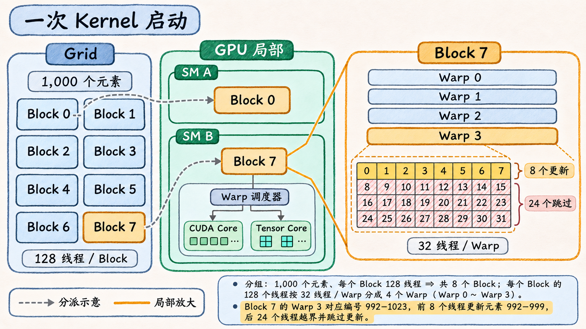

# CUDA Kernel 的线程分组与 SM 执行

同样是计算芯片，为什么一颗主频只有不到 2 GHz 的 GPU，在运行神经网络层或海量数组运算时，吞吐可以甩开主频 4 GHz 的多核 CPU 几十倍？反过来，如果只交给它几百条数据的零星任务，这张顶级 GPU 却可能跑得比 CPU 还慢？

答案藏在两者的设计哲学差异里。CPU 像几位手艺精湛的“全能工匠”，把大量晶体管花在超大缓存和分支预测上，全力压低单个任务的延迟；而 GPU 像一座拥有上百个平行车间的“工业装配厂”，把芯片面积倾注在海量算术单元上，靠**极高的并行度**与**瞬时切换工作**来吞掉数据等待时间，全力拉高整体吞吐。

## 一、主机与设备的分工：一次 Kernel 如何启动

第 01 章已经把 GPU 放回了服务器整机拓扑。现在我们进入其中一张 GPU，看一段最简单的并行更新：CPU 需要对两个各含 1,000 个元素的数组执行逐位置乘加 `y[i] ← a × x[i] + y[i]`。其中每个下标 `i` 的计算彼此独立，更新第 6 个元素不必等待第 5 个完成，这正是 GPU 最擅长的并行形态。

**CUDA** 是 NVIDIA 的通用并行计算平台与编程模型。框架（如 PyTorch）或底层数学库通过 CUDA 软件接口管理显存、搬运数据并提交计算任务。在这套分工里，CPU 侧称为**主机（Host）**，负责发号施令；GPU 侧称为**设备（Device）**，负责大规模并行执行。

被主机提交到 GPU 上运行的函数称为 **Kernel（核函数）**。下面是一段精简的 CUDA 核函数及主机启动示例，可以帮助你直观看到主机如何把计算意图交给设备：

```cpp
// 设备端 Kernel：每个 GPU 线程只负责计算并更新属于自己的 1 个下标 i
__global__ void saxpy_kernel(int n, float a, const float *x, float *y) {
    int i = blockIdx.x * blockDim.x + threadIdx.x;  // 计算全局元素下标
    if (i < n) {                                    // 尾部越界保护：超出 1,000 的线程跳过
        y[i] = a * x[i] + y[i];
    }
}

// 主机端提交：所有操作按序排入同一条 CUDA Stream 工作队列
cudaMemcpyAsync(d_x, h_x, bytes, cudaMemcpyHostToDevice, stream); // 1. 输入从主机拷入显存
cudaMemcpyAsync(d_y, h_y, bytes, cudaMemcpyHostToDevice, stream);
saxpy_kernel<<<8, 128, 0, stream>>>(1000, a, d_x, d_y);           // 2. 启动 8 个 Block × 128 线程
cudaMemcpyAsync(h_y, d_y, bytes, cudaMemcpyDeviceToHost, stream); // 3. 按需将结果拷回主机
```

整段流程只有三步，却清晰划出了主机与设备的职责边界：

1. **准备与搬运**：CPU 在主机内存中准备好数组 `x` 与旧的 `y`，通过主机到设备拷贝（H2D）写入 GPU 显存中的两块设备缓冲区。
2. **异步入队执行**：主机把拷贝与 Kernel 依次提交到同一条 **CUDA Stream**（一条保序的工作队列，第 04 篇展开）。设备会严格等拷贝完成后再启动 Kernel 读取输入。
3. **就地消费或读回**：GPU 线程并行读出各自的 `x[i]` 与 `y[i]`，算出结果并原地写回显存。后续若继续在 GPU 上做下一层计算，结果直接留在显存即可；只有 CPU 需要读取结果时，才发起拷回并等待完成。

## 二、Grid、Block 与线程下标：三层并行组织

在 GPU 里，一个**线程（Thread）** 是 Kernel 的最小逻辑执行实例，拥有独立的下标与局部状态。本例安排 1 个线程更新 1 个数组元素，但 GPU 不会把成千上万个线程散乱地撒向硬件，而是组织成规整的三层结构：

- **Grid（网格）**：一次 Kernel 启动所生成的全部线程集合，对应一整次计算任务。
- **Block（线程块）**：把 Grid 切分成的若干固定大小的小组。同一 Block 内的线程可以共用一块片上暂存空间，也能通过屏障互相等待；但不同 Block 之间彼此独立，由硬件自由调度先后次序。
- **Thread（线程）**：Block 内的单个执行流，通过“块号 + 块内编号”锁定自己要处理的数据位置。

假设我们设定每个 Block 包含 128 个线程，要覆盖 1,000 个数组元素，Grid 的规模和全局下标计算如下：

$$\text{Block 数} = \left\lceil \frac{1{,}000}{128} \right\rceil = 8 \text{ 个 Block}, \qquad \text{总启动线程数} = 8 \times 128 = 1{,}024 \text{ 个线程}$$

$$i = 128 \times \text{Block 编号} + \text{块内线程编号}$$

由于 1,000 不能被 128 整除，末尾多出了 24 个“兜底线程”。内核中的 `if (i < 1000)` 边界判断会拦截这些越界线程：

| 线程块范围 | 映射全局下标 `i` | 实际执行行为 |
| --- | --- | --- |
| Block 0 – Block 6 | `0` – `895` | 全部 128 个线程均满足 `i < 1000`，正常读写更新 |
| Block 7（前 104 个线程） | `896` – `999` | 满足 `i < 1000`，正常读写更新 |
| Block 7（后 24 个线程） | `1000` – `1023` | 触发越界掩码，跳过访存与写回 |

## 三、SM 分派、Warp 发射与隐藏延迟的秘密

逻辑上的 Block 最终要落到芯片上的物理算力单元去干活。GPU 芯片由大量结构相同的计算模块拼装而成，每一个模块称为 **SM（Streaming Multiprocessor，流式多处理器）**，相当于装配厂里一座座自带调度员、工具台与小仓库的独立车间。一张 H100 SXM 80 GB 芯片内部集成了多达 **132 个 SM**。

当 Kernel 启动后，硬件调度器会把 Grid 中的每个 Block 作为一个整体分派到某个空闲或有余量的 SM 上。只要硬件资源足够，同一个 SM 可以同时**驻留（Resident）** 多个 Block——也就是说，这些线程保持状态所需的寄存器与片上空间已经全部就位，随时可以上场。

进入 SM 后，硬件并不是逐个线程发指令，而是把 Block 内连续编号的每 **32 个线程**捆绑成一个最小调度单位，称为 **Warp（线程束）**。因此，本例每个 128 线程的 Block 被切成 4 个 Warp，整个 Grid 共 32 个 Warp。



*图 02-01-01：一次 Kernel 启动从 Grid 到 Warp 的映射关系。左侧 8 个 Block 被动态分派到不同 SM（图中仅示意 SM A 与 SM B）；右侧放大 Block 7 的最后一个 Warp（Warp 3），32 条执行槽位中仅前 8 条更新元素 992–999，后 24 条被越界掩码跳过。*

NVIDIA 把这种以 Warp 为单位的并行机制称为 **SIMT（Single Instruction, Multiple Threads，单指令多线程）**。每当 SM 发射指令时，同一 Warp 内参与执行的线程都会步调一致地运行同一条指令，各自读写不同地址。

如果一个 Warp 内部发生条件分支（例如图中的尾部越界检查），硬件只能分路径依次发射指令，未走当前路径的槽位在那个周期就会空转闲置。

那么，GPU 是如何扛住动辄数百个时钟周期的显存读取延迟的呢？可以把它类比成**一位同时盯多口锅的厨师**：当第一口锅刚下料进入“烧水等待”阶段时，厨师不会站在灶台前发呆，而是立刻转身去切第二口锅的菜，等水烧开了再无缝切回来。

在 SM 里，每个驻留线程的操作数和中间结果都稳稳保存在**寄存器文件（Register File）** 中。一旦某个 Warp 发出内存读取指令被迫等待数据返回，**Warp 调度器（Warp Scheduler）** 会在零切换开销下立刻挑选另一个已就绪的 Warp 发射指令。只要 SM 里驻留了足够多的就绪 Warp，大量算术指令就能把漫长的访存等待严严实实地遮盖掉。

> [!summary] 核心结论
> GPU 并不是靠“把单次访存变快”来提速，而是靠在每个 SM 上同时驻留大量 Warp、在等待数据的空档里无缝切换发射其他就绪 Warp，用**吞吐隐藏延迟**。

## 四、CUDA Core 与 Tensor Core：两类算力引擎

指令从 Warp 调度器发射出去后，具体交给 SM 里的哪一类计算单元执行，取决于这条指令是什么运算。观察下面这张 H100（GH100）单个 SM 的真实内部架构图，可以一眼看清各功能部件的位置：


*图 02-01-02：H100 单个 SM 的内部微架构（来源：NVIDIA Hopper Architecture In-Depth）。每个 SM 被划分为 4 个对称处理分区，各配独立的 Warp 调度器、发射单元、16,384 个 32 位寄存器、标量运算单元、第四代 Tensor Core 与 LD/ST 访存单元；底部为该 SM 共用的 TMA 引擎与 256 KB 统一 L1 缓存/共享内存。*

图中绿色阵列里的两类核心运算单元，支撑着 AI 基础设施里截然不同的算子需求：

- **CUDA Core（标量/常规计算单元）**：图中的 `FP32`、`INT32`、`FP64` 单元，每次指令处理单个标量元素的加减乘除。本文的 FP32 数组乘加，以及大模型中的 LayerNorm、Softmax、激活函数和位置编码（RoPE）等逐元素算子，都在这里执行。
- **Tensor Core（矩阵乘加专用单元）**：图中每个分区右侧的大块绿色模块，专门在一个周期内吞吐整块小矩阵的乘加（$D = A \times B + C$）。大模型训练和推理中占比最高的线性层投影与注意力矩阵运算，核心算力全部来自 Tensor Core。

> [!tip] 工程直觉
> **启动形状决定有多少线程干活，指令种类决定用哪条产线干活。** 一张 H100 的 FP16 Tensor Core 理论算力接近常规 FP32 CUDA Core 的 15 倍。如果模型或数学库因形状不对齐、精度不匹配回退到了 CUDA Core，即使 SM 看起来满负荷运转，端到端算力也会瞬间暴跌一个数量级。

## 五、寄存器、共享内存与驻留率（Occupancy）

既然 SM 驻留的 Warp 越多越容易隐藏延迟，那能不能无限往一个 SM 里塞 Block 呢？不行。SM 的片上物理资源是固定配额，只要**寄存器、共享内存、最大 Block 数、最大 Warp 数**四项中有任何一项触顶，新的 Block 就只能排队等待。

工程上用**驻留率（Occupancy）** 来衡量 SM 的“工位装填度”：

$$\text{驻留率（Occupancy）} = \frac{\text{单 SM 实际可同时驻留的 Warp 数}}{\text{单 SM 硬件允许的最大 Warp 数}}$$

以 H100 单个 SM 为例，硬件配额包含 4 个分区合计 **65,536 个 32 位寄存器**、最多同时驻留 **64 个 Warp**（2,048 线程），共享内存最高可配约 228 KiB。

假设启动一个大 Grid，每 Block 含 128 线程（4 个 Warp），每线程占 64 个寄存器。暂忽略分配粒度，先看寄存器约束：

$$\text{单 Block 寄存器需求} = 128 \times 64 = 8{,}192 \text{ 个}$$

$$\text{寄存器允许的 Block 上限} = \left\lfloor \frac{65{,}536}{8{,}192} \right\rfloor = 8 \text{ 个 Block} = 32 \text{ 个 Warp} \quad (\text{驻留率 } 50\%)$$

如果这个 Kernel 为了复用数据，每个 Block 还需要申请 **32 KiB** 共享内存，而当前 SM 配置分给共享内存的空间为 **132 KiB**，再核算共享内存约束：

$$\text{共享内存允许的 Block 上限} = \left\lfloor \frac{132\text{ KiB}}{32\text{ KiB}} \right\rfloor = 4 \text{ 个 Block} = 16 \text{ 个 Warp} \quad (\text{驻留率 } 25\%)$$

取各资源约束的最小值，这个 SM 最终最多只能同时驻留 $\min(8,\, 4) = 4$ 个 Block（16 个 Warp），共享内存成了真正的木桶短板。

> [!warning] 常见误区：别把“低驻留率”和“算力喂不饱”混为一谈
> 1. **小 Grid 喂不饱芯片**：回到开篇只有 8 个 Block 的 1,000 元素任务，整张 H100 有 132 个 SM，意味着最多只有 8 个 SM 能分到活，其余 **124 个 SM 全程空转**。在线推理遇到极小 Batch 或拆分过细的算子时，也常出现类似“波尾效应”。
> 2. **驻留率并非越高越快**：只要当前驻留的 Warp 已经足够隐藏访存和指令延迟，继续强行压低单线程寄存器或共享内存来换取 100% 驻留率，反而可能逼出寄存器溢出（Spill）到慢速显存，导致性能倒退。

即使把数组规模扩大到千万级、让全部 132 个 SM 都塞满活跃 Warp，每一次乘加依然绕不开同一个现实问题：**操作数 `x[i]` 和 `y[i]` 到底存在哪里，要翻过几道墙才能送到算术单元手里？** 下一篇我们将顺着存储层次，拆解显存带宽与容量的底层账本。

> [!info]- 参考资料
> - **CUDA 平台与编程模型**：[CUDA 13.2.1 · The CUDA Platform](https://docs.nvidia.com/cuda/archive/13.2.1/cuda-programming-guide/01-introduction/cuda-platform.html)、[CUDA 13.2.1 · Programming Model](https://docs.nvidia.com/cuda/archive/13.2.1/cuda-programming-guide/01-introduction/programming-model.html)
> - **线程层次、SIMT 与流顺序**：[CUDA 13.2.1 · Thread Hierarchy](https://docs.nvidia.com/cuda/archive/13.2.1/cuda-programming-guide/02-basics/writing-cuda-kernels.html#thread-hierarchy)、[CUDA 13.2.1 · Basics of SIMT](https://docs.nvidia.com/cuda/archive/13.2.1/cuda-programming-guide/02-basics/writing-cuda-kernels.html#basics-of-simt)、[CUDA 13.2.1 · SIMT Execution Model](https://docs.nvidia.com/cuda/archive/13.2.1/cuda-programming-guide/05-appendices/cuda-cpp-execution-model.html)、[CUDA 13.2.1 · Stream Ordering](https://docs.nvidia.com/cuda/archive/13.2.1/cuda-programming-guide/02-basics/asynchronous-execution.html#cuda-stream-ordering)
> - **Hopper SM 微架构与 Tensor Core**：[NVIDIA H100 架构白皮书 · H100 GPU Architecture](https://dam-cdn.nvd.orangelogic.com/AssetLink/705n6ur546g0uk43w0117r17n8042d73.pdf#page=18)、[NVIDIA · Hopper Architecture In-Depth（图 4）](https://developer.nvidia.com/blog/nvidia-hopper-architecture-in-depth/#h100_sm_architecture)、[cuBLAS 13.2 · Tensor Core Usage](https://docs.nvidia.com/cuda/archive/13.2.1/cublas/index.html#tensor-core-usage)
> - **驻留率与硬件配额**：[Hopper Tuning Guide 13.2 · Occupancy](https://docs.nvidia.com/cuda/archive/13.2.1/hopper-tuning-guide/index.html#occupancy)、[Hopper Tuning Guide 13.2 · Unified Shared Memory/L1/Texture Cache](https://docs.nvidia.com/cuda/archive/13.2.1/hopper-tuning-guide/index.html#unified-shared-memory-l1-texture-cache)、[CUDA 13.2.1 · Compute Capabilities](https://docs.nvidia.com/cuda/archive/13.2.1/cuda-programming-guide/05-appendices/compute-capabilities.html)、[CUDA Best Practices Guide 13.2 · Memory Instructions](https://docs.nvidia.com/cuda/archive/13.2.1/cuda-c-best-practices-guide/index.html#memory-instructions)
