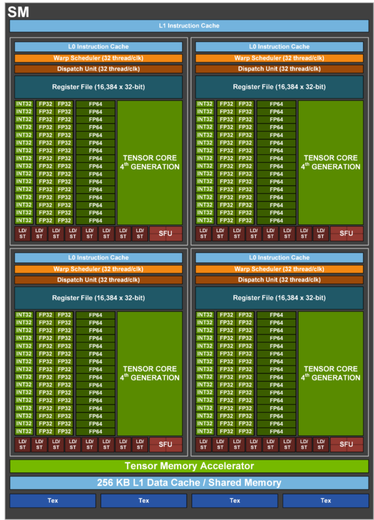

第 01 章把 GPU 放回了服务器的设备拓扑。现在只看其中一张 NVIDIA GPU。CPU 上的程序要更新两个数组中的 1,000 个位置，每个位置各做一次 `y[i] ← a × x[i] + y[i]`。`i` 是从 0 开始的下标，`a` 是事先给定的一个数。更新位置 6 不需要等待位置 5，GPU 因此可以把很多位置交给不同线程处理。

CUDA 是 NVIDIA 的 GPU 计算平台和编程模型。框架、数学库或应用借助 CUDA 软件接口管理设备内存、搬运数据、提交 GPU 工作。下面的程序运行在主机一侧，CUDA 运行时和驱动把请求交给设备。**Kernel（核函数）** 是此次提交给 GPU 运行的函数。主机和设备各有自己的执行和存储资源。 [CUDA 13.2.1 · The CUDA platform](https://docs.nvidia.com/cuda/archive/13.2.1/cuda-programming-guide/01-introduction/cuda-platform.html) · [CUDA 13.2.1 · Programming Model](https://docs.nvidia.com/cuda/archive/13.2.1/cuda-programming-guide/01-introduction/programming-model.html)

1. CPU 在主机内存准备 `x` 和旧的 `y`，程序把它们复制到这张 GPU 的两个设备缓冲区。一块缓冲区是一段用来存数据的内存。
2. 主机启动 Kernel，给出两个设备缓冲区的位置、元素数量和线程分组形状。拷贝和 Kernel 可提交到同一个 CUDA Stream，也就是一条有执行顺序的工作队列。这样设备先完成拷贝，再读取输入。
3. GPU 线程读取各自的 `x[i]` 和旧的 `y[i]`，执行乘加，把结果写回原来的 `y[i]`。Kernel 完成后，同一个 Stream 中后续的设备操作可以按序使用结果。要让 CPU 读结果，再把 `y` 拷回主机内存并等拷贝完成。第 04 篇展开提交、执行和完成这几个时点。 [CUDA 13.2.1 · Stream Ordering](https://docs.nvidia.com/cuda/archive/13.2.1/cuda-programming-guide/02-basics/asynchronous-execution.html#cuda-stream-ordering)

## Grid、Block 与线程下标

GPU 线程是 Kernel 的一个逻辑执行实例，有自己的下标和局部状态。本例安排一个线程更新一个位置。主机把工作切成每组 128 个线程，每组称为一个 **Block（线程块）**。一次 Kernel 启动的全部 Block 组成 **Grid（网格）**。要覆盖 1,000 个位置，Grid 需要 `⌈1,000 / 128⌉ = 8` 个 Block，共启动 1,024 个线程。 [CUDA 13.2.1 · Thread Hierarchy](https://docs.nvidia.com/cuda/archive/13.2.1/cuda-programming-guide/02-basics/writing-cuda-kernels.html#thread-hierarchy)

| 线程如何定位元素 | 例子 |
| --- | --- |
| `i = 128 × Block 编号 + 块内线程编号` | Block 0 对应 0–127，Block 7 对应 896–1023 |
| 只有 `i < 1,000` 才读写数组 | Block 7 的 896–999 更新结果，1,000–1023 跳过 |

Block 也划定了普通 Kernel 中线程协作的范围。同一 Block 的线程可以用一块共用的片上暂存空间，也可以在块内等待彼此到达指定位置。对于这里的独立更新，每个 Block 处理一段互不重叠的数据，各块的先后次序由设备安排。 [CUDA 13.2.1 · Programming Model](https://docs.nvidia.com/cuda/archive/13.2.1/cuda-programming-guide/01-introduction/programming-model.html)

## SM 分派与 Warp 发射

**SM（Streaming Multiprocessor，流式多处理器）** 是 GPU 芯片上重复布置的执行模块，自带调度器、执行单元和片上存储。整张 H100 SXM 80 GB 有 132 个 SM。普通 Block 作为整体派到一个 SM，资源允许时，同一 SM 可以驻留多个 Block。驻留指线程已在 SM 上占有保持执行状态所需的硬件资源。 [NVIDIA H100 架构白皮书 · H100 GPU Architecture](https://dam-cdn.nvd.orangelogic.com/AssetLink/705n6ur546g0uk43w0117r17n8042d73.pdf#page=18) · [CUDA 13.2.1 · Programming Model](https://docs.nvidia.com/cuda/archive/13.2.1/cuda-programming-guide/01-introduction/programming-model.html)

在 SM 上，块内线程按连续编号每 32 个编成一组，称为 **Warp（线程束）**。本例每个 Block 有 4 个 Warp，整个 Grid 有 32 个 Warp。Block 7 的最后一个 Warp 对应 992–1023，其中前 8 个线程参与更新。NVIDIA 把这种执行方式称为 SIMT（Single Instruction, Multiple Threads，单指令多线程）。发射一条 Warp 指令时，参与的线程执行相同的指令，各自操作自己的数据。如果一个 Warp 的线程进入不同的分支，发射某一路径的指令时只有走该路径的线程参与，部分运算槽位因此可能闲置。尾部越界检查就是一个简单的例子。 [CUDA 13.2.1 · Writing CUDA SIMT Kernels](https://docs.nvidia.com/cuda/archive/13.2.1/cuda-programming-guide/02-basics/writing-cuda-kernels.html#basics-of-simt) · [CUDA 13.2.1 · SIMT Execution Model](https://docs.nvidia.com/cuda/archive/13.2.1/cuda-programming-guide/05-appendices/cuda-cpp-execution-model.html)

**图 02-01-01**　虚线画出两个 Block 的可能分派，两个 SM 代表 GPU 的局部。放大图中的 0–31 是 Warp 内的槽位编号。前 8 个槽位对应数组元素 992–999。SM B 内的实线指向两类可用的运算单元，下文解释这次更新使用哪一类。

## CUDA Core、Tensor Core 与等待中的 Warp

一次逐元素更新依次需要加载操作数、乘加、写回。Warp 发出读取指令后，乘加要等数据到达。每个线程的操作数和中间值可以保存在 SM 的寄存器中。等待期间，Warp 调度器可以从其他已驻留且就绪的 Warp 发射指令，原 Warp 的状态保留在片上。多份工作交替推进，可以用别的指令覆盖一部分访存等待。 [CUDA 13.2.1 · SIMT Execution Model](https://docs.nvidia.com/cuda/archive/13.2.1/cuda-programming-guide/05-appendices/cuda-cpp-execution-model.html) · [CUDA Best Practices Guide 13.2 · Memory Instructions](https://docs.nvidia.com/cuda/archive/13.2.1/cuda-c-best-practices-guide/index.html#memory-instructions)

本例以 FP32（32 位浮点数）执行标量乘加，相应指令走常规 FP32 执行单元，规格表将这类单元计入 CUDA Core。Tensor Core 是同一 SM 中专门执行矩阵乘加指令的单元，适合批量处理一小块矩阵的乘积与累加。一个矩阵乘法能否使用它，取决于 GPU 支持的运算格式与库或 Kernel 选择的指令。启动形状决定有多少逻辑线程，指令种类决定这些线程用到哪类硬件。 [NVIDIA · Hopper SM 与 Tensor Core](https://developer.nvidia.com/blog/nvidia-hopper-architecture-in-depth/#h100_sm_architecture) · [cuBLAS 13.2 · Tensor Core Usage](https://docs.nvidia.com/cuda/archive/13.2.1/cublas/index.html#tensor-core-usage)

**图 02-01-02**　NVIDIA 的 GH100 单个 SM 结构图。沿一个分区看，Warp Scheduler 选择工作，Dispatch Unit 发射指令，FP32 和 Tensor Core 对应不同运算，LD/ST 执行加载和存储。底部的 L1 和共享内存是该 SM 的片上资源。 [NVIDIA · Hopper Architecture In-Depth，图 4](https://developer.nvidia.com/blog/nvidia-hopper-architecture-in-depth/#h100_sm_architecture)

## 寄存器、共享内存与驻留率

只要寄存器、共享内存、Block 或 Warp 槽位中有一项放不下新的 Block，待派发的 Block 就需要等待资源释放。**驻留率（occupancy）** 以每 SM 能驻留的最大 Warp 数为分母。驻留率高时可能有更多 Warp 可供选择，能否发射还取决于操作数、执行单元和依赖是否就绪。 [Hopper Tuning Guide 13.2 · Occupancy](https://docs.nvidia.com/cuda/archive/13.2.1/hopper-tuning-guide/index.html#occupancy)

设 Grid 足够大，每 Block 仍有 128 个线程，每线程使用 64 个 32 位寄存器。H100 每 SM 有 65,536 个 32 位寄存器，最多驻留 64 个 Warp。先忽略具体分配粒度，一个 Block 要 `128 × 64 = 8,192` 个寄存器，单看寄存器最多容纳 8 个 Block，即 32 个 Warp（50%）。若每个 Block 还要用 32 KiB 共享内存，而该 SM 划给共享内存的容量为 132 KiB，按这两项资源估算最多只容纳 4 个 Block，即 16 个 Warp（25%）。实际驻留还受编译结果、分配粒度及其他上限约束。 [Hopper Tuning Guide 13.2 · Occupancy 与 L1/Shared Memory](https://docs.nvidia.com/cuda/archive/13.2.1/hopper-tuning-guide/index.html#unified-shared-memory-l1-texture-cache) · [CUDA 13.2.1 · Hardware Limits](https://docs.nvidia.com/cuda/archive/13.2.1/cuda-programming-guide/05-appendices/compute-capabilities.html)

回到最初只有 8 个 Block 的 Grid，这批工作最多分到 8 个 SM。即使增大 Grid 让更多 SM 获得工作，每个乘加仍要先读到对应的 `x[i]` 和 `y[i]`。这些值从哪里来、要经过哪些存储层，决定了执行单元能多快取得下一组操作数。
