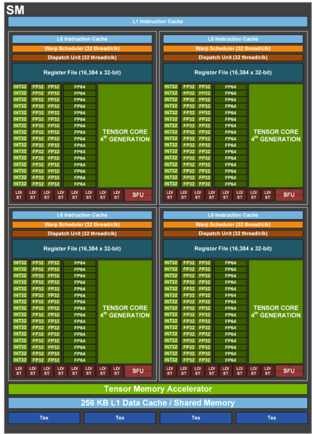
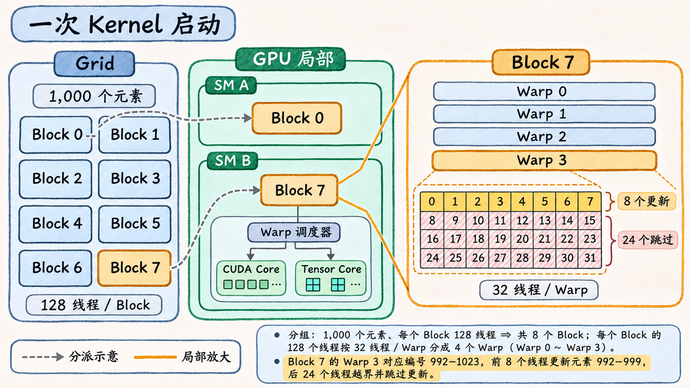

# 从一次 Kernel 启动到 SM 执行

假设 CPU 已把两个数组 `x` 和 `y` 传入显存，接下来要更新 1,000 个元素。每个位置都做同一件事，`y[i] ← a × x[i] + y[i]`，其中 `a` 是一个标量，各位置之间没有依赖。CPU 可以发起一次 **Kernel（核函数）**启动，让 GPU 上的线程各自取一个位置来处理。要理解这些线程如何执行，先看它们将在哪些硬件上运行。 [CUDA 13.2.1 · Programming Model](https://docs.nvidia.com/cuda/archive/13.2.1/cuda-programming-guide/01-introduction/programming-model.html)

## 先在 GPU 上找到执行的位置

GPU 芯片里有许多重复的 **SM**（Streaming Multiprocessor，流式多处理器）。以 H100 SXM 80 GB 为例，一张卡有 132 个 SM。多个 SM 可以各自执行不同的工作，并经芯片内共享的 L2 访问显存。图中放大的是其中一个 SM。 [NVIDIA H100 架构白皮书 V1.04 · H100 GPU Architecture](https://resources.nvidia.com/en-us-hopper-architecture)

**GH100 的单个 SM**　先找 `Warp Scheduler`，它从就绪的 Warp 中选择下一条要发射的指令。再看旁边的 `Register File`，它保存线程的操作数和中间值。`FP32`、`Tensor Core` 和 `LD/ST` 分别是图中执行浮点运算、矩阵乘加和访存指令的几类单元。底部的 `L1 Data Cache / Shared Memory` 是片上存储，其中共享内存可以由程序显式用作同一 Block 内线程的暂存区。整颗芯片与单个 SM 的原图分别见 NVIDIA 的图 3 和图 4。 [NVIDIA · Hopper Architecture In-Depth](https://developer.nvidia.com/blog/nvidia-hopper-architecture-in-depth/#h100_sm_architecture)

## 先派整个 Block，再按 Warp 发射

回到 1,000 个元素。程序按每段 128 个位置划分工作，一段交给一个 **Block**。Block 内的每个 **Thread（线程）** 用 Block 编号和自己的编号算出要处理的位置。一次启动的所有 Block 组成 **Grid**。本例向上取整需要 8 个 Block，实际给出 `8 × 128 = 1,024` 个线程位置。Block 7 的线程对应编号 896–1023，其中 896–999 有数据可更新。 [CUDA 13.2.1 · Programming Model](https://docs.nvidia.com/cuda/archive/13.2.1/cuda-programming-guide/01-introduction/programming-model.html)

设备以 Block 为单位分派工作。假设 Block 7 被派给下图的 SM B，整组线程就在这个 SM 上执行。同一个 SM 有足够资源时也可以容纳别的 Block。Block 编号用来确定处理哪段数据，具体派到哪个 SM 和何时开始由设备决定。 [CUDA 13.2.1 · Programming Model](https://docs.nvidia.com/cuda/archive/13.2.1/cuda-programming-guide/01-introduction/programming-model.html)

进入 SM 后，128 个线程按连续编号每 32 个分成一组，每组称为一个 **Warp**。Block 7 因此有 4 个 Warp，整个 Grid 有 32 个。最后一组的范围是 992–1023。越界检查决定哪些线程参与接下来的读写和乘加，只有前 8 个位置有对应元素。类似地，如果同一个 Warp 中有线程分别走两个分支，执行各路径的指令时只有走该路径的线程参与。两条路径都很长时，执行单元就会有更多时间只为一部分线程做有效工作。 [CUDA 13.2.1 · SIMT Architecture](https://docs.nvidia.com/cuda/archive/13.2.1/cuda-c-programming-guide/index.html#simt-architecture)

**图 02-01-01**　一次 Grid 启动包含 8 个 Block，每个 Block 有 128 个线程。图中展示两个代表性 SM 和一组可能的分派。Block 7 的最后一个 Warp 有 8 个线程更新元素 992–999，其余 24 个跳过更新。

## 跟着一个 Warp 看它如何用到硬件

假设这些数组使用 FP32。一个 Warp 做逐元素更新时，先通过访存指令读取 `x[i]` 和旧的 `y[i]`。如果数据还没到，下一条使用这些数据的乘加指令就不能发射。此时 SM 的 Warp 调度器可以选择另一个已就绪的 Warp。原来的 Warp 保留自己的执行状态，等操作数就绪后再继续。对于这里的标量 FP32 乘加，发射的是常规 FP32 运算指令，由 CUDA Core 对应的执行单元完成，之后再把结果写回。 [CUDA 13.2.1 · Hardware Multithreading](https://docs.nvidia.com/cuda/archive/13.2.1/cuda-c-programming-guide/index.html#hardware-multithreading) · [NVIDIA H100 架构白皮书 V1.04 · H100 SM Architecture](https://resources.nvidia.com/en-us-hopper-architecture)

如果换成矩阵乘法，库可能选择使用矩阵乘加指令的实现。某个 SM 发射这类指令时，相应运算由该 SM 内的 Tensor Core 执行。能否走这条路径取决于硬件、运算格式、输入的形状和布局，以及库实际选择的实现。规格表里的 CUDA Core 与 Tensor Core 数量分别描述两类硬件资源。一次启动有多少线程，看的是应用给出的 Grid 和 Block。 [NVIDIA · H100 Tensor Core Architecture](https://developer.nvidia.com/blog/nvidia-hopper-architecture-in-depth/#h100_tensor_core_architecture) · [cuBLAS 13.2 · Tensor Core Usage](https://docs.nvidia.com/cuda/archive/13.2.1/cublas/index.html)

## 为什么 SM 有时还能接下一个 Block

调度器要在一个 Warp 等数据时找到别的工作，前提是有其他 Warp 已经**驻留**在 SM 上，而且其中有 Warp 就绪。Block 驻留需要给线程分配寄存器，并为该 Block 按需分配共享内存。只要其中一项资源或硬件的 Block、Warp 数量上限先用尽，后续 Block 就要等已有工作完成并释放资源。 [CUDA 13.2.1 · Hardware Multithreading](https://docs.nvidia.com/cuda/archive/13.2.1/cuda-c-programming-guide/index.html#hardware-multithreading)

以 H100 为例，单个 SM 有 65,536 个 32 位寄存器，最多驻留 64 个 Warp。另假设一个规模足够大的 Grid，每 Block 仍有 128 个线程，每线程使用 64 个寄存器。忽略分配粒度，先只看寄存器，一个 Block 需要 `128 × 64 = 8,192` 个寄存器，所以最多同时放 `65,536 ÷ 8,192 = 8` 个 Block。每 Block 有 4 个 Warp，这一项给出 32 个 Warp 的上限，即 `32 ÷ 64 = 50%` 的理论驻留率（occupancy）。若共享内存只够 4 个 Block，则上限变为 16 个 Warp，也就是 25%。 [Hopper Tuning Guide 13.2 · Occupancy](https://docs.nvidia.com/cuda/archive/13.2.1/hopper-tuning-guide/index.html#occupancy)

最初的例子总共只有 8 个 Block，每个只能分给一个 SM，因此一次启动最多让 8 个 SM 承担这批计算。读性能记录时，可以先数 Grid 给了多少 Block，判断多少个 SM 有机会分到工作。再看每个 SM 能容纳多少 Warp，以及调度器能从中找到多少就绪的 Warp。 [CUDA Best Practices Guide 13.2 · Occupancy](https://docs.nvidia.com/cuda/archive/13.2.1/cuda-c-best-practices-guide/index.html#occupancy)
