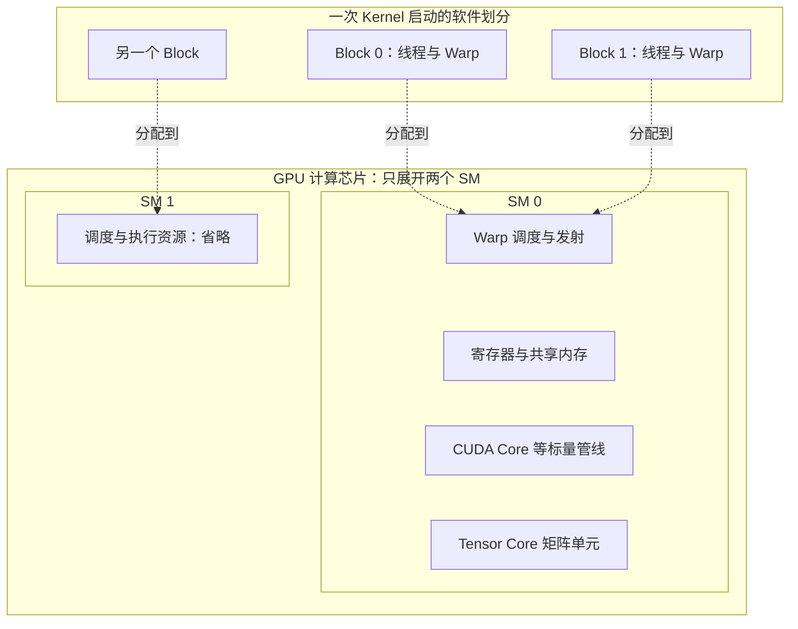

# 从一次 Kernel 启动到 SM 执行

## 先把一项计算拆成许多工作

假设有两组数组 A、B，需要逐元素相加得到 C。CPU 可以组织输入和分配空间，再让 GPU 执行大量相似的加法。这里把在 GPU 上执行的函数称为 **Kernel（核函数）**；一次启动会指定它要启动多少 GPU 线程，以及怎样分组。框架中的一个算子可以调用一个或多个 Kernel，也可以与其他算子融合进同一个 Kernel，算子名和 Kernel 名不必一一对应。

GPU 线程是一次 Kernel 中带有自身编号、寄存器状态和控制流的执行实例。它不是 Linux 调度器管理的一个主机线程。CPU 侧可以只有少量提交线程，GPU 侧却有大量线程实例处理不同的数据。

CUDA 把一次启动的线程组织成 **Grid（线程块网格）**，Grid 包含 **Thread Block（线程块，后文简称 Block）**，Block 再包含线程。线程用组内编号和 Block 编号决定处理哪项数据。下面仅用一维编号说明分工，不需要阅读 CUDA 代码：

```text
任务：C[i] = A[i] + B[i]，i 从 0 到 999
一次启动：4 个 Block，每个 256 个线程
全局编号：i = Block 编号 × 256 + Block 内线程编号
只有 i < 1000 的线程进行这次数组读写
```

因此启动了 `4 × 256 = 1,024` 个线程实例，其中 1,000 个处理有效元素，末尾 24 个只完成边界判断。这个例子把“要计算多少数据”和“启动多少线程”建立了映射。真实 Kernel 也可以让一个线程循环处理多项数据；不能看到元素数就直接认定线程数。

线程块内部可以使用块内同步与共享内存协作。普通 Block 的执行不应依赖其他 Block 按某个先后顺序完成；Grid 很大时，硬件可能分批执行它们。这里的基本层次见 [CUDA 12.8.1 Programming Guide：Thread Hierarchy](https://docs.nvidia.com/cuda/archive/12.8.1/cuda-c-programming-guide/index.html#thread-hierarchy)。

## SM 是承接线程块的硬件范围

**SM（Streaming Multiprocessor，流式多处理器）**是 GPU 中承接线程块、调度指令并提供执行资源的一组硬件。一个普通 Block 分配到一个 SM，该 Block 的线程不会分散到多个 SM 执行；一个 SM 可以同时驻留多个 Block。SM 内的寄存器保存各线程的执行数据，共享内存则供块内线程协作；下一篇再展开它们的访问方式。这里的“驻留”是指为线程分配了寄存器等资源、保持执行状态，并不表示它们每个周期都在发出指令。

下面的软件划分框表达工作分组，GPU 计算芯片框表达硬件包含关系；虚线箭头仅示意 Block 的一次放置。图中只展开两个 SM，省略其余 SM 与许多执行管线。



框中的寄存器和执行单元属于 SM；图中没有把寄存器画成指令必须经过的中间处理器，也没有表达具体芯片的内部布线。Block 到 SM 的分配由执行系统进行，Block 编号不等于 SM 编号。对应机制见 [CUDA 12.8.1：Hardware Implementation](https://docs.nvidia.com/cuda/archive/12.8.1/cuda-c-programming-guide/index.html#hardware-implementation)。

## Warp 把线程组织为可调度的执行组

NVIDIA 的 **Warp** 由同一 Block 内连续编号的 32 个线程位置组成。线程数不是 32 的整数倍时，最后一个 Warp 仍占用一个组，只是部分位置没有线程。Warp 不跨 Block 拼接。

刚才的例子中，每个 Block 有 `256 ÷ 32 = 8` 个 Warp，四个 Block 共 32 个 Warp。最后一个 Block 的最后一个 Warp 对应全局编号 992—1023，其中 992—999 的 8 个线程做有效加法，其余 24 个跳过读写。整个启动的有效元素比例是 `1,000 / 1,024`，但这不意味着整段 Kernel 的每条指令都以这个比例利用执行资源。

SM 的 Warp 调度器从已经驻留、且下一条指令所需条件已满足的 Warp 中选择工作。某个 Warp 等待数据时，另一个就绪 Warp 可以发出指令，用其他工作覆盖等待时间。GPU 的高吞吐依赖足够多的就绪工作；“把一次访问变快”和“用其他工作遮住访问延迟”是两种机制。

这种执行方式称为 **SIMT（Single Instruction, Multiple Threads，单指令多线程）**：共同发出的指令作用于参与该指令的线程，各线程可以使用不同数据。不能把一个 Warp 理解成“32 个 Linux 线程”，也不能把它理解成“永久绑定 32 个 CUDA Core”。指令类型、架构管线和发射能力共同决定执行节奏。基本机制见 [CUDA 12.8.1：SIMT Architecture](https://docs.nvidia.com/cuda/archive/12.8.1/cuda-c-programming-guide/index.html#simt-architecture)。

如果同一 Warp 中一部分线程走分支 A，另一部分走分支 B，执行系统需要用相应的活动线程集合推进不同路径，降低共同执行的机会；这叫 Warp 内分支分歧。Volta 起的独立线程调度改变了执行与重汇合的细节，不能假设 Warp 中所有线程始终逐指令锁步。对本章而言，关键是：**线程可以有各自的控制流，但不规则工作仍可能减少有效并行执行。**

## CUDA Core 与 Tensor Core 各承接什么指令

CUDA Core 是 NVIDIA 对部分标量算术执行单元的称呼；SM 还包含加载/存储、整数、特殊函数等不同管线。它与能够独立运行复杂程序的 CPU 核不处于相同层次，所以“几万个 CUDA Core”不能直接和“几十个 CPU 核”计算性能倍数。

Tensor Core 是用于矩阵乘加等受支持操作的专用执行单元，可以把一小块矩阵的乘法与累加作为硬件操作推进。线程通过相应指令组织这些工作；Tensor Core 不是与 CUDA 线程体系分离的另一套作业调度器。

普通逐元素加法不会因为数组叫 Tensor 就自动获得矩阵乘加峰值。是否使用 Tensor Core，取决于硬件代际、数据类型、操作形式、数据布局和库实际选择的实现。后文讨论精度时，再把“输入存什么格式”和“指令使用什么计算路径”连接起来。两类单元的职责可对照 [NVIDIA GPU Performance Background：GPU Architecture Fundamentals](https://docs.nvidia.com/deeplearning/performance/dl-performance-gpu-background/index.html#gpu-arch)。

## 为什么线程很多，仍然可能没有足够工作

Block 的数量决定有多少组工作可被放置，Block 的资源需求则决定同一个 SM 能同时容纳多少组。寄存器和共享内存的物理含义将在下一篇展开，这里先把它们视作 SM 内有限的两种资源。

对 GPU-T 再给出一组**专用于驻留计算的教学限制**：每个 SM 最多 64 个驻留 Warp、8 个驻留 Block、65,536 个 32 位寄存器和 96 KiB 共享内存。某 Kernel 每个 Block 有 256 个线程，每线程需 128 个寄存器，每 Block 需 48 KiB 共享内存。本题忽略分配粒度等附加限制，且 Grid 足够大。

| 约束 | 最多同时容纳的 Block |
| --- | --- |
| Warp 数 | `64 ÷ 8 = 8` |
| Block 数 | `8` |
| 寄存器 | `65,536 ÷ (256 × 128) = 2` |
| 共享内存 | `96 ÷ 48 = 2` |

取各项的最小值，得到每 SM 最多驻留 2 个 Block，即 16 个 Warp。相对 64 个 Warp 的硬件上限，理论 **Occupancy（占用率）**为 `16 / 64 = 25%`。实际硬件的寄存器分配粒度、其他限制和实际调度还要分别核对；上面的数字没有借用某个真实型号的规格。

Occupancy 衡量驻留 Warp 的比例。驻留 Warp 中又可能有人在等待数据，只有满足条件的 Warp 才是就绪的；就绪之后还要获得发射机会。因此，占用率不能直接换算成算术吞吐百分比。提高占用率有助于提供更多可选工作，但如果代价是寄存器溢出、更多内存访问或其他争用，Kernel 仍可能变慢。工具中的相关定义见 [Nsight Compute Profiling Guide：Occupancy 与 Scheduler Statistics](https://docs.nvidia.com/nsight-compute/ProfilingGuide/index.html#sections-and-rules)。

现在只改变 Grid：如果一次启动仅有 4 个普通 Block，即使每个 Block 的线程很多，也至多同时用到 GPU-T 的 4 个 SM；80 个 SM 中其余部分没有这次启动的 Block。反过来，Grid 足够大也不保证每个 SM 持续满负载：Block 耗时不均、最后一批工作数量不足或所有 Warp 都等待数据，都可能留下空档。

至此，可以区分四个数量：启动的线程数、组成的 Warp 数、当前驻留的 Warp 数、当前能够发出指令的工作数。下一篇继续解释限制驻留的片上资源，以及这些工作从哪里取得数据。

[上一篇：本章导读](00_导读.md) · [下一篇：数据放在哪里与显存容量预算](02_数据放在哪里与显存容量预算.md)
