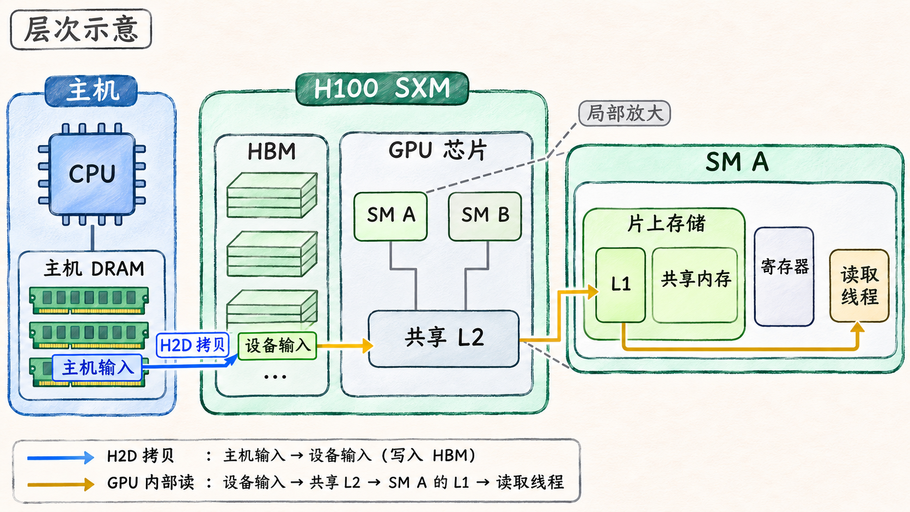

逐元素更新有两次读取和一次写回。先从 `x[i]` 的来处查起。CPU 准备的数组放在主机 DRAM（动态随机存取内存），主机到设备的拷贝（Host to Device，H2D）把它复制到目标 GPU 的设备缓冲区。下文假设 Linux 上的一张 H100 SXM 80 GB，使用普通的设备内存分配和显式拷贝。 [CUDA 13.2.1 · Understanding Memory](https://docs.nvidia.com/cuda/archive/13.2.1/cuda-programming-guide/02-basics/understanding-memory.html)

## 从设备全局内存读取一个元素

**全局内存**是设备代码可访问的一类内存空间。本例的两个数组都是全局内存缓冲区，以卡上的 **HBM（High Bandwidth Memory，高带宽内存）** 为物理存储。线程的 load 指令从该缓冲区读数，芯片上的缓存可以先满足部分请求。 [CUDA 13.2.1 · Memory Hierarchy](https://docs.nvidia.com/cuda/archive/13.2.1/cuda-programming-guide/01-introduction/programming-model.html) · [NVIDIA H100 架构白皮书 · HBM3 与 L2](https://dam-cdn.nvd.orangelogic.com/AssetLink/705n6ur546g0uk43w0117r17n8042d73.pdf#page=36)

| 位置 | 谁能用到它 | 在更新中的作用 |
| --- | --- | --- |
| HBM | 同一张 GPU 上的 SM 通过内存系统访问 | 放设备缓冲区，提供显存容量 |
| L2 数据缓存 | 同一 GPU 上的多个 SM | 可将常用数据留在芯片上，减少去 HBM 的请求 |
| L1 数据缓存 | 所在的 SM | 按访问类型及缓存策略缓存全局访存数据 |
| 共享内存（shared memory） | 本章普通 Block 内的线程 | Kernel 显式用作暂存和协作空间 |
| 寄存器 | 分配给 SM 上的线程 | 保存线程的操作数和中间值 |

当读取使用 L1 时，若 `x[i]` 所在的缓存行在 L1 命中，请求就能由该层满足。没命中时继续查共享的 L2，L2 有数据也能满足请求。两级都没有数据时，才沿这条路径从 HBM 取回。线程随后可用寄存器中的操作数做乘加，结果由写指令写回设备缓冲区。图中只展开读路径。 [CUDA 13.2.1 · Global Memory](https://docs.nvidia.com/cuda/archive/13.2.1/cuda-programming-guide/02-basics/writing-cuda-kernels.html#global-memory) · [PTX ISA 9.2 · Cache Operators](https://docs.nvidia.com/cuda/archive/13.2.1/parallel-thread-execution/index.html#data-movement-and-conversion-instructions-cache-operators)

**图 02-02-01**　蓝线标出源和目的缓冲区，省略主机互联及 GPU 内部的拷贝细节。琥珀线表示使用 L1、两级缓存均未命中时的数据返回方向，读取请求沿反向查找。图仅画出代表性 SM 和 HBM 堆叠，寄存器框标出资源位置。

缓存命中可以自动减少后续的 HBM 访问。若知道一组线程会反复使用同一批数据，例如矩阵乘法反复需要同一小块矩阵，Kernel 也可以先载入共享内存，让同一 Block 的线程在数据就绪后反复读这份副本。H100 的 L1 与共享内存共用一片片上存储，给共享内存的份额增大后，可用于 L1 的空间会缩小。单个 Block 请求更多共享内存，也可能使同一 SM 能同时驻留的 Block 变少。 [Hopper Tuning Guide 13.2 · Unified Shared Memory/L1/Texture Cache](https://docs.nvidia.com/cuda/archive/13.2.1/hopper-tuning-guide/index.html#unified-shared-memory-l1-texture-cache)

如果程序改用 CUDA 统一内存，则需结合平台能力确定页的驻留和迁移。一块由 CPU 和 GPU 访问的分配，可能在访问时产生迁移或跨主机互联访问。本章的预算与性能算例均按显式拷贝后的设备缓冲区推导。 [CUDA 13.2.1 · Unified Memory](https://docs.nvidia.com/cuda/archive/13.2.1/cuda-programming-guide/02-basics/understanding-memory.html)

## 按形状、元素类型和存活时间算峰值

稠密、连续且无额外填充的数据本体占用 **元素个数 × 每元素字节数**。张量可以理解成带形状和元素类型的数组，形状为 `2 × 3` 时有 6 个元素。以 FP32 存储，每元素 32 位即 4 B，数据本体为 24 B。对于两个各含 1,000 个元素的 FP32 数组，一批输入共 `2 × 1,000 × 4 B = 8,000 B`。`y` 原地更新，输入和值更新后的结果使用同一块存储。如果保留上一批的数据，同时接收下一批，就要给两批各留一套数组，占 16,000 B，另外再考虑运行时和分配器开销。

模型的容量预算也沿着谁在何时仍占用存储来算。加载权重后，它通常会持续驻留。计算到某个算子时，可能还需要留住输入和中间结果，同时申请该算法的工作区，也就是临时使用的一块内存。判断峰值要按执行阶段求同时占用量，共用底层存储的张量视图只记一次。训练时还需检查梯度、反向传播保留的中间状态、优化器状态等是否与其他分配重叠。

下表是独立的**教学算例**。假设给某个作业的单卡预算为 24 GB，`1 GB = 10⁹ B`，与 H100 标称 80 GB 的总容量属于不同口径。70 亿个 FP16 权重各占 2 B，合计 14 GB。假定工作区的峰值与输入、输出及中间状态的峰值同时出现，并在预算中另留 1 GB。

| 同一阶段的开销 | 原批量 | 增大批量 |
| --- | ---: | ---: |
| FP16 权重 | 14 GB | 14 GB |
| 活跃输入、输出与中间状态 | 3 GB | 8 GB |
| 算子工作区 | 2 GB | 2 GB |
| 预算预留 | 1 GB | 1 GB |
| 合计 | 20 GB | 25 GB |

原批量还有 4 GB 预算，增大批量后超出 1 GB。若在变大的批次中，2 GB 工作区等到表中的 8 GB 活跃状态全部释放后才申请，且无其他时点更高，两阶段分别需要 23 GB 和 17 GB，峰值降到 23 GB。若只把权重改为 FP32，权重本身需 28 GB。能否装下取决于实际存储格式及生命周期，能否成功申请还受当前可用量和分配器状态影响。

## 活跃张量、分配器保留量与设备用量

以 PyTorch 2.8 的原生 CUDA 缓存分配器为例，对应配置为 `PYTORCH_CUDA_ALLOC_CONF=backend:native`。为避免每次都向 CUDA 申请和归还空间，分配器可把已空出的内存块留下供同一进程复用。同一进程、同一设备上，`torch.cuda.memory_allocated(device)` 统计当前由张量占用的字节，`torch.cuda.memory_reserved(device)` 统计缓存分配器管理的字节，后者包含前者。`nvidia-smi` 的设备级 `memory.used` 还可能反映 CUDA 上下文、其他分配器或其他进程的显存使用。工具给出 MiB 时，先用 `1 MiB = 2²⁰ B` 统一口径。 [PyTorch 2.8 · Memory Management](https://docs.pytorch.org/docs/2.8/notes/cuda.html#memory-management) · [NVIDIA System Management Interface · FB Memory Usage](https://docs.nvidia.com/deploy/nvidia-smi/index.html#fb-memory-usage)

| 教学记录 | 活跃张量 | 分配器保留 | 设备已用 |
| --- | ---: | ---: | ---: |
| 释放张量前 | 2,048 MiB | 3,072 MiB | 3,328 MiB |
| 相关工作完成且张量引用释放后 | 1,024 MiB | 3,072 MiB | 3,328 MiB |

这里少了 1,024 MiB 的活跃张量，分配器仍持有空出的空间。要测一段工作的张量峰值，可以在起点调用 `torch.cuda.reset_peak_memory_stats(device)`，在区间结束后读 `torch.cuda.max_memory_allocated(device)`。该峰值包含起点已驻留的张量。遇到显存不足（out of memory，OOM），先对齐失败分配的大小、发生阶段和设备，再查失败前的活跃量、其他分配与可复用块。若有空出的空间却仍无法满足单次申请，可用 `memory_stats()` 或分配快照检查块的大小与状态。 [PyTorch 2.8 · Max Memory Allocated](https://docs.pytorch.org/docs/2.8/generated/torch.cuda.memory.max_memory_allocated.html) · [PyTorch 2.8 · Memory Management](https://docs.pytorch.org/docs/2.8/notes/cuda.html#memory-management)

容量按同时占据的字节计。换一个问题，两个数组即使都已装进 HBM，Kernel 每次更新仍会发出两读一写。要估算运行时间，需要数出真正跨过 HBM 边界的读写流量，再用每秒可传输的字节数换算。
