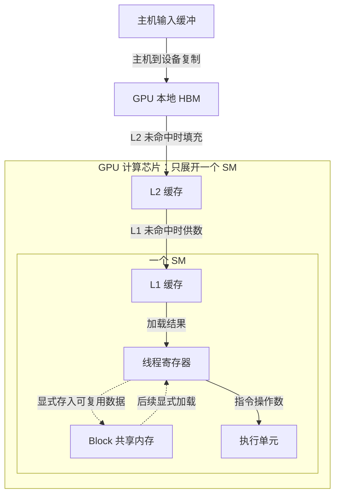

# 数据放在哪里与显存容量预算

## 先区分物理位置与程序中的名称

一次加法的输入可能最初位于主机内存，复制到 GPU 本地显存，再由 SM 发出加载指令取得数据。中间还会使用缓存、寄存器，某些 Kernel 会显式使用共享内存保存可复用的数据块。这里既有硬件层次，也有程序可见的存储范围。

| 对象 | 主要位置与用途 | 对本章判断的影响 |
| --- | --- | --- |
| 主机内存 | CPU 侧 DRAM，存输入、加载缓冲和主机状态 | 主机放得下，不代表目标 GPU 的本地显存放得下 |
| GPU 本地显存 | 与 GPU 相连的 DRAM，保存大部分设备数据 | 既要有容量，又要有持续搬运数据的能力 |
| L2 缓存 | GPU 计算芯片内，供多个 SM 使用 | 命中后可减少对片外显存的访问 |
| L1 缓存 | SM 附近的片上缓存 | 改变局部访问的代价与片外流量 |
| 共享内存（Shared Memory） | SM 内、由程序显式使用的片上存储，本章按 Block 范围讨论 | 支持块内线程复用数据，也占用 SM 的驻留资源 |
| 寄存器（Register） | SM 内，保存各线程的执行数据 | 每线程使用越多，可同时驻留的工作可能越少 |

**HBM（High Bandwidth Memory，高带宽内存）**是一类采用堆叠 DRAM 与宽接口的内存技术，常用于数据中心 GPU 的本地显存。它不是 SM 内的缓存。其他 GPU 也可能以 GDDR 作为显存，不能把“GPU 显存”和“HBM”当成始终可互换的名称。GPU-T 的 HBM 是本章选定的教学条件。

**Global Memory（全局内存）** 在 CUDA 中描述可由 GPU 中各 SM 访问的设备内存空间，普通设备分配的数据主要由本地显存承载。“Global”不表示自动横跨所有服务器。还有一个容易误读的名称 **Local Memory**：它表示线程私有的逻辑存储，其数据可以落在设备 DRAM 中，并非必然位于低延迟片上存储。寄存器放不下的部分数据可能溢出到这里，增加内存流量。相关定义见 [CUDA 12.8.1：Device Memory 与 Local Memory](https://docs.nvidia.com/cuda/archive/12.8.1/cuda-c-programming-guide/index.html#device-memory)。

## 画出一条普通加载路径

下面表达教学模型中的**数据复制与普通全局内存加载**。实线箭头表示选定方向的数据移动；虚线箭头表示 Kernel 对共享内存的显式存取。图只展开一个 SM，省略全局内存写回与其他访问类型。

这里画的是数据向执行单元流动的方向，未画从 SM 向外发出的访问请求。命中已有缓存时无需每次重新从 HBM 搬运。真实访问可以绕过部分缓存，支持条件下还可异步把全局数据送入共享内存；图中的普通路径不代表所有指令的唯一必经路线。

在一些架构中，L1 与共享内存使用可配置的共同片上资源，因此表格里的逻辑功能不一定对应完全独立的物理存储。无论怎样配置，共享内存都不能简单加到 HBM 容量上，作为任意设备分配可用的空间。架构实例见 [Ampere Tuning Guide：Unified Shared Memory/L1/Texture Cache](https://docs.nvidia.com/cuda/archive/12.8.1/ampere-tuning-guide/index.html#unified-shared-memory-l1-texture-cache)。

这也解释了前一篇的资源限制：为每个 Block 多保留一块共享内存，可能减少同时驻留的 Block，却也可能让这些 Block 少读多次 HBM。判断是否有利，要同时看工作并发与实际流量。

## 容量看同时存活的对象，带宽看单位时间的搬运

容量不足时，下一次分配可能失败，计算尚未开始就无法继续；带宽不足时，数据可以全部放下，但执行单元拿数据的速度限制了进度。一个 60 GiB 的常驻对象可以在很多轮计算中被重复读取，造成远大于 60 GiB 的累计流量；缓存复用也可以让多次逻辑读取只引起一次片外读取。

因此需要分别记录：某时刻有多少字节仍占据显存，一段时间实际读写多少字节，以及这些字节经过哪一层。下一篇的性能计算会使用 HBM 流量，不把主机到 GPU 的复制速率直接当成 HBM 带宽。

## 从数据生存期计算容量峰值

对 GPU-T，容量题给定 80 GiB 本地显存，其中 4 GiB 固定占用不进入应用预算，剩余 **76 GiB** 供下表中的对象使用。这个预算是教学假设，不表示驱动在所有 GPU 上固定占 4 GiB。假设应用独占设备、分配器能够满足下列请求，无碎片、额外缓存或其他隐藏占用。

| 对象 | 大小 | 何时仍需保留 |
| --- | --- | --- |
| 长期状态 | 50 GiB | 整轮都保留 |
| 当前批次的输入与中间结果 | 10 GiB | 从输入进入显存到本批完成 |
| 计算库临时工作区（Workspace） | 12 GiB | 计算阶段；本题在阶段结束即释放 |
| 下一批的预取缓冲 | 8 GiB | 采用预取时，与当前计算阶段重叠 |

本题当前批次的 10 GiB 由 8 GiB 输入和 2 GiB 预先分配的中间结果空间组成；预取只准备下一批的 8 GiB 输入，因此两项大小不同。Workspace 是库为了执行某种算法临时申请的空间；“模型数据已经装下”不保证库还能取得这块空间。按阶段列出占用，可以直接看出什么时候达到峰值：

| 阶段                   | 无预取的应用占用                | 加入重叠预取后的应用占用                |
| -------------------- | ----------------------- | --------------------------- |
| 仅长期状态                | 50 GiB                  | 50 GiB                      |
| 当前输入进入显存             | `50 + 10 = 60 GiB`      | 60 GiB                      |
| 当前计算及其工作区            | `50 + 10 + 12 = 72 GiB` | `50 + 10 + 12 + 8 = 80 GiB` |
| 本批结束、释放当前输入、中间结果与工作区 | 50 GiB                  | 下一批尚保留时为 58 GiB             |

无预取时，峰值 72 GiB，低于应用预算 76 GiB，按题设可以容纳，余量 4 GiB。重叠预取时应用需求达到 80 GiB，比预算多 4 GiB；连同固定占用，设备总需求是 84 GiB。不能拿应用的 80 GiB 与物理的 80 GiB 直接比较而漏掉固定占用。

若其他对象不变，想在当前计算期间预取，缓冲最多为 `76 − 50 − 10 − 12 = 4 GiB`。另一种选择是延后预取、让其避开工作区的生存期；这样降低了峰值，却也可能失去传输与计算重叠的机会。容量选择会改变后文的时间线。

## 为什么“只算权重”容易少算

AI 负载的长期状态可以包含模型参数、梯度和优化器状态；一轮中的中间结果称为激活值。某些推理负载还会缓存注意力计算中已得到的键和值，称为 KV Cache，其容量随保存的序列长度与并发增长。它们在这里仅作为不同生存期、不同增长方式的数据对象，无需掌握模型算法。

容量估算先问“本轮哪些对象同时存在”，再问每个对象的元素数与每元素字节数。例如，`2^30` 个 FP32 元素占 `2^30 × 4 B = 4 GiB`；同样元素数的 FP16 对象占 2 GiB。如果只把一个 4 GiB 对象改成 2 GiB，而其他对象保持原样，总峰值只减少 2 GiB。

混合精度可能保留 FP32 主副本或使用 FP32 累加与状态，数据转换也可能暂时保留新旧副本。不能把“某个张量改为半精度”直接换成“整项作业显存减半”。官方的一个实现实例见 [NVIDIA Mixed Precision Training：Automatic Mixed Precision](https://docs.nvidia.com/deeplearning/performance/mixed-precision-training/index.html#amp)；具体框架的对象和生存期仍须单独确认。

## 分配器占用、活跃数据与空闲空间

应用框架可以从设备分配一批显存，自己管理并缓存已释放的数据块，供后续复用。此时应区分：仍被活跃张量使用的字节、框架保留但可在内部复用的字节，以及设备层报告的空闲字节。设备总占用不会告诉你这些细分项。一个明确的实现实例是 [PyTorch 2.15 CUDA Semantics：Memory Management](https://docs.pytorch.org/docs/2.15/notes/cuda.html#memory-management) 中对 allocated 与 reserved 的区分；这里的框架 reserved 也不能和设备工具中的同名 Reserved 字段直接等同。

因此，一次内存分配失败（Out of Memory，OOM）需要结合请求大小、失败时的峰值、分配器状态和并发进程分析。总空闲量只是其中一个条件；特定内存池、碎片与分配策略也可能影响请求是否成功。本章计算题已排除这些额外因素，所以能够给出明确答案；真实材料中则需要补齐相应证据。

## 统一地址与统一内存不会创造 HBM

统一虚拟寻址帮助软件在同一虚拟地址体系下辨认不同位置的分配，不表示所有分配已经存放在同一块物理内存中。**Unified Memory（统一内存）**进一步提供可由 CPU/GPU 访问的内存管理方式；数据可能迁移，或在支持的平台上通过相关路径访问，具体行为取决于硬件与系统支持。

在支持显存超额订阅的平台上，某些受管理分配可以超过本地显存容量，但活跃页面的换入换出或远端访问需要付出时间与带宽代价。GPU-T 上那次普通设备分配失败，不会因此自动改成成功的统一内存运行。相关条件见 [CUDA 12.8.1：Unified Memory Programming](https://docs.nvidia.com/cuda/archive/12.8.1/cuda-c-programming-guide/index.html#unified-memory-programming)。

到这里，容量判断已经能回答“这轮计算能否按给定安排放下”。放得下之后还要回答“需要多快地供数、执行多少运算”，下一篇把这两个量放进同一套时间预算。

[上一篇：从一次 Kernel 启动到 SM 执行](01_从一次Kernel启动到SM执行.md) · [下一篇：精度、带宽与性能上界](03_精度_带宽与性能上界.md)
