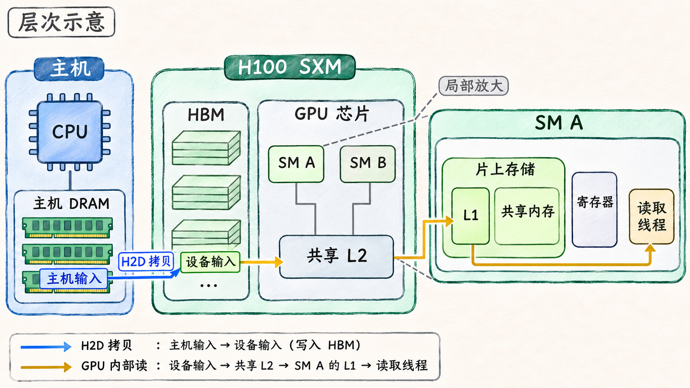

# 数据放在哪里，显存容量怎么算

一份模型权重可以顺利载入 GPU，等到批量加大，第一批计算却可能在分配工作区时耗尽显存。权重的大小只覆盖了部分需求。要判断能否运行，需要找到数据所在的内存，以及哪些数据会在同一时间占据那块内存。

## 从主机 DRAM 到 GPU 片上资源

以单张 NVIDIA H100 SXM 为例，CPU 准备的输入先放在主机 DRAM。应用通过主机到设备的拷贝（H2D）将输入写入这张 GPU 的设备缓冲区。HBM（High Bandwidth Memory，高带宽内存）是这款 GPU 的显存介质。**全局内存**描述设备代码能访问的一种地址空间，常规设备内存分配得到其中的缓冲区，数据由设备显存承载。CUDA 统一内存等机制可以根据系统和设备能力改变数据放置或迁移。遇到这类路径，要另外确认页当前在哪里、访问时是否需要搬运。 [NVIDIA H100 数据表](https://resources.nvidia.com/en-us-gpu/h100-datasheet-24306) · [CUDA 13.2.1 · Unified and System Memory](https://docs.nvidia.com/cuda/archive/13.2.1/cuda-programming-guide/02-basics/understanding-memory.html)

| 位置 | 在本例中的用途 |
| --- | --- |
| HBM | 为权重、张量和算子工作区等设备缓冲区提供容量 |
| 设备共享的 L2 | 缓存设备内存的数据，供多个 SM 使用 |
| SM 内的 L1 | 为适用的访问缓存数据，具体路径取决于访问类型及缓存策略 |
| SM 内的共享内存 | Kernel 显式使用的片上空间，供同一 Block 的线程暂存和交换数据 |
| SM 内的寄存器 | 保存每个线程操作数和中间值等状态 |

一个 Warp 发出全局内存读请求时，若该访问使用 L1 且命中，可以就地取得数据。若要继续到 L2，L2 命中也能满足请求。两级都未提供数据时，才需要沿这条路径读 HBM。数据复用因此能减少 HBM 流量。共享内存则由 Kernel 显式安排读写，比如让一组线程先把输入的一小块搬入片上，再反复使用。Hopper 的 L1 与共享内存可使用同一片片上存储资源，划分方式会改变各自可用空间。 [CUDA 13.2.1 · Writing SIMT Kernels](https://docs.nvidia.com/cuda/archive/13.2.1/cuda-programming-guide/02-basics/writing-cuda-kernels.html) · [Hopper Tuning Guide 13.2 · Unified Shared Memory/L1/Texture Cache](https://docs.nvidia.com/cuda/archive/13.2.1/hopper-tuning-guide/index.html#unified-shared-memory-l1-texture-cache)

**图 02-02-01**　H2D 拷贝把主机输入写入设备缓冲区。琥珀色箭头展示一次使用 L1 的全局读在两级缓存均未命中时，数据从 HBM 经共享 L2 和 L1 返回读取线程的路径。

## 显存预算取同时存活的峰值

连续、稠密且无额外填充的张量，可以用「各维长度相乘 × 每元素字节数」计算数据本体。FP16 每元素 2 B，FP32 每元素 4 B。预算时按底层存储计数，共享同一块存储的视图只算一次。再沿运行阶段标出权重、输入、输出、中间结果和算子工作区各自的起止。某阶段的峰值由当时还需要保留的存储共同决定。权重通常持续驻留，工作区则可能只在某个算子运行时出现。训练还要为梯度和优化器状态等额外对象留空间。

下表是**教学算例**。假设单卡可给作业的预算为 24 GB，单位取十进制。模型有 70 亿个 FP16 权重，稠密存储需 `7 × 10⁹ × 2 B = 14 GB`。算例假定工作区出现时，中间状态也仍然存活。预留量是预算余量，与活跃张量分开列。

| 峰值阶段的开销 | 原批量 | 增大批量 |
| --- | ---: | ---: |
| FP16 权重 | 14 GB | 14 GB |
| 活跃输入、输出与中间状态合计 | 3 GB | 8 GB |
| 算子工作区 | 2 GB | 2 GB |
| 预留 | 1 GB | 1 GB |
| 合计 | 20 GB | 25 GB |

在原批量下，按估算还剩 4 GB 预算。增大批量后超出预算 1 GB。若只把权重改为 FP32，权重本身就要 28 GB。如果工作区实际在中间状态释放之后才申请，就要分别计算这两个时点的需求。批量、并发、存储类型、算法和缓冲区复用都可能改变峰值。规划能否容纳这些对象时用 GB 或 GiB，判断 Kernel 需要多快搬完它们时用 GB/s，后者还要计入一段时间内读写了多少次。

## 活跃张量、分配器保留和设备已用

PyTorch 2.8 的原生 CUDA 缓存分配器会保留已经向 CUDA 取得的内存块，以便后续分配复用。以 `PYTORCH_CUDA_ALLOC_CONF=backend:native` 为例，`torch.cuda.memory_allocated(device)` 统计该进程在指定设备上由张量占用的字节，`torch.cuda.memory_reserved(device)` 统计原生缓存分配器管理的字节。`nvidia-smi` 的 `memory.used` 是设备侧 FB Memory Usage 的 Used 项，还可反映 CUDA 上下文、框架分配器以外的分配或其他进程的用量。比较时对齐设备、进程和时点，并把工具显示的 MiB 与 API 返回的字节换成同一单位。`1 MiB = 2²⁰ B`。 [PyTorch 2.8 · Memory Management](https://docs.pytorch.org/docs/2.8/notes/cuda.html#memory-management) · [NVIDIA System Management Interface · FB Memory Usage](https://docs.nvidia.com/deploy/nvidia-smi/index.html)

下表是**示意记录**，所有值统一换算为 MiB。假设一个进程使用 PyTorch 2.8 原生分配器，张量的最后一个引用已释放，相关 GPU 工作已完成，空出的块留在缓存中，其他开销恒定。

| 同一设备上的观测时点 | 活跃张量 | 分配器保留 | 设备已用 |
| --- | ---: | ---: | ---: |
| 释放前 | 2,048 MiB | 3,072 MiB | 3,328 MiB |
| 释放后 | 1,024 MiB | 3,072 MiB | 3,328 MiB |

这里活跃张量减少 1,024 MiB，分配器仍持有这部分空间。判断泄漏或持续增长时，可以在相同批次边界连续比较活跃量。要量某段的张量峰值，先在选定起点用 `torch.cuda.reset_peak_memory_stats(device)` 重置统计，再在区间结束时读 `torch.cuda.max_memory_allocated(device)`。它记录区间内张量占用的峰值，包括区间起点已经驻留的张量。 [PyTorch 2.8 · Reset Peak Memory Stats](https://docs.pytorch.org/docs/2.8/generated/torch.cuda.memory.reset_peak_memory_stats.html) · [PyTorch 2.8 · Max Memory Allocated](https://docs.pytorch.org/docs/2.8/generated/torch.cuda.memory.max_memory_allocated.html)

若实际发生 OOM，先把失败分配的大小和发生阶段与容量预算对照。再看失败前的活跃张量和保留量、同一 GPU 上的其他分配，以及分配器中现有空闲块能否满足这次申请。事后的一次 `nvidia-smi` 快照只覆盖当时设备上的占用。要分辨同时存活量、缓存保留或分配器碎片，可补取失败前后的 `memory_stats()` 或分配快照。 [PyTorch 2.8 · Memory Management](https://docs.pytorch.org/docs/2.8/notes/cuda.html#memory-management)
