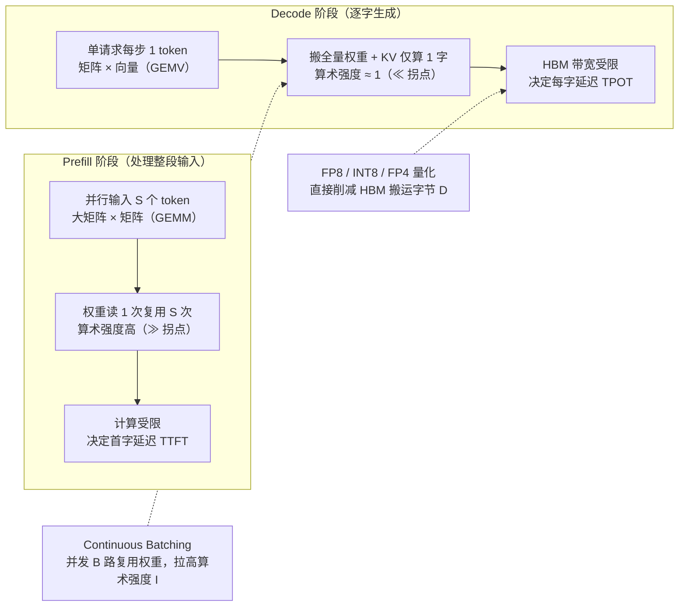

# 运算精度、算术强度与 Roofline 性能上界

一张 H100 SXM 80 GB 在规格表上写着近 1,000 TFLOP/s 的 BF16 算力和近 2,000 TFLOP/s 的 FP8 算力。但在真实机房里，当你用它跑大模型单路在线推理时，实测算力往往连纸面峰值的 1% 都摸不到；可换到同一张卡跑训练或处理长提示词时，算力却能轻松冲上七八成。

同一个模型、同一张顶级显卡，为什么算力表现天差地别？因为决定 GPU 速度上限的从来不止“算得有多快”，还有 **“从 HBM 搬数据到算术单元有多快”**。读懂运算精度与 **Roofline（屋顶线模型）** ，你就能一眼看透任何 AI 算子到底卡在算力还是卡在带宽。

## 一、存储、计算与累加精度：看懂显卡规格表

看矩阵乘法 $C = AB$ 时，不要把“精度”混成一件事，它至少包含四个环节：**输入存储格式、乘法计算格式、累加格式、结果写回格式**。

例如在混合精度矩阵乘法中，输入可以按 FP16 或 BF16（2 B）存储并送入 Tensor Core 相乘，中途求和则提升到 FP32 累加防溢出，最后再按需写回。

FP16 与 BF16 同占 16 位，但 **BF16 将更多比特分给指数位**，动态范围与 FP32 持平，在大模型训练中更不易溢出，代价是小数有效位略稀。

再比如 cuBLAS 提供的 `CUBLAS_COMPUTE_32F_FAST_TF32` 模式：矩阵在显存里仍按 FP32（4 B）读写，但送进 Tensor Core 做乘法时会自动截断尾数走 **TF32（TensorFloat-32）** 路径。可见，**存储格式决定了显存容量与搬运字节，计算与累加格式决定了命中哪条硬件算力管线**。

对照单张 **H100 SXM 80 GB**（HBM3 带宽 $B = 3.35\text{ TB/s}$，按十进制 $1\text{ TB} = 10^{12}\text{ B}$；1 次浮点运算记 1 FLOP，1 次整数运算记 1 OP）的核心规格：

| 计算路径 | 存储位宽 | 稠密计算峰值 $P$ | 2:4 结构化稀疏峰值 | 算术强度拐点 $P/B$ |
| --- | ---: | ---: | ---: | ---: |
| 常规 FP32（CUDA Core） | 4 B | 约 67 TFLOP/s | — | 约 20 FLOP/B |
| TF32 Tensor Core | 4 B（FP32 存储） | 494.7 TFLOP/s | 989.4 TFLOP/s | 约 148 FLOP/B |
| FP16 / BF16 Tensor Core（FP32 累加） | 2 B | 989.4 TFLOP/s | 1,978.9 TFLOP/s | 约 295 FLOP/B |
| FP8 Tensor Core | 1 B | 1,978.9 TFLOP/s | 3,957.8 TFLOP/s | 约 591 FLOP/B |
| INT8 Tensor Core | 1 B | 1,978.9 TOP/s | 3,957.8 TOP/s | 约 591 OP/B |

> [!warning] 常见误区：别拿“稀疏峰值”当普通模型上限
> 厂商宣传页上常带星号的高数字，对应的是 **2:4 结构化稀疏**——它要求权重沿规定维度每 4 个连续元素中严格至少有 2 个零，并启用专用稀疏格式与算子。普通稠密矩阵即便恰好含有一半零元素，也只能对照表中的**稠密峰值**列。

## 二、算术强度与 Roofline 性能上界

设某个 Kernel 需要完成总计 $F$ 次浮点运算，并在执行期间跨过 HBM 边界累计读写（读 + 写合计）$D$ 字节数据。在匹配的计算峰值 $P$（FLOP/s）与 HBM 带宽上限 $B$（B/s）下，哪怕计算和搬运能够完美重叠，整个 Kernel 的耗时也绝不可能短于二者的较大值：

$$T_{\min} = \max\!\left(\frac{F}{P},\; \frac{D}{B}\right)$$

为了衡量“每从 HBM 辛辛苦苦搬 1 字节数据，到底能换来多少次浮点运算”，我们定义**算术强度（Arithmetic Intensity）** $I$，并由此推导出著名的 **Roofline（屋顶线）** 吞吐上界：

$$I = \frac{F}{D} \quad (\text{FLOP/B})$$

$$\text{实际吞吐上界} = \frac{F}{T_{\min}} = \min\!\left(P,\; B \times I\right), \qquad I_{\text{拐点}} = \frac{P}{B}$$

这条公式把所有 GPU 算子清晰地划成了两个世界：

- **显存带宽受限（Memory-bandwidth-bound，$I < P/B$）**：搬数据太慢，算术单元大部分时间在干等，此时吞吐上界被死死压在斜坡 $B \times I$ 上。就算把显卡算力峰值再翻一倍，耗时也不会快一微秒。
- **计算受限（Compute-bound，$I > P/B$）**：数据复用充分，搬运时间被计算时间完全藏住，吞吐上界顶到平屋顶 $P$。此时优化显存带宽收益甚微，必须切向更高吞吐的计算管线（如 FP8 Tensor Core）。

## 三、两个基础对照：逐元素更新 vs 稠密矩阵乘法

我们用两个数据都已就绪在 HBM 中的经典算例，直观感受算术强度跨越拐点的巨大威力（一次乘加计 2 FLOP）：

1. **FP32 逐元素更新（数组放大至 $10^8$ 个元素）**：每个位置读 `x[i]`（4 B）、读旧 `y[i]`（4 B）、写新 `y[i]`（4 B），合计搬运 12 B 却只做 2 FLOP。虽然 `y` 是原地更新只占一份容量，但读和写都跨过了 HBM 边界，因此 $F = 0.2\text{ GFLOP}$，$D = 1.2\text{ GB}$。
2. **稠密矩阵乘法（$N = 8{,}192$ 方阵，FP16 输入、FP32 累加与写回）**：共 $N^2$ 个输出元素，每个需做 $N$ 次乘加，总计算量 $F = 2N^3$；理想片上分块复用下，A、B 各读一次（各 2 B/元素），C 写一次（4 B/元素），最小流量 $D_{\min} = (2+2+4)N^2$：

$$F_{\text{GEMM}} = 2 \times 8{,}192^3 \approx 1.100\text{ TFLOP}, \qquad D_{\text{GEMM}} = 8 \times 8{,}192^2 \approx 0.537\text{ GB}$$

将两例分别代入 H100 SXM 对应管线（逐元素对应常规 FP32 67 TFLOP/s；矩阵乘对应 FP16 Tensor Core 989.4 TFLOP/s；HBM 均为 3.35 TB/s）：

| 算例 | 运算量 $F$ | HBM 流量 $D$ | 算术强度 $I = F/D$ | 计算时间下界 $F/P$ | HBM 时间下界 $D/B$ | 瓶颈归属 |
| --- | ---: | ---: | ---: | ---: | ---: | --- |
| FP32 逐元素更新 | 0.2 GFLOP | 1.2 GB | 0.167 FLOP/B | 0.003 ms | **0.358 ms** | **HBM 带宽受限** |
| 稠密矩阵乘法 | 1.100 TFLOP | 0.537 GB | 2,048 FLOP/B | **1.11 ms** | 0.160 ms | **计算受限** |

逐元素更新的算术强度只有 0.167，远低于常规 FP32 拐点（20 FLOP/B），吞吐上界锁死在 $3.35\text{ TB/s} \times 0.167 \approx 0.56\text{ TFLOP/s}$。而 $8{,}192$ 阶方阵的算术强度高达 2,048，远超 FP16 拐点（295 FLOP/B），稳稳吃满计算天花板。

不过，即便是矩阵乘法，如果分块策略糟糕导致数据反复从 HBM 重读，也会跌回带宽受限：只要本例 HBM 流量膨胀到 $3.35\text{ TB/s} \times 1.11\text{ ms} \approx 3.72\text{ GB}$，访存耗时就追平了计算耗时；流量升至 4 GB 时，访存下界达 1.19 ms，正式成为新瓶颈。

此外，实际 HBM 流量还取决于**合并访存（Coalesced Access）**。一个 Warp 的 32 个线程各读 4 B，逻辑需求是 128 B：如果地址连续对齐，硬件合并成 4 个 32 B 扇区即可一次取回；如果地址零散跨步，最多可能触发 32 个独立扇区读取，逻辑字节不变，实际显存事务却放大了 8 倍。

## 四、大模型推理的双阶段本质：Prefill 与 Decode

有了 Roofline 这把尺子，大模型推理最核心的反直觉现象就能迎刃而解。自回归 LLM 生成一次回答必须经历 **Prefill（预填充）** 与 **Decode（解码生成）** 两个截然不同的阶段，它们在 Roofline 上恰好落在拐点的左右两端。

对参数量为 $W$ 的 Transformer 大模型，每个 token 经过全部线性投影层（QKV 投影、输出投影与 FFN）的计算量约为 $2W$ FLOP；BF16（2 B/参数）下权重体积为 $2W$ 字节。

下面以单卡 H100 SXM 80 GB 运行 **32B 参数的 BF16 模型**（$W = 3.2 \times 10^{10}$，权重 $64\text{ GB}$）为例，对比两阶段的算术强度：

- **Prefill 阶段（像训练一样，计算受限）**：用户一次输入 $S_{\text{in}} = 2{,}048$ 个提示词 token，模型将整段序列打包成巨大的矩阵-矩阵乘法（GEMM）并行前向。整套 64 GB 权重从 HBM 读入一次，就被全部 2,048 个 token 共享复用：

$$I_{\text{Prefill}} \approx \frac{2 W \cdot S_{\text{in}}}{2 W} = S_{\text{in}} = 2{,}048\text{ FLOP/B} \gg 295\text{ FLOP/B}$$

此时算术强度远超 H100 BF16 拐点，**Prefill 处于典型的计算受限区**，Tensor Core 接近满负荷轰鸣，这一阶段的耗时直接决定用户的 **TTFT（首字延迟）**。

- **Decode 阶段（退化为矩阵-向量乘，彻底带宽受限）**：生成回复时，因为第 $t+1$ 个字依赖第 $t$ 个字，单请求（$B=1$）每步只能推进 **1 个 token**。为了算出这短短 1 个 token，GPU 却不得不把 64 GB 权重（外加该请求全部历史 KV Cache）从 HBM 完完整整搬进芯片过一遍！哪怕先乐观忽略 KV Cache 流量，仅看线性层：

$$I_{\text{Decode},\, B=1} \approx \frac{2 W \times 1}{2 W} = 1\text{ FLOP/B} \ll 295\text{ FLOP/B}$$

$$T_{\text{计算下界}} = \frac{64\text{ GFLOP}}{989.4\text{ TFLOP/s}} \approx 0.065\text{ ms}, \qquad T_{\text{HBM下界}} = \frac{64\text{ GB}}{3{,}350\text{ GB/s}} \approx 19.1\text{ ms}$$

**搬运权重耗时 19.1 ms，真正做数学计算却仅需 0.065 ms——相差近 300 倍！** 哪怕不计注意力层的 KV Cache 读取，单请求吐字速度也被 HBM 锁死在约 52 token/s，Tensor Core 算力利用率不足 0.4%。

一旦上下文拉长，注意力算子每步还需全量扫描历史 KV Cache，Decode 会被牢牢钉在带宽墙上，直接决定用户的 **TPOT（单 token 生成延迟）**。

*图 02-03-01：LLM 推理双阶段的 Roofline 瓶颈分化与破局路径。Prefill 依靠序列并行天然处于计算受限区；Decode 因逐字依赖跌入 HBM 带宽受限深渊，需要依靠量化减载与连续批处理提升复用率来拯救。*

## 五、打破 Decode 带宽墙：量化与 Continuous Batching

既然 Decode 的死穴是“每步搬的字节 $D$ 太大、算术强度 $I$ 太低”，工程上的破局思路也直指这两个变量。

### 1. FP8 / INT8 / FP4 量化：容量与带宽的双重红利

量化把权重（甚至激活与 KV Cache）从 16 位压缩到 8 位或 4 位，对推理带来一举两得的增益：

- **先砍显存占用**：70B 模型权重从 BF16（140 GB）压到 FP8/INT8 只需 70 GB，压到 4-bit 更只需 35 GB，既减少了卡数，又给长上下文 KV Cache 腾出海量空间。
- **再砍 HBM 搬运时间**：在 Decode 阶段，带宽下界直接正比于数据字节数 $D$。对上面 32B 模型 $B=1$ 的 Decode，权重从 BF16（64 GB）量化为 FP8（32 GB）后，HBM 读取下界立刻腰斩至 **9.55 ms**；进一步压到 4-bit（16 GB），权重读取下界缩至 **4.78 ms**，单路吐字速度直接翻倍再翻倍！

> [!note] 硬件架构与量化执行差异
> - **FP8 / INT8**：H100 的第四代 Tensor Core 原生支持 FP8 与 INT8 矩阵指令（稠密峰值高达 1,978.9 TFLOP/s / TOP/s，是 BF16 的 2 倍），因此既能成倍加速 Decode 搬运，也能加速 Prefill 计算。
> - **FP4 / INT4**：在 H100 上常采用“仅权重量化（W4A16/W4A8）”——权重以 4-bit 紧缩存储在 HBM 中，搬进 SM 寄存器后再实时反量化为 FP16/FP8 计算；尽管计算仍走旧管线，但因 Decode 本就卡在搬运上，依然能获得近乎线性的速度飞跃。而在更新的 Blackwell 架构 GPU 上，硬件进一步加入了原生 FP4 Tensor Core，连 Prefill 计算吞吐也能同步翻番。

### 2. Continuous Batching：用并发复用权重，把 Decode 推向拐点

既然每步都必须把 64 GB 权重从 HBM 读一遍，那为什么只替 1 位用户算呢？如果同时拉来 $B$ 个正在生成中的请求拼成一批，**这 $B$ 个请求就能共享同一次从 HBM 读出来的模型权重**！

早期推理服务采用**静态批处理（Static Batching）**：一整批请求一起进、必须等其中回答最长的那个请求吐完结束符（EOS），整批才能退出。短请求早就答完了，却被迫占着显存槽位空转，GPU 算力被严重浪费。

现代推理引擎普遍采用 **Continuous Batching（连续批处理，又称迭代级调度）**：调度粒度细化到**每一个 token 的生成迭代**。只要这一步里有任何一个请求吐出结束符，下一毫秒立刻踢出它并无缝插进排队中的新请求，始终维持高并发批次在跑。

把并发数 $B$ 放回线性层的算术强度公式（BF16 权重，暂忽略各请求独立的 KV 读写），会得到一个极其简洁的规律：

$$I_{\text{Decode}}(B) \approx \frac{2 W \cdot B}{2 W} = B \text{ FLOP/B}$$

只要并发批大小 $B$ 还没有越过 Roofline 拐点（例如 BF16 的 295 FLOP/B），增加并发带来的计算增量几乎被藏在原本就闲着的 Tensor Core 里——**系统总吞吐近乎随 $B$ 线性翻倍，而单请求感知到的 TPOT 延迟几乎不怎么恶化**！

> [!summary] 核心结论：加 Batch 的双边界约束
> Continuous Batching 并非可以无限拉高并发。随着 $B$ 增大，两条天花板最终会拦住去路：一是并发大到使线性层越过 Roofline 拐点，Decode 转为计算受限，TPOT 开始随 $B$ 线性拉长；二是各请求的 **KV Cache 无法共享**（无公共前缀时），长上下文下 KV 显存容量或 KV 读取带宽会率先打满，迫使推理引擎限制并发规模。

看清了单个 Kernel 的算力与带宽天花板后，我们还差最后一块单机拼图：在真实的训练步或推理请求中，CPU 提交任务、H2D 搬运数据与多个 Kernel 执行是如何排成时间线并行流水运作的？下一篇我们进入 CUDA Stream 与事件同步机制。

> [!info]- 参考资料
> - **Hopper 精度、Tensor Core 与稀疏规格**：[NVIDIA · H100 Specifications](https://www.nvidia.com/en-us/data-center/h100/#specifications)、[NVIDIA H100 架构白皮书（含表 3 与数据格式）](https://dam-cdn.nvd.orangelogic.com/AssetLink/705n6ur546g0uk43w0117r17n8042d73.pdf)、[NVIDIA H100 架构白皮书 · 表 3](https://dam-cdn.nvd.orangelogic.com/AssetLink/705n6ur546g0uk43w0117r17n8042d73.pdf#page=39)、[NVIDIA · Structured Sparsity](https://developer.nvidia.com/blog/structured-sparsity-in-the-nvidia-ampere-architecture-and-applications-in-search-engines/)
> - **cuBLAS 混合精度与计算类型**：[cuBLAS 13.2 · cublasGemmEx](https://docs.nvidia.com/cuda/archive/13.2.1/cublas/index.html#cublasgemmex)、[cuBLAS 13.2 · Compute Types / Tensor Core Usage](https://docs.nvidia.com/cuda/archive/13.2.1/cublas/index.html#cublascomputetype-t)
> - **Roofline、合并访存与带宽测量**：[Nsight Compute · Roofline Charts](https://docs.nvidia.com/nsight-compute/ProfilingGuide/index.html#roofline-charts)、[CUDA 13.2.1 · Coalesced Global Memory Access](https://docs.nvidia.com/cuda/archive/13.2.1/cuda-programming-guide/02-basics/writing-cuda-kernels.html#coalesced-global-memory-access)、[CUDA Best Practices Guide 13.2 · Bandwidth](https://docs.nvidia.com/cuda/archive/13.2.1/cuda-c-best-practices-guide/index.html#bandwidth)
> - **LLM 推理双阶段与量化批处理**：[NVIDIA · Mastering LLM Techniques: Inference Optimization](https://developer.nvidia.com/blog/mastering-llm-techniques-inference-optimization/)
