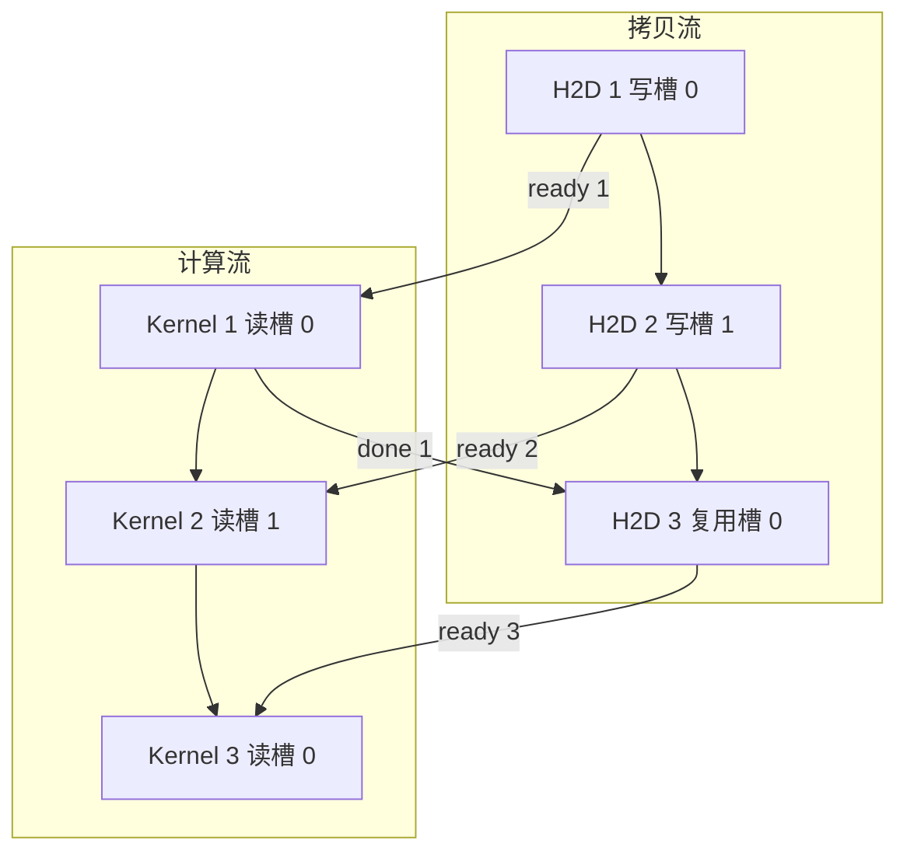

即使已知道一次 Kernel 的耗时，也要看上一段工作何时把输入交给它，以及结果何时能交给下一段。**Stream（流）** 是 CUDA 中一系列具有先后顺序的工作。主机提交 Kernel 后可以继续运行，设备则在前置工作满足后再执行它。这就是本篇所说的异步。下面按 CUDA 13.2.1、单进程单设备的常规 Stream 语义推演。 [CUDA 13.2.1 · Asynchronous Execution](https://docs.nvidia.com/cuda/archive/13.2.1/cuda-programming-guide/02-basics/asynchronous-execution.html)

## 单流保证拷贝、计算和读回的次序

把一批数据的 H2D 拷贝、Kernel 和设备到主机拷贝（Device to Host，D2H）都放进同一个 Stream。主机可以连续提交这三项工作。设备完成 H2D 后，Kernel 才读取设备缓冲区。Kernel 完成后，D2H 才把结果写到主机缓冲区。主机如果要读取结果，需要确认 D2H 已完成，即使三项调用都已返回。若下一次计算也在同一流中且直接用设备结果，就可以接着提交，由流内顺序保证读取时机。 [CUDA 13.2.1 · CUDA Stream Ordering](https://docs.nvidia.com/cuda/archive/13.2.1/cuda-programming-guide/02-basics/asynchronous-execution.html#cuda-stream-ordering)

**CUDA Event（事件）**可以记录某条流上已经提交的工作。当这些工作完成，事件对应的完成条件也就满足。把事件放在 D2H 后面，可以用它确认这份主机结果什么时候可读。不同的同步调用控制不同范围。 [Runtime API 13.2.1 · Event Management](https://docs.nvidia.com/cuda/archive/13.2.1/cuda-runtime-api/group__CUDART__EVENT.html) · [CUDA 13.2.1 · Explicit Synchronization](https://docs.nvidia.com/cuda/archive/13.2.1/cuda-programming-guide/02-basics/asynchronous-execution.html#explicit-synchronization)

| 操作 | 何处等待，等待什么 |
| --- | --- |
| `cudaEventSynchronize(event)` | 主机等待事件已捕获的工作完成 |
| `cudaStreamSynchronize(stream)` | 主机等待指定流此前提交的工作完成 |
| `cudaDeviceSynchronize()` | 主机等待当前设备上该 CUDA 上下文中此前提交的工作完成，覆盖各流 |
| `cudaStreamWaitEvent(stream, event, 0)` | 指定流中此调用之后提交的工作等待事件，主机可继续提交 |

## 双缓冲如何保护输入和槽位复用

要让拷贝第 2 批时计算第 1 批，设备上得有两个互不重叠的输入槽位，计算和拷贝也得能独立推进。下面采用一个独立的三批教学例。第 1、3 批用设备输入槽 0，第 2 批用槽 1。Kernel 读输入槽，结果写入独立的设备输出区。两条显式流用 `cudaStreamNonBlocking` 创建，避免参与与 legacy 默认流的隐式同步。各批次使用不同的事件，主机输入已经备好并放在页锁定缓冲区。页锁定内存的页在传输期间保持可供设备访问。 [CUDA 13.2.1 · Page-Locked Host Memory](https://docs.nvidia.com/cuda/archive/13.2.1/cuda-programming-guide/02-basics/understanding-memory.html#page-locked-host-memory) · [Runtime API 13.2.1 · Default Stream Behavior](https://docs.nvidia.com/cuda/archive/13.2.1/cuda-runtime-api/stream-sync-behavior.html)

把第 `n` 批的 H2D 提交到拷贝流，在其后记录 `ready[n]`。计算流排入事件等待，再排入 Kernel，避免读到未拷完的输入。Kernel 结束才允许覆盖这个输入槽，所以在它后面记录 `done[n]`。第 3 批 H2D 复用槽 0，必须等第 1 批的 `done[1]`。如果结果也写在槽内，允许复用的时点还要晚到最后一个结果消费者完成。主机源缓冲区可以在本批 H2D 完成后复用。 [CUDA 13.2.1 · Explicit Synchronization](https://docs.nvidia.com/cuda/archive/13.2.1/cuda-programming-guide/02-basics/asynchronous-execution.html#explicit-synchronization) · [Runtime API 13.2.1 · Event Management](https://docs.nvidia.com/cuda/archive/13.2.1/cuda-runtime-api/group__CUDART__EVENT.html)

下面是 CPU 的提交顺序，省略内存分配、流与事件创建、错误检查及最终同步。`enqueue_kernel` 代表向计算流提交例中的 Kernel。

```text
for n in 1..3:
    slot = (n - 1) mod 2
    if n > 2:
        cudaStreamWaitEvent(copy, done[n-2], 0)
    cudaMemcpyAsync(device_in[slot], pinned_input[n], bytes, cudaMemcpyHostToDevice, copy)
    cudaEventRecord(ready[n], copy)
    cudaStreamWaitEvent(compute, ready[n], 0)
    enqueue_kernel(compute, device_in[slot], device_out[n])
    cudaEventRecord(done[n], compute)
```



图中的箭头从先完成的操作指向等待它的操作。同一槽位的保护有两个方向，`ready` 让计算等数据，`done` 让后续拷贝等槽位腾空。

## 从执行依赖推算三批完成时间

假设每批 H2D 要 2 ms、Kernel 要 6 ms，结果留在设备，设备支持拷贝与计算重叠。略去提交开销和资源争用，这些时长与第 03 篇的 Kernel 算例独立。单槽串行时，每批要先花 2 ms 拷贝，再花 6 ms 计算。双缓冲时，第 2 批拷贝可在 2 ms 启动。第 3 批在 4 ms 时只等到了拷贝流空闲，还得等第 1 批 Kernel 在 8 ms 释放槽 0。

| 批次 | 串行 H2D | 串行 Kernel | 双缓冲 H2D | 双缓冲 Kernel |
| --- | --- | --- | --- | --- |
| 1 | 0–2 ms | 2–8 ms | 0–2 ms | 2–8 ms |
| 2 | 8–10 ms | 10–16 ms | 2–4 ms | 8–14 ms |
| 3 | 16–18 ms | 18–24 ms | 8–10 ms | 14–20 ms |

第一批仍在 8 ms 完成。这三批的总时间由 24 ms 降至 `2 + 3 × 6 = 20 ms`。如果两个流共用一个输入槽，下一批 H2D 每次都要等上一批计算释放它，时间线会退回串行。双缓冲以额外的设备内存换取重叠机会，节省多少时间取决于藏进前一批计算窗口的拷贝时长。

实际重叠还受设备的拷贝引擎、传输方向、共享资源争用和提交时点影响。`asyncEngineCount` 是设备的拷贝引擎能力信息，真实重叠要看 GPU 时间线。若换成可分页的主机缓冲区，`cudaMemcpyAsync` 可能阻塞主机。需要暂存到页锁定内存时，驱动也可能先同步该流。 [CUDA Best Practices Guide 13.2 · Overlapping Transfers with Computation](https://docs.nvidia.com/cuda/archive/13.2.1/cuda-c-best-practices-guide/index.html#asynchronous-and-overlapping-transfers-with-computation) · [Runtime API 13.2.1 · API Synchronization Behavior](https://docs.nvidia.com/cuda/archive/13.2.1/cuda-runtime-api/api-sync-behavior.html)

如果调用混入默认流，还要看默认流模式。Legacy 默认流与同一上下文中参与隐式同步的流双向建立顺序，例如由 `cudaStreamCreate()` 创建的流。Per-thread 默认流归属于主机线程和 CUDA 上下文，可通过 `nvcc --default-stream per-thread` 启用。它通常独立于其他显式流，与 legacy 默认流混用时仍会同步。 [Runtime API 13.2.1 · Stream Synchronization Behavior](https://docs.nvidia.com/cuda/archive/13.2.1/cuda-runtime-api/stream-sync-behavior.html)

## 主机提交、设备执行与端到端计时

主机时钟只围住 Kernel 启动调用时，量到的是主机调用经历的时间。要量设备流上的一段，在同一流前后记录可计时事件，确认结束事件完成后读 `cudaEventElapsedTime`。事件时差会受到两标记之间的等待及并发影响。要量一次服务或作业批次的延迟，再用主机时钟覆盖输入准备到契约规定的结果可用时点，并在对比时固定预热、统计窗口和并发条件。Nsight Systems 可关联 CPU 上的 CUDA 调用和 GPU 上的流活动，查看实际拷贝与 Kernel 的起止。 [Runtime API 13.2.1 · Event Management](https://docs.nvidia.com/cuda/archive/13.2.1/cuda-runtime-api/group__CUDART__EVENT.html) · [Nsight Systems · CUDA Trace](https://docs.nvidia.com/nsight-systems/UserGuide/index.html#cuda-trace)
