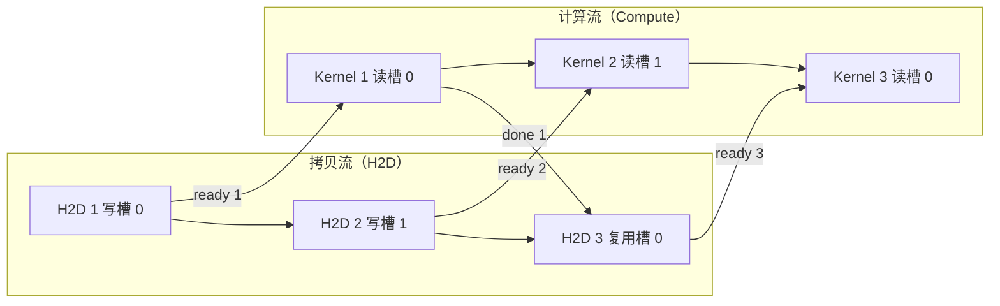

# CUDA Stream 的执行顺序、事件与拷贝重叠

就算你把单个 Kernel 优化到紧贴 Roofline 上限，真实作业依然可能跑得很慢——因为 CPU 提交任务、数据经 PCIe 搬进显存、GPU 真正算完这三个动作之间，存在着微妙的**异步与等待关系**。

初学者最常掉进两个坑：一是忘了让拷贝与计算并行流水，结果 132 个 SM 每算完一批就干等着 PCIe 慢慢传下一批数据；二是顺手在 Python 里用 CPU 时钟包住一次 CUDA 调用，测出耗时仅 0.02 ms，却不知道自己测到的只是“把任务扔进队列的时间”，真正的计算还没开始。这一篇我们把单个 Kernel 放回完整的作业时间线。

## 一、单流保序与 CUDA Event：把异步提交和完成时机对齐

在 CUDA 执行模型里，主机与设备是天然解耦的。**CUDA Stream（流）** 可以理解成一条交付给 GPU 的单行传送带：CPU 只需把“拷入输入（H2D）→ 执行 Kernel → 拷回结果（D2H）”三张工单依次放上传送带，函数立刻返回，CPU 马上就能腾出手去做别的事。

在**同一条 Stream** 内，GPU 硬件严格按照先进先出（FIFO）的顺序执行工单：只有 H2D 彻底完成，Kernel 才会开始读取设备缓冲区；只有 Kernel 写完结果，D2H 才会把数据拷回主机内存。如果下一层计算也留在 GPU 上，直接继续排进同一条流即可，全程无需惊动 CPU。

但只要主机代码需要真正读取 D2H 拷回来的结果，就不能以为“API 函数返回了数据就到了”，必须显式确认设备侧任务已经完工。为此，CUDA 提供了 **CUDA Event（事件）**——你可以把它看作插在传送带某个位置的一枚**里程碑打卡器**，一旦它前面提交的工作全部完成，这枚事件就会变为“已触发”状态。

不同范围的等待需要选用匹配的同步原语：

| 同步操作 | 等待发生的位置 | 实际等待的目标 |
| --- | --- | --- |
| `cudaEventSynchronize(event)` | 阻塞主机线程 | 等待该事件所捕获的前置设备工作完成 |
| `cudaStreamSynchronize(stream)` | 阻塞主机线程 | 等待指定流中此前提交的全部工作完成 |
| `cudaDeviceSynchronize()` | 阻塞主机线程 | 等待当前设备该上下文中所有流此前提交的工作完成 |
| `cudaStreamWaitEvent(stream, event, 0)` | **不阻塞主机**（设备侧流间等待） | 让指定流后续提交的工作等待 `event` 触发，主机可继续提交 |

> [!tip] 工程直觉
> 高性能训练与推理框架会尽量避开大范围阻塞主机的 `cudaDeviceSynchronize()`，优先使用 **`cudaStreamWaitEvent` 在设备侧完成跨流接力**，让 CPU 始终领先 GPU 几步把指令队列填满，防止设备“断粮”。

## 二、双缓冲与多流重叠：如何把 H2D 藏进计算窗口

如果想让 GPU 在计算第 1 批数据的同时，拷贝引擎已经悄悄把第 2 批输入经 PCIe 搬进显存，就必须把“拷贝”和“计算”拆进**两条独立的 Stream**，并满足两个硬前提：

1. **设备侧双输入槽位（Double Buffering）**：如果两批共用同一块显存输入区，第 2 批 H2D 就会把第 1 批正在读取的数据冲花。因此必须在 HBM 中开辟两个互不重叠的槽位（槽 0 供奇数批，槽 1 供偶数批），用一点额外显存换取并行窗口。
2. **主机侧页锁定内存（Pinned / Page-Locked Memory）与非阻塞流**：主机源缓冲区需要锁定物理内存页，防止传输中途被操作系统换出；显式流通过 `cudaStreamNonBlocking` 创建，避免与旧式默认流发生隐式串行同步。

下面这段伪代码展示了三批数据如何在“拷贝流（`copy`）”与“计算流（`compute`）”之间用两组事件完成**双向保护**——`ready[n]` 防止计算读到半截数据，`done[n]` 防止新拷贝提前覆盖正在算的旧槽位：

```cpp
// 前提：copy 与 compute 均为 cudaStreamNonBlocking 创建的显式流；
// pinned_input[n] 为页锁定主机内存；device_in[0..1] 为设备侧双输入槽位。
for (int n = 1; n <= 3; ++n) {
    int slot = (n - 1) % 2;                          // 第 1、3 批用槽 0，第 2 批用槽 1
    if (n > 2) {
        // 复用槽位前，拷贝流必须等待两批前的 Kernel 彻底读完该槽位（不阻塞 CPU）
        cudaStreamWaitEvent(copy, done[n - 2], 0);
    }
    cudaMemcpyAsync(device_in[slot], pinned_input[n], bytes,
                    cudaMemcpyHostToDevice, copy);
    cudaEventRecord(ready[n], copy);                 // 标记第 n 批输入已安全落入显存

    cudaStreamWaitEvent(compute, ready[n], 0);       // 计算流等本批输入就绪再启动
    enqueue_kernel(compute, device_in[slot], device_out[n]);
    cudaEventRecord(done[n], compute);               // 标记本批 Kernel 已用完该槽位
}
```

如果结果也直接原地覆盖在输入槽内，允许拷贝流复用该槽位的时点还要往后推，直到最后一个消费该结果的算子彻底完成；而主机侧的源缓冲区只要本批 H2D 结束即可安全复用。整条跨流接力的依赖方向如下图所示：



*图 02-04-01：双缓冲三批流水的跨流事件依赖图。箭头指向等待方：`ready` 事件保证计算不早于本批搬运完成，`done` 事件保证第 3 批搬运不会提前覆写第 1 批仍在使用的槽 0。*

## 三、三批流水线的定量推演与默认流陷阱

假设每批 H2D 搬运耗时 **2 ms**，每个 Kernel 计算耗时 **6 ms**，结果留在显存中，且忽略提交开销与总线争用。先算**单槽串行**与**双槽重叠**的理论总耗时：

$$T_{\text{串行}} = 3 \times (2 + 6)\text{ ms} = 24\text{ ms}$$

$$T_{\text{双缓冲}} = T_{\text{H2D},1} + 3 \times T_{\text{Kernel}} = 2 + 3 \times 6 = 20\text{ ms}$$

逐批拆解两者的起止时刻，可以清楚看到“拷贝流空闲”与“槽位释放”两项条件如何共同框住第 3 批：

| 批次 | 串行 H2D | 串行 Kernel | 双缓冲 H2D | 双缓冲 Kernel | 双缓冲关键依赖 |
| --- | --- | --- | --- | --- | --- |
| 第 1 批 | 0–2 ms | 2–8 ms | 0–2 ms | 2–8 ms | 首个批次无法隐藏，2 ms 起算 |
| 第 2 批 | 8–10 ms | 10–16 ms | 2–4 ms | 8–14 ms | 2 ms 即借空闲拷贝流预取至槽 1，藏入第 1 批计算窗 |
| 第 3 批 | 16–18 ms | 18–24 ms | 8–10 ms | 14–20 ms | 4 ms 时拷贝流虽空，但必须等 8 ms `done[1]` 释放槽 0 |

对比可见，第 1 批都在 8 ms 完成，但第 2、3 批的 H2D 耗时（共 4 ms）被完全藏进了前一批 6 ms 的计算窗口里，总耗时从 24 ms 压到 20 ms。相反，若两流共用单个输入槽，下一批 H2D 每次都得等上一批算完腾槽，流水线会瞬间退化回 24 ms 的串行状态。

> [!warning] 常见误区：导致多流重叠“神秘失效”的三大元凶
> 1. **误用可分页主机内存**：如果源缓冲是普通 `malloc` 的可分页内存，`cudaMemcpyAsync` 为了保证 DMA 安全可能需要先同步暂存到驱动内部页锁定区，从而阻塞主机或迫使该流串行。
> 2. **混入 Legacy 默认流**：如果程序中某个库悄悄向旧式默认流（Stream 0）提交了任务，它会与同一上下文中用普通 `cudaStreamCreate()` 建出来的流双向强同步，瞬间把两条并行流锁死成串行。启用 `nvcc --default-stream per-thread` 可将默认流隔离为线程私有，但仍需避免与 Legacy 默认流混用。
> 3. **硬件拷贝引擎与资源争用**：能否同时跑 H2D、D2H 与计算取决于设备拷贝引擎数（可查设备属性 `asyncEngineCount`），而多个大 Kernel 并发时也可能因抢占 SM 或 HBM 带宽而无法线性提速。

> [!tip] 工程直觉：多流重叠在训练与推理中的典型落地
> 在大规模训练中，框架利用独立通信流把反向传播计算与 NCCL 梯度同步重叠（第 08 章展开），并利用拷贝流把下一批训练数据的 H2D 预取藏进当前步计算（第 09 章展开）。在 LLM 推理中，引擎不仅用多流隐藏异步词表采样回传与 KV Cache 卸载预取，还会针对 Decode 阶段极短且重复的 Kernel 序列引入 **CUDA Graph** 一次性整图提交，避免 CPU 逐个发工单的速度赶不上 GPU 执行速度。

## 四、主机提交、设备执行与端到端计时

回到开篇的测速陷阱：如果在 CPU 侧用普通计时器只夹住 Kernel 启动调用，量到的仅仅是主机往队列里塞工单的几微秒，完全不是 GPU 跑完的时间。

正确的测速方式必须区分**设备段计时**与**端到端业务计时**。下面以 PyTorch 2.9 演示如何用封装自 `cudaEventElapsedTime` 的 CUDA Event 准确测量一段 GPU 执行耗时：

```python
import time
import torch

# ❌ 错误示范：未同步直接用 CPU 时钟，测到的只是主机异步提交开销
t0 = time.perf_counter()
c = a @ b
t1 = time.perf_counter()  # 此时 GPU 可能连算都没开始算

# ✅ 正确方式一（测单流 GPU 执行时间）：在同流前后插 Event 并等待结束事件
start_evt = torch.cuda.Event(enable_timing=True)
end_evt = torch.cuda.Event(enable_timing=True)

start_evt.record()
c = a @ b
end_evt.record()
end_evt.synchronize()                              # 等设备真正执行到 end_evt
gpu_ms = start_evt.elapsed_time(end_evt)           # 底层调用 cudaEventElapsedTime
```

需要注意两层口径差异：
- **流内事件时差（`cudaEventElapsedTime`）**：衡量同一条流上两个事件标记之间的设备耗时，但如果中间插了跨流等待或其他并发负载争抢资源，这部分等待也会计入时差。
- **端到端服务或批次耗时**：衡量真实业务体验（如推理 TTFT/TPOT 或训练单步时长）时，应在做好预热、固定并发后，用主机时钟完整覆盖“数据准备 → 提交 → 结果按契约可用（含必要同步）”全区间。

要彻底看清 CPU 何时发单、哪条流在跑 H2D、哪个 Kernel 之间存在大段空白（Bubble），最直接的武器就是 **Nsight Systems** 的系统级 CPU+GPU 联合时间线。下一篇我们就拿着这份时间线和 `nvidia-smi` 指标，学习如何精准抓出真正拖慢作业的罪魁祸首。

> [!info]- 参考资料
> - **CUDA 异步执行、流顺序与显式同步**：[CUDA 13.2.1 · Asynchronous Execution](https://docs.nvidia.com/cuda/archive/13.2.1/cuda-programming-guide/02-basics/asynchronous-execution.html)、[CUDA 13.2.1 · CUDA Stream Ordering](https://docs.nvidia.com/cuda/archive/13.2.1/cuda-programming-guide/02-basics/asynchronous-execution.html#cuda-stream-ordering)、[CUDA 13.2.1 · Explicit Synchronization](https://docs.nvidia.com/cuda/archive/13.2.1/cuda-programming-guide/02-basics/asynchronous-execution.html#explicit-synchronization)、[Runtime API 13.2.1 · Event Management](https://docs.nvidia.com/cuda/archive/13.2.1/cuda-runtime-api/group__CUDART__EVENT.html)
> - **页锁定内存、重叠条件与默认流行为**：[CUDA 13.2.1 · Page-Locked Host Memory](https://docs.nvidia.com/cuda/archive/13.2.1/cuda-programming-guide/02-basics/understanding-memory.html#page-locked-host-memory)、[CUDA Best Practices Guide 13.2 · Overlapping Transfers with Computation](https://docs.nvidia.com/cuda/archive/13.2.1/cuda-c-best-practices-guide/index.html#asynchronous-and-overlapping-transfers-with-computation)、[Runtime API 13.2.1 · Stream Synchronization Behavior](https://docs.nvidia.com/cuda/archive/13.2.1/cuda-runtime-api/stream-sync-behavior.html)、[Runtime API 13.2.1 · API Synchronization Behavior](https://docs.nvidia.com/cuda/archive/13.2.1/cuda-runtime-api/api-sync-behavior.html)
> - **系统级时间线追踪**：[Nsight Systems · CUDA Trace](https://docs.nvidia.com/nsight-systems/UserGuide/index.html#cuda-trace)
