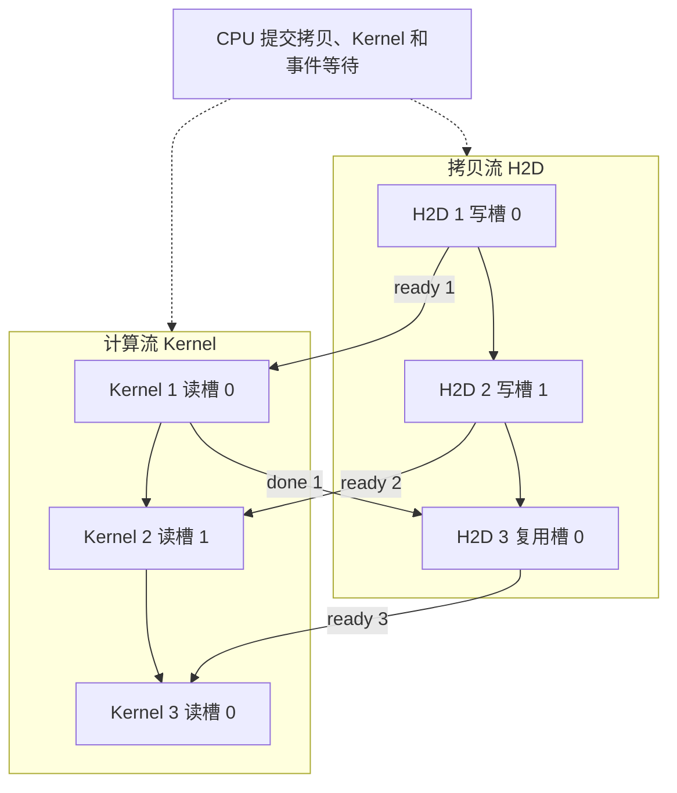

# 在时间线上读懂 Stream、异步与同步

CPU 调用一次 Kernel 启动后可以继续执行主机代码，GPU 可能还在处理之前的工作。排查「CPU 已经返回但结果没到」时，要把三个时刻分开看。主机提交请求，GPU 实际开始执行，GPU 完成操作。提交与执行之间可以隔着队列或依赖。以下用单张独立 GPU 和 CUDA 13.2.1 的普通 Stream 语义推演。 [CUDA 13.2.1 · Asynchronous Execution](https://docs.nvidia.com/cuda/archive/13.2.1/cuda-programming-guide/02-basics/asynchronous-execution.html)

## 单个 Stream 内的先后顺序

Stream 是一组按序执行的设备操作。以单批输入为例，CPU 可以先入队主机到设备拷贝（H2D），再入队处理这批输入的 Kernel，最后按需入队把结果拷回主机（D2H）。放在同一个 Stream 时，Kernel 在 H2D 完成后才读取输入，D2H 在 Kernel 完成后才取结果。需要让 CPU 读回结果时，等 D2H 完成再读主机缓冲区。GPU 上的下一步如果也在这个 Stream，可以按序消费结果。 [CUDA 13.2.1 · Stream Ordering](https://docs.nvidia.com/cuda/archive/13.2.1/cuda-programming-guide/02-basics/asynchronous-execution.html#cuda-stream-ordering)

| 操作 | 等待的范围 |
| --- | --- |
| `cudaEventSynchronize(event)` | 主机等待事件最近一次记录所捕获的工作。把事件记录在 D2H 后，就可等这一份结果 |
| `cudaStreamSynchronize(stream)` | 主机等待该流此前提交的工作 |
| `cudaDeviceSynchronize()` | 主机等待当前设备上该上下文此前提交的工作，覆盖各流 |
| `cudaStreamWaitEvent(stream, event, 0)` | 让目标流随后入队的工作等待事件。跨流依赖由设备端顺序表达，主机可以继续提交 |

在 CPU 上用时钟包住一次 Kernel 启动，量到的是主机提交一侧的耗时。若想量流内一段设备工作，在同一 Stream 前后记录可计时的 CUDA Event，等结束事件完成后读 `cudaEventElapsedTime`。区间可能包含等待或并发造成的影响。复测要固定区间、输入、预热和并发条件。端到端耗时另用主机时钟覆盖从准备输入到结果可用的完整过程。Nsight Systems 的 CPU CUDA API 行显示调用区间，GPU 的 Stream 行显示 Kernel 与拷贝活动，二者对齐后可定位提交和执行之间的空档。 [Runtime API 13.2.1 · Event Management](https://docs.nvidia.com/cuda/archive/13.2.1/cuda-runtime-api/group__CUDART__EVENT.html) · [Nsight Systems · CUDA Trace](https://docs.nvidia.com/nsight-systems/UserGuide/index.html#cuda-trace)

## 两个 Stream 如何共享两块缓冲区

一条拷贝流搬下一批，另一条计算流消费上一批。要让两项操作重叠，先给两批输入不同的设备缓冲区。用 `ready[n]` 表示第 n 批拷贝完成，计算流等它之后才读。用 `done[n]` 表示 Kernel 已结束对这一块输入缓冲区的使用，拷贝流等它之后才覆盖该槽位。下面是 CPU 提交顺序的伪代码。两流用 `cudaStreamCreateWithFlags(..., cudaStreamNonBlocking)` 创建，各批次使用独立事件。结果写入单独的设备输出区。

```text
for n in 1..3:
    slot = (n - 1) mod 2
    if n > 2:
        cudaStreamWaitEvent(copy, done[n-2], 0)
    cudaMemcpyAsync(device_in[slot], pinned_input[n], bytes, cudaMemcpyHostToDevice, copy)
    cudaEventRecord(ready[n], copy)
    cudaStreamWaitEvent(compute, ready[n], 0)
    enqueue_kernel(compute, device_in[slot], device_out[n])
    cudaEventRecord(done[n], compute)
```

两类等待分别保护生产和复用。若遗漏 `ready[n]`，Kernel 可能在本批拷贝完成前读取。若遗漏 `done[n-2]`，第 3 批可能覆盖第 1 批仍在读的缓冲区。主机页锁定输入也要在本批 H2D 完成前保持有效且内容稳定。这里用 `cudaEventRecord` 捕获生产流中已经入队的工作，再用 `cudaStreamWaitEvent` 将捕获的完成条件交给消费流。 [CUDA 13.2.1 · Explicit Synchronization](https://docs.nvidia.com/cuda/archive/13.2.1/cuda-programming-guide/02-basics/asynchronous-execution.html#explicit-synchronization) · [Runtime API 13.2.1 · Stream Management](https://docs.nvidia.com/cuda/archive/13.2.1/cuda-runtime-api/group__CUDART__STREAM.html)



虚线表示主机提交，实线表示设备执行依赖。按 **教学算例**，三批输入均已备好，H2D 每批 2 ms，Kernel 每批 6 ms，结果留在设备上。假设设备支持所需重叠，忽略提交开销和资源争用。各区间为从本轮开始计的毫秒数。

| 批次 | 串行 H2D | 串行 Kernel | 双缓冲 H2D | 双缓冲 Kernel |
| --- | --- | --- | --- | --- |
| 1 | 0–2 | 2–8 | 0–2 | 2–8 |
| 2 | 8–10 | 10–16 | 2–4 | 8–14 |
| 3 | 16–18 | 18–24 | 8–10 | 14–20 |

第一批都在 8 ms 完成。双缓冲把下一批的一部分搬运放进前一批的计算窗口，三批完成时间从 24 ms 降到 `2 + 3 × 6 = 20 ms`。能否得到这些重叠区间，还取决于设备的拷贝能力与方向、两项工作对资源的争用，以及 CPU 能否及时提交。`cudaDeviceProp.asyncEngineCount` 提供拷贝引擎信息。若要判断两个 Kernel 是否能并发，再看 `concurrentKernels` 和可用 SM 资源。实际发生的重叠以设备时间线为准。 [CUDA Best Practices Guide 13.2 · Asynchronous and Overlapping Transfers](https://docs.nvidia.com/cuda/archive/13.2.1/cuda-c-best-practices-guide/index.html#asynchronous-and-overlapping-transfers-with-computation) · [Runtime API 13.2.1 · cudaDeviceProp](https://docs.nvidia.com/cuda/archive/13.2.1/cuda-runtime-api/structcudaDeviceProp.html)

## 有多个 Stream 仍然排成一串时

先找有没有同一缓冲区上的真实依赖，再查默认流。Legacy 默认流与同一 CUDA 上下文里的 blocking 流有隐式顺序。提交给 legacy 流的操作要等此前的 blocking 流工作，随后这些流的工作也要等 legacy 流中的操作完成。`cudaStreamCreate()` 创建的流默认参与这一关系，`cudaStreamNonBlocking` 标志可将显式流排除在这组隐式同步之外。通过 `nvcc --default-stream per-thread` 可按编译单元启用 per-thread 默认流，它归属于主机线程和上下文，通常与其他显式流独立。若程序混用了 per-thread 和 legacy 默认流，两者之间仍会同步。 [Runtime API 13.2.1 · Stream Synchronization Behavior](https://docs.nvidia.com/cuda/archive/13.2.1/cuda-runtime-api/stream-sync-behavior.html)

再查拷贝方向、主机缓冲区类型和 API 的同步语义。上述常规 H2D 流水线使用页锁定主机内存，比如由 `cudaMallocHost` 分配。`cudaMemcpyAsync` 对 pageable 主机内存的传输可能阻塞主机，需要先暂存到页锁定内存时也可能同步该流。读 trace 时，CPU 调用区间很长和 GPU 活动排成一串是两种观测，分别沿主机阻塞和流间依赖去查。 [Runtime API 13.2.1 · API Synchronization Behavior](https://docs.nvidia.com/cuda/archive/13.2.1/cuda-runtime-api/api-sync-behavior.html) · [CUDA 13.2.1 · Page-Locked Host Memory](https://docs.nvidia.com/cuda/archive/13.2.1/cuda-programming-guide/02-basics/understanding-memory.html)
