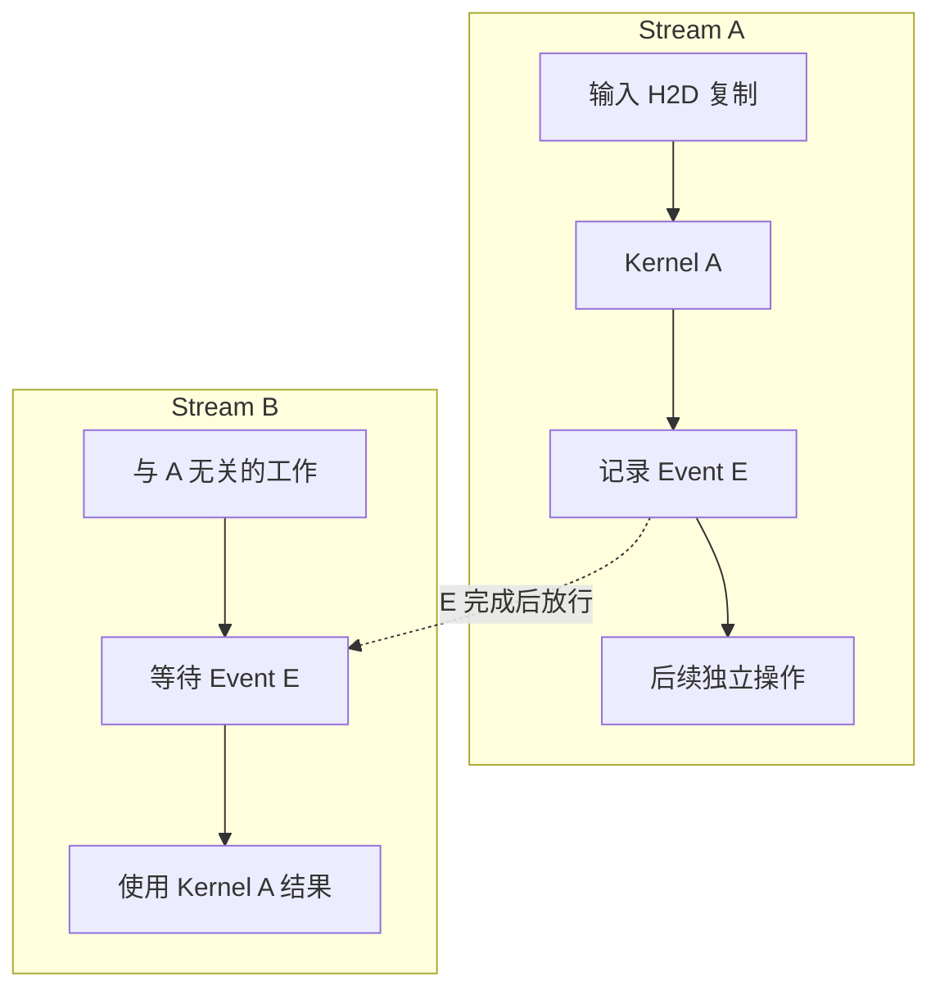

# Stream 与异步执行的时间线

## CPU 返回，只说明提交过程到了哪里

CPU 调用一次 Kernel 启动接口后，通常在 GPU 完成计算之前就可以继续执行主机代码。这叫相对于主机的**异步执行**。于是，CPU 线程可能正在准备下一批数据，GPU 才刚开始处理本批；CPU 也可能阻塞在等待完成的位置，而 GPU 正在持续计算。

要分清至少四个时刻：主机开始调用接口、接口把控制权交还主机、GPU 开始执行对应操作、GPU 完成该操作。只用 CPU 时钟包住一次异步启动，量到的主要是调用与提交耗时，不能把这个间隔当成 Kernel 执行时间。

异步并不承诺接口在任何条件下都立即返回。尤其是内存复制，带 `Async` 的名称并不足以确定主机是否会阻塞：主机缓冲的类型、传输方向及内部资源状态都可能影响行为。这里以 [CUDA 12.8.1 Runtime API：API Synchronization Behavior](https://docs.nvidia.com/cuda/archive/12.8.1/cuda-runtime-api/api-sync-behavior.html) 为准；后面的时间模型明确排除这些额外开销。

## Stream 记录操作顺序，不是专属执行硬件

**Stream（流）**是按顺序提交设备操作的序列。在本章普通执行模型下，同一 Stream 中的前序复制完成后，依赖它的 Kernel 才开始；后续复制又等待前序 Kernel 完成。Stream 不等于 GPU 卡，也不等于一个 SM、一个主机线程或一台固定复制引擎。

把两批互不依赖的数据放入不同 Stream，会给系统留下重叠执行的机会。机会能否兑现，还取决于数据依赖、硬件复制/计算能力、资源可用性与竞争。多开一个 Stream 不会把计算单元或带宽翻倍。基本约定见 [CUDA 12.8.1：Streams 与 Overlapping Behavior](https://docs.nvidia.com/cuda/archive/12.8.1/cuda-c-programming-guide/index.html#streams)。

下面表达的是依赖关系，不是实际耗时或物理连线。框表示操作所属的 Stream；实线箭头表示同流顺序，虚线箭头表示通过 Event 建立的跨流依赖。

**H2D** 是 Host to Device，即主机到设备复制；**D2H** 是反方向复制。**Event（事件）**是插入 Stream 的进度标记：当执行推进到标记时，它可用于判断此前的工作已完成。`cudaStreamWaitEvent` 在另一个 Stream 中加入等待依赖，主机可以继续提交；`cudaEventSynchronize` 则让调用它的主机线程等到事件完成。

图中 B 的结果使用必须等 E，A 的后续独立操作没有被这条依赖强制要求先于 B 完成。真正开始时仍要有硬件资源。反过来，如果从两个不同 Stream 读写同一缓冲，却没有保证先写后读的依赖，就可能产生错误，不能把“跨流无默认顺序”当作自动正确的并发。

## 一次明确的串行时间预算

对 GPU-T 假设两批相互独立的输入已经准备好，输出只在两批都结束后由 CPU 使用。为便于手算，本题给出固定耗时，不从 HBM 带宽推导主机复制时间：

| 单批操作 | 时间 | 必要条件 |
| --- | --- | --- |
| H2D 复制 | 4 ms | 主机缓冲已就绪 |
| Kernel | 10 ms | 本批 H2D 已完成 |
| D2H 复制 | 2 ms | 本批 Kernel 已完成 |

先把两批放进同一 Stream，严格依次执行：

| 操作 | 开始—结束（ms） |
| --- | --- |
| 批次 0 H2D | 0—4 |
| 批次 0 Kernel | 4—14 |
| 批次 0 D2H | 14—16 |
| 批次 1 H2D | 16—20 |
| 批次 1 Kernel | 20—30 |
| 批次 1 D2H | 30—32 |

总时间为 `2 × (4 + 10 + 2) = 32 ms`。CPU 即使在最初很短的时间内把这些请求全部提交完，也仍需等到 32 ms 才能安全使用全部输出。

## 用两组缓冲形成一次有效重叠

现在给出重叠所需的额外条件：两批使用不同主机和设备缓冲；主机复制缓冲已经页锁定；GPU 支持复制与计算重叠，并支持本题的双向复制并发；两个显式 Stream 不引入默认流的额外同步；资源争用不改变各操作的给定耗时；启动、提交和 Event 开销在本题忽略。Kernel 阶段按最多一批计算占用计算资源安排。

**页锁定主机内存（Pinned Memory）**是保持物理页面稳定、可用于相应异步传输的主机缓冲。它仍然占主机内存，不会变成 HBM。过量页锁定也会给系统带来压力。复制与计算重叠的条件可核对 [CUDA 12.8.1 Best Practices：Asynchronous and Overlapping Transfers with Computation](https://docs.nvidia.com/cuda/archive/12.8.1/cuda-c-best-practices-guide/index.html#asynchronous-and-overlapping-transfers-with-computation)。

将批次 0 放入 Stream A，批次 1 放入 Stream B，可以安排出下面这条符合依赖的时间线：

| 操作 | 开始—结束（ms） | 为什么此时可以开始 |
| --- | --- | --- |
| 批次 0 H2D | 0—4 | 输入已就绪 |
| 批次 1 H2D | 4—8 | 上一项同方向复制结束；使用另一组缓冲 |
| 批次 0 Kernel | 4—14 | 批次 0 H2D 完成，可与批次 1 H2D 重叠 |
| 批次 0 D2H | 14—16 | 批次 0 Kernel 完成 |
| 批次 1 Kernel | 14—24 | 本批 H2D 已在 8 ms 完成，计算资源此时可用 |
| 批次 1 D2H | 24—26 | 批次 1 Kernel 完成 |

这条安排的总时间为 **26 ms**：填充 4 ms，两个 Kernel 合计 20 ms，最后排空 2 ms；中间复制被计算覆盖。它是在题设下构造出的可行安排，不是“有两个 Stream 就必然获得 26 ms”的实机承诺。

如果持续处理 n 批，且一直满足同样条件，理想流水线可按 `4 + 10n + 2 ms` 完成，稳态每 10 ms 完成一批。单批从其 H2D 开始到 D2H 完成的时间仍是至少 16 ms；这里改善的是多批的吞吐与总完成时间，不能直接说单批延迟降为 10 ms。

## 更高并发会反过来占用显存

两组缓冲必须有存储空间。[第二篇的容量题](02_数据放在哪里与显存容量预算.md)中，当前计算占应用预算 72 GiB，只有 4 GiB 余量；想完整预取 8 GiB 下一批时，峰值会超预算 4 GiB。所以那项作业不能直接采用需要 8 GiB 额外设备缓冲的重叠方案。

可以缩小分块到不超过 4 GiB，或者调整数据生存期、减少其他占用，再重新计算时间线。分块之后复制次数和 Kernel 数量也可能变化，不能原封不动沿用这里的 26 ms。容量预算与重叠时序必须使用同一套缓冲安排。

本篇 4/10/2 ms 的流水练习是另一组操作时序条件；它并未声称复制量就是容量题的 8 GiB，也没有使用 1,500 GB/s 的 HBM 上界估计 H2D。

## 同步既建立正确性，也改变可观察的时间

| 方式 | 谁等待什么 | 如何解释观察结果 |
| --- | --- | --- |
| `cudaStreamSynchronize(s)` | 调用它的主机线程等待 s 中此前提交的工作 | 等待时间可以是前面一批工作的剩余耗时 |
| `cudaEventSynchronize(e)` | 主机等待事件 e 完成 | 可以把等待范围定位到插入的标记 |
| `cudaStreamWaitEvent(s, e)` | s 中后续工作等待 e；主机通常继续提交 | 在设备执行序列中建立跨流依赖 |
| `cudaDeviceSynchronize()` | 主机等待当前设备上该应用执行上下文中此前提交的工作 | 范围较大，不代表整台服务器其他进程都被等待 |

表中的执行上下文可先理解为应用管理一组 GPU 执行状态的范围，第 03 章会继续解释。同步接口的语义见 [CUDA 12.8.1：Explicit Synchronization](https://docs.nvidia.com/cuda/archive/12.8.1/cuda-c-programming-guide/index.html#explicit-synchronization)。若 CPU 记录显示 9 ms 花在同步调用中，而它刚提交了一个尚未完成的 Kernel，这 9 ms 很可能包含等待设备的时间；不能把它再当成独立的 9 ms 开销与同一段 GPU 时间相加。

测单个 Kernel 时，可以在同一 Stream 中依次放置开始 Event、Kernel、结束 Event，等待结束 Event 后读两者时间差。这个区间仍可能受其他并发工作影响；如果 CPU 迟迟不提交 Kernel，也可能包含设备空档。测端到端耗时则应在开始前排除不希望计入的历史工作，并在结束时等待目标输出完成。启动开销、初始化和热身是否计入，要由问题决定并明确记录。

默认 Stream 还有 legacy default stream 与 per-thread default stream 等不同语义，可能带来额外的同步关系。`cudaStreamNonBlocking` 中的“NonBlocking”主要描述与 legacy default stream 的关系，不能推出所有主机调用都不会阻塞。本章采用显式 Stream 和明确依赖，避免把未知默认流语义当作计算依据。相关规则见 [CUDA 12.8.1：Default Stream](https://docs.nvidia.com/cuda/archive/12.8.1/cuda-c-programming-guide/index.html#default-stream)。

现在已经能把“CPU 在等”“GPU 在算”“复制正在进行”和“输入尚未准备好”放到同一张图上。最后一篇将用实际字段定义和教学记录完成整章判断。

[上一篇：精度、带宽与性能上界](03_精度_带宽与性能上界.md) · [下一篇：从指标和作业记录判断瓶颈](05_从指标和作业记录判断瓶颈.md)
