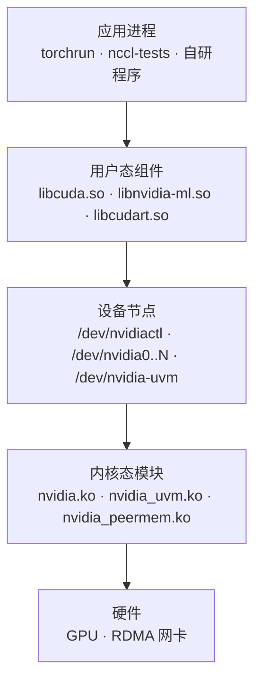

---
tags:
  - AI-Infra
  - 驱动
  - 内核模块
  - 原理
  - 驱动栈层次
created: 2026-10-11
---

# 驱动栈的三个层次

同一句「GPU 用不了」，可能来自三个互不相同的地方：进程链接的用户态库存不存在、设备节点能不能被打开、内核模块有没有加载。这三层各自由不同的东西提供，各自有自己的产物与自己的报错文本，因此**排障的第一动作不是敲命令，而是先判断这句报错落在哪一层**。把层次判错，后面所有的动作都作用在错的对象上——一个内核模块没加载的机器，重装用户态库不会让 GPU 回来；一个只是缺设备节点的容器，重装驱动也不是正确的起点。

## 三层各自是谁

一个进程要用上 GPU，要穿过一条五段的路径：应用调用运行时库，运行时库打开设备节点，设备节点交给内核模块，内核模块驱动硬件。中间三层是本篇的对象。



三个层次的提供者、产物与失败形态如下表。表里的「谁提供」决定了升级或替换时该动哪个包，也决定了报错文本归属哪一层。

| 层 | 代表组件 | 谁提供 | 这一层坏了的现象 |
| --- | --- | --- | --- |
| 用户态 | `libcuda.so`、`libnvidia-ml.so`（NVML）、`libcudart.so` | 驱动包与 CUDA 工具链 | `Failed to initialize NVML: Driver/library version mismatch`；容器内的库版本与宿主机不一致 |
| 设备节点 | `/dev/nvidiactl`、`/dev/nvidia0..N`、`/dev/nvidia-uvm` | udev 规则创建，`nvidia-modprobe` 兜底 | `nvidia-smi` 报 `couldn't communicate with the NVIDIA driver`；容器内 CUDA 初始化失败 |
| 内核态 | `nvidia.ko`、`nvidia_uvm.ko`、`nvidia_peermem.ko` 等 | 驱动包，DKMS 现场编译或发行版预编译 | `lsmod` 里看不到对应模块；内核日志里出现 `NVRM` 记录 |

这里要留意一处措辞上的陷阱：三层的失败形态**不是互斥的**。设备节点缺失与内核模块缺失都会让 `nvidia-smi` 报同一句「无法与驱动通信」，所以这句话只能定位到「内核态或设备节点这一侧」，不能直接定位到某一层；要分开它们，靠的是设备清单与模块清单两份读数，而不是报错文本本身。

## 一条分界线：`nvidia-smi` 走哪条链路，CUDA 走哪条链路

这三层里最容易混为一谈的是设备节点层，因为**管理工具与计算程序用的不是同一组节点**。

`nvidia-smi` 通过管理库（NVML，NVIDIA Management Library）访问 GPU，只需要 `/dev/nvidiactl` 与 `/dev/nvidia0..N` 这一组节点。CUDA 程序在初始化上下文时，除了这一组节点，还必须能打开 `/dev/nvidia-uvm`——它是统一内存与统一地址空间子系统（UVM，Unified Virtual Memory）的入口。两组节点的使用方不同，于是一个看似矛盾的现象是成立的：**`nvidia-smi` 正常只能证明内核模块到 NVML 这条链路通了，证明不了 CUDA 能用。**

| 工具或程序 | 依赖的节点 | 说明 |
| --- | --- | --- |
| `nvidia-smi` | `/dev/nvidiactl`、`/dev/nvidia0..N` | 走 NVML，不需要 UVM 节点 |
| CUDA 程序 | 上述节点，加上 `/dev/nvidia-uvm` | 上下文初始化需要 UVM 子系统 |

现场遇到「`nvidia-smi` 正常、CUDA 程序起不来」时，第一个动作是比对两边的 `/dev/nvidia*` 清单，而不是改动驱动版本；这条分界线的判据落在设备节点层，具体归属与权限的机制在另一条链路里展开。

## 报错落在哪一层的判定

判定用三问完成，每一问对应一份读数。三问的顺序是先看模块、再看节点、最后看版本，因为后者的比较对象要以前者都成立为前提。

| 判定问题 | 读什么 | 判据 | 与谁同看 | 转向哪一步 |
| --- | --- | --- | --- | --- |
| 内核模块加载了吗 | `lsmod` 里 `nvidia` 开头的行 | 这一行不存在，GPU 一定不可用，且问题不在用户态 | 与 `dkms status` 和内核日志里的 `NVRM` 记录同看 | 转入模块为什么没加载的分支 |
| 设备节点齐全吗 | `/dev/nvidia*` 的列表与权限位 | 节点缺失或权限不对，用户态进程打不开设备 | 与 `nvidia` 模块的引用计数同看 | 转入节点归属与访问控制的分支 |
| 两个版本对得上吗 | `/proc/driver/nvidia/version` 与 `nvidia-smi` 显示的驱动版本 | 两者不一致就是版本不匹配，报错文本是 `Driver/library version mismatch` | 与包管理器里已安装的驱动包版本同看 | 转入升级是否重启、模块是否重载的分支 |

有一条容易过界的读法要提前划清：CUDA 初始化失败时常见的 `CUDA error: unknown error`（错误码 999）看起来像设备节点层的指纹，但它**不是这一项的专属证据**——权限、显存、容器能力集都可能给出同一句报错，因此它只能作为「继续查节点清单」的触发条件，不能作为结论。

```bash
# 验证：三条判定各自的取值入口（只读）
lsmod | grep -E '^nvidia'; ls -l /dev/nvidia*; cat /proc/driver/nvidia/version
```

三个层次的机制各自还有更细的对象：内核模块由哪几个模块组成、设备节点由谁创建、两个版本分别由哪个包决定，这些分别属于后续的展开。上面这条命令只用来说明三个判定的取值入口，设备名与模块清单随机型、驱动四元组与内核版本变化，任何对照使用的数值仅示意、不代表你的环境。

**第一反应不要做什么**：不要在报错文本上直接猜根因，先把 `lsmod`、`/dev/nvidia*` 与两个版本三份读数取出来；不要把 `nvidia-smi` 正常当成 CUDA 可用；不要把 `couldn't communicate` 当成用户态库损坏；不要在设备节点缺失时去重装驱动包。正确的顺序是先判层次、再取该层的字段、最后才谈改动。

## 参考文档

- NVIDIA 驱动包自带的 `nvidia-smi(1)` 手册页：NVML 的字段口径，以及头部版本字段的含义。
- NVIDIA 驱动安装指南的 Kernel Modules 与 Device Node Verification 各节：内核模块清单、设备节点的验证方式，以及 `nvidia-smi` 与 CUDA 各自依赖的节点。
- NVIDIA 驱动的持久化文档：统一内存子系统与 `nvidia-uvm` 的关系，以及设备初始化状态的生命周期。
- Linux 内核文档中关于字符设备与 `udev` 的说明：设备节点的创建者与权限来源。