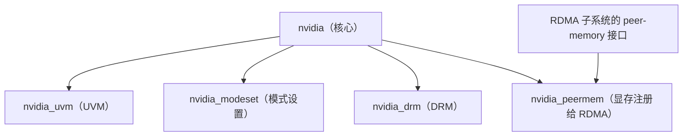
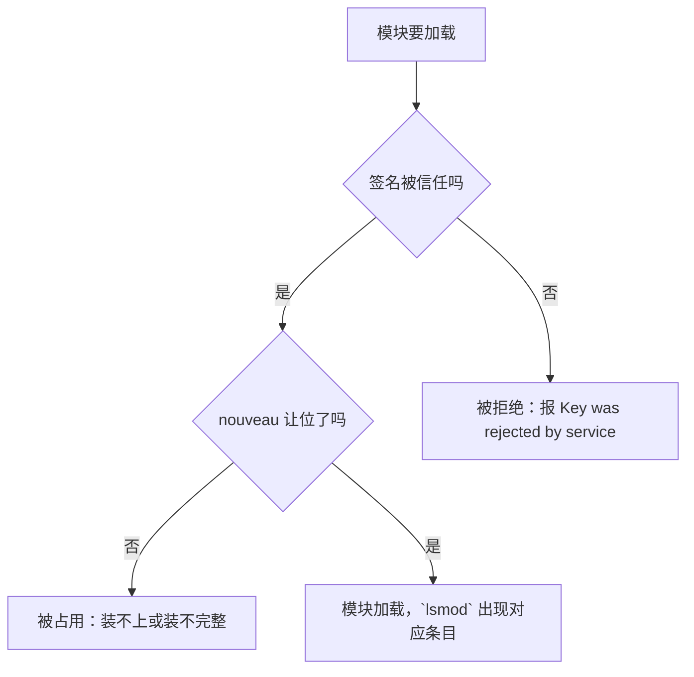

---
tags:
  - AI-Infra
  - 驱动
  - 内核模块
  - 原理
  - DKMS
  - GSP 固件
created: 2026-10-11
---

# 模块家族与两套 flavor

驱动包解开之后落到 `/lib/modules` 下的不是一个名字的模块，而是一组分工不同的文件；它们由两种实现风格、两种构建方式产出。同一句「内核升级之后 GPU 失联」，在这台机器上可能是 DKMS 没重编，在另一台机器上是要等发行版推新包，在第三台机器上是自签名模块被固件拒绝——**现象相同，改动对象完全不同**，区别就藏在这组模块的来源与实现里。本篇要把这个来源与实现讲清楚：模块家族各自管什么、固件在这一步从哪里来、DKMS 与预编译在内核升级时的分水岭在哪里、以及签名与冲突这一类前置条件为什么会让模块根本加载不上。

## 模块家族里各管一摊

驱动包含五个内核模块。文件的命名用短横线，载入内核后 `lsmod` 里显示为下划线，两种写法 `modprobe` 都识别；下表把文件、载入后的名字、职责与缺失后果排开。

| 模块文件 | `lsmod` 里的名字 | 职责 | 缺失后果 |
| --- | --- | --- | --- |
| `nvidia.ko` | `nvidia` | 核心：GPU 初始化、显存管理、CUDA 驱动接口 | 核心模块缺失时整条链路不可用，管理工具直接失联 |
| `nvidia-uvm.ko` | `nvidia_uvm` | 统一内存与统一地址空间（UVM），CUDA 上下文依赖它 | 管理工具仍正常，CUDA 程序初始化失败 |
| `nvidia-modeset.ko` | `nvidia_modeset` | 显示模式设置，与内核显示子系统衔接 | 无显示的计算节点无影响；图形环境起不来 |
| `nvidia-drm.ko` | `nvidia_drm` | 直接渲染管理（DRM）接口 | 同上，计算节点可忽略 |
| `nvidia-peermem.ko` | `nvidia_peermem` | 把 GPU 显存注册给 RDMA 子系统，支撑显存直连 | 显存直连退化为经主机内存中转；模块**不会自动加载** |

模块之间存在引用关系，判断「加载了哪一部分」不能只看单个模块在不在，还要看谁挂在谁下面。



`nvidia` 是其余模块的底座，`lsmod` 里 `nvidia` 那一行的 `Used by` 列会列出挂在它下面的模块。`nvidia_peermem` 特殊在它同时依赖核心模块与 RDMA 子系统的 peer-memory 接口，**因此它既不会随核心模块自动加载，加载失败的原因也可能出在 RDMA 栈一侧而不是驱动一侧**：内核需要具备 peer-memory 支持，且它要用 RDMA 栈提供的接口来编译。

## GSP 固件在这一步进来

现代数据中心驱动里，GPU 的初始化不是全部由驱动代码在主机侧完成，其中一部分由 GPU 板载的处理器执行固件后再回传状态，这个处理器叫 GPU 系统处理器（GSP，GPU System Processor）。固件文件随驱动包安装到磁盘上，**在内核模块加载时被读入 GPU**，因此它属于「包落地」与「模块加载」之间的一环，而不是独立的一次升级动作。

由此产生两条判据。其一，固件文件与已加载的模块是配对的，**只更新一半会让模块加载失败**；其二，是否走 GSP 路径、固件是哪一个版本，都由驱动分支与内核模块参数决定，**默认值现场取、不凭记忆**，取值方式是读管理工具里的固件版本字段与内核日志里的加载记录。

| 关注对象 | 取值入口 | 读到什么 | 与谁同看 | 转向哪一步 |
| --- | --- | --- | --- | --- |
| GSP 固件版本 | 管理工具的 `GSP Firmware Version` 字段 | 当前生效的固件版本 | 与 `/proc/driver/nvidia/version` 的内核模块版本同看 | 两者不匹配时，先核对包是否落地完整 |
| 固件加载记录 | 内核日志里的驱动加载行 | 固件是在何时、以哪个版本被读入 | 与 `lsmod` 的模块清单同看 | 模块加载失败且日志指向固件时，转入包完整性核对 |

开源实现与专有实现对待 GSP 的方式不同：开源实现更彻底地依赖 GSP 路径，因此在固件这一项上，两套实现可能出现不同的行为。

## 两套 flavor 与两种构建方式

**实现风格有两条。** 同一批内核模块存在两套实现：专有（proprietary）与开源（open）。开源实现以 MIT 与 GPLv2 双许可发布，从 515 系列起与专有实现并存，**自 560 系列起开源实现成为默认安装，且要求 GPU 为 Turing 或更新世代**。这个版本门是判断点之一：早于 Turing 的卡上装开源实现不成立，需要回到专有实现。

**构建方式也有两条。** 模块是装包时现场编译，还是发行版预先编好，决定了内核升级之后要做什么。

| 维度 | DKMS | 预编译 |
| --- | --- | --- |
| 模块从哪来 | 装包或内核升级时，用本机内核头文件（kernel headers）现场编译 | 发行版按内核包版本预先编好 |
| 内核升级后 | 触发重编；编译失败则新内核下没有 `nvidia.ko` | 要等对应新内核版本的模块包发布 |
| 前置条件 | 必须装与当前内核匹配的头文件与编译器 | 无额外前置，但内核版本必须与包匹配 |
| 排障入口 | `dkms status` 中当前内核那一行的状态 | 包管理器里模块包的版本 |
| 一眼识别 | `modinfo -F filename nvidia` 的路径落在 `updates/dkms/` 之下 | 路径落在内核自带目录之下 |

这两条轴是独立的：开源/专有决定实现，DKMS/预编译决定产物怎么来，四种组合都可能出现。识别用一条命令即可，路径落在哪里就是哪种构建方式。

```bash
# 验证：看这台机器的模块来自哪种构建方式（只读）
modinfo -F filename nvidia; dkms status
```

数值与路径仅示意、不代表你的环境：发行版、内核版本与驱动四元组都会改变实际路径。

## 加载之前的两个前置：签名与冲突

模块被加载进内核之前，还要过两道不属于驱动自身的前置。

**签名。** 启用安全启动（Secure Boot）的机器上，内核只加载被信任密钥签名的模块。现场编译出来的模块默认由本机密钥签名，而**对应的公钥必须注册进固件的机器所有者密钥列表（MOK，Machine Owner Key）才会被信任**。这一步没做时，现象不是「找不到模块」而是「模块被拒绝」，两者的报错文本不同。

| 现象 | 报错文本（仅示意） | 说明 |
| --- | --- | --- |
| 模块被安全启动拒绝 | 手动加载时报 `Key was rejected by service` | 模块存在但签名不被信任 |
| 内核日志记录签名缺失 | `module verification failed: signature and/or required key missing` | 内核侧留下的同一条线索 |

**冲突。** 发行版自带的开源显示驱动 `nouveau` 会占用 GPU，使专有驱动装不上或装得不完整。它的处理不是一个软件包的问题，而是要让 `nouveau` 在 NVIDIA 驱动加载之前让位——判据落在模块清单上：只要它还在被加载，NVIDIA 模块的安装与加载就不算成立。



```bash
# 验证：签名前置与冲突前置各自的取值入口（只读）
mokutil --sb-state; lsmod | grep nouveau
```

上面两条命令只回答「这台机器有没有把签名作为前置、`nouveau` 有没有让位」，它们不指导现场动手；具体的注册与冲突处置属于变更动作。这里的结论只有一条：**模块加载失败时，除了编译与路径，还要把签名与冲突这两个前置一起核对**。

**第一反应不要做什么**：不要把「模块没加载」直接当成编译失败；不要看到 `couldn't communicate` 就去重装整套驱动；不要在同一台机器上并存两套实现风格或两种构建方式的包；不要假设 `nvidia_peermem` 会随核心模块自动加载。正确的顺序是先看模块清单与来源路径，再把签名与冲突这两个前置核对完，最后才谈重编或重装。

## 参考文档

- NVIDIA 驱动安装指南的 Kernel Modules 与 Pre-installation Actions 各节：五个内核模块的清单与职责、安装方式的互斥要求、安全启动与模块签名。
- NVIDIA 开源内核模块仓库与驱动安装指南：开源与专有两套实现的版本门与默认安装变化。
- NVIDIA GPUDirect RDMA 文档：`nvidia-peermem` 的模块前置、与旧版显存注册模块的互斥关系，以及它不会自动加载这一条。
- NVIDIA DKMS 使用说明：构建期间的签名密钥与公钥注册，以及内核升级后重编失败的恢复路径。
- 对应发行版的内核文档：`nouveau` 与专有驱动并存时的模块占用关系。