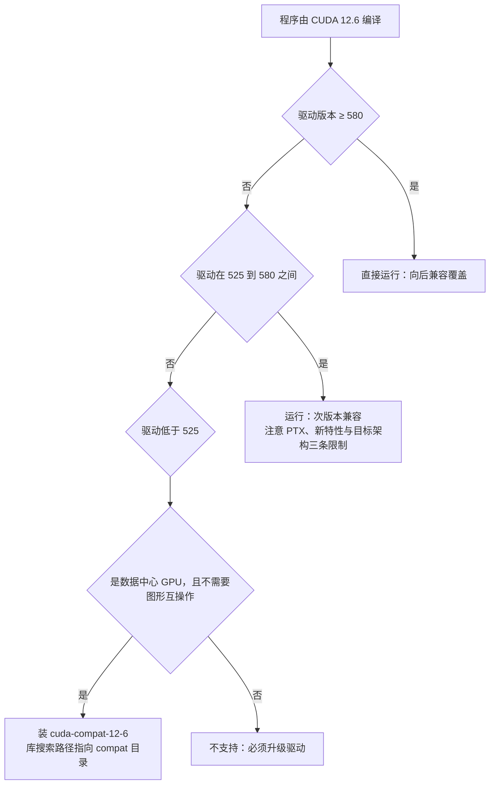

---
tags:
  - AI-Infra
  - 驱动
  - 内核模块
  - 原理
  - 版本兼容
  - CUDA
created: 2026-10-11
---

# 版本四元组的约束方向

一次升级之后报错，先要问的往往不是「升到哪个版本」，而是「这次动作动了四元组里的哪一项，它把哪一项变成了下限」。四项版本必须成组记录这一点已经成立——驱动、CUDA、通信库（NCCL）与 RDMA 栈四项各有自己的取值入口，缺一项就无法判断这套组合能不能跑。本篇要展开的是它们之间的**约束方向**：谁抬高会把谁压成下限、升级顺序为什么有先后、哪一条边界看起来能省掉一次升级而实际上不能。

四项之间不是一条直线，而是三条方向不同的边，下表先给出轮廓。

| 约束边 | 方向 | 后果 |
| --- | --- | --- |
| CUDA 与驱动 | 新版 CUDA 需要足够新的驱动 | 驱动过旧时，用新工具链编的程序不能运行 |
| NCCL 与 CUDA | NCCL 按 CUDA 大版本编译发布 | 升级了 CUDA 而 NCCL 停在旧包，构成半升级状态 |
| 驱动与 RDMA 栈 | 显存直连模块要用 RDMA 栈的接口编译 | 安装顺序错了要重装驱动，才能让模块对上接口 |

## CUDA 与驱动：两条路径

官方兼容性模型给出的最低驱动要求是这张表。**它是「大版本族」的门槛，不是逐个小版本的对照表**，这一点在下面读法里会体现。

| CUDA 工具链大版本 | 最低驱动 | 说明 |
| --- | --- | --- |
| CUDA 13.x | ≥ 580 | 驱动达到 580 及以上 |
| CUDA 12.x | ≥ 525 | 驱动在 525 及以上、580 以下 |
| CUDA 11.x | ≥ 450 | 驱动在 450 及以上、525 以下 |

在最低要求之上，还有两条可以省掉升级的路径，它们的适用范围不同。

**次版本兼容（minor version compatibility）是 CUDA 11 起的默认行为。** 同一个大版本族内，用较新次版本工具链编译的程序可以运行在较老的驱动上。它有三条硬限制：使用 PTX（Parallel Thread Execution，一种由驱动在运行期编译的中间表示）、需要在运行期即时编译（JIT）的程序在旧驱动上跑不起来，必须升级驱动；程序用到了新版工具链与驱动才具备的能力时，会报 `cudaErrorCallRequiresNewerDriver`；编译时需要显式指定目标架构而不是依赖默认值。

**前向兼容（forward compatibility）用于跨大版本。** 当驱动停在旧大版本、程序要用新大版本工具链时，可以安装 `cuda-compat-<major>-<minor>` 兼容包，把运行库落到该工具链目录下的 `compat/` 子目录，再用库搜索路径指向它。它的边界必须先划清，否则会把它当成「免升级驱动」的通用手段。

| 边界 | 说明 |
| --- | --- |
| 适用范围 | 仅数据中心 GPU，少数服务器认证的消费级型号与嵌入式平台另行判定 |
| 图形互操作 | 不覆盖 CUDA 与 OpenGL、Vulkan 的互操作 |
| 生效对象 | 只对 CUDA 生效，系统内的其它计算组件仍停在旧版本 |
| 错误码 | 认 `803`（系统驱动不匹配）与 `804`（设备不支持兼容包）两个错误码 |
| 生命周期 | 驱动也随之升级后，兼容包应当移除，否则会掩盖真实版本 |
| 命名 | 包名对应**它能支持的最高工具链版本**，而不是当前驱动版本 |

三条路径的判定顺序用一次具体输入走完。输入是「一个用 CUDA 12.6 编译的程序」。



把同一个输入换成三台驱动版本不同的机器，对照关系如下。两个换算点是「525」与「580」两条边界，反推判据在表后。

| 驱动版本 | 与 CUDA 12.6 的关系 | 结论 |
| --- | --- | --- |
| 580 及以上 | 高于该工具链所需 | 直接运行 |
| 525 至 580 之间（不含 580） | 处于 12.x 大版本族的最低要求之上 | 走次版本兼容运行，三条限制生效 |
| 525 以下（如 470） | 低于 12.x 的最低要求 | 需前向兼容包；不满足其边界时只能升级驱动 |

**反推判据**：管理工具头部显示的 CUDA 版本是**当前驱动支持的最高运行时版本**，不是机器上安装的工具链版本；判断能不能运行时，要拿程序工具链的**大版本族最低驱动要求**（12.x 对应 525）与驱动作比较，而不是拿头部数字与工具链版本号直接相减。这两个量属于不同的对象，混用会得出「12.2 小于 12.6 所以不能跑」这类错误结论。

## NCCL 与 CUDA：包名里的绑定

NCCL 按 CUDA 大版本编译发布，这个绑定直接写在包名里——形如 `libnccl2=2.4.8-1+cuda10.0` 的版本串中，`+cudaX.Y` 就是它编译所依赖的 CUDA 版本。由此产生一类典型故障：升级了 CUDA 工具链而 NCCL 仍停在旧包，程序能编过、运行起来却找不到符号或性能异常。**判据不是「NCCL 装了没有」，而是「运行期实际加载的那一套 NCCL 是用哪个 CUDA 大版本编的」**，后者要看程序运行日志里报告出的版本串，而不是镜像或系统里存在几个库文件。

## 驱动与 RDMA 栈：一条安装顺序

显存直连所用的模块需要调用 RDMA 子系统提供的显存注册接口，因此它的编译依赖 RDMA 栈已经就位。官方给出的顺序规定很明确：**如果 GPU 驱动是在 RDMA 栈之前安装的，就需要把 GPU 驱动卸载后重装**，以保证该模块是针对 RDMA 栈提供的接口编译的。反过来，内核本身也需要具备显存注册支持，模块才可能加载成功。

需要同时记住的是第四项在不同机器上的来源并不统一：可以是发行版内核自带的栈，也可以是厂商打包的整份发行版。具体该用哪一种、各自的能力边界，不属于本篇负责的内容；这里只落一条判据：**这一项与驱动存在编译期的顺序依赖，因此它必须和驱动版本一起记录、一起规划升级顺序。**

## 四个版本判断点

| 判断点 | 会改变什么动作 | 现场取法 |
| --- | --- | --- |
| 工具链大版本的最低驱动要求 | 决定驱动能不能支撑这套工具链 | 工具链版本与驱动版本，按大版本族对照 |
| 次版本兼容的三条限制 | 决定是否需要升级驱动 | 程序是否使用 PTX、是否用到新特性、编译时的目标架构 |
| 前向兼容包的边界 | 决定能否用兼容包替代升级驱动 | 是否为数据中心 GPU、是否需要图形互操作 |
| 驱动与 RDMA 栈的安装顺序 | 决定显存直连模块能否按正确接口编译 | 两者的安装先后与模块是否已加载 |

```bash
# 验证：四元组各自的取值入口（只读）
nvidia-smi --query-gpu=driver_version --format=csv; nvcc --version; lsmod | grep -E 'nvidia_peermem|nv_peer_mem'
```

上面一行只给出四项中三项的取值入口；通信库那一项的值要看程序运行日志报告的版本串。数值仅示意、不代表你的环境，实际组合随机型、驱动四元组与打包方式变化。

**第一反应不要做什么**：不要只报一个版本号就说兼容性已经确认；不要拿管理工具头部的 CUDA 版本当成工具链版本；不要把前向兼容包当成免升级驱动的通用手段；不要在内核驱动的安装顺序颠倒之后只重装显存直连模块。正确的顺序是先确定程序用哪个大版本族工具链，再用最低驱动要求与两条兼容路径的边界逐项核对，最后才谈升级哪一项。

## 参考文档

- NVIDIA CUDA 兼容性文档：最低驱动版本、次版本兼容与前向兼容两条路径，以及 `cudaErrorCallRequiresNewerDriver` 的触发条件。
- NVIDIA CUDA 安装指南的 Pre-installation Actions 一节：兼容包的安装位置、库搜索路径与两个错误码。
- NCCL 用户指南：版本串的构成与它同 CUDA 大版本的绑定关系。
- NVIDIA GPUDirect RDMA 文档：显存直连模块对 RDMA 栈接口的编译依赖，以及驱动与 RDMA 栈的安装顺序规定。