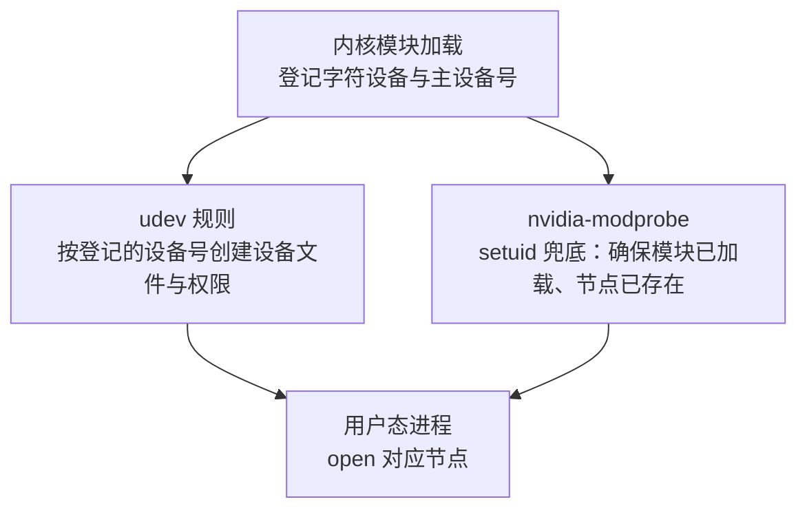

---
tags:
  - AI-Infra
  - 驱动
  - 内核模块
  - 原理
  - 设备节点
  - udev
created: 2026-10-11
---

# 设备节点的归属与访问控制

内核模块加载成功，只说明内核对这张卡有了认识；用户态进程能不能用上它，还要看 `/dev` 下有没有一个可以被打开的设备文件。中间这一步常被忽略，因为它平时是自动完成的——节点由内核之外的一方按内核登记的设备号创建出来，创建者与使用者分属两方，权限也来自第三份规则。于是会出现一类现象：模块在，卡也在，进程就是打不开设备，而报错文本和「驱动没装好」一模一样。本篇要讲清的就是这一层：节点由谁创建、编号从哪里来、权限由谁决定，以及为什么容器里的节点只能沿用宿主机已有的那一份。

## 节点清单与各自的用途

同一个驱动暴露出来的不是单个节点，而是一组职责不同的字符设备。

| 节点 | 用途 | 谁创建 | 编号与权限特征 |
| --- | --- | --- | --- |
| `/dev/nvidia0` 到 `/dev/nvidiaN` | 每张 GPU 对应一个 | udev 规则；`nvidia-modprobe` 兜底 | 主设备号约定、次设备号逐卡递增，权限通常为全体可读写 |
| `/dev/nvidiactl` | 控制设备：枚举卡、下发控制命令 | 同上 | 主设备号与次设备号都是约定值 |
| `/dev/nvidia-uvm` | UVM 子系统入口，**CUDA 必需** | 同上 | 主设备号**动态分配**，不能写死 |
| `/dev/nvidia-uvm-tools` | UVM 的调试工具入口 | 同上 | 部分发行版或驱动分支才创建 |
| `/dev/nvidia-caps/*` | 按能力拆分出来的设备，用于多实例等场景 | `nvidia-modprobe` 按能力名创建 | 按能力拆分，逐个创建 |

这张表里最需要记牢的是最后一行与倒数第三行的差异：控制设备与显存设备的编号是约定的，**UVM 设备的主设备号是内核动态分配的**。任何脚本里写死了 UVM 的编号，换一台机器或换一个内核都可能对不上，正确取值方式是读内核登记的设备号清单。

## 节点的创建链

一条设备节点从「内核认识这张卡」到「进程能打开它」，要经过三方，缺任何一方节点都不存在。



| 环节 | 做什么 | 产物 | 失效时的现象 |
| --- | --- | --- | --- |
| 内核模块 | 登记字符设备，分配主设备号 | 一份可被识别的设备号 | 模块未加载时任何节点都无从谈起 |
| udev 规则 | 按设备号创建节点文件，设置属主与权限 | `/dev/nvidia*` 下的节点 | 精简系统或被裁剪的镜像里节点缺失 |
| `nvidia-modprobe` | 以发行版无关的方式确保模块已加载、节点已存在 | 兜底创建或补建节点 | 发行版通常已由 udev 覆盖，手动运行一般不是必须 |

`nvidia-modprobe` 是一支带 setuid 权限的工具，它被设计成「以发行版无关的方式开箱即用」，用来做上述两件事的兜底。这解释了一个容易误判的现象：**节点缺失不等于内核不支持**——它可能只是创建环节被裁掉了；反过来，节点存在也不等于权限正确，因为权限位来自 udev 规则而不是驱动本身。

## 编号从哪里读

编号分成两类，读法也分成两类。

| 对象 | 编号性质 | 取值方式 | 判据 |
| --- | --- | --- | --- |
| 控制设备 | 约定值 | 直接读节点列表 | 各机器应当一致 |
| 显存设备 | 约定主设备号、次设备号逐卡递增 | 直接读节点列表 | 卡数变化时条目随之增减 |
| UVM 设备 | 主设备号动态分配 | 读内核登记的设备号清单 | 与记忆中的编号不一致是正常的 |

判据只有一条：**凡是需要写进脚本或注入清单的编号，都要在目标机器上现取，不能沿用其它机器或记忆中的值。** UVM 设备是这条判据最典型的对象，因为它是三类节点里唯一采用动态编号的一个。

```bash
# 验证：三类节点与内核登记的编号（只读）
ls -l /dev/nvidia*; grep nvidia /proc/devices
```

上面两条命令分别给出「进程看到的节点」与「内核登记的编号」两份读数；两份对照才能判断节点是不是按当前内核的编号创建出来的。数值仅示意、不代表你的环境。

## 容器为什么只能沿用宿主机的节点

容器的文件系统与宿主机的 `/dev` 是两套视图，容器内的进程不会让 udev 去创建节点，也不应该由容器进程直接创建。因此容器里的 GPU 设备是**由运行时把宿主机上已经存在、编号已经确定的节点注入进来的**，注入的是宿主机的对象而不是新造的对象。

这一点带来三条判据：

| 判据 | 说明 |
| --- | --- |
| 注入清单必须与宿主机逐项一致 | 宿主机少一个节点，容器里必然也少 |
| 容器内不能自造节点 | 编号由宿主机内核决定，容器内创建出来的节点无法对上真实设备 |
| 节点齐全不等于权限齐全 | 注入方式与容器配置决定进程能否打开节点 |

管理工具只需要控制设备与显存设备，而 CUDA 还要 UVM 设备这一点在这里再次成立：容器里出现「管理工具正常、CUDA 起不来」时，判据落在两边的节点清单是否逐项一致，而不是驱动版本是否一致。**节点齐全只是必要条件**，容器侧还有能力集与权限配置，那些属于容器运行时负责的部分，不在本篇展开。

**第一反应不要做什么**：不要看到节点缺失就判断内核不支持；不要在脚本里写死 UVM 设备的主设备号；不要在容器里手工创建设备节点；不要把「用它管理工具能跑」当成「计算程序也能跑」。正确的顺序是先读内核登记的编号，再读 `/dev` 下的实际节点，两者对上之后才谈权限与注入。

## 参考文档

- NVIDIA 驱动包自带的 `nvidia-modprobe(1)` 手册页：设备节点的创建方式、兜底定位与 setuid 机制。
- NVIDIA 驱动安装指南的 Device Node Verification 一节：各类节点的清单与验证方式。
- Linux 内核文档中关于字符设备与设备号的说明：主设备号、次设备号与动态分配。
- `udev(7)` 与对应发行版的规则文档：设备文件的创建者、属主与权限来源。
- NVIDIA 容器工具链文档：宿主机设备节点注入容器的方式与注入对象。