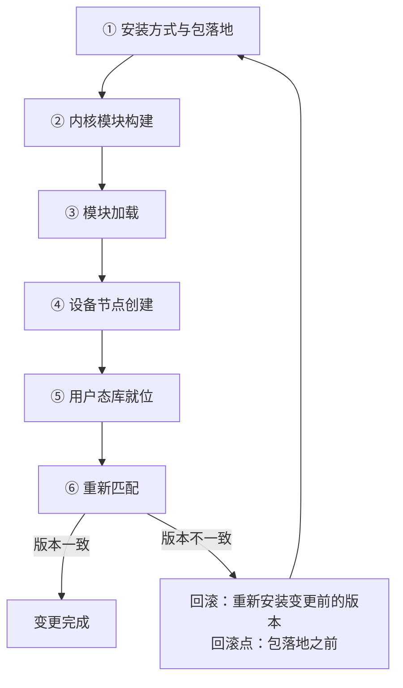

---
tags:
  - AI-Infra
  - 驱动
  - 内核模块
  - 体系
  - 变更旅程
created: 2026-10-11
---

# 一次驱动安装或升级的完整旅程

一次驱动变更的失败，很少失败在「按下了安装命令」这一步，而是失败在它前后某一段没有走完。包落地了但固件文件没跟上，模块编出来了但没有被信任的签名，节点补建了但 UVM 那一个缺失，库替换了但模块还没重载——这些失败在动作发生的那一刻都不报警，要等到下一次重启、下一次起容器或下一次调用计算库时才以「GPU 用不了」这一句笼统的话出现。因此这条链的价值不在于把动作排成顺序，而在于**明确每一段要产出什么对象、失败时现场留下什么、回滚点在哪一步**。

下表把六段排开，它是后面逐段展开的目录。

| 段 | 这一段在做什么 | 到这里要能说清 |
| --- | --- | --- |
| 1 安装方式与包落地 | 发行版仓库包、官方仓库包或独立安装包把文件放到磁盘上；升级时同一事务把旧包移出 | 三种方式为什么互斥，以及旧对象随哪一步退出 |
| 2 内核模块构建 | 用本机内核头文件现场编译并签名，或由发行版按内核版本提供预编译模块 | 这台机器是哪一种，内核升级后分别会怎样 |
| 3 模块加载 | 模块被加载进内核并读入固件，模块清单里出现对应条目 | 五个模块各管什么，固件缺失或不匹配时报错长什么样 |
| 4 设备节点创建 | 按内核登记的设备号创建设备文件，兜底工具补齐 | 节点的属主与权限从哪来，哪一个编号是动态分配的 |
| 5 用户态库就位 | 计算库与管理库被安装，被进程链接到 | 管理工具与计算程序各自依赖哪一条链路 |
| 6 重新匹配 | 内核重启或模块重载之后，内核模块版本与用户态库版本必须对上 | 不匹配时的两类报错文本，以及不重启的处置边界 |

六段不是一条没有回路的直线：第六段的复测不通过时，要有回到变更前状态的通道，而这条通道的入口在第一段——包管理器留下了可回退的旧版本记录。



## 段 1：安装方式与包落地

这一段把新版本的文件放到磁盘上，同时把旧版本的文件移出。三种方式在磁盘上落下的对象不同：发行版仓库包与官方仓库包都接受包管理器管理，独立安装包则不更新包管理器，它覆盖系统库、把版本记录写在自己的目录里。三种方式**互斥**，因此升级意味着先把旧方式的对象清干净，再走新方式。

**前置条件**：这一段的成立不依赖前面的段，它是整条链的起点。它的关键产物有两类——模块文件与固件文件，两者同属一个包事务。

**失败落点**：包事务被中断会让模块与固件落成两个版本，这种不一致在段 3 才暴露；独立安装包覆盖系统库之后，包管理器里的记录与磁盘上的实际文件脱节，后续任何基于包管理的回滚都会失效。**这一段的回滚点就在动作之前**：包管理器留有旧版本记录时回滚是改一次版本锁定再执行一次升级，独立安装包则要跑它自带的卸载脚本。

## 段 2：内核模块构建

这一段把模块从驱动版本变成当前内核能加载的产物。两条路径的差别在内核升级时才显现：现场编译的路径用本机内核头文件编译，并在这时用本机密钥对模块签名；预编译的路径直接提供已编好的文件，但要等发行版为这个内核推出对应的包。

**前置条件**：现场编译要求内核头文件与编译器就位；启用安全启动的机器还要求签名公钥已被固件信任，否则模块能编出来但加载时被拒绝。

**失败落点**：编制失败时新内核下不存在模块文件，现象是管理工具在内核升级并重启之后直接失联；这一段的失败不会在变更当天报警，它等到下一次重启才生效。判据落在构建系统的状态输出上，它逐内核记录这个驱动编到了哪一步。

## 段 3：模块加载

这一段把模块放进内核，并在这时读入固件。五个模块不是一起上场的：核心模块是底座，其余模块挂在它下面；显存注册模块还要等 RDMA 栈的接口就位，且不会自动加载。

**前置条件**：段 2 产出的模块文件、固件文件在磁盘上配对完整、签名被信任、且没有冲突驱动占用 GPU。

**失败落点**：这一段的失败形态最集中，也最容易被误判——签名被拒绝表现为「模块存在但装不进内核」，固件不匹配表现为加载中途失败，冲突驱动占用表现为安装不全。判据是模块清单与内核日志两份读数：清单说明有哪些模块进去了，日志说明为什么没进去。

## 段 4：设备节点创建

这一段把内核登记的设备号变成用户态可以打开的文件。创建者是内核之外的规则链，控制设备与显存设备的编号是约定的，UVM 设备的编号由内核动态分配。

**前置条件**：段 3 成功，设备号已在当前内核中登记。

**失败落点**：节点缺失或权限不对时，进程拿到的是「无法与驱动通信」这类笼统报错，指向的是这一层或上一层的边界。判据落在节点清单与内核登记编号这两份读数的对照上，而不是报错文本本身。

## 段 5：用户态库就位

这一段把计算库与管理库放到系统里，并让进程链接到它们。管理工具的依赖链路短，只要控制设备与显存设备可用；计算程序的依赖链路长，还要 UVM 设备能打开。

**前置条件**：段 1 的包事务完成，且这一段的库版本与段 2、段 3 的模块版本出自同一个驱动版本。

**失败落点**：库替换完成而模块未重载时，两边的版本会在段 6 对不上；库被覆盖而没被任何进程感知时，运行中的进程仍持有旧库。这一段的产物是「进程实际链接到哪一份库」，判据要看运行期加载的版本，而不是磁盘上存在几份文件。

## 段 6：重新匹配

这一段判断这次变更是否完成：内核模块版本与用户态库版本必须对上。达成它的方式是重启或重载模块，两条路径的适用边界不同——重载要求当前没有进程占用设备，因此它只适用于已经空出来的机器。

**前置条件**：段 1 到段 5 都已完成。

**失败落点**：两边版本不一致时，管理工具会给出明确文本：用户态库与内核模块不匹配，或者无法与驱动通信。这两句的区别在于前者是版本对不上、后者是链路不通，处理方向不同。

## 一次具体变更的走查

以「一台用现场编译方式的节点，从旧分支升到新分支」为输入，逐段走一遍。

| 段 | 这一段的输入 | 产出 | 如果不成立 |
| --- | --- | --- | --- |
| 1 包落地 | 新版本的包与旧版本的安装记录 | 模块文件与固件文件成组落盘 | 版本落成两半，问题推迟到第 3 段暴露 |
| 2 构建 | 内核头文件、编译器、本机签名密钥 | 当前内核可加载的模块文件 | 新内核下没有模块，重启之后失联 |
| 3 加载 | 配对完整的模块与固件、已让位的冲突驱动 | 模块清单出现对应条目 | 模块进不去，日志给出原因 |
| 4 建节点 | 内核登记的设备号 | 一组可打开的设备文件 | 进程拿不到设备，报错与上一段同形 |
| 5 库就位 | 同一驱动版本的用户态库 | 进程链接到新库 | 版本与模块错位，问题推迟到第 6 段暴露 |
| 6 重新匹配 | 一次重启或一次无占用的模块重载 | 内核模块与用户态库版本一致 | 报错文本指出是版本不一致还是链路不通 |

## 每段的失败落点与恢复方向

| 段 | 失败判据 | 现场留下什么 | 恢复方向 |
| --- | --- | --- | --- |
| 1 包落地 | 模块与固件版本不成组 | 包管理器记录与磁盘实际文件 | 重新执行包事务，或回到变更前版本 |
| 2 构建 | 构建系统状态不是已完成 | 构建输出与缺失的头文件 | 补齐前置后重新构建 |
| 3 加载 | 模块清单缺条目 | 内核日志中的加载失败原因 | 按日志给出的原因处置签名、冲突或固件 |
| 4 建节点 | 节点缺失或权限不对 | `/dev` 清单与内核登记编号 | 补齐创建环节，修改归创建规则 |
| 5 库就位 | 运行期加载的库版本与预期不符 | 进程链接的库路径与版本 | 重新安装对应版本的库 |
| 6 重新匹配 | 两个版本不一致 | 报错文本与两个版本字段 | 重启，或在无占用时重载模块 |

```bash
# 验证：一次变更完成与否，看两个版本是否一致（只读）
cat /proc/driver/nvidia/version; nvidia-smi --query-gpu=driver_version --format=csv
```

两条读数的对象不同：前者是已加载的内核模块版本，后者是用户态库报告的驱动版本；数值仅示意、不代表你的环境。

**第一反应不要做什么**：不要在包事务没走完时就去解释运行期报错；不要把「管理工具能用」当成变更完成；不要在机器上还有作业时重载模块；不要在版本对不上时先怀疑硬件。正确的顺序是逐段核对产物——包成组、模块可加载、节点齐全、库就位、两边版本一致——任何一段没有产出就回到那一段，而不是跳到最后重装。

## 参考文档

- NVIDIA 驱动安装指南的 Choose an Installation Method、Kernel Modules 与 Post-installation Actions 各节：三种安装方式的互斥关系、模块清单与安装后验证。
- NVIDIA 驱动安装指南的 Removing the Driver 一节：卸载路径与包管理器的记录关系。
- NVIDIA DKMS 使用说明：现场编译的触发条件、签名密钥与内核升级后的重建路径。
- NVIDIA 驱动持久化文档：模块卸载与重启对运行时状态的影响。
- NVIDIA 驱动包自带的 `nvidia-modprobe(1)` 与 `nvidia-smi(1)` 手册页：设备节点创建与版本字段的口径。