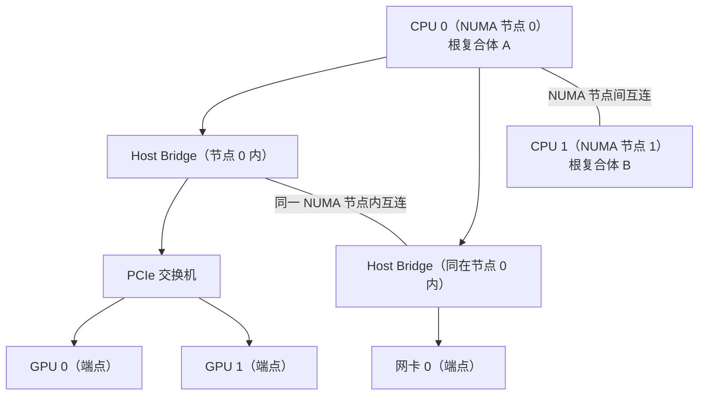

---
tags:
  - AI-Infra
  - GPU
  - PCIe
  - NUMA
  - 原理
  - 拓扑距离
created: 2026-10-11
---

# 距离的分层与它的成因

同一个机箱里的两份数据，从一张卡的显存搬到另一张卡的显存，带宽可以相差一个数量级；而一台机器把卡插错了槽位、把网卡挂到了另一颗处理器的下面，任何命令都不会报错，训练只是比预期慢。这类问题的共同点是**位置本身是合法的**——设备在，驱动正常，功能可用——只有路径的代价变了。要判断代价落在哪里，就要把「设备在 PCIe 树与 NUMA 域上处于什么位置」翻译成一个可比较的量，距离代号（distance code）就是这份翻译。

## 一棵最小的 PCIe 树

理解代号之前先要有树的形状。CPU 与设备之间是一条分层的连接，从处理器的根复合体（root complex）出发，经过若干级桥（bridge）或交换机（switch），最后到达端点（endpoint，也就是 GPU、网卡这类功能设备）。两件设备之间的路径，就是各自从端点向上走到共同祖先的那几段之和。



图里几个词在这一章会反复用到：

- **BDF**：设备的 PCI 地址记号，写作「总线:设备.功能」，它同时是 `/sys/bus/pci/devices/` 下的目录名。`lspci`、管理工具与 sysfs 三处读到的同一张卡，就是靠 BDF 对上的。
- **Host Bridge**：处理器内部连接 PCIe 根复合体的部件。跨过它意味着数据多走一段处理器内部的通路。
- **PCIe 交换机**：把一个上游端口扇出成多个下游端口的部件，跨过它意味着多经过一级交换。
- **NUMA 节点**：一颗处理器连同它直接挂载的内存构成一个内存域（NUMA 节点）。设备挂在哪个域上，由它与哪个根复合体相连决定。

## 五个代号分别多了什么

`nvidia-smi topo -m` 的矩阵里，两个设备交汇的那一格写着它们之间的距离代号。五个代号的差别不在于「快慢」，而在于**从端点到端点一共多经过了哪一段**。

| 代号 | 路径上多出的部分 | 是否跨 socket |
| --- | --- | --- |
| `PIX` | 至多一个 PCIe 桥 | 否 |
| `PXB` | 多个 PCIe 桥，但不经过 Host Bridge | 否 |
| `PHB` | 经过一个 Host Bridge（典型是 CPU） | 否 |
| `NODE` | 经过 Host Bridge，且经过同一 NUMA 节点内 Host Bridge 之间的互连 | 否 |
| `SYS` | 经过 NUMA 节点之间的互连（UPI、Infinity Fabric 一类） | 是 |

这里最容易读错的是 `PHB` 与 `NODE`：两者都**没有跨 socket**，都留在同一个 NUMA 节点内，区别只在路径深度——`NODE` 比 `PHB` 多走了节点内两个 Host Bridge 之间的那一段互连。因此判据不是看代号听起来像不像「跨节点」，而是看它有没有跨 socket 这件事的唯一标志：**五个代号里只有 `SYS` 跨了 socket**。

## 把距离读出来

`nvidia-smi topo -m` 输出一张矩阵：第 i 行第 j 列是设备 i 与设备 j 之间的距离代号，对角线是自身，另外还带若干列亲和信息。

| 要回答的问题 | 读哪里 | 判据 |
| --- | --- | --- |
| 两件设备之间隔了几跳 | 矩阵里两设备交汇的那一格 | 代号即跳数与跨域情况，`SYS` 表示跨 socket，`NODE` 仍在同一 NUMA 节点内 |
| GPU 离哪个 CPU 近 | 同一行的 `CPU Affinity` 列 | 列出的是这颗 GPU 建议绑定的核；与 `NUMA Affinity` 列对照着读 |
| GPU 的内存该落在哪个域 | 同一行的 `NUMA Affinity` 列 | 即该 GPU 的本地内存域编号 |
| 为什么这一列是 `N/A` | 当前进程的核集合 | 当 GPU 亲和核与当前核集合没有交集时该列显示 `N/A`；这是进程可见范围造成的，不是设备拓扑异常 |
| 网卡行能不能当作直通目标清单 | 矩阵里的网卡行 | 它可能包含并非 RDMA 能力的 bonded 网口，因此「矩阵里有它」不等于「它能当直通目标」；能不能当直通目标要另用 RDMA 侧的设备清单确认 |

矩阵只回答「路径长什么样」，不回答「这条路能跑多快」——单位与判据分属两件事，后者要结合下一节的量级与后续的直通判定一起看。

## 每一档的带宽量级锚点

代号给出结构，量级给出参照。没有量级，「这条路径算不算慢」就只能靠感觉。下表把两条主数据路径的量级排开。

| 路径 | 口径 | 量级 | 说明 |
| --- | --- | --- | --- |
| PCIe 3.0 x16 | 单向 | 约 16 GB/s | 8 GT/s × 16 通道，经 128b/130b 编码 |
| PCIe 4.0 x16 | 单向 | 约 32 GB/s | 16 GT/s × 16 通道 |
| PCIe 5.0 x16 | 单向 | 约 64 GB/s | 32 GT/s × 16 通道 |
| NVLink 3（A100 一代） | 每 GPU 双向聚合 | 600 GB/s | 12 条链路 |
| NVLink 4（H100 一代） | 每 GPU 双向聚合 | 900 GB/s | 18 条链路 |
| NVLink 5（Blackwell 一代） | 每 GPU 双向聚合 | 1,800 GB/s | 18 条链路 |

**这两行数字的口径不一样，不能直接相减。** PCIe 给的是单向，NVLink 官方给的是每 GPU 的双向聚合；要对照就把口径拉齐，例如 PCIe 4.0 x16 的双向约 64 GB/s，与 NVLink 4 的 900 GB/s 处在同一口径上。

两个换算点加一个反推算例：一条 PCIe 4.0 x16 单向通道约 32 GB/s，把 1 GB 数据从显存送到网卡，理想下限约 `1 GB ÷ 32 GB/s ≈ 31 ms`；同样 1 GB 若走 NVLink 4，理想下限约 `1 GB ÷ 900 GB/s ≈ 1.1 ms`。反过来，如果把 x16 降成 x8，带宽减半、时间翻倍——这就是为什么链路协商结果值得单独判一次。

数值仅示意、不代表你的环境：实际吞吐受各段效率、协议开销与并发度影响，量级锚点只用来判断「差一个数量级」还是「在预期附近」。

## 为什么判据是代号，而不是「快慢」

代号是**结构性的事实**，带宽是它的**推论**。同一档代号下，两对设备的实际带宽可能不同——链路协商结果、代际、并发度都会影响它；反过来，只要代号变了，路径上就确定多了一段，判断就有了确定的动作对象。因此现场的口径是：先用代号确定路径结构，再用链路协商结果与量级确认代价，两者分开读，不合成一个「快 / 慢」的印象。

有一个例外要单独认。以 Grace-Hopper 一类集成平台为例，CPU 与 GPU 之间不走 PCIe 而走片间直连（NVLink-C2C），矩阵里对应位置会出现一个表示直连的代号。这类平台上，PCIe 侧的世代与宽度读数**不代表主数据路径的带宽**，管理工具也明确提示该口径不适用。遇到它时不要把 PCIe 的五档深度硬套上去，而要转到该平台的片间直连口径。

```bash
# 验证：距离代号与亲和列的取值入口（只读，生产节点上也可以做）
nvidia-smi topo -m
```

输出的分档代号与亲和列随机型、GPU 世代与固件上报变化，任何对照使用的数值仅示意、不代表你的环境。

**第一反应不要做什么**：不要用「感觉快慢」代替距离代号；不要把 `PHB` 与 `NODE` 当成跨了 socket 而实际上是 `SYS`；不要看到网卡行里没有某张网卡就断定它不在位或不能做直通；不要把 PCIe 的单向带宽与 NVLink 的双向聚合带宽直接比大小；不要在 Grace-Hopper 一类平台上拿 PCIe 读数解释主数据路径。正确的顺序是先读代号确定路径结构，再看链路协商结果，最后才用同口径的量级下判断。

## 参考文档

- NVIDIA System Management Interface 文档的拓扑一节：`topo -m` 的矩阵与图例，`PIX`、`PXB`、`PHB`、`NODE`、`SYS` 的官方定义，以及 `CPU Affinity`、`NUMA Affinity` 两列的取值。
- NVIDIA 数据中心 NVLink 页面：各代 NVLink 的每 GPU 带宽与每 GPU 链路数。
- PCI-SIG 关于 PCIe 各代速率与编码方式的说明：`GT/s` 与经编码后的有效带宽换算。
- Linux 内核与 `lspci`、`numactl` 手册页：BDF 记号、根复合体与桥的枚举，以及 NUMA 节点的表示方式。