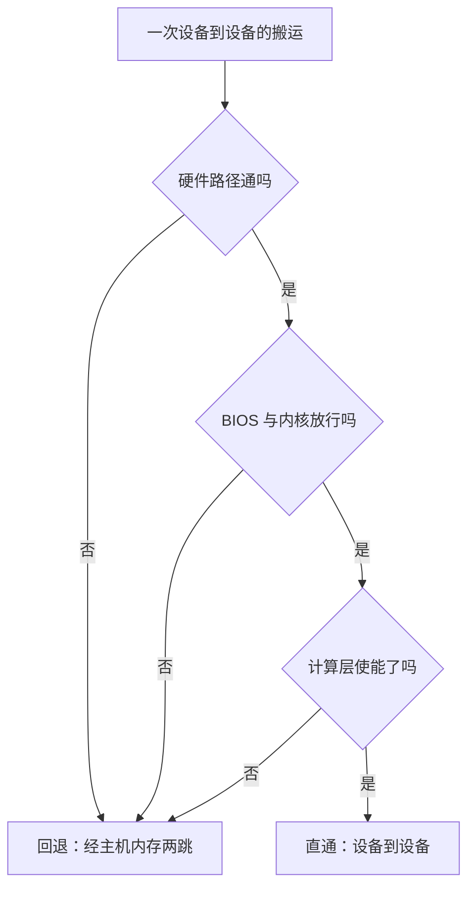

---
tags:
  - AI-Infra
  - GPU
  - PCIe
  - P2P
  - 原理
  - 直通
created: 2026-10-11
---

# P2P 的三道门

两张卡之间的显存拷贝可以走两条路：一条是设备之间直接搬运、不惊动主机内存，另一条是先把数据读到主机内存再写进对端。前者省掉一趟主机内存的往返，带宽与延迟都更好；后者在直通不可用时自动顶上，**功能照常，性能打折，不报错**。判断一次搬运走的是哪条路，要连续过三道门：硬件路径本身通不通、BIOS 与内核拦不拦、计算层放不放行。三道门分属三个来源，任何一道不通，直通就失效，而这三道门的判据落在不同工具上。

本篇的判定对象有两类：GPU 与 GPU 之间，GPU 与网卡之间。后者的直通就是把显存直接交给网卡做远端读写的基础，即显存直接远程访问（GPUDirect RDMA）；它能不能成立同样取决于这两件设备在 PCIe 树上的相对位置，与显存注册模块加不加载是两件事——模块本身的加载前置不是本章负责的内容，本篇只判拓扑前提。

## 三道门各自管什么

| 道 | 由谁决定 | 这一道不通时 | 判据落在哪 |
| --- | --- | --- | --- |
| 一 硬件路径 | 两件设备在 PCIe 树上的位置与两端的能力 | 路径上根本没有设备到设备的通路 | 拓扑矩阵与直通能力矩阵 |
| 二 BIOS 与内核 | 固件与内核的策略：访问控制服务与地址翻译 | 路径存在，但设备之间的流量被压回根复合体拦截或改写 | 链路能力读数的取值组合 |
| 三 计算层 | 计算运行时对端访问的使能与可见性 | 硬件都通，但这一对设备没有被允许互访 | 运行时的端访问使能结果 |



## 第一道：硬件路径

硬件路径解决的是**有没有路**。两件设备要能直接互访，它们的上游必须汇合在支持转发的部件上：挂在同一个 PCIe 交换机下的两件设备可以直接经交换机转发；分属两个根复合体的设备，流量就得先上行到处理器内部的路径，回退成经主机内存中转。这一道的判定对象是设备本身与它们之间的交换部件，不涉及任何软件开关。

这一道还会因为两端的能力而收紧：设备型号本身是否支持某一类直通访问（例如对端写、对端读或原子操作）是硬件能力问题，软件改不动。因此当判定结果指向「设备不支持」时，它是一个结论而不是一个待处理的配置项。

## 第二道：BIOS 与内核

路径存在，流量也可能被拦。这一道的两个主角是访问控制服务（ACS，Access Control Services）与输入输出内存管理单元（IOMMU，Input-Output Memory Management Unit）。

访问控制服务是 PCIe 交换机上的一个机制，它的能力位不止「重定向」一项，但影响直通的那一项是：**一旦要求点对点流量重定向，交换机就会把本该在设备之间直接走的流量压回上游的根复合体**。设计它的初衷是隔离与安全，代价是直通变回绕行。固件与内核都可能把它设置成要求重定向。

地址翻译是另一个作用点。当输入输出内存管理单元工作在翻译模式时，设备发出的地址要经过一层翻译才落到物理内存；如果这一层没有为设备之间的直通建立相应的映射，直通流量就过不去。因此这一道的常态是：地址翻译关闭或置于直通模式时，设备之间的地址不经过二次翻译，直通才有条件成立。

这一道的判据不是看某个开关的名字，而是看**能力矩阵与链路能力读数的组合**：路径代号说明设备之间隔了几跳，而它能不能实际生效，要看这一对的直通能力判定落在哪一档。

## 第三道：计算层

前两道都通了，最后一关在计算运行时这一侧：一对设备要被允许互相访问，才会真正建立直通。这里还叠了两个会改变结论的条件。

其一是**可见性与实例划分**。当一张卡被切成多个实例（MIG，Multi-Instance GPU）时，跨实例的直通能力与整卡时不同，判定结果会随实例划分而变。因此在读到「不支持」时，先要确认这张卡当前是不是处于被切分的模式——模式本身就能解释一部分不支持，不必都算到型号能力头上。

其二是**连接数上限**。设备之间能同时建立的直通关系有数量上限，超出之后并非全部对端都能同时直通。这意味着「一次判定支持」不等于「任意多对都能同时直通」。这一项没有独立的查询字段，判据落在第三道的使能结果上：单独使能每一对都成功、同时建立到某一对开始失败，即触及上限。

## 用能力矩阵判定

判定入口是直通能力矩阵。它按不同的访问类型分别给出每一对设备的判定结果，比距离矩阵更接近「能不能走」。

```bash
# 验证：直通能力矩阵的取值入口（只读，生产节点上也可以做）；r/w/n/a/p 分别是读、写、NVLink、原子、PCIe
nvidia-smi topo -p2p r
```

矩阵每一格的取值来自命令自带的图例，含义如下。

| 取值 | 含义 | 指向谁 |
| --- | --- | --- |
| `OK` | 这一类直通可用 | 无需进一步动作 |
| `CNS` | 芯片组不支持 | 芯片组与固件一侧 |
| `TNS` | 拓扑不支持 | 两件设备之间的拓扑结构 |
| `GNS` | 设备不支持 | 设备本身的能力（含被切分模式带来的限制） |
| `NS` | 不支持，未细分 | 需要再取更多读数细化 |

四类「不支持」的价值在于把问题指向不同的对象：`CNS` 与 `TNS` 落在路径与策略一侧，`GNS` 落在设备能力一侧。这与第一道、第二道、第三道的划分是一致的——先分清是哪一道门关上了，再决定去哪一种读数里找原因。

```bash
# 验证：不同的访问能力各有自己的矩阵（只读）
nvidia-smi topo -p2p p
```

输出仅示意、不代表你的环境：同一对设备在读写、原子操作与点对点等不同能力上的判定可能不同，任何对照使用的取值都要连同机型与模式一起记。

## 回退之后代价落在哪

直通失效不会让程序失败，它会回退到经主机内存中转：数据先从源设备读到主机内存，再从主机内存写进目标设备。代价有两层——**多走一趟主机内存的往返**，以及**占用主机内存带宽与处理器那一段通路**。这就是「位置错误不会报错，只会变慢」在直通这一层的具体形态：命令全部成功，只有吞吐掉下来。

因此现场读到一个「不支持」时不应急着改配置。先确认三件事：这一对设备走的是哪一类访问、当前是不是被实例划分模式改变过能力、以及这一次判定的是上限还是此刻生效值。三件事清楚了，回退的代价落在哪一段也就清楚了。

**第一反应不要做什么**：不要把直通不可用当成故障去重装驱动；不要把能力矩阵的「不支持」直接归到设备型号头上，先排除实例划分模式；不要把硬件路径通当成直通一定成立，后面还有两道门；不要用一次判定支持就断定任意多对都能同时直通；不要把显存直接远程访问的成立与否只归结到设备模块，它的拓扑前提先要过这三道门。正确的顺序是先看硬件路径、再看固件与内核策略、最后看计算层的使能与模式。

## 参考文档

- NVIDIA System Management Interface 文档的拓扑一节：`topo -p2p` 的能力取值与判定含义。
- PCI-SIG 关于访问控制服务（ACS）的规范说明：重定向能力与点对点流量被压回根复合体的关系。
- Linux 内核文档中关于 IOMMU 与设备直通模式的说明：地址翻译模式对设备之间直通访问的影响。
- NVIDIA Multi-Instance GPU 用户指南：实例划分对设备之间直通能力的影响。
- NVIDIA GPUDirect RDMA 文档：显存直接远程访问对两端设备拓扑位置的要求。