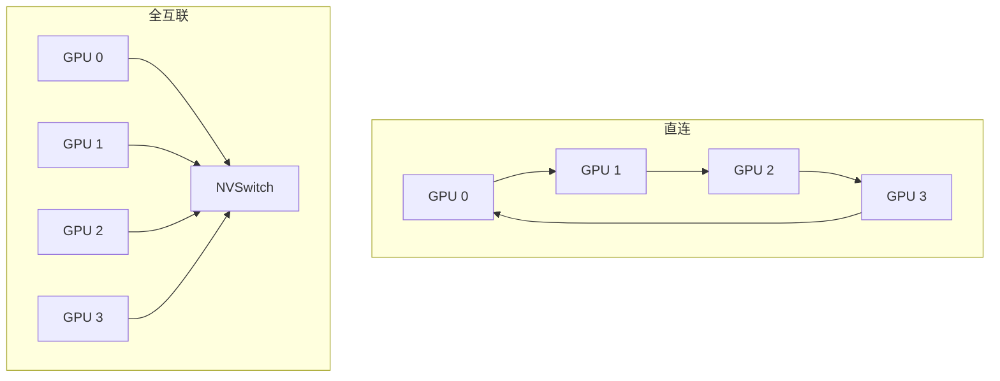

---
tags:
  - AI-Infra
  - GPU
  - NVLink
  - NVSwitch
  - 原理
  - 互联形态
created: 2026-10-11
---

# NVLink 与 NVSwitch 的形态差异

一台八卡节点里，任意两张卡之间的关系并不总是一样的。有的两卡之间直接相连，有的要在节点内的交换芯片上转一次，有的甚至还是绕 PCIe。判断一次卡间通信走的是哪条路，先要看清这台机器用的是哪一种**节点内互联形态**：卡与卡直接相连，还是全部经交换芯片汇成一张全互联的网。形态决定了任意两张卡之间的跳数与带宽是否对称，也决定了后面每一步的判据落在哪里。

## 两种形态

**直连形态**下，卡与卡之间用一组 NVLink 两两相连，每张卡只与一部分对端有直接链路，其余对端没有硬件直达路径：要么退到 PCIe 绕行，要么由上层通信库把一次搬运拆成多跳拷贝。于是同一台机器里存在不对称：一部分卡对之间的带宽高、跳数少，另一部分要绕。

**全互联形态**下，每张卡都连到交换芯片（NVSwitch），任意两张卡之间的路径都经过一次交换，带宽与跳数对称。这就是「非阻塞全互联」的意义：不存在某几对卡特别吃亏的拓扑。



两种形态在距离矩阵里的表现不同：全互联机型上，卡与卡之间那一格是 NVLink 代号，整张矩阵除对角线外基本一致；直连机型上，有的格子是 NVLink 代号、有的会退成 PCIe 的代号。**看到矩阵里 NVLink 与 PCIe 代号混排，说明这台机器不是全互联形态**，不能假设任意两卡都走 NVLink。

## 四代交换芯片，判据分别落在哪里

节点内交换芯片（NVSwitch）到现在有四代，它们改变的是**这一步由谁完成、读什么**，而不是判据本身。判据始终是两条：链路是不是已经建立，以及 GPU 是不是已经注册到这张 fabric 上。

| 代际 | 代表机型 | 链路训练由谁完成 | 这一步多要读什么 |
| --- | --- | --- | --- |
| 第一代 | DGX-2、HGX-2 一代 | 由管理服务参与训练与配置 | 链路状态与 fabric 注册状态 |
| 第二代 | DGX、HGX A100 一代 | 仍由管理服务参与训练与配置 | 同上 |
| 第三代 | DGX、HGX H100 一代 | 起用自主链路初始化，由硬件自行训练，管理服务不再参与训练 | 链路状态与 fabric 注册状态（训练与注册是两件事） |
| 第四代 | DGX、HGX B200 / B300、HGX B100 一代 | 硬件自行训练，控制面结构改变 | 交换芯片不再以 PCIe 设备出现，管理通路改经板载网卡承载 |

第三代的**自主链路初始化**（ALI，Autonomous Link Initialization）是一个关键分水岭：第一、二代机型上，链路要在驱动加载后由管理服务参与训练才建立；第三代起，链路由 GPU 与交换芯片硬件自行训练，不再需要管理服务参与训练。但**训练完成不等于可用**——GPU 仍要向这张 fabric 注册，注册不到位时链路即使在，跨卡能力也不成立。把这两件事分开，是这一段最容易出错的判据。

第四代的变化在控制面形态，而不在数据面形态：交换芯片不再作为主机 PCIe 设备出现，管理通路改由集成在基板上的网卡功能承载，控制面借它进出。对使用者的直接影响是**读设备清单读不到交换芯片**，因此不能再用「PCIe 设备里有没有交换芯片」来判断这一代机型的管理通路是否就绪。

## 用 NVLink 读数确认形态与状态

链路的建立情况由 NVLink 侧的读数给出，它们与距离矩阵互补：矩阵说**应不应该连**，链路读数说**此刻连没连上**。

| 读数 | 看什么 | 判据 | 与谁同看 |
| --- | --- | --- | --- |
| 链路状态 | 每条 NVLink 的状态与带宽 | 正常工作时为 `Active` 并给出带宽；`Inactive` 表示链路在但未激活；`Sleep` 表示处于休眠 | 与链路能力读数、错误计数同看 |
| 链路能力 | 每条链路声明支持的带宽与宽度 | 声明值是上限，状态值是此刻；两者要分开 | 与链路状态同看 |
| 远端链路信息 | 这条链路对端设备与对端链路号 | 用于确认链路连到了谁 | 与距离矩阵同看 |
| 错误计数 | 链路侧的累计错误 | 累计量，判据是两次读数之差在运行期是否增长 | 与链路状态、fabric 注册状态同看 |

错误计数的项目**随代际不同**：较新的一代按重放、恢复与校验类错误给出计数，更新的一代则按收发包、收发包字节与畸形包、缓冲溢出这类项目给出计数。因此「错误计数是多少才算多」不能跨代比较，只能在同一机型内看增长。

```bash
# 验证：链路状态与错误计数的取值入口（只读，生产节点上也可以做）
nvidia-smi nvlink -s; nvidia-smi nvlink -e
```

输出仅示意、不代表你的环境：链路条数、带宽数值与计数项随机型与代际变化，任何对照使用的数值都要连同机型一起记。

## 实例划分带来的取舍

当一张卡被切成多个实例（MIG，Multi-Instance GPU）来提高利用率与隔离度时，卡间直通的判定要重新落到**实例**这一级：整卡之间能走的路，不代表切分之后任意两个实例之间也能走。取舍正在这里——切分提高了利用率与隔离，代价是部分实例之间拿不到完整的 NVLink 直通能力。因此读到链路异常或直通不可用时，先确认这张卡当前是不是处于被切分的模式，再判断是形态问题还是实例划分造成的限制。

**第一反应不要做什么**：不要把全互联机型上的对称当成所有机型都对称，先看矩阵里有没有 PCIe 代号混排；不要把链路训练完成当成 fabric 就绪；不要在第四代机型上去 PCIe 设备清单里找交换芯片；不要拿一代的错误计数项去套另一代；不要在没确认实例划分之前就断定直通能力。正确的顺序是先看形态、再看链路是否建立、最后看是否注册到 fabric。

## 参考文档

- NVIDIA System Management Interface 文档中关于 NVLink 的说明：链路状态、链路能力、远端链路信息与错误计数各类子命令的取值。
- NVIDIA Fabric Manager User Guide：NVSwitch 的分代、第一、二代机型由管理服务参与链路训练、第三代起支持自主链路初始化。
- NVIDIA 数据中心 NVLink 页面：各代每 GPU 链路数与带宽。
- NVIDIA Multi-Instance GPU 用户指南：实例划分对卡间直通能力的影响。