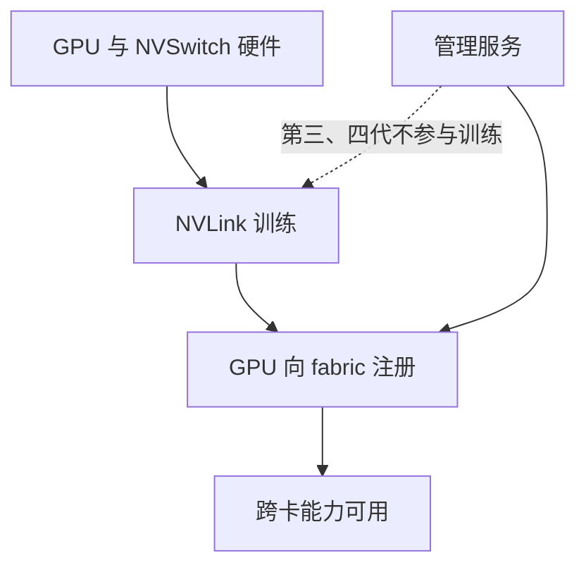

---
tags:
  - AI-Infra
  - GPU
  - NVSwitch
  - Fabric Manager
  - 原理
  - 管理通路
created: 2026-10-11
---

# Fabric Manager 与管理通路

在带交换芯片的机型上，链路建立起来和链路能用起来之间还隔着一步。硬件把 NVLink 训练好之后，GPU 还要向这张节点内的互联网络**注册**；注册不到位，链路即使在，跨卡能力也拿不到——计算运行时可能在初始化阶段直接报错说系统未就绪，或者干脆静默退回 PCIe。管这件事的是一个特权服务，它没起来或版本不对，整台机器的卡间能力就会以这种方式消失。

## 这个服务在管什么

管理服务（Fabric Manager）在带交换芯片的机型上负责把节点内的交换结构配置成一张可用的互联网络。它的职责按机型分两类：

- **配置与训练**：为交换芯片端口配置路由；在第一、二代机型上还负责与交换芯片驱动协同，把 NVLink 训练起来。
- **初始化与监控**：与 GPU 驱动协同完成 GPU 侧的初始化；建立 GPU 的路由与端口映射（若适用）；监控整张结构上的 NVLink 与交换芯片错误；对外提供分区管理接口。

从第三代机型起，链路训练改由硬件自行完成（这就是上一段的自主链路初始化），管理服务不再参与训练；但它**仍然参与注册与监控**。于是「链路训练完成」与「fabric 注册完成」成为两个独立的量，前者不代表后者。



## 版本绑定：服务与驱动同版本

管理服务的发行包与驱动包之间存在一条硬绑定：**管理服务的包版本要与驱动包版本相同**。这不是建议值，而是判断点——两者版本不一致时，注册会在初始化阶段失败，现象与「服务没起来」很接近，但成因不同。因此核对这一项时，版本字段与服务状态要一起读，不能只看其中一项。

| 关注对象 | 读哪里 | 判据 | 与谁同看 |
| --- | --- | --- | --- |
| 服务是否在运行 | 服务管理器的状态输出 | 服务处于运行态；第四代机型上这份状态同时反映管理服务与子网管理进程 | 与管理服务的包版本同看 |
| 服务与驱动是否同版本 | 管理服务的包版本与驱动包版本 | 两者相同 | 与驱动四元组的记录方式同看 |
| 结构是否已注册 | 管理工具查询输出的 fabric 段 | 注册中为「进行中 / 不适用」，成功后为「已完成 / 成功」 | 与链路状态同看 |

## fabric 注册的判据

注册进度的判据落在管理工具的查询输出里，是一段单独分出的结构信息。

| 字段 | 取值 | 说明 |
| --- | --- | --- |
| 结构状态 | 进行中 / 已完成 | 进行中表示 GPU 正在向 fabric 注册，此时不可用；已完成表示注册结束 |
| 结构结果 | 不适用 / 成功 | 注册中结果字段为不适用；成功后为成功 |

管理服务的文档给出过这两种状态的原样对照：注册过程中是「进行中 / 不适用」，注册成功后是「已完成 / 成功」。**判据是两者同时满足**——只看状态字段为「已完成」而结果字段不是「成功」，仍然不算就绪。

```bash
# 验证：fabric 注册状态与服务状态的取值入口（只读，生产节点上也可以做）
nvidia-smi -q | grep -i -A 2 Fabric; systemctl status nvidia-fabricmanager
```

输出仅示意、不代表你的环境：字段文本与服务名随机型与发行版变化，第四代机型上这份服务状态还同时包含子网管理进程的状态。

## 第四代机型的控制面变化

第四代交换芯片在控制面上换了一套结构，变化有三处，都影响判据的读法。

其一是**交换芯片不再是主机的 PCIe 设备**。管理通路改由集成在基板上的网卡功能承载，控制面借它进出。由此带来的直接影响是：在 PCIe 设备清单里找不到交换芯片属于这一代的正常形态，不能据此判断管理通路不正常。

其二是**控制面被拆成几个角色协同**。这一代引入 NVLink 子网管理器（NVLSM，NVLink Subnet Manager），它负责配置交换芯片侧的路由表；管理服务则负责 GPU 侧的路由、NVLink 配置与分区管理接口。两者通过进程间接口协同，共同完成 fabric 的初始化与配置。交换芯片的错误与遥测计数也改由链路交换设备管理器（NVSDM，NVLink Switch Device Manager）对外提供——在更早的机型上，这部分信息来自交换芯片自身的错误码。

其三是**依赖的操作系统组件变了**。这一代的管理通路依赖系统自带的开放结构驱动（in-box OFED）或厂商版的驱动包（MOFED），管理服务包还会带去一个子网管理器的依赖。安装服务单元在需要时会一并拉起子网管理进程，**服务状态于是同时反映两个进程**——启动、停止这类操作作用的也是这两个进程。

| 代际 | 交换芯片是否作为 PCIe 设备 | 控制面组成 | 服务状态反映谁 |
| --- | --- | --- | --- |
| 第三代及更早 | 是 | 交换芯片内核驱动 + 管理服务 | 管理服务 |
| 第四代 | 否，经基板网卡功能承载 | 管理服务 + 子网管理器 + 交换设备管理器 | 管理服务与子网管理进程一并反映 |

## 失败现象与影响范围

注册不到位的现象有两类。一类是显式的：计算运行时在初始化阶段返回「系统未就绪」这类错误，指向的正是 fabric 这一层。另一类是隐式的：跨卡路径静默退回 PCIe，程序照常运行，只有带宽比预期低。两类现象对应同一条判据——结构状态与结果字段是否同时满足。

这一层的动作影响范围较大：管理服务与其子网管理进程是节点级的，重启它们会中断同一台机器上的**全部**作业，因此这类动作只允许在实验节点上验证，在生产节点上执行前必须完成隔离。**这条影响范围不是「某张卡」或「某个进程」，而是整机**——这一点在判断动作能不能做时，比动作本身更关键。

**第一反应不要做什么**：不要把链路训练完成当成 fabric 就绪；不要在第四代机型上去 PCIe 设备清单里找交换芯片；不要只看结构状态字段而不看结果字段；不要把服务版本与驱动版本拆开核对；不要在机器上还有作业时重启管理服务。正确的顺序是先确认服务在运行且版本相同，再读结构状态与结果字段，两者同时满足才算就绪。

## 参考文档

- NVIDIA Fabric Manager User Guide：管理服务的职责与两类机型的分工、包版本与驱动版本必须相同、结构注册状态的两组对照输出、第四代机型的控制面组成与基板网卡功能承载的管理通路。
- NVIDIA System Management Interface 文档：结构注册状态字段的取值。
- 系统服务管理器手册页：服务状态的读取方式。
- NVIDIA 数据中心驱动文档：开放结构驱动与厂商版驱动包在管理通路上的作用。