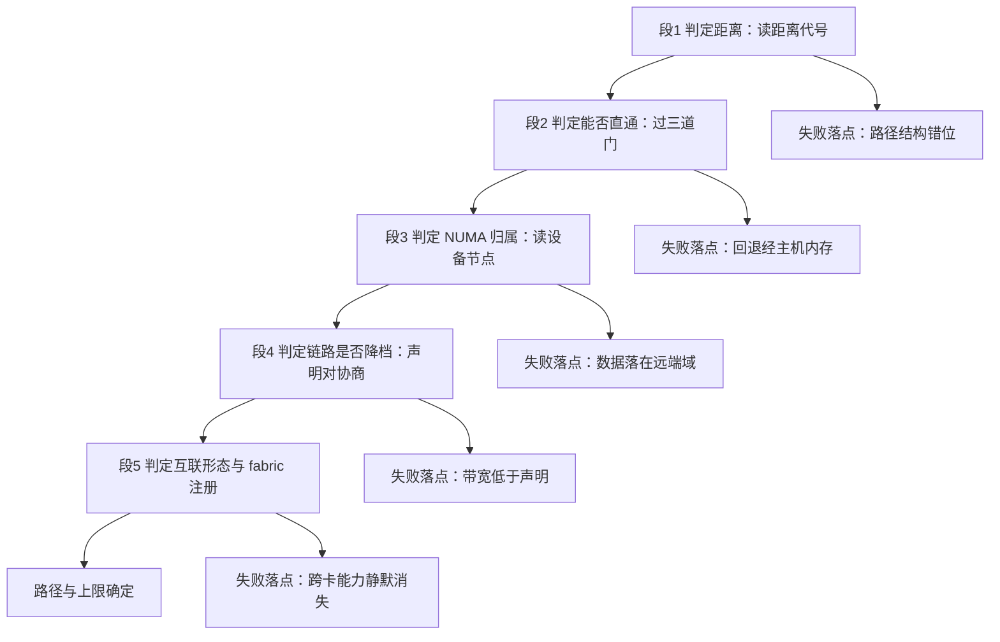

---
tags:
  - AI-Infra
  - GPU
  - PCIe
  - NUMA
  - 体系
  - 路径判定
created: 2026-10-11
---

# 一次搬运路径的完整判定

前五段各自回答一个问题：两件设备隔了几跳、这条路能不能直通、数据落在哪个内存域、链路实际协商成了什么、节点内互联是什么形态且管理通路是否就绪。实际现场不会把它们当作五道独立的选择题——一次「GPU 到 GPU」或「GPU 到网卡」的搬运，要从头到尾走一遍这五段，任何一段的判断错位，后面几段都会在错的对象上找原因。这一段把五段串成一次完整判定，并给出每一段的失败落点与机型分叉。

## 五段的骨架

| 段 | 这一段在做什么 | 到这里要能说清 |
| --- | --- | --- |
| 1 判定距离 | 按距离代号把两件设备之间的距离分成若干档 | 每个代号对应路径上多了什么、判据是哪个代号，以及这一档的带宽量级 |
| 2 判定能否直通 | 过三道门：硬件路径、BIOS 与内核、计算层使能与模式 | 走不了直通时数据绕到哪里、现象是什么，以及不支持码各指向谁 |
| 3 判定 NUMA 归属 | 把距离平移到处理器与内存：设备各挂在哪号域 | 跨域影响的是带宽还是延迟，以及绑核绑内存各在哪一层生效 |
| 4 判定链路是否降档 | 把链路此刻的协商结果与它声明的能力对照 | 降速为什么静默，以及哪几处读数能把它抓出来 |
| 5 判定节点内互联形态 | 区分直连与经交换芯片的全互联，并确认管理通路已就绪 | 交换芯片机型上哪一项服务必须先起来，链路训练与 fabric 注册是不是两件事 |

## 贯穿全程的三个问句

这条链上每一步都在问同样三件事，问句不变，变量随段落变化。

| 问句 | 在段 1 | 在段 2 | 在段 3 | 在段 4 | 在段 5 |
| --- | --- | --- | --- | --- | --- |
| 隔了几跳 | 距离代号 | 路径是否直达两端 | 是否跨内存域 | 是否经过上游交换 | 是否经过交换芯片 |
| 上限由哪一段决定 | 最慢的一段通路 | 硬件与固件策略 | 本地还是跨域 | 协商出的速率与宽度 | 链路能力与 fabric 状态 |
| 读的是声明还是实际 | 代号是结构事实 | 能力矩阵是判定结果 | 节点归属是当前事实 | `LnkCap` 对 `LnkSta` | 链路能力对链路状态 |

## 上限与量级：把三处读数收在一起

这一段判定最需要的是一条数量级参照，否则「慢」没有对象。下表把同一口径的对照收在一起。

| 路径 | 口径 | 量级 | 判定用途 |
| --- | --- | --- | --- |
| PCIe 3.0 x16 | 单向 | 约 16 GB/s | 一代之差，约减半 |
| PCIe 4.0 x16 | 单向 | 约 32 GB/s | 常见直通水平 |
| PCIe 5.0 x16 | 单向 | 约 64 GB/s | 新一代平台水平 |
| NVLink 3 / 4 / 5 | 每 GPU 双向聚合 | 600 / 900 / 1,800 GB/s | 卡间路径的上限 |
| 经主机内存中转 | 取决于两段取舍 | 由最慢的一段决定 | 直通失效后的实际水平 |

对照时先把口径拉齐：PCIe 给的是单向，NVLink 给的是每 GPU 双向聚合。经验判据是「**上限由最慢的一段决定**」——一次搬运的实际水平不会超过它经过的任何一段的上限，所以先找最慢的那一段，再谈优化。

## 一次 GPU 到 GPU 的走查

输入是「八卡交换芯片机型上，把 GPU 0 的显存搬到 GPU 3」，逐段走一遍。

| 段 | 输入 | 产出 | 不成立时 |
| --- | --- | --- | --- |
| 1 距离 | 两张卡的编号 | 矩阵里对应格子的距离代号 | 代号是 PCIe 而非 NVLink，说明这一对不在同一张全互联网内 |
| 2 直通 | 这一对的设备能力 | 直通能力判定结果 | 出现不支持码，按码指向的对象分层看 |
| 3 NUMA | 两张卡各自的内存域 | 数据落域与本地关系 | 跨域时经主机内存的那一段要多走 |
| 4 链路 | 上游链路读数 | 声明对协商是否一致 | 低于声明即为降档，先排除空闲状态 |
| 5 互联与 fabric | 结构状态与结果字段 | 注册是否完成 | 未完成时跨卡能力不可用，或静默退回 PCIe |

一次典型的正确顺序是这样的：先确认这一对的代号，看到是 NVLink 而不是 PCIe，说明形态对；再看直通能力判定，是可用，说明三道门都过了；接着看两张卡的内存域，若跨域则主机内存这一侧有代价；再看链路读数是否满档；最后确认结构状态与结果字段都满足。五段的读数都拿到，这条路径的上限与代价就清楚了。

## 一次 GPU 到网卡的走查

输入是「同一台机器上，把 GPU 0 的显存直接交给一张网卡做远端读写」，逐段走一遍。

| 段 | 输入 | 产出 | 与 GPU 到 GPU 的差别 |
| --- | --- | --- | --- |
| 1 距离 | 卡与网卡的编号 | 矩阵里卡与网卡那一格 | 网卡行的判定同样读距离代号 |
| 2 直通 | 这一对的点对点能力 | 直通能力判定 | 这一对的对象是显存与网卡，不是两张卡 |
| 3 NUMA | 卡与网卡各自的内存域 | 是否同域 | 同域才让这段搬运是本地关系 |
| 4 链路 | 各自上游链路 | 是否满档 | 与卡间判定相同 |
| 5 互联与 fabric | — | — | 网卡不在 NVLink 结构上，这一段的判据落在卡间路径，不能套到网卡这条路上 |

两条走查的结论要分开记：GPU 到 GPU 的上限由 NVLink 与 fabric 决定，GPU 到网卡的上限由 PCIe 与内存域决定。把一张机器上的卡间水平当成卡到网卡的水平，是这条链上最常见的口径错位。

## 每段的失败落点

| 段 | 失败判据 | 现场留下什么 | 恢复方向 |
| --- | --- | --- | --- |
| 1 距离 | 代号与预期形态不符 | 矩阵里两设备的格子 | 核对设备位置与形态，确认是不是插错 |
| 2 直通 | 能力判定为不支持 | 直通能力矩阵的取值 | 按取值指向的对象分层：路径、策略还是设备 |
| 3 NUMA | 两设备不在同一域或归属缺失 | 设备节点与距离矩阵 | 转向固件侧核对，或在进程绑定一侧找关系 |
| 4 链路 | 协商结果低于声明能力 | 链路能力与状态两份读数 | 先带负载复读，再对照槽位与固件设置 |
| 5 互联与 fabric | 状态或结果字段任一不满足 | fabric 段读数与服务状态 | 先修 fabric，再谈链路能力 |

## 机型分叉

同一条判据在不同机型上落到不同的读数上。判断一次搬运走哪条路时，先确认这台机器属于哪一类。

| 机型类别 | 段 1、2、3 是否相同 | 段 4 是否相同 | 段 5 的差别 |
| --- | --- | --- | --- |
| 直连机型（无交换芯片） | 相同 | 相同 | 矩阵里 NVLink 与 PCIe 代号混排，卡间不对称，判据落在链路状态 |
| 第一、二代交换芯片机型 | 相同 | 相同 | 链路训练由管理服务参与 |
| 第三代交换芯片机型 | 相同 | 相同 | 起用自主链路初始化，链路训练与 fabric 注册分开判 |
| 第四代交换芯片机型 | 相同 | 相同 | 交换芯片不再是 PCIe 设备，控制面组成与管理通路形态改变 |

前三段对四类机型是一致的：距离代号、直通三道门、内存域归属的读法都相同。分叉集中在第四段和第五段——链路的读法一致，但对降档的容忍范围随机型变化；第五段的差别最大，机型决定链路训练由谁完成、管理通路如何承载。

**第一反应不要做什么**：不要把五段当成五道独立的选择题，要按顺序走；不要把卡间水平当成卡到网卡的水平；不要在第四代机型上用 PCIe 清单判断交换芯片；不要把链路训练完成当成 fabric 就绪；不要在没确认形态前就假设任意两卡对称。正确的顺序是先定形态、再走五段、最后把上限收到最慢的一段上。

## 参考文档

- NVIDIA System Management Interface 文档的拓扑与 NVLink 各节：距离代号、直通能力、链路状态与结构注册状态的取值。
- NVIDIA Fabric Manager User Guide：交换芯片分代、自主链路初始化与 fabric 注册的关系、第四代控制面形态。
- NVIDIA 数据中心 NVLink 页面：各代每 GPU 链路数与带宽。
- PCI-SIG 关于链路训练与状态寄存器的规范说明：链路声明能力与实际协商结果的对照。