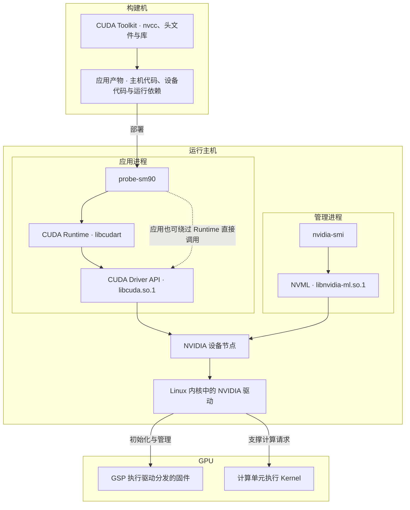

第 02 章从主机提交 Kernel（在 GPU 上运行的函数）讲到 GPU 执行。现在从主机侧追踪一次提交。假设 Linux 服务器有一张未切分的 NVIDIA H100，运维人员拿到预编译程序 `probe-sm90`。它要让 GPU 的一个线程向显存写入整数 7，再把这个整数拷回给 CPU 校验。机器上的 `nvidia-smi` 能列出 H100，当前 shell 却找不到 `nvcc`。要判断探针能不能运行，先看构建机交付了什么，以及运行主机需要提供什么。

## CUDA Toolkit 与应用产物

**CUDA** 是 NVIDIA 的 GPU 计算平台和编程模型。应用用 CUDA 提供的接口分配显存、搬运数据和提交 Kernel。这里有两类代码。主机代码由 CPU 执行，负责选卡、发出请求和检查结果。设备代码由 GPU 执行，负责向显存写入 7。两类代码可以随同一个文件交付，但运行的位置和装入方式各有分工。 [CUDA 13.2.1 编程指南 · CUDA 平台](https://docs.nvidia.com/cuda/archive/13.2.1/cuda-programming-guide/01-introduction/cuda-platform.html)

**CUDA Toolkit** 是构建 CUDA 应用的开发工具包，包含 NVIDIA CUDA 编译器驱动 `nvcc`、头文件、Runtime 与其他开发库。`nvcc` 组织主机代码和设备代码的编译，把设备代码嵌入主机可执行文件或库。主机程序可以带着这个文件部署到另一台机器。构建时选择共享 Runtime，交付时就要让目标进程能加载相应的库。选择静态 Runtime 时，Runtime 的代码已编入产物，这份产物仍须调用运行主机的 CUDA 驱动。 [CUDA 13.2 GA · NVCC 编译流程与 Runtime 链接选项](https://docs.nvidia.com/cuda/archive/13.2.0/cuda-compiler-driver-nvcc/index.html)

## Runtime、用户态驱动与内核模块

`probe-sm90` 要先为结果申请一块显存。它调用的 `cudaMalloc` 属于 **CUDA Runtime API（应用编程接口）**，由 `libcudart` 实现。Runtime 让调用者用较高层接口操作设备，并为常见用法管理运行状态和设备代码的装载。下层的 **CUDA Driver API** 由 NVIDIA 驱动提供，在 Linux 上的入口是用户态库 `libcuda.so.1`。需要显式控制设备状态和代码装载的程序，也可直接调用 Driver API。 [CUDA 13.2.1 · Runtime API 与 Driver API](https://docs.nvidia.com/cuda/archive/13.2.1/cuda-driver-api/driver-vs-runtime-api.html) · [NVIDIA Linux 驱动组件](https://download.nvidia.com/XFree86/Linux-x86_64/580.65.06/README/installedcomponents.html)

用户态驱动通过 `/dev/nvidiactl`、`/dev/nvidia0` 等设备节点与 Linux 内核中的驱动交互。设备节点是进程打开驱动接口的文件入口。内核侧的 `nvidia.ko` 是管理 GPU 并支撑用户态访问的主模块，`nvidia-uvm.ko` 提供统一虚拟内存（Unified Virtual Memory，UVM）相关的内核支持。Linux 可以先在 PCIe 总线上枚举 GPU，随后由驱动绑定设备并接管它。进程要使用这张卡，还需要相应的设备文件和访问权限。 [NVIDIA Linux 驱动组件](https://download.nvidia.com/XFree86/Linux-x86_64/580.65.06/README/installedcomponents.html) · [CUDA 13.2 GA · Linux 安装指南](https://docs.nvidia.com/cuda/archive/13.2.0/cuda-installation-guide-linux/index.html)

GPU 自身也运行管理代码。H100 上有 **GSP（GPU System Processor，GPU 系统处理器）**，可执行由驱动分发的固件，承担部分设备初始化和管理工作。固件文件存放在主机，执行位置在 GPU 上，对应的是设备管理工作。探针携带的 Kernel 代码则由 GPU 的计算单元执行。 [NVIDIA Linux 驱动 · GSP 固件](https://download.nvidia.com/XFree86/Linux-x86_64/580.65.06/README/gsp.html)

## NVML 管理路径与观测工具

`nvidia-smi` 要读取设备标识和运行状态，使用 **NVML（NVIDIA Management Library，NVIDIA 管理库）**。在 Linux 上，这一路通常加载 `libnvidia-ml.so.1`。管理和计算都依赖内核驱动与 GPU，但各自在进程中加载所需的用户态库，发出各自的请求。 [NVIDIA SMI 手册](https://docs.nvidia.com/deploy/nvidia-smi/index.html) · [NVML API 参考](https://docs.nvidia.com/deploy/nvml-api/nvml-api-reference.html)

图示为软件调用、控制和交付关系。虚线是其他应用可选的 Driver API 入口。设备节点合并绘出，实际使用的文件随调用和环境而异。

| 观测 | 对应的证据 |
| --- | --- |
| `lspci -nnk` | 用 BDF（PCI 域、总线、设备、功能号，如 `0000:65:00.0`）找到 GPU 条目。条目出现表示枚举成功。该条目的 `Kernel driver in use: nvidia` 表示此卡已由 NVIDIA 驱动绑定。`lsmod` 可补查模块是否已装入。 |
| `nvidia-smi -q` | 查询成功表示这次管理调用能访问设备。支持的设备上可用 `GSP Firmware Version` 观察 GSP 固件版本。 |
| `nvcc --version` | `release` 和完整构建版本属于当前命令找到的编译器。找不到命令时，证据只涉及当前的命令搜索环境。 |

`nvidia-smi` 历史输出中的 `CUDA Version` 表示驱动支持的 CUDA 版本。较新的工具文档把驱动侧两个字段分别称为 `KMD Version`（Kernel Mode Driver，内核态驱动版本）和 `CUDA UMD Version`（User Mode Driver，CUDA 用户态驱动支持的 CUDA 版本）。读日志时按采集工具的版本识别字段。本机的 CUDA 编译器版本看 `nvcc`，Toolkit 包版本看安装清单，应用构建版本看交付记录。 [PCI 设备查询 · lspci(8)](https://man7.org/linux/man-pages/man8/lspci.8.html) · [NVIDIA SMI · GPU Attributes](https://docs.nvidia.com/deploy/nvidia-smi/index.html#gpu-attributes) · [CUDA 13.2 GA · NVCC 选项](https://docs.nvidia.com/cuda/archive/13.2.0/cuda-compiler-driver-nvcc/index.html)

开头的两条命令给出了管理查询成功和当前找不到编译器的证据。预编译探针能否写回 7，要继续观察它加载的库、可见的设备和实际提交的那次计算。
